## **CEBU INSTITUTE OF TECHNOLOGY**

**UNIVERSITY**

COLLEGE OF COMPUTER STUDIES

# **Software Design Description**

## *for*

## I.R.I.S. – Intelligent Research & IP System

**Version 2.0 (MVP as built)**

**Change History**

| Date | Reason | Feedback |
| :---: | ----- | :---: |
| May 2026 | v1: initial design for the planned system (seven modules, Qdrant, LangChain, OpenDataLoader, on-premise hosting). | |
| November 2026 | **v2: rewritten to the built MVP; see SRS v2 Appendix A: v1 → v2 mapping.** Re-shaped into the seven SRS v2 modules. Architecture, technology stack, data model and every sequence are redrawn from the code. Designs for removed features (Auth PIN, file storage, KPI dashboard, `RAGConfiguration`) are dropped. | Pending review (IR-1275) |

**Preface**

This Software Design Description (SDD) describes how IRIS is built: its services, data model, components and the main interactions between them. It is derived from the Architecture Decision Records in `docs/adr/` and from the code at commit `a46d7fc4` on `main`. **Where they differ from this document, they win.** It is a thesis deliverable, not an engineering authority. Requirements are those of SRS v2 (`docs/SRS-v2.md`), and its requirement IDs (FR-1.1 … FR-7.3) are used here.

**Table of Contents**

1. Introduction (1.1 Purpose · 1.2 Scope · 1.3 Definitions · 1.4 References)
2. Architectural Design (2.1 Architecture · 2.2 Technology Stack · 2.3 Cross-cutting Design · 2.4 Data Model)
3. Detailed Design
   - Module 1: Accounts and Access
   - Module 2: Records and Submission
   - Module 3: Review Workflow
   - Module 4: Notifications
   - Module 5: Indexing and AI
   - Module 6: Reader Library and Discovery
   - Module 7: Audit and Administration
4. Figures

---

# 1. Introduction

## 1.1 Purpose

This SDD turns the requirements of SRS v2 into a concrete design: which service does what, which tables hold what, which modules enforce which rules, and how a request flows through them. It is written for the thesis panel, for new team members and for anyone who maintains IRIS. It explains why each part exists before saying how it works.

## 1.2 Scope

The design covers the MVP as built, in the seven modules of SRS v2:

* **Module 1:** Accounts and Access
* **Module 2:** Records and Submission
* **Module 3:** Review Workflow (the thesis contribution: clearance-aware resubmission)
* **Module 4:** Notifications
* **Module 5:** Indexing and AI (thesis-critical)
* **Module 6:** Reader Library and Discovery
* **Module 7:** Audit and Administration

Work planned beyond the MVP (SRS v2 §3.4) has no design here.

## 1.3 Definitions and Acronyms

* **API-first Django:** Django serves only a REST API under `/api/v1/`. Every screen is the React single-page application (SPA); no Django template renders a page for users.
* **ORM:** Object-Relational Mapping. Django models are Python classes that read and write PostgreSQL tables.
* **Service module:** a plain Python module that holds a business rule (for example `apps/reviews/new_version.py`). Views stay thin and call it, so the rule lives in one place and is tested there.
* **Version:** one submitted state of a Record, with its own manuscript, documents and review text.
* **Clearance:** one specialist office's recorded outcome for a Record, stored per office (`RecordClearance`).
* **Assignment / Seat:** an Assignment means a party holds the Record; a Seat means a named person is reviewing it for that party.
* **Disclosure gate:** the single check (`apps/ai/policy/disclosure.py`) that decides whether any of a paper's text may leave IRIS for an AI vendor: published, embargo released, IP mark released, and AI consent given.
* **AI runtime:** the FastAPI service `ai-gateway` and its worker `ai-runs-worker` (package `ai/`), which answer Ask IRIS and Paper Chat.
* **Reader grant:** a short-lived, signed authorization Django issues, saying which reader is asking and what they may read. The AI runtime verifies it inside PostgreSQL.
* **Chunk / Passage:** a retrievable piece of a manuscript, about 700 tokens. A chunk set belongs to one manuscript revision and is swapped in atomically.
* **Embedding space:** a named model, dimension and metric under which vectors are stored, so a model change can be built beside the live one and promoted in one step.
* **Admission:** reserving a paid AI call's worst-case cost against spending limits before it is sent (ADR-041, proposed, off by default).
* **Hint:** a short server-sent message naming what changed, which makes a page refetch (ADR-073).
* **Celery / Redis:** background task workers (Celery) and the message broker and cache they use (Redis).

## 1.4 References

* Institute of Electrical and Electronics Engineers. (2009). *IEEE Std 1016-2009: IEEE standard for information technology — Systems design — Software design descriptions*.
* Abac, A. S. B., Adolfo, L. J. R., Revalde, J. T. I., & Zozobrado, H. J. J. (2026). *Software requirements specification for I.R.I.S. – Intelligent Research & IP System* (Version 2.0). College of Computer Studies, Cebu Institute of Technology – University. (`docs/SRS-v2.md`)
* IRIS Architecture Decision Records, `docs/adr/`, at commit `a46d7fc4`.
* Django Software Foundation. *Django 5.2 documentation*. https://docs.djangoproject.com/en/5.2/
* Encode. *Django REST Framework documentation*. https://www.django-rest-framework.org/
* The PostgreSQL Global Development Group. *PostgreSQL 16 documentation*. https://www.postgresql.org/docs/16/
* pgvector. https://github.com/pgvector/pgvector
* Voyage AI. *Documentation*. https://docs.voyageai.com/
* Unstructured. *Platform API documentation*. https://docs.unstructured.io/
* Caddy. *Automatic HTTPS*. https://caddyserver.com/docs/automatic-https
* FastAPI. https://fastapi.tiangolo.com/

---

# 2. Architectural Design

## 2.1 System Architecture

**Why it is shaped this way.** IRIS must run cheaply on one machine (ADR-010), keep the workflow's rules in one place (Django), and keep the AI work, which is slow, costly and talks to outside vendors, from blocking or weakening the rest. The result is one Docker Compose stack on one AWS EC2 instance, with the AI runtime as a separate service that can read only what each reader may read.

Figure V-1 shows the deployment. A request travels like this:

1. **Browser → Caddy** (`caddy`): HTTPS on 443 with an automatic Let's Encrypt certificate for the DuckDNS name. Plain HTTP is redirected. Caddy is the only container that publishes ports (ADR-057).
2. **Caddy → nginx** (`frontend`): serves the built React SPA, proxies `/api/` to Django, and is the **same-origin edge** for the AI runtime. Requests to `/api/v1/ai/runtime/…` are first authorized by an `auth_request` to Django's `runtime/edge-grant/`, then forwarded to `ai-gateway` with a service secret.
3. **Django** (`backend`): Django 5 + DRF, served over **ASGI** by Gunicorn with Uvicorn workers (ADR-017), so that streams (live hints, run journals) don't tie up a worker. It owns accounts, the workflow, visibility, the disclosure gate, indexing and the audit log.
4. **AI runtime** (`ai-gateway`, `ai-runs-worker`): FastAPI accepts and reports runs. The worker claims queued runs from PostgreSQL and runs the bounded agent loop (ADR-049). It has no public port and no CORS. It connects as `iris_ai_runtime`, a least-privilege login that reads Django's tables only through row policies tied to the reader's grant.
5. **Data:** `db` (PostgreSQL 16 + pgvector: Django's tables plus the AI-owned `iris_ai` schema), `redis` (Celery broker, cache, live-hint channels, run wake-ups) and a `media_files` volume for uploads.
6. **Workers:** `celery-default` (chunking, notifications, email, reminders), `celery-extraction` (concurrency 2), `celery-embedding` (concurrency 4) and `celery-beat` (schedules, in Manila time).
7. **`clamav`:** scans every upload during the request (ADR-074).
8. **`migrate`:** a one-shot service that runs `manage.py migrate` before the application services start (ADR-039).

**Networks.** `private` is internal-only: the database and Redis live there and have no outside access. Containers that call a vendor (`backend`, `ai-gateway`, `ai-runs-worker`, the Celery workers, `clamav` for signature updates, `caddy`) also join `egress`. Outbound calls go to Unstructured, Voyage, OpenRouter and SMTP only.

**Hosting** (`deploy/aws/iris-demo.yaml`, proposed ADR-010 amendment): `m7i-flex.large` (8 GB) plus 4 GB swap, Ubuntu 24.04, an encrypted 64 GiB gp3 volume, an Elastic IP, a security group open on 80 and 443 only, and Session Manager instead of SSH keys. Guards (`iris-guards.yaml`): a budget alert, automatic recovery and a daily stop/start schedule. Updates go through `scripts/deploy.sh`.

**Built but not deployed.** `ai/ingestion` and `apps/publication` (IR-737/738) implement a durable outbox and an isolated ingestion worker that reads manuscripts under an ingestion grant. No production service runs that worker yet; production indexing uses the Celery path in Module 5.

## 2.2 Technology Stack

Table 1: Technology Stack

| Layer / Domain | Technology | Version | Role within IRIS |
| :---- | :---- | :---- | :---- |
| Backend framework | Django + Django REST Framework | 5.2 / ≥ 3.18 | API, ORM, permissions, workflow services |
| ASGI server | Gunicorn + `uvicorn.workers.UvicornWorker` | ≥ 22 / ≥ 0.29 | Serves Django, including long-lived streams (ADR-017) |
| Authentication | djangorestframework-simplejwt, with the refresh token in an HttpOnly cookie | ≥ 5.3 | 30-minute access token; rotating, blacklisted refresh token (ADR-072) |
| Brute-force protection | django-axes; DRF throttles | ≥ 6.4 | Lockout per account and address; 429 per user, address and sign-in |
| Database | PostgreSQL + pgvector | 16 / ≥ 0.3 | Relational data, weighted FTS (GIN), vectors (HNSW cosine), the `iris_ai` schema |
| Task queue and cache | Celery + Redis | ≥ 5.3 / 7 | Background work on three queues; schedules; live-hint channels |
| AI runtime | FastAPI (`ai/`) | n/a | Ask IRIS and Paper Chat runs, research tools, agent executor (ADR-049) |
| Extraction | Unstructured Platform API (`hi_res`) | API | The only extractor, no fallback (ADR-067) |
| Embedding and rerank | Voyage `voyage-context-4` (1024-d) + Voyage rerank | API | Contextualized chunk vectors; reordering retrieved passages (ADR-015) |
| Language model | OpenAI-compatible endpoint through OpenRouter | API | Answers and AI Overviews; the model is configuration (ADR-036) |
| Malware scanning | ClamAV (`clamav/clamav:stable`) | stable | Scan during upload; fail closed (ADR-074) |
| PDF handling | pypdf, reportlab, pdfplumber, pdf.js | 6 / 5 / n/a / 6 | Validation, watermarking, local review text, in-browser reader |
| Spreadsheets | pyexcel (+ xls/xlsx plugins), openpyxl | 0.7 / ≥ 3.1 | Excel import and the styled template |
| Frontend | React + TypeScript + Vite + Tailwind CSS + Zustand | 18 / 5 / 8 / 3 / 4 | The SPA |
| Forms | react-hook-form + zod | 7 / 4 | Form state and validation (ADR-060, proposed) |
| TLS and web server | Caddy; nginx | 2.11 | TLS termination and HSTS; SPA serving, API proxy, AI edge |
| Deployment | Docker Compose on AWS EC2, CloudFormation | n/a | One stack per instance (ADR-005, ADR-010 amendment proposed) |
| CI | GitHub Actions | n/a | Backend suite on PostgreSQL, frontend suite, lint, Compose checks |
| Testing | pytest; Vitest + axe-core; Playwright | n/a | Backend, frontend with accessibility checks, end-to-end smoke |
| Load testing | Apache JMeter (planned) | n/a | Not yet run (NFR-P1) |

Removed from v1's table: LUKS, Qdrant Cloud, LangChain, Cohere Rerank, OpenDataLoader and PyMuPDF, `text-embedding-3-small` and GPT-4.1-mini as fixed choices.

## 2.3 Cross-cutting Design

**One visibility predicate.** `Record.objects.visible_to(user)` decides which records a person may read. Every record queryset uses it, and so do retrieval, citations, reminders and the AI runtime's row policies. A refusal is a **404 identical to a missing record** (IR-153), so existence is never confirmed. An unsubmitted draft is visible to its creator alone (IR-1227, VERIFIED).

**Roles in one place.** `core/enums.py` `RoleName` defines seven roles, and `core/permissions.py` the permission classes: `IsStaff` (the four offices), `IsAdmin` (RDCO), `IsAccountAdmin` (RDCO or System Admin), `IsSystemAdmin`, and `IsCommentModerator`. `is_staff` and `is_superuser` grant nothing in the API (ADR-009, IR-165).

**Acts lock and audit in one transaction.** Workflow acts lock the record (`select_for_update`). They refuse a stale page with 409, and write their `AuditEvent` inside the same transaction (`apps/audit/workflow.py`), so an act and its audit row commit or fail together. Notifications, live hints and queued tasks run in `transaction.on_commit`, so nobody is told about something that then rolls back.

**Configuration from the environment.** Every secret and limit is an environment variable (`backend/.env.example`, `ai/.env.example`). With `DEBUG` off, Django refuses to start without required secrets, a malware scanner, or the Unstructured key.

**Fail closed for paid AI.** Every outbound AI call passes the disclosure gate. When `AI_PROVIDER_ADMISSION=enforce`, each call also reserves its worst-case cost against campaign limits through a separate `admission` database alias, and an unset limit refuses all paid work (ADR-041, proposed, off by default).

## 2.4 Data Model

The ERDs are **generated from the models and SQL migrations**, not drawn by hand (Section D set, IR-1021). They show every key and up to four other fields per table.

| Figure | Area | Main tables |
| --- | --- | --- |
| D-8 | Overview | domains and the links between them |
| D-9 | Accounts, roles and consent | `User`, `Role`, `RoleRequest`, `UserSession`, `DataNotice`, `NoticeAnswer`, `AccountDeletionRequest`, `SystemSetting`, recovery tables |
| D-10 | Records, versions and publication | `Record`, `RecordOwner`, `RecordVersion`, `RecordVersionDocument`, `ReviewText`, `DownloadRequest`, `DeleteRequest`, `PublicComment`, `EmbargoReminder` |
| D-11 | Review workflow | `RecordAssignment`, `ReviewerSeat`, `RecordClearance`, `ResubmissionRequest`, `Review`, `RoutingEvent`, `ReviewComment`, `ReviewThreadEvent`, `Turnaround`, `Holiday`, `Extension` |
| D-12 | Documents and extraction | `UploadSlot`, `RecordUpload`, `RecordFile`, `DocumentRequest`, `DocumentRequestItem`, `PdfExtraction`, `ExtractionFigure`, `AdviserTemplate` |
| D-13 | AI in Django | `ChunkSet`, `DocumentChunk`, `ChunkEmbedding`, `EmbeddingSpace`, `RecordEmbedding`, `RecordOverview`, `ProviderCampaign`, `ProviderReservation`, earlier `Conversation`/`Turn` (read-only) |
| D-14 | AI runtime schema `iris_ai` | `ask_run`, `run_event`, `conversation`, `turn`, `citation`, `research_handle`, `run_checkpoint`, `conversation_handoff` |
| D-15 | Notifications, audit, library, opportunities | `Notification`, `AuditEvent`, `SavedRecord`, `LibraryFolder`, `ReadingNote`, `ReadingHighlight`, `Opportunity`, `SavedCall` |

`apps/storage` and its tables no longer exist. The `iris_ai` schema is migrated only by `python -m ai.runs.migrate` (SQL files `ai/runs/migrations/0001`–`0021`) and written only by `iris_ai_runtime`.

---

# 3. Detailed Design

Each feature gives its frontend components, backend components, API routes and the figures that show it. Paths are relative to `frontend/src/` and `backend/`.

### Module 1: Accounts and Access

#### 3.1.1 Sign-up, Consent and Email Verification (FR-1.1)

**Frontend components**

| Component | Purpose |
| --- | --- |
| `features/auth/SignupPage.tsx` | Registration as Student or Adviser; loads colleges, departments and courses; shows the server's current data notice with the required AI answer |
| `features/auth/VerifyEmailPage.tsx`, `ResendVerificationPage.tsx` | Confirms the emailed link; asks for a new one without saying whether an address exists |
| `api/auth.ts`, `api/notice.ts`, `api/referenceLists.ts` | Typed API calls |

**Backend components**

| Component | Purpose |
| --- | --- |
| `apps/accounts/views.py` `RegisterView` | `POST /auth/register/` in one transaction: user, profile, notice answer and AI consent |
| `apps/accounts/serializers.py` | Field rules: institutional domain, password policy (`password_validation.py`), role-specific fields |
| `apps/accounts/notice.py`; `DataNotice`, `NoticeAnswer` | The versioned notice and each person's answer with its version and time (ADR-054) |
| `apps/accounts/recovery/` | Verification and reset tokens, delivery intents, rate limits and audit (ADR-045) |
| `apps/accounts/tasks.py` `expire_unverified_registrations` | Daily: removes unverified registrations nothing links to, after `UNVERIFIED_REGISTRATION_DAYS` |

**API:** `POST /api/v1/auth/register/`, `GET /api/v1/auth/notice/`, `POST /api/v1/auth/notice/answer/`, `POST /api/v1/auth/verification/resend/`, `POST /api/v1/auth/verification/confirm/`, `GET /api/v1/colleges/`, `/departments/`, `/courses/`.

**Figures:** D-2 (use cases), D-9 (schema).

#### 3.1.2 Sign In, Stay Signed In, Sign Out (FR-1.2, NFR-S2)

**Why:** a person should not have to sign in again in every tab, but a stolen script must not be able to read a long-lived credential, and an unattended session must end (ADR-072).

**Frontend components**

| Component | Purpose |
| --- | --- |
| `features/auth/LoginPage.tsx` | Email, password, "Keep me signed in"; shows lockout countdowns from the server's 429 |
| `api/client.ts`, `api/sessionRefresh.ts` | Adds the Bearer token; on 401 or a new tab, calls refresh once across tabs and retries |
| `lib/authSession.ts`, `lib/authStorage.ts` | Session-ended messages by code; clears any legacy stored token on load |

**Backend components**

| Component | Purpose |
| --- | --- |
| `apps/accounts/views.py` `LoginView`, `RefreshView`, `LogoutView` | Issue, rotate and revoke tokens |
| `apps/accounts/refresh_cookie.py` | Sets and reads `iris_refresh` (`HttpOnly`, `Secure`, `SameSite=Strict`, `Path=/api/v1/auth/`); checks `Origin` and `X-IRIS-Auth` |
| `apps/accounts/sessions.py`, `UserSession` | Per-session last activity; idle and remembered expiry; end reasons (`SessionEndReason`) |
| `apps/accounts/authentication.py` | Authenticates the access token and touches the session |
| `apps/accounts/lockout.py`, `client_address.py` | axes lockout response and trusted client address |

**API:** `POST /api/v1/auth/login/`, `POST /api/v1/auth/token/refresh/`, `POST /api/v1/auth/logout/`, `POST /api/v1/auth/password/change/`.

**Figure:** V-5 (sequence).

#### 3.1.3 Account Protection (FR-1.3)

django-axes (`AXES_FAILURE_LIMIT`, `AXES_COOLOFF_TIME_MINUTES`, locked by username and address) and DRF throttles (`auth_login`, `auth_login_burst`, `user`, `anon`, each a setting). **axes ships off** (`AXES_ENABLED=False`, IR-865) and must be enabled for launch.

#### 3.1.4 Account Recovery (FR-1.4)

`features/auth/ForgotPasswordPage.tsx`, `ResetPasswordPage.tsx`; `apps/accounts/recovery/`. A request always answers the same way. An eligible account gets a single-use link (`RECOVERY_RESET_TTL_SECONDS`), sent through a durable intent that `dispatch_recovery_intents` retries (`celery-beat`). Completing a reset bumps `User.credential_version`, which invalidates every refresh and access token. **API:** `POST /api/v1/auth/password/reset/request/`, `POST /api/v1/auth/password/reset/confirm/`.

#### 3.1.5 Roles, Role Requests, Coordinators and Administration (FR-1.5, FR-1.6)

| Component | Purpose |
| --- | --- |
| `features/accounts/UserListPage.tsx`, `RoleRequestsPage.tsx`; `features/admin/SessionsPage.tsx` | RDCO's and the System Admin's user screens |
| `core/permissions.py` `role_change_refusal` | Who may give which role: RDCO gives Student/Adviser outside the offices; the System Admin gives office roles; nobody gives System Admin |
| `apps/accounts/views.py` `ChangeUserRoleView`, `OfficeCoordinatorView` (System Admin), `LockUserView`/`UnlockUserView`, `RoleRequestDetailView`, `ActiveSessionsView`/`RevokeSessionView` (RDCO) | The acts, each audited |

**API:** `GET /api/v1/users/`, `PATCH /api/v1/users/<id>/role/`, `POST /api/v1/users/<id>/coordinator/`, `POST /api/v1/users/<id>/lock/`, `/unlock/`, `GET /api/v1/users/locked/`, `GET|PATCH /api/v1/users/role-requests/…`, `GET /api/v1/users/sessions/`, `DELETE /api/v1/users/sessions/<jti>/`.

#### 3.1.6 Personal Data Rights (FR-1.7)

| Component | Purpose |
| --- | --- |
| `features/settings/YourDataPanels.tsx`, `AiAnswerPanel.tsx` | Data export, deletion request, AI answer |
| `apps/accounts/personal_data/` | Builds the export |
| `apps/accounts/deletion/`, `AccountDeletionRequest` | Request, blockers, confirm or reject (System Admin) |
| `features/admin/AccountDeletionRequestsPage.tsx`, `RetentionPage.tsx` | System Admin screens |
| `apps/audit/tasks.py` `erase_expired_personal_data` | Daily erasure by retention period; blank erases nothing |

**API:** `GET /api/v1/users/me/data/`, `POST|DELETE /api/v1/users/me/deletion-request/`, `GET /api/v1/users/deletion-requests/`, `POST …/<id>/confirm/`, `…/reject/`, `PATCH /api/v1/users/me/ai-answer/`, `GET|PATCH /api/v1/settings/<key>/`, `GET /api/v1/settings/<key>/erasure-preview/`.

---

### Module 2: Records and Submission

#### 3.2.1 Publish a Record (FR-2.1)

**Frontend components**

| Component | Purpose |
| --- | --- |
| `features/publish/PublishDialog.tsx` with `ManuscriptStep.tsx`, `DocumentsStep.tsx`, `ReviewStep.tsx`, `PublishSuccess.tsx` | The multi-step form; autosaves the draft (`autosave.ts`, `draft.ts`) |
| `api/records.ts`, `api/documents.ts`, `api/people.ts` | Record, upload and people-search calls |

**Backend components**

| Component | Purpose |
| --- | --- |
| `apps/records/views.py` `RecordViewSet` (`create`, `partial_update`, `submit`) | Draft creation and submission; queryset always `visible_to(user)` |
| `apps/records/serializers.py` | Metadata, owners (verified only), Adviser not an owner (IR-260) |
| `apps/records/versions.py` `write_version` | The one writer of Versions (IR-416) |
| `apps/records/duplicates.py` | Exact-manuscript matches among records the author may read; acknowledgement |
| `apps/records/contact_person.py` | The paper's Contact person, whose AI answer the paper keeps (ADR-054) |
| `apps/records/embargo.py` | Every paper starts embargoed (IR-882) |

**API:** `POST /api/v1/records/`, `PATCH /api/v1/records/<id>/`, `POST /api/v1/records/<id>/submit/`, `GET /api/v1/records/<id>/duplicate-matches/`, `POST /api/v1/records/<id>/acknowledge-duplicates/`, `GET /api/v1/users/advisers/`.

**Figures:** D-3, D-10.

#### 3.2.2 Required Documents and Templates (FR-2.2)

`features/setup/SetupPage.tsx` (RDCO), `features/guidelines/GuidelinesPage.tsx` (everyone), `features/myTemplates/` (Advisers). Backend: `apps/documents/setup.py`, `setup_views.py`, `template_files.py` (templates up to 50 MB), `adviser_templates.py`; model `UploadSlot` with order, description and Required/Optional label. **API:** `/api/v1/documents/setup/record-types/…`, `/api/v1/documents/setup/requirements/…`, `/api/v1/documents/guidelines/`, `/api/v1/documents/my-templates/…`, `/api/v1/documents/adviser-templates/…`.

#### 3.2.3 Upload Checks (FR-2.3, NFR-S7)

1. `apps/documents/validators.py` `pdf_upload_problem`: PDF signature, opens with at least one page, at most `MAX_PDF_SIZE_BYTES` (50 MB).
2. `apps/documents/scanning.py`: streams the bytes to `clamd` (`INSTREAM`, TCP 3310). A flagged file is refused with 400 and audited as `UPLOAD_REFUSED_UNSAFE` (hash, size, signature name). An unreachable scanner refuses the upload. `MALWARE_SCAN=off` is accepted only with `DEBUG` on.
3. Only then is the file written to `media_files` and the row saved.

Every upload path calls the same two functions, so a new path cannot skip them. **Figure:** V-2 (first steps).

#### 3.2.4 Versions (FR-2.4)

`RecordVersion` (manuscript file, revision UUID, SHA-256, filename, creator, `review_text`) and `RecordVersionDocument`. `apps/records/review_text/` reads each Version locally with pdfplumber into `ReviewText` and `ReviewTextSection`, with no AI. `apps/reviews/version_comparison.py` compares two Versions section by section. `apps/records/continuation.py` continues an accepted Proposal as a new linked record (`Record.derived_from`). Frontend: `features/records/paper-view/VersionPicker.tsx`, `NewVersionDialog.tsx`. **API:** `GET /api/v1/records/<id>/versions/<n>/manuscript/`, `…/versions/<n>/text/`, `GET /api/v1/records/<id>/versions/compare/`, `POST /api/v1/records/<id>/continue-as/`.

#### 3.2.5 Download Requests and Watermarked Copies (FR-2.5)

| Component | Purpose |
| --- | --- |
| `features/records/paper-view/PaperDownloadControl.tsx` | Request, cancel, download within the grant |
| `features/library/DownloadRequestsView.tsx`; `features/admin/DownloadRequestsPage.tsx` | The reader's and RDCO's views |
| `apps/records/download_service.py` | Who is exempt; grant check; audit `DOWNLOAD` with source `grant` or `exempt` |
| `apps/records/watermark.py` | Builds a per-download copy with reportlab and pypdf; never stored |
| `features/records/paper-view/ReaderWatermark.tsx` | The faint per-page mark in the reader (IR-1128) |
| `DownloadRequest` | Note, RDCO note, `grant_expires_at` (`DOWNLOAD_GRANT_DAYS`), revocation, cancellation |

**API:** `POST /api/v1/records/download-requests/`, `GET …/mine/`, `POST …/<id>/approve/`, `…/decline/`, `…/revoke/`, `…/cancel/`, `GET /api/v1/records/<id>/download/`.

#### 3.2.6 Delete Requests (FR-2.6)

`DeleteRequest` keeps `previous_pipeline_status`, so a decline restores it. `features/admin/DeleteRequestsPage.tsx`. **API:** `/api/v1/records/delete-requests/…` (`approve`, `decline`, `counts`).

#### 3.2.7 Bulk Import from Excel (FR-2.7)

`features/records/ImportRecordsPage.tsx`. `RecordViewSet.download_template` builds a styled `.xlsx` with openpyxl. `RecordViewSet.import_excel` parses with pyexcel, validates each row with the single-record rules, and saves each row's Record, primary owner and authors in its own transaction (IR-637). A rejected value skips its row with a reason (IR-638). Both are `IsStaff`. **API:** `GET /api/v1/records/download_template/`, `POST /api/v1/records/import_excel/`.

#### 3.2.8 Discover (FR-2.8)

`features/discover/DiscoverPage.tsx`; `features/records/paper-view/PaperViewPage.tsx` with `PaperReader.tsx`/`PaperPdfReader.tsx` (pdf.js). `Record.search_vector` is a weighted `SearchVectorField` (title A, abstract B) with a GIN index, kept current by `apps/records/signals.py`. `apps/records/filters.py` filters by year, type, classification, PSCED and IP type; `RecordViewSet.facets` returns the counts. The list is narrowed to `PUBLICLY_VISIBLE_STATUSES`. **API:** `GET /api/v1/records/?search=…`, `GET /api/v1/records/facets/`, `GET /api/v1/records/<id>/`, `GET /api/v1/records/<id>/manuscript/`, `GET /api/v1/records/<id>/first-page/`.

---

### Module 3: Review Workflow (Thesis Core)

**Why this design.** The thesis claims that per-office clearance state makes resubmission cheaper: only the office that asked looks again (ADR-003). That needs three separate facts that v1 merged into one status column: **who holds the record** (Assignments and Seats), **what each office concluded** (Clearances), and **what is being asked of the owner** (revision and document requests). `pipeline_status` is kept to one value while in review, and the API derives a readable `workflow_state` from those facts (ADR-021 §4). Figure V-3 shows the states, and D-20 the core classes.

#### 3.3.1 Data model (Figure D-11)

| Model | Holds | Key rules |
| --- | --- | --- |
| `RecordAssignment` | A party (`adviser`, `itso`, `ierc`, `ktto`, `rdco`) holding the record: `state` (active, completed, withdrawn), due date fields, `closed_by_decision` | An office with no Seat is its Pool |
| `ReviewerSeat` | A named reviewer on an assignment: `state` (assigned, in_review, done, withdrawn), `source` (entry, claimed, assigned, nominated, added) | Coordinators assign and reassign; reviewers add colleagues |
| `RecordClearance` | One office's outcome: `status` (pending, cleared, declined, not_cleared), unique per (record, office) | Routing never resets a cleared clearance |
| `ResubmissionRequest` | A party's open revision request: `state` (open, resubmitted, withdrawn), `closed_by_decision` | Answered by one new Version |
| `DocumentRequest` / `DocumentRequestItem` | A file asked for; items missing, uploaded, accepted or rejected | Changes no clearance (ADR-022) |
| `Review` | A party's recorded review against a Version: stage and decision | The Decision's own row |
| `RoutingEvent` | Who routed to whom, why, and suggested offices | History |
| `ReviewComment`, `ReviewThreadEvent`, `ThreadPlace` | Threads, severity, answers, placement on new Versions | ADR-032 §7 |
| `Turnaround`, `Holiday`, `Extension`, `DeadlineMoment` | Working-day clocks, holidays, extensions, reminder moments | ADR-043 |

#### 3.3.2 Service modules

| Module | Responsibility |
| --- | --- |
| `apps/reviews/routing.py` | The routing graph (ADR-047 §2): Adviser send to RDCO; RDCO to offices; offices to offices. Opens assignments, nominated Seats, `RoutingEvent` |
| `apps/reviews/seats.py`, `seat_views.py` | Claim, assign, add reviewer, reassign, withdraw |
| `apps/reviews/office_review.py`, `finish_review.py` | An office's clear or finding; records `RecordClearance`; notifies RDCO |
| `apps/reviews/revisions.py` | Request and withdraw revision requests |
| `apps/reviews/new_version.py` | **Clearance-aware resubmission** (below) |
| `apps/reviews/decisions.py` | `decide()`: accept (Proposal), publish, keep unlisted, reject; withdraws open work with `closed_by_decision` |
| `apps/records/lifecycle.py` | The workflow table and `RESUBMISSION_POLICY` (`CLEARANCE_AWARE` default, `RESTART_ALL` comparison, `WORKFLOW_TABLE` setting) |
| `apps/reviews/tracker.py` | `derive_workflow_state` and the party tracker |
| `apps/reviews/clearance_state.py` | `is_preserved`: tells a surviving clearance from a reset one |
| `apps/reviews/deadlines.py`, `reminders.py`, `tasks.py` | Due dates, pauses, reminders and escalations (hourly beat task) |
| `apps/reviews/threads.py`, `thread_places.py`, `response_letter.py`, `comments.py`, `mentions.py`, `saved_replies.py`, `viewed.py` | Review discussion |
| `apps/reviews/analytics.py` | RDCO's workflow analytics from audit events |

**Frontend components:** `features/review/MyReviewsPage.tsx` (To review, In review, Done; sort; Overdue only), `OfficeConsolePage.tsx`, `AssignReviewerDialog.tsx`, `ReassignDialog.tsx`, `ExtendDueDateDialog.tsx`, `ReviewAnalyticsPage.tsx`. In `features/records/paper-view/`: `ReviewWorkspaceLayout.tsx`, `ReviewActionBar.tsx`, `RouteDialog.tsx`, `DecisionDialog.tsx`, `RequestRevisionDialog.tsx`, `OfficeReviewDialog.tsx`, `NewVersionDialog.tsx`, `ReviewRoutingTracker.tsx`, `ReviewTimeline.tsx`, `EmbargoCard.tsx`, `IpTagger.tsx`, `RdcoPaperControls.tsx`. `features/document-requests/`.

#### 3.3.3 Adviser-first review and RDCO decisions (FR-3.1, FR-3.2)

* **Proposal:** `decide(outcome=accept|reject)` by the Adviser only. Accept sets `approved`; reject sets `rejected` with a reason.
* **Thesis / Research and Project:** the Adviser's *Accept & send to RDCO* (`accept-and-route`) completes the Adviser's assignment and opens RDCO's, with optional nominees and suggested offices. It is refused while a revision request is open. RDCO routes with `route` (one or more offices, each as a Pool or with named officers, with a reason).
* **RDCO's Decision** (`decide`, outcome `publish | keep_unlisted | reject`) locks the record and every active assignment. It writes RDCO's `Review`, withdraws every other assignment, unfinished Seat, open document request and open revision request with `closed_by_decision`, keeps completed clearances, restores the last submitted manuscript if an unsubmitted revision was uploaded, sets the status, and notifies once after commit. Publishing is refused while the embargo is active. `publish-unlisted` publishes a `completed` record later.

**API:** `POST /api/v1/records/<id>/accept-and-route/`, `GET /api/v1/records/<id>/route-options/`, `POST /api/v1/records/<id>/route/`, `POST /api/v1/records/<id>/decide/`, `POST /api/v1/records/<id>/publish-unlisted/`, `GET /api/v1/records/<id>/tracker/`, `POST /api/v1/assignments/<id>/claim/`, `…/assign/`, `…/add-reviewer/`, `…/extend/`, `POST /api/v1/seats/<id>/open/`, `…/reassign/`, `…/withdraw/`, `POST /api/v1/records/<id>/office-review/`, `POST /api/v1/records/<id>/finish-review/`, `GET /api/v1/reviews/mine/`, `GET /api/v1/reviews/office/`, `GET /api/v1/reviews/analytics/`.

#### 3.3.4 Clearance-aware resubmission (FR-3.4)

**This is the figure the thesis rests on (V-4).** `submit_new_version(record, actor)` in `apps/reviews/new_version.py` runs in one transaction:

1. **Lock and check.** Lock the record. The actor must be an owner, the record in review, and at least one revision request open. Something must have changed since the newest request: a different manuscript, a document uploaded since, or an edited detail. Every *Must fix* thread from an asking party must be answered. The resubmission policy is read first, so a misconfiguration refuses cleanly.
2. **Work out who reviews again.** `_parties` lists the asking parties. `_reset_offices` decides which clearances reset: **under `CLEARANCE_AWARE`, only the asking parties'**; under `RESTART_ALL`, every office's. `_kept_offices` records which `cleared` clearances survive, counted per office for the evaluation (IR-144).
3. **Write.** `write_version(…, REVISION)` writes Version n+1. The response letter is frozen from the open threads. The requests are marked `resubmitted`. Earlier action notifications are settled (ADR-069). The record's resubmission count is bumped before the reset, so every reset row is dated after it.
4. **Reset and reopen.** `RecordClearance.update(...)` resets only the chosen offices to `pending`. The asking parties' completed assignments reopen with the **same Seats**, so the same reviewers look again in parallel. An office still reviewing keeps its Seats under both policies.
5. **After commit.** The revised manuscript gets its review text, and is read for AI only once the record is published. Threads are re-placed on the new Version. The asking reviewers are notified, and live hints sent. Each post-commit step is independent: a failing step is logged and the rest still run (IR-1049).

**Why it is correct by construction.** The two policies differ only in step 2's set of offices. Seats and assignments follow the reset rather than reading the policy, so the comparison arm changes exactly one thing (ADR-004). Nothing is deleted, so every round stays visible.

**API:** `POST /api/v1/records/<id>/request-revision/`, `POST /api/v1/records/<id>/revision-requests/<rid>/withdraw/`, `POST /api/v1/records/<id>/new-version/`, `POST /api/v1/records/<id>/discard-revised-manuscript/`, `GET /api/v1/records/<id>/response-letters/`.

#### 3.3.5 Document requests, threads, turnaround, IP type (FR-3.5 – FR-3.8)

* **Document requests:** `apps/documents/requests.py`; `POST /api/v1/records/<id>/document-requests/`, `PATCH /api/v1/document-requests/<id>/`, `PATCH /api/v1/document-request-items/<id>/`. The requesting party's clock pauses (`RecordAssignment.document_pause_started_at`).
* **Threads:** `GET|POST /api/v1/records/<id>/review-comments/`, `…/<comment_id>/<act>/` (resolve, reopen, answer, severity), `GET /api/v1/records/<id>/review-mentionable/`, `/api/v1/reviews/saved-replies/…`. Public comments and reports: `/api/v1/records/<id>/comments/…`, moderation at `/api/v1/moderation/comments/…`.
* **Turnaround:** `Turnaround` per party (edited in Django admin), `Holiday`, `Extension` (coordinators, audited). `send_deadline_notifications` runs hourly and sends each moment at most once per assignment, due date and kind.
* **IP type and release:** `PATCH /api/v1/records/<id>/tags/` (IP type; only KTTO may clear the IP mark), `POST /api/v1/records/<id>/ip-release/` (KTTO). Embargo: `POST /api/v1/records/<id>/embargo-set/`, `…/embargo-release/` (Adviser or RDCO); `send_embargo_reminders` runs daily.

---

### Module 4: Notifications

#### 3.4.1 Notifications (FR-4.1)

`apps/notifications/services.py` creates `Notification` rows, after commit, for each recipient that `visible_to` admits. `apps/notifications/settling.py` stamps `resolved_at` and `resolved_label` when an action notification's task ends, whoever ended it (ADR-069); resolved rows leave the unread count. Email goes through Celery tasks on `default`. Frontend: `features/notifications/NotificationsPage.tsx` and the bell in the app shell. **API:** `GET /api/v1/notifications/`, `POST /api/v1/notifications/<id>/read/`, `POST /api/v1/notifications/mark-all-read/`.

#### 3.4.2 Live updates (FR-4.2)

**Why hints and not data:** a pushed payload would need its own permission checks, and could drift from what the API returns. A hint makes the page ask the API again, so the normal checks apply (ADR-073).

| Component | Purpose |
| --- | --- |
| `apps/live/views.py`, `stream.py` | `GET /api/v1/live/`: an async view answering `text/event-stream`; authenticates once, then holds no database connection |
| `apps/live/channels.py` | Channels chosen by the server: `live:user:<id>`, `live:office:<party>`, `live:role:rdco` |
| `apps/live/publish.py`, `signals.py` | Publish in `on_commit`; a Redis failure is logged and swallowed |
| One `PSUBSCRIBE live:*` per ASGI worker | Fans out to that worker's streams through bounded in-process queues |
| `frontend/src/lib/live.ts` | Reads the stream with `fetch` (so it can send `Authorization`), maps topics to refetches, and reconnects |

**Figure:** V-6.

---

### Module 5: Indexing and AI (Thesis-Critical)

#### 3.5.1 Indexing pipeline (FR-5.1, FR-5.2)

Figure V-2 shows the flow; each step is a Celery task on its own queue (`CELERY_TASK_ROUTES`).

| Step | Task / module | Queue |
| --- | --- | --- |
| Review text (every Version, no AI) | `apps/records/review_text/` | default |
| Gate check | `apps/ai/policy/disclosure.py` | (inline) |
| Extraction | `apps/documents/tasks.py` `extract_manuscript_text` → `apps/ai/extraction/` (`UnstructuredExtractor`, `unstructured_client.py`, `shaping_unstructured.py`) → `PdfExtraction`, `ExtractionFigure` | extraction |
| Chunking | `apps/ai/tasks.py` `chunk_extraction` → `apps/ai/ingestion/pipeline.py`, `apps/ai/chunking/` (`labeled-structure-v1`; tokens counted with the pinned `voyage-context-4` tokenizer) → `apps/ai/repositories.py` swaps the `ChunkSet` atomically | default |
| Embedding | `embed_chunk_set` → `apps/ai/indexing.py` through the `EmbeddingProvider` port (Voyage `/contextualizedembeddings`, windows under the 32k limit) → `ChunkEmbedding` per `EmbeddingSpace`; `embed_record` for the title-and-abstract vector | embedding |
| AI Overview | `generate_record_overview` → `RecordOverview` | embedding |

Only changed chunks (by `text_hash`) are re-embedded. Vector indexes are HNSW with `vector_cosine_ops`. `manage.py check_vector_index` compares them with an exact scan, and `promote_embedding_space` swaps a fully built space in one transaction. **Publishing** queues the reading and indexing (ADR-052 §Amendment 2026-11-21). With admission enforced, each paid call is reserved and settled through `apps/ai/admission` against `ProviderCampaign` and `ProviderReservation`.

#### 3.5.2 Disclosure gate (FR-5.3)

`apps/ai/policy/disclosure.py` evaluates one set of inputs (published and not deleted, embargo state, IP mark and its release, the paper's stored AI answer) and returns a reason code: `unpublished`, `embargoed`, `embargo_unknown`, `unreleased_ip` or `no_consent`. Every outbound path calls it: extraction, embedding, the AI Overview, briefs, figure and formula reading. The AI runtime applies the same conditions in its PostgreSQL row policies (`iris_authz.research_record_ids()`, IR-1252). Only the consent reason is shown to a reader; an embargo is never named to someone who may not see the paper.

#### 3.5.3 Ask IRIS and Paper Chat (FR-5.4, FR-5.5)

Figure D-18 shows the request flow; D-14 the `iris_ai` schema; D-21 the runtime's classes.

| Component | Purpose |
| --- | --- |
| `features/ai/RAGChatPage.tsx`, `features/ai/components/RuntimeReader.tsx` | Ask IRIS at `/ai` and `/ai/conversations/<uuid>`: streamed answers, citations that open the paper at a page, the conversation list with Pin, Rename and Delete |
| `features/records/paper-view/PaperChatDock.tsx`, `AskIrisFab.tsx`, `CitationOverlay.tsx` | Paper Chat on a paper's page; citation regions drawn on the PDF |
| `api/runtimeReader.ts` | Calls `/api/v1/ai/runtime/…` on the same origin; resumes with `?after=N` |
| `frontend/runtime-edge.conf` (nginx) | `auth_request` to Django's edge grant, then proxy to `ai-gateway` with the service secret |
| `apps/ai/views/grants.py`, `apps/ai/grants/` | Issue reader and edge grants (signed, short-lived, optionally scoped to one record) |
| `ai/api/` | `POST /runs`, `GET /runs/{id}` (journal past a cursor), `POST /runs/{id}/cancel`, `POST /runs/{id}/retry`, `GET|PATCH|DELETE /conversations/{id}`, `GET /conversations/{id}/export` |
| `ai/runs/service.py`, `store.py`, `worker.py`, `dispatch.py` | Commit a queued run, wake workers through Redis (a hint only), claim with a lease and fence, cap deep runs and per-reader runs, answer `503 busy` past the queue bounds |
| `ai/agent/executor.py`, `tools.py`, `context.py`, `assurance.py`, `checkpoint.py` | The bounded loop under per-depth Bounds; fit every request to the model's declared capacity; check every cited sentence and repair once; checkpoint after each tool step so a takeover resumes |
| `ai/research/tools.py`, `selection.py`, `rerank.py` | Read-only tools under the reader's grant: `search` (keyword, paper-level and passage vectors fused by rank, filtered by Area, PSCED, type or years), `open_passage`, `read_manuscript`, `resolve_papers`, `count_records`, `recover_turn` |
| `ai/infrastructure/openai_adapter.py` | The only language-model adapter: plain `httpx` to the OpenAI-compatible endpoint, sent only within an admitted attempt |
| `apps/ai/views/conversations.py` | Earlier Django conversations, read-only |

**Run lifecycle:** submitted → `queued` → claimed by a worker (leased, fenced) → tool loop within Bounds → final draft checked (repaired once if needed) and sources rechecked → Turn and citations committed under the fence → delivered. A page that closes does not cancel the run, and reconnecting replays the journal from the cursor. A run that ended `cancelled`, `expired` or `failed` can be retried as a new linked run with fresh limits. A source replaced during the run stops it with `source_changed` rather than cite stale text. Django's old answer routes (`/ai/ask/`, `/ai/ask/stream/`, `/ai/search/`) answer **410 Gone**.

#### 3.5.4 AI Overview, degradation, index administration (FR-5.6 – FR-5.8)

* **AI Overview:** `apps/ai/overview/`; `GET /api/v1/ai/records/<id>/overview/`; `features/records/paper-view/PaperAiOverview.tsx`. A paper brief for reviewers: `GET /api/v1/ai/records/<id>/brief/`.
* **Degradation:** a failing vendor call is classified and recorded; extraction and embedding are retried by Celery and by hand (`retry-extraction`). `GET /api/v1/ai/status/` lets AI screens say AI is unavailable. Discover's FTS does not depend on any vendor.
* **Index administration** (`IsStaff`): `GET /api/v1/ai/embed/jobs/`, `POST /api/v1/ai/embed/<id>/`, `POST /api/v1/ai/embed/all/`.

---

### Module 6: Reader Library and Discovery

| Feature | Frontend | Backend | API |
| --- | --- | --- | --- |
| Saved records and reading status (FR-6.1) | `features/library/MyLibraryPage.tsx`, `SavedView.tsx` | `apps/library/views.py`; `SavedRecord`, `ReadingVisit`, `ReadingPosition` | `/api/v1/library/saves/…`, `/history/…`, `/positions/<id>/` |
| Folders (FR-6.2) | `MyLibraryPage.tsx` | `apps/library/folders.py`; `LibraryFolder`, `FolderMembership` (owner-only) | `/api/v1/library/folders/…` |
| Notes and highlights (FR-6.3, ADR-064/065 proposed) | `paper-view/NotesPanel.tsx`, `ReaderHighlights.tsx`, `features/library/ReadingPanel.tsx` | `ReadingNote` (revision counter; conflicts keep both texts), `ReadingHighlight` (bound to `manuscript_revision` and `manuscript_sha256`) | `/api/v1/library/notes/<id>/`, `/api/v1/library/highlights/…` |
| Calls & Conferences (FR-6.4) | `features/opportunities/CallsAndConferencesPage.tsx`, `MyCallsPage.tsx`, `CallRequestsPage.tsx`, `OpportunityFormDialog.tsx` | `apps/opportunities/`: `Opportunity` with `CallStatus` (pending, confirmed, rejected), papers state (`CallPapersState`) and event state (`CallEventState`) derived in Manila's date; `remove_lapsed_requests` (beat); every change audited | `/api/v1/opportunities/…` (`confirm`, `reject`, `remove`, `save`, `calendar`, `requests`, `mine`, `saved`) |
| Personal discovery (FR-6.5) | `DiscoverPage.tsx` (Sort: Best, Newest, Most viewed, Trending) | `apps/records/discovery.py`; `DiscoveryInterests`, `DiscoveryDismissal`, `DiscoveryFeedSnapshot`; `apps/library/feeds.py` | `GET /api/v1/records/for-you/`, `/records/interests/`, `POST /records/<id>/not-interested/`, `/api/v1/library/feeds/…`, `/api/v1/users/interests/` |

---

### Module 7: Audit and Administration

#### 3.7.1 Audit log (FR-7.1, NFR-S5)

`apps/audit/models.py` `AuditEvent` (actor, event type, time, target, details). Security events are written by the account views; workflow events by `apps/audit/workflow.py`, called **inside each act's transaction**, so an act without its audit row cannot commit. No API route updates or deletes an event, and the model admin is read-only. Retention follows the System Admin's setting (`apps/audit/retention.py`). Event keys are listed in `docs/evaluation/AUDIT_EXPORT.md`. There is no backfill before IR-144.

#### 3.7.2 Consoles (FR-7.2)

| Console | Screens | API |
| --- | --- | --- |
| System Admin (`/admin/…`) | `features/audit/AuditLogPage.tsx`, `features/admin/RetentionPage.tsx`, `AccountDeletionRequestsPage.tsx`, `ReportedCommentsPage.tsx` (shared), Users (office roles, coordinator flag) | `GET /api/v1/audit/`, `GET /api/v1/audit/export/`, `GET /api/v1/audit/event-types/`, `/api/v1/settings/<key>/` |
| RDCO (`/rdco/…`) | Users, Role requests, `SessionsPage.tsx`, `DownloadRequestsPage.tsx`, `DeleteRequestsPage.tsx`, Setup (requirements, templates, the data notice), Call requests, `ReviewAnalyticsPage.tsx` | the Module 1, 2, 3 and 6 routes above; `GET /api/v1/dashboard/queue-counts/` (live sidebar counts) |

Django's admin site (`/django-admin/`) is closed to outside networks and is not part of either console.

#### 3.7.3 Settings and Help (FR-7.3)

`features/settings/SettingsPage.tsx` holds the profile, password, AI answer (`AiAnswerPanel.tsx`), the current notice (`CurrentNoticePanel.tsx`), data export and deletion (`YourDataPanels.tsx`), and **Help** (`features/help/`, opened as `/settings?tab=help`; `/help` redirects there).

---

# 4. Figures

Section D figures are in `docs/diagrams/section-d/png/` (IR-1021). The ERDs and the component diagram are generated from the code. V figures are in `docs/diagrams/srs-sdd-v2/png/` and are drawn by the same renderer (`docs/diagrams/srs-sdd-v2/README.md`).

| Figure | Title | Used in |
| --- | --- | --- |
| V-1 | Deployment architecture (production) | §2.1 |
| D-8 – D-15 | ERDs: overview, accounts, records, review workflow, documents, AI (Django), `iris_ai`, supporting | §2.4 and each module |
| D-19 | Backend components and dependencies | §2.1 |
| D-20 | Workflow core classes | Module 3 |
| D-21 | AI runtime classes: ports and adapters | Module 5 |
| V-2 | Manuscript processing: upload to searchable passages | Modules 2 and 5 |
| V-3 | Record lifecycle and review states | Module 3 |
| V-4 | Clearance-aware resubmission | Module 3 |
| V-5 | Sign in, stay signed in, and the inactivity limit | Module 1 |
| V-6 | Live updates by server-sent hints | Module 4 |
| D-18 | Ask IRIS request flow | Module 5 |

**Note on Section D:** D-16 and D-17 predate ADR-067 (Unstructured) and ADR-074 (ClamAV), and D-17 predates ADR-052's 2026-11-21 amendment. V-1 and V-2 are their corrected versions, and this document uses those instead.

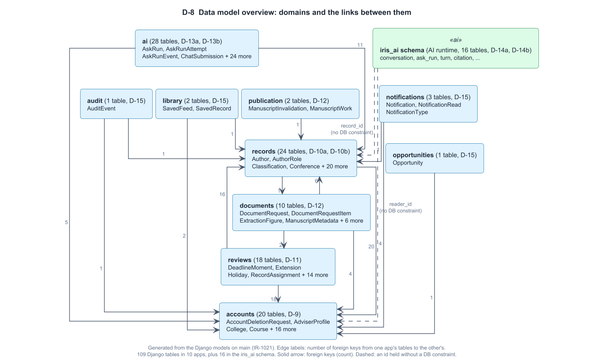
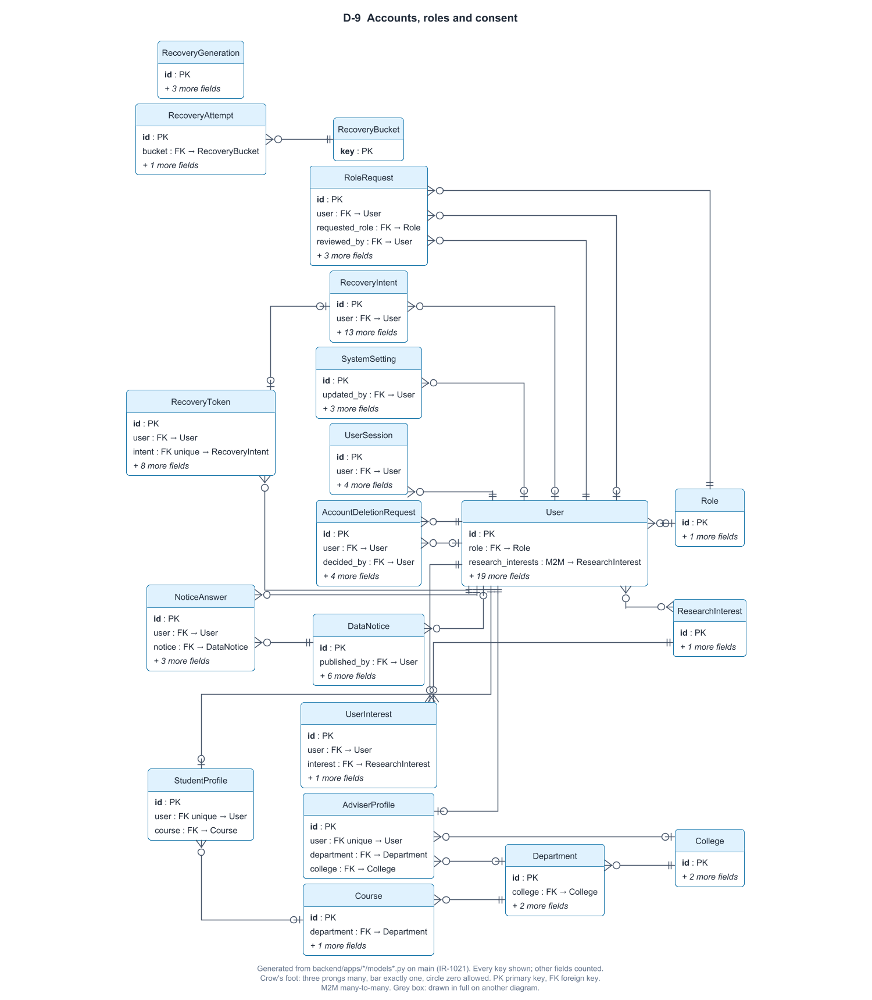
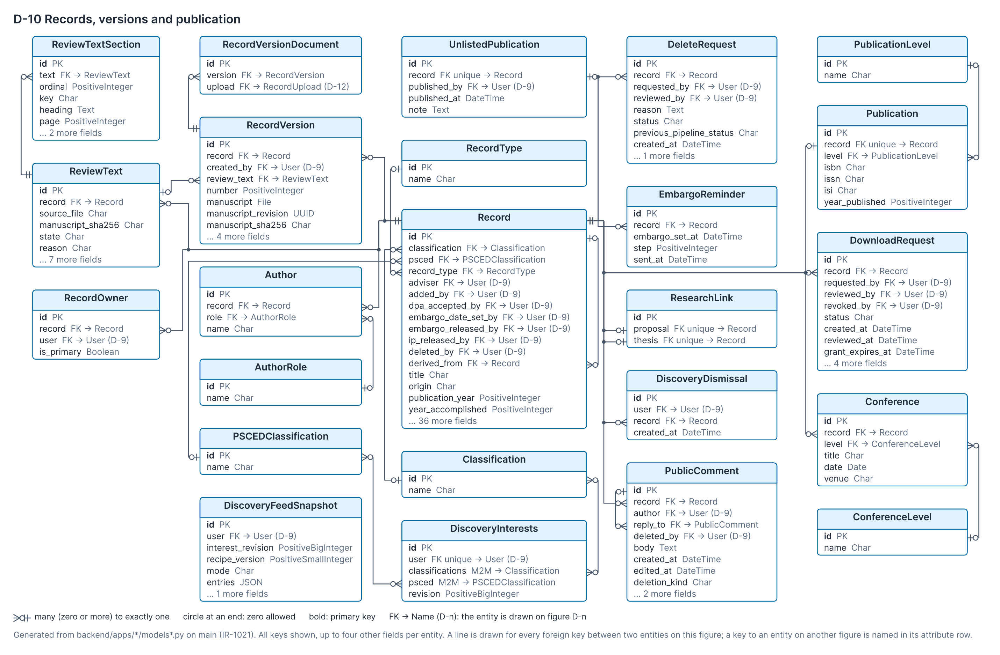
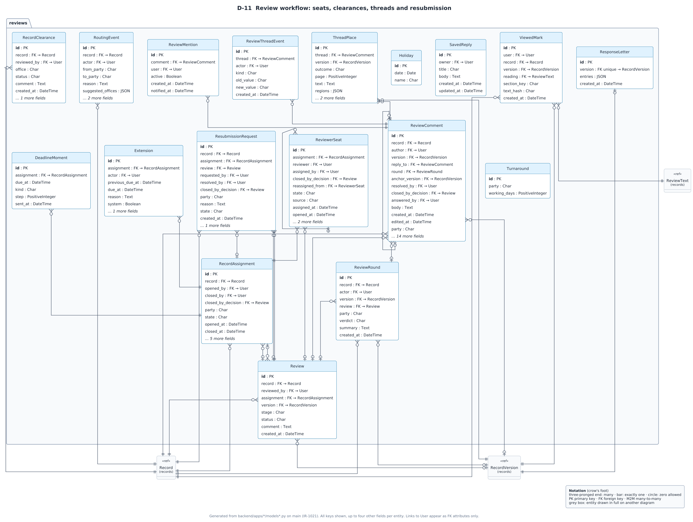
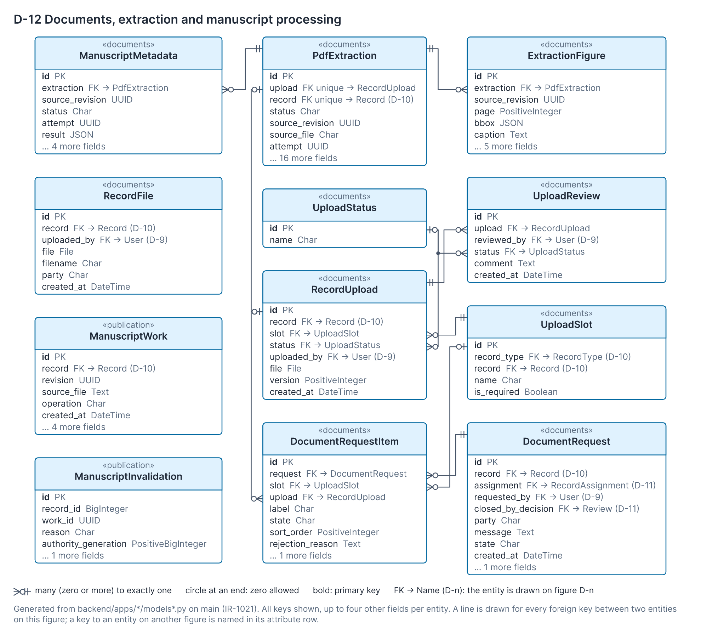
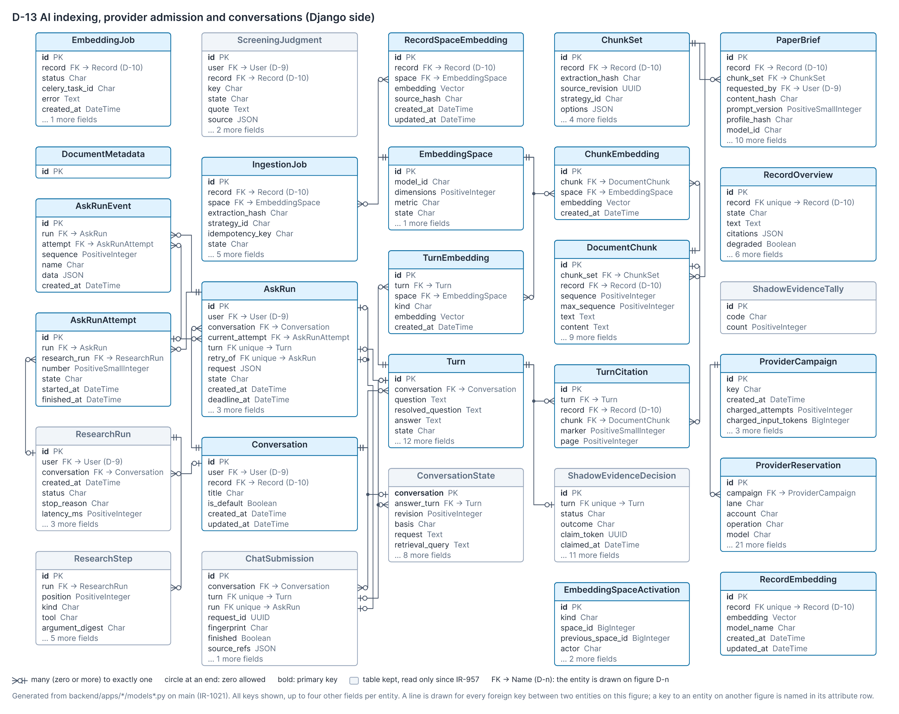
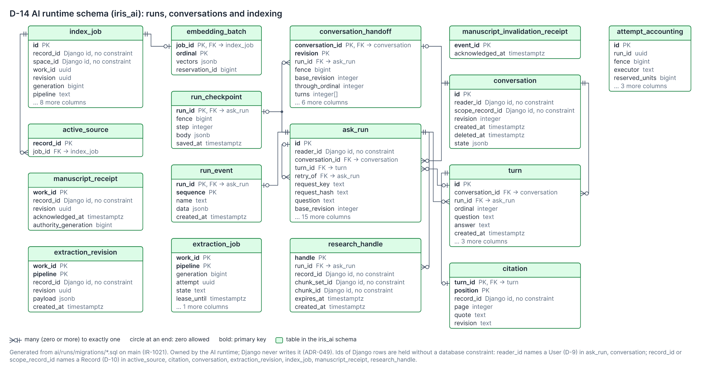
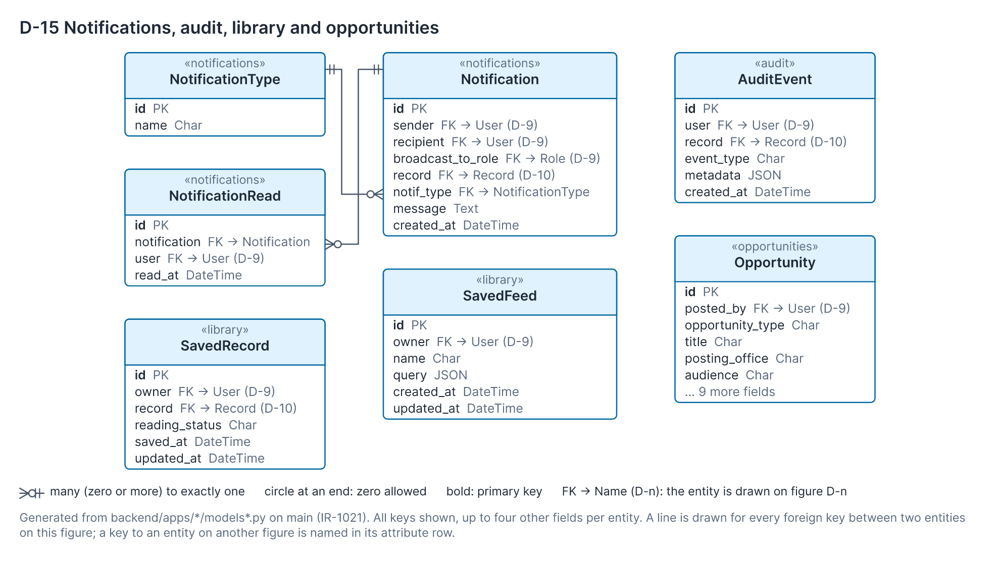
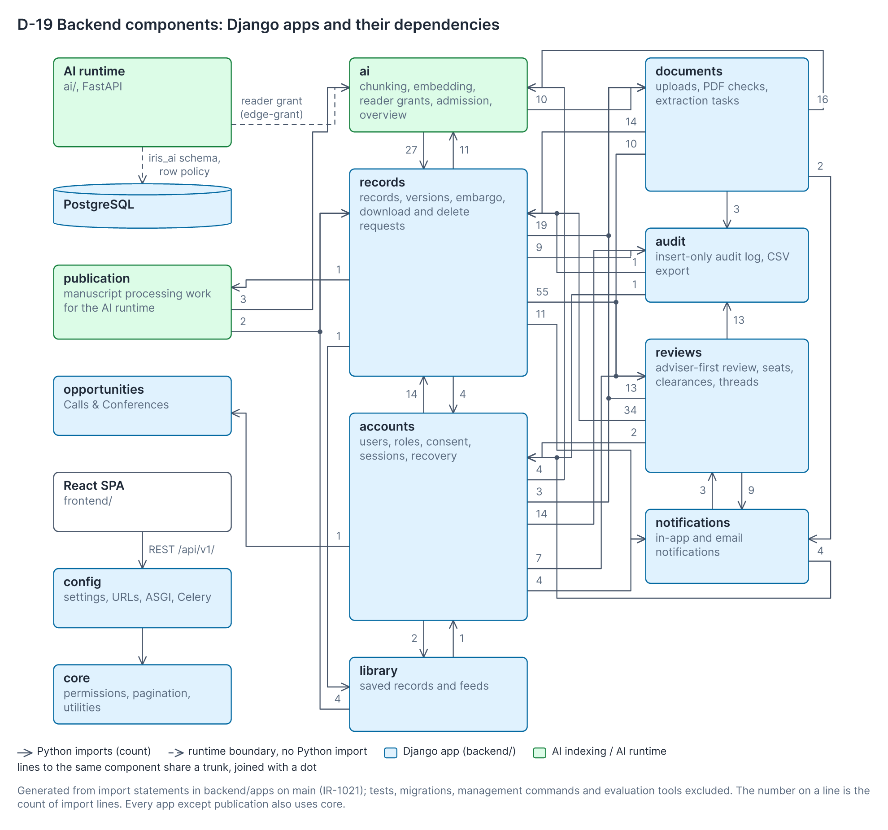

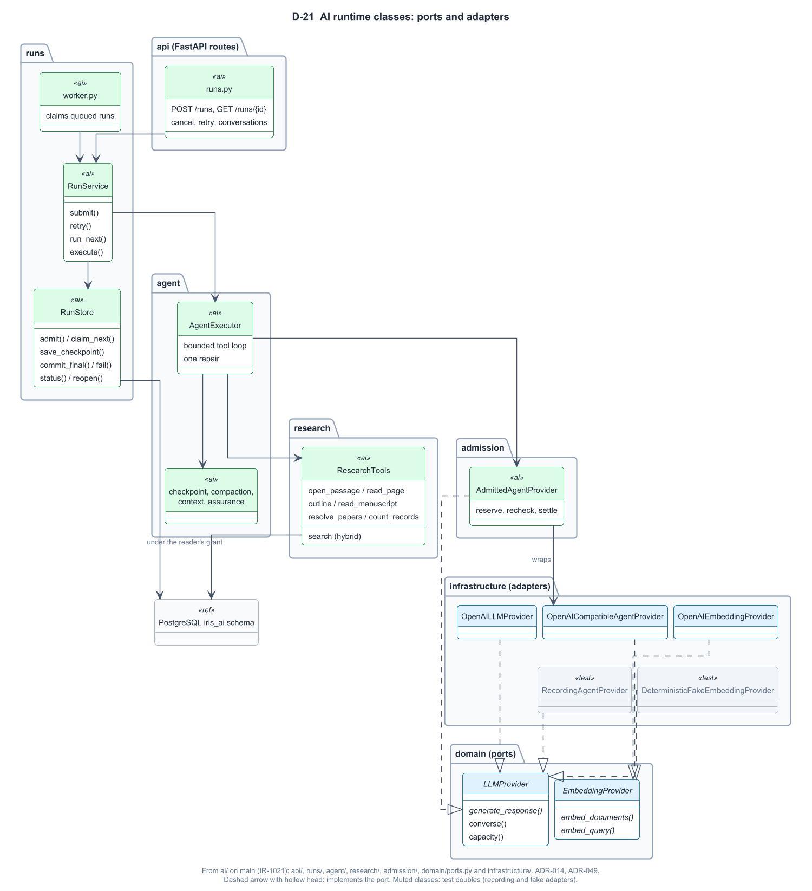
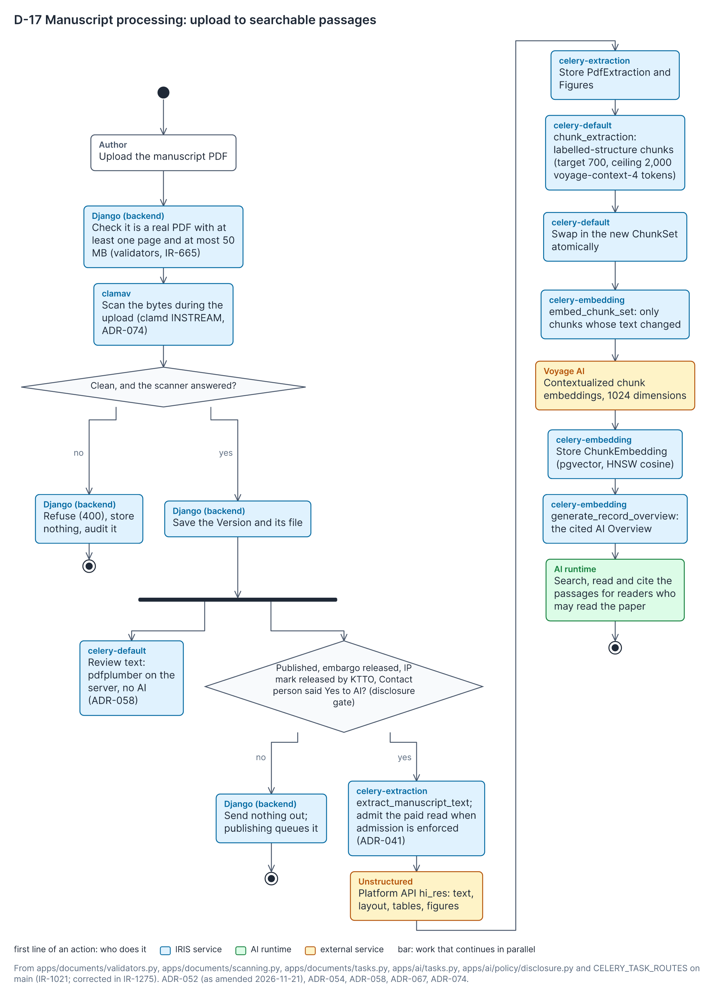

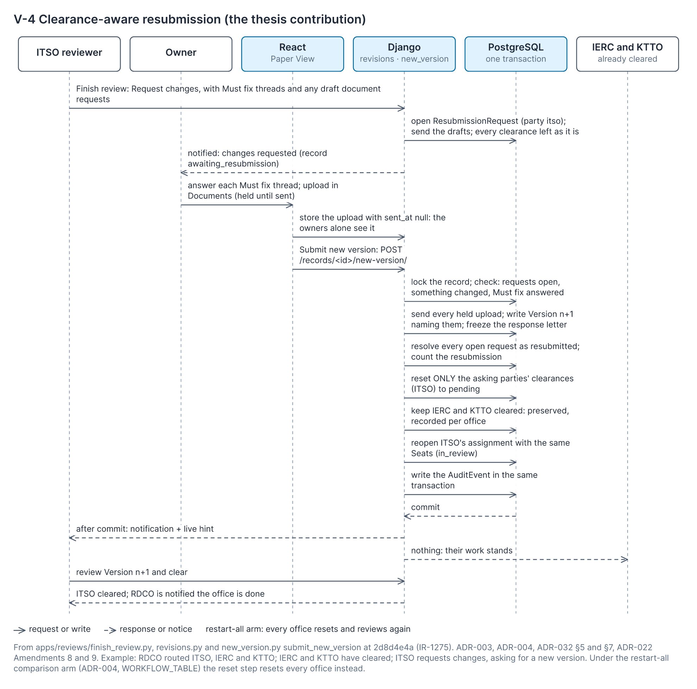

