## **CEBU INSTITUTE OF TECHNOLOGY**

**UNIVERSITY**

COLLEGE OF COMPUTER STUDIES

# **Software Design Description**

## *for*

## I.R.I.S. – Intelligent Research & IP System

**Version 2.0 (MVP as built)**

**Change History Signature**

| Date | Reason | Feedback |
| :---: | ----- | :---: |
| May 2026 | v1: initial design for the planned system (seven modules, Qdrant, LangChain, OpenDataLoader, on-premise hosting). | |
| November 2026 | **v2: rewritten to the built MVP; see SRS v2 Appendix A: v1 → v2 mapping.** Re-shaped into the seven SRS v2 modules. Architecture, technology stack, data model and every sequence are redrawn from the code. Designs for removed features (Auth PIN, file storage, KPI dashboard, `RAGConfiguration`) are dropped. | Pending review (IR-1275) |
| November 24, 2026 | Re-pinned from `a46d7fc4` to `c01f0ef1`, after IR-1322. Review workflow components, sequences and schema updated for *Request changes* and held uploads (ADR-022 Amendment 8); `ai-migrate` added to the services; screens retaken from a local build. | Pending review (IR-1275) |
| November 25, 2026 | Re-pinned from `c01f0ef1` to `2d8d4e4a`, after IR-1325. Document requests are drafts that *Finish review* sends (`send_drafts`, `documents.0030`); `RequestChangesFields` removed; notes and highlights on published papers only (IR-1326, `library.0009`); reading history as a pop-up (IR-1331). Each feature gains a seventh part, Tests. | Pending review (IR-1275) |

**Preface**

This Software Design Description (SDD) describes how IRIS is built: its services, data model, components and the main interactions between them. It is derived from the Architecture Decision Records in `docs/adr/` and from the code at commit `2d8d4e4a` on `main`. **Where they differ from this document, they win.** It is a thesis deliverable, not an engineering authority. Requirements are those of SRS v2 (`docs/SRS-v2.md`), and its requirement IDs (FR-1.1 … FR-7.3) are used here.

**Table of Contents**

- 1. Introduction
  - 1.1 Purpose
  - 1.2 Scope
  - 1.3 Definitions and Acronyms
  - 1.4 References
- 2. Architectural Design
  - 2.1 System Architecture Diagram
    - Cross-cutting design
    - Data model
  - 2.2 Technology Stack
- 3. Detailed Design
    - Module 1: Accounts and Access
      - 3.1.1 Sign-up, Consent and Email Verification (FR-1.1)
      - 3.1.2 Sign In, Stay Signed In, Sign Out (FR-1.2)
      - 3.1.3 Account Protection (FR-1.3)
      - 3.1.4 Account Recovery (FR-1.4)
      - 3.1.5 Roles, Role Requests and Office Coordinators (FR-1.5)
      - 3.1.6 Account Administration (FR-1.6)
      - 3.1.7 Personal Data Rights (FR-1.7)
    - Module 2: Records and Submission
      - 3.2.1 Publish a Record (FR-2.1)
      - 3.2.2 Required Documents and Templates (FR-2.2)
      - 3.2.3 Upload Checks (FR-2.3)
      - 3.2.4 Versions (FR-2.4)
      - 3.2.5 Download Requests and Watermarked Copies (FR-2.5)
      - 3.2.6 Delete Requests (FR-2.6)
      - 3.2.7 Bulk Import from Excel (FR-2.7)
      - 3.2.8 Discover: Browse and Search (FR-2.8)
    - Module 3: Review Workflow (Thesis Core)
      - 3.3.1 Adviser-First Review (FR-3.1)
      - 3.3.2 RDCO Routes and Decides at Any Time (FR-3.2)
      - 3.3.3 Parallel Office Clearance (FR-3.3)
      - 3.3.4 Clearance-Aware Resubmission (FR-3.4)
      - 3.3.5 Explicit Document Requests (FR-3.5)
      - 3.3.6 Review Threads and Comments (FR-3.6)
      - 3.3.7 Turnaround, Reminders and Escalation (FR-3.7)
      - 3.3.8 IP Type on Published Records (FR-3.8)
    - Module 4: Notifications
      - 3.4.1 In-App and Email Notifications (FR-4.1)
      - 3.4.2 Live Updates (FR-4.2)
    - Module 5: Indexing and AI (Thesis-Critical)
      - 3.5.1 Extraction (FR-5.1)
      - 3.5.2 Chunking and Embedding (FR-5.2)
      - 3.5.3 Disclosure Gate (FR-5.3)
      - 3.5.4 Ask IRIS (FR-5.4)
      - 3.5.5 Paper Chat (FR-5.5)
      - 3.5.6 AI Overview (FR-5.6)
      - 3.5.7 Degradation When AI Is Unavailable (FR-5.7)
      - 3.5.8 Index Administration (FR-5.8)
    - Module 6: Reader Library and Discovery
      - 3.6.1 Saved Records and Reading Status (FR-6.1)
      - 3.6.2 Folders (FR-6.2)
      - 3.6.3 Private Notes and Highlights (FR-6.3)
      - 3.6.4 Calls & Conferences (FR-6.4)
      - 3.6.5 Personal Discovery (FR-6.5)
    - Module 7: Audit and Administration
      - 3.7.1 Audit Log (FR-7.1)
      - 3.7.2 System Admin and RDCO Consoles (FR-7.2)
      - 3.7.3 Settings and Help (FR-7.3)

---

# 1. Introduction

## 1.1 Purpose

This SDD turns the requirements of SRS v2 into a concrete design: which service does what, which tables hold what, which modules enforce which rules, and how a request flows through them. It is written for the thesis panel, for new team members and for anyone who maintains IRIS. It explains why each part exists before saying how it works.

## 1.2 Scope

The design covers the MVP as built, in the seven modules of SRS v2:

* **Module 1:** Accounts and Access
* **Module 2:** Records and Submission
* **Module 3:** Review Workflow (the thesis contribution: clearance-aware resubmission)
* **Module 4:** Notifications
* **Module 5:** Indexing and AI (thesis-critical)
* **Module 6:** Reader Library and Discovery
* **Module 7:** Audit and Administration

Work planned beyond the MVP (SRS v2 §3.4) has no design here.

## 1.3 Definitions and Acronyms

* **API-first Django:** Django serves only a REST API under `/api/v1/`. Every screen is the React single-page application (SPA); no Django template renders a page for users.
* **ORM:** Object-Relational Mapping. Django models are Python classes that read and write PostgreSQL tables.
* **Service module:** a plain Python module that holds a business rule (for example `apps/reviews/new_version.py`). Views stay thin and call it, so the rule lives in one place and is tested there.
* **Version:** one submitted state of a Record, with its own manuscript, documents and review text.
* **Clearance:** one specialist office's recorded outcome for a Record, stored per office (`RecordClearance`).
* **Assignment / Seat:** an Assignment means a party holds the Record; a Seat means a named person is reviewing it for that party.
* **Disclosure gate:** the single check (`apps/ai/policy/disclosure.py`) that decides whether any of a paper's text may leave IRIS for an AI vendor: published, embargo released, IP mark released, and AI consent given.
* **AI runtime:** the FastAPI service `ai-gateway` and its worker `ai-runs-worker` (package `ai/`), which answer Ask IRIS and Paper Chat.
* **Reader grant:** a short-lived, signed authorization Django issues, saying which reader is asking and what they may read. The AI runtime verifies it inside PostgreSQL.
* **Chunk / Passage:** a retrievable piece of a manuscript, about 700 tokens. A chunk set belongs to one manuscript revision and is swapped in atomically.
* **Embedding space:** a named model, dimension and metric under which vectors are stored, so a model change can be built beside the live one and promoted in one step.
* **Admission:** reserving a paid AI call's worst-case cost against spending limits before it is sent (ADR-041, proposed, off by default).
* **Hint:** a short server-sent message naming what changed, which makes a page refetch (ADR-073).
* **Celery / Redis:** background task workers (Celery) and the message broker and cache they use (Redis).

## 1.4 References

* Institute of Electrical and Electronics Engineers. (2009). *IEEE Std 1016-2009: IEEE standard for information technology — Systems design — Software design descriptions*.
* Abac, A. S. B., Adolfo, L. J. R., Revalde, J. T. I., & Zozobrado, H. J. J. (2026). *Software requirements specification for I.R.I.S. – Intelligent Research & IP System* (Version 2.0). College of Computer Studies, Cebu Institute of Technology – University. (`docs/SRS-v2.md`)
* IRIS Architecture Decision Records, `docs/adr/`, at commit `2d8d4e4a`.
* Django Software Foundation. *Django 5.2 documentation*. https://docs.djangoproject.com/en/5.2/
* Encode. *Django REST Framework documentation*. https://www.django-rest-framework.org/
* The PostgreSQL Global Development Group. *PostgreSQL 16 documentation*. https://www.postgresql.org/docs/16/
* pgvector. https://github.com/pgvector/pgvector
* Voyage AI. *Documentation*. https://docs.voyageai.com/
* Unstructured. *Platform API documentation*. https://docs.unstructured.io/
* Caddy. *Automatic HTTPS*. https://caddyserver.com/docs/automatic-https
* FastAPI. https://fastapi.tiangolo.com/

---

# 2. Architectural Design

## 2.1 System Architecture Diagram

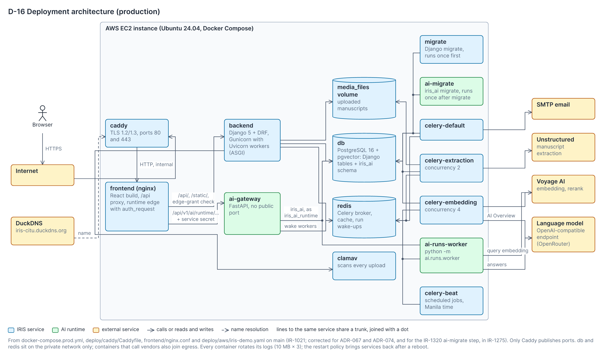
*Figure 1: System Architecture Diagram (production deployment)*

**Why it is shaped this way.** IRIS must run cheaply on one machine (ADR-010), keep the workflow's rules in one place (Django), and keep the AI work, which is slow, costly and talks to outside vendors, from blocking or weakening the rest. The result is one Docker Compose stack on one AWS EC2 instance, with the AI runtime as a separate service that can read only what each reader may read.

1. **Browser → Caddy** (`caddy`): HTTPS on 443 with an automatic Let's Encrypt certificate for the DuckDNS name. Plain HTTP is redirected. Caddy is the only container that publishes ports (ADR-057).
2. **Caddy → nginx** (`frontend`): serves the built React SPA, proxies `/api/` to Django, and is the **same-origin edge** for the AI runtime. Requests to `/api/v1/ai/runtime/…` are first authorized by an `auth_request` to Django's `runtime/edge-grant/`, then forwarded to `ai-gateway` with a service secret.
3. **Django** (`backend`): Django 5 + DRF, served over **ASGI** by Gunicorn with Uvicorn workers (ADR-017), so that streams (live hints, run journals) don't tie up a worker. It owns accounts, the workflow, visibility, the disclosure gate, indexing and the audit log.
4. **AI runtime** (`ai-gateway`, `ai-runs-worker`): FastAPI accepts and reports runs. The worker claims queued runs from PostgreSQL and runs the bounded agent loop (ADR-049). It has no public port and no CORS. It connects as `iris_ai_runtime`, a least-privilege login that reads Django's tables only through row policies tied to the reader's grant.
5. **Data:** `db` (PostgreSQL 16 + pgvector: Django's tables plus the AI-owned `iris_ai` schema), `redis` (Celery broker, cache, live-hint channels, run wake-ups) and a `media_files` volume for uploads.
6. **Workers:** `celery-default` (chunking, notifications, email, reminders), `celery-extraction` (concurrency 2), `celery-embedding` (concurrency 4) and `celery-beat` (schedules, in Manila time).
7. **`clamav`:** scans every upload during the request (ADR-074).
8. **`migrate`** and **`ai-migrate`:** one-shot services. `migrate` runs `manage.py migrate` before the application services start (ADR-039); `ai-migrate` then runs `python -m ai.runs.migrate` for the `iris_ai` schema, and the AI services wait for it (IR-1320).

**Networks.** `private` is internal-only: the database and Redis live there and have no outside access. Containers that call a vendor (`backend`, `ai-gateway`, `ai-runs-worker`, the Celery workers, `clamav` for signature updates, `caddy`) also join `egress`. Outbound calls go to Unstructured, Voyage, OpenRouter and SMTP only.

**Hosting** (`deploy/aws/iris-demo.yaml`, proposed ADR-010 amendment): `m7i-flex.large` (8 GB) plus 4 GB swap, Ubuntu 24.04, an encrypted 64 GiB gp3 volume, an Elastic IP, a security group open on 80 and 443 only, and Session Manager instead of SSH keys. Guards (`iris-guards.yaml`): a budget alert, automatic recovery and a daily stop/start schedule. Updates go through `scripts/deploy.sh`.

**Built but not deployed.** `ai/ingestion` and `apps/publication` (IR-737/738) implement a durable outbox and an isolated ingestion worker that reads manuscripts under an ingestion grant. No production service runs that worker yet; production indexing uses the Celery path in Module 5.

### Cross-cutting design

**One visibility predicate.** `Record.objects.visible_to(user)` decides which records a person may read. Every record queryset uses it, and so do retrieval, citations, reminders and the AI runtime's row policies. A refusal is a **404 identical to a missing record** (IR-153), so existence is never confirmed. An unsubmitted draft is visible to its creator alone (IR-1227, VERIFIED).

**Roles in one place.** `core/enums.py` `RoleName` defines seven roles, and `core/permissions.py` the permission classes: `IsStaff` (the four offices), `IsAdmin` (RDCO), `IsAccountAdmin` (RDCO or System Admin), `IsSystemAdmin`, and `IsCommentModerator`. `is_staff` and `is_superuser` grant nothing in the API (ADR-009, IR-165).

**Acts lock and audit in one transaction.** Workflow acts lock the record (`select_for_update`). They refuse a stale page with 409, and write their `AuditEvent` inside the same transaction (`apps/audit/workflow.py`), so an act and its audit row commit or fail together. Notifications, live hints and queued tasks run in `transaction.on_commit`, so nobody is told about something that then rolls back.

**Configuration from the environment.** Every secret and limit is an environment variable (`backend/.env.example`, `ai/.env.example`). With `DEBUG` off, Django refuses to start without required secrets, a malware scanner, or the Unstructured key.

**Fail closed for paid AI.** Every outbound AI call passes the disclosure gate. When `AI_PROVIDER_ADMISSION=enforce`, each call also reserves its worst-case cost against campaign limits through a separate `admission` database alias, and an unset limit refuses all paid work (ADR-041, proposed, off by default).

**Frontend shell (NFR-U3).** The app shell keeps the sidebar state in `useUIStore` (`frontend/src/store/ui.store.ts`): full sidebar on desktop, icon rail on tablets, a drawer on phones.

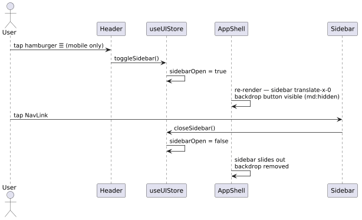
*Figure 2: Mobile sidebar sequence (v1, kept)*

### Data model

The ERDs are **generated from the models and SQL migrations**, not drawn by hand (Section D set, IR-1021). They show every key and up to four other fields per table.

| Figure | Area | Main tables |
| --- | --- | --- |
| D-8 | Overview | domains and the links between them |
| D-9 | Accounts, roles and consent | `User`, `Role`, `RoleRequest`, `UserSession`, `DataNotice`, `NoticeAnswer`, `AccountDeletionRequest`, `SystemSetting`, recovery tables |
| D-10 | Records, versions and publication | `Record`, `RecordOwner`, `RecordVersion`, `RecordVersionDocument`, `ReviewText`, `DownloadRequest`, `DeleteRequest`, `PublicComment`, `EmbargoReminder` |
| D-11 | Review workflow | `RecordAssignment`, `ReviewerSeat`, `RecordClearance`, `ResubmissionRequest`, `Review`, `RoutingEvent`, `ReviewComment`, `ReviewThreadEvent`, `Turnaround`, `Holiday`, `Extension` |
| D-12 | Documents and extraction | `UploadSlot`, `RecordUpload`, `RecordFile`, `DocumentRequest`, `DocumentRequestItem`, `PdfExtraction`, `ExtractionFigure`, `AdviserTemplate` |
| D-13 | AI in Django | `ChunkSet`, `DocumentChunk`, `ChunkEmbedding`, `EmbeddingSpace`, `RecordEmbedding`, `RecordOverview`, `ProviderCampaign`, `ProviderReservation`, earlier `Conversation`/`Turn` (read-only) |
| D-14 | AI runtime schema `iris_ai` | `ask_run`, `run_event`, `conversation`, `turn`, `citation`, `research_handle`, `run_checkpoint`, `conversation_handoff` |
| D-15 | Notifications, audit, library, opportunities | `Notification`, `AuditEvent`, `SavedRecord`, `LibraryFolder`, `ReadingNote`, `ReadingHighlight`, `Opportunity`, `SavedCall` |

`apps/storage` and its tables no longer exist. The `iris_ai` schema is migrated only by `python -m ai.runs.migrate` (SQL files `ai/runs/migrations/0001`–`0021`) and written only by `iris_ai_runtime`.

---

## 2.2 Technology Stack

Table 1: Technology Stack

| Layer / Domain | Technology | Version | Role within IRIS |
| :---- | :---- | :---- | :---- |
| Backend framework | Django + Django REST Framework | 5.2 / ≥ 3.18 | API, ORM, permissions, workflow services |
| ASGI server | Gunicorn + `uvicorn.workers.UvicornWorker` | ≥ 22 / ≥ 0.29 | Serves Django, including long-lived streams (ADR-017) |
| Authentication | djangorestframework-simplejwt, with the refresh token in an HttpOnly cookie | ≥ 5.3 | 30-minute access token; rotating, blacklisted refresh token (ADR-072) |
| Brute-force protection | django-axes; DRF throttles | ≥ 6.4 | Lockout per account and address; 429 per user, address and sign-in |
| Database | PostgreSQL + pgvector | 16 / ≥ 0.3 | Relational data, weighted FTS (GIN), vectors (HNSW cosine), the `iris_ai` schema |
| Task queue and cache | Celery + Redis | ≥ 5.3 / 7 | Background work on three queues; schedules; live-hint channels |
| AI runtime | FastAPI (`ai/`) | n/a | Ask IRIS and Paper Chat runs, research tools, agent executor (ADR-049) |
| Extraction | Unstructured Platform API (`hi_res`) | API | The only extractor, no fallback (ADR-067) |
| Embedding and rerank | Voyage `voyage-context-4` (1024-d) + Voyage rerank | API | Contextualized chunk vectors; reordering retrieved passages (ADR-015) |
| Language model | OpenAI-compatible endpoint through OpenRouter | API | Answers and AI Overviews; the model is configuration (ADR-036) |
| Malware scanning | ClamAV (`clamav/clamav:stable`) | stable | Scan during upload; fail closed (ADR-074) |
| PDF handling | pypdf, reportlab, pdfplumber, pdf.js | 6 / 5 / n/a / 6 | Validation, watermarking, local review text, in-browser reader |
| Spreadsheets | pyexcel (+ xls/xlsx plugins), openpyxl | 0.7 / ≥ 3.1 | Excel import and the styled template |
| Frontend | React + TypeScript + Vite + Tailwind CSS + Zustand | 18 / 5 / 8 / 3 / 4 | The SPA |
| Forms | react-hook-form + zod | 7 / 4 | Form state and validation (ADR-060, proposed) |
| TLS and web server | Caddy; nginx | 2.11 | TLS termination and HSTS; SPA serving, API proxy, AI edge |
| Deployment | Docker Compose on AWS EC2, CloudFormation | n/a | One stack per instance (ADR-005, ADR-010 amendment proposed) |
| CI | GitHub Actions | n/a | Backend suite on PostgreSQL, frontend suite, lint, Compose checks |
| Testing | pytest; Vitest + axe-core; Playwright | n/a | Backend, frontend with accessibility checks, end-to-end smoke |
| Load testing | Apache JMeter (planned) | n/a | Not yet run (NFR-P1) |

Removed from v1's table: LUKS, Qdrant Cloud, LangChain, Cohere Rerank, OpenDataLoader and PyMuPDF, `text-embedding-3-small` and GPT-4.1-mini as fixed choices.

# 3. Detailed Design

Each feature follows v1's six parts: user interface design, frontend components, backend components, class diagram, sequence diagram(s) and schema. v2 adds a seventh, **Tests**, which traces the feature to the tests that check it: the files its rows in `docs/testing/TRACEABILITY.md` name, each confirmed to exist at `2d8d4e4a`, and the Playwright tests that drive it. How they run, and the latest results at the time of writing:

- **Backend (pytest) and frontend (Vitest, with axe-core accessibility checks)** run in CI on every pull request and on `main`. On `main` at `2d8d4e4a` every job passed, including the four backend shards ([run 45531494691](https://github.com/moisturicer/IRIS/actions/runs/45531494691)).
- **Smoke tests** (`e2e/smoke/`, Playwright, IR-904) run on every pull request. They passed on #1018, the last pull request merged into `2d8d4e4a`.
- **Core journeys** (`e2e/specs/`, Playwright, IR-631) drive a production-settings stack end to end and are run by hand and on a schedule ([plan](testing/CORE_JOURNEYS.md)). They passed on 2026-11-16 (`b9f0777f`) and failed on 2026-11-23 (`82705eef`). On `2d8d4e4a`, one run failed on 2026-11-25 and another was still running when this was written. The only run with a written record, 2026-11-07, had 23 tests passed, 5 failed and 24 not run.

A test listed here shows where a requirement is checked. It is not a claim that the requirement is VERIFIED: that is the status the matrix records. Paths are relative to the repository root. Screens are from a production build of this repository on a local machine with `seed_demo` data (local build, not the live site).

### Module 1: Accounts and Access

#### 3.1.1 Sign-up, Consent and Email Verification (FR-1.1)

A person needs an account tied to an institutional email, with the data notice and the AI question answered before anything else, so consent is on record from the first moment (ADR-045, ADR-054).

1. User Interface Design

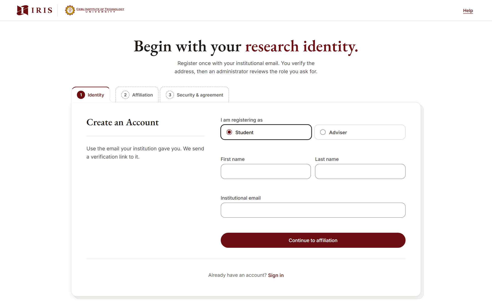
*Figure 3: Sign-up page (local build)*

2. ##### Frontend Components

| Component Name | Description & Purpose | Component Format |
| :---: | ----- | ----- |
| **SignupPage** frontend/src/features/auth/SignupPage.tsx | Three-step registration (identity, affiliation, security and agreement); loads the current notice and the reference lists. | React page component |
| **VerifyEmailPage / ResendVerificationPage** frontend/src/features/auth/ | Confirms the emailed token; asks for a new link without saying whether an address exists. | React page component |
| **authApi, noticeApi, referenceLists** frontend/src/api/ | Typed calls for register, notice and colleges/departments/courses. | API client module |

3. ##### Backend Components

| Component Name | Description & Purpose | Component Format |
| :---: | ----- | ----- |
| **RegisterView** backend/apps/accounts/views.py | Creates the user, profile, NoticeAnswer and AI consent in one transaction. | DRF APIView (AllowAny) |
| **RegisterSerializer** backend/apps/accounts/serializers.py | Institutional domain, password policy, role-specific fields. | DRF serializer |
| **DataNotice, NoticeAnswer** backend/apps/accounts/models.py | The versioned notice and each answer with its version and time. | Django model |
| **recovery.service, recovery.delivery** backend/apps/accounts/recovery/ | Verification tokens, durable delivery intents, rate limits, audit. | Service module |
| **expire_unverified_registrations** backend/apps/accounts/tasks.py | Daily: removes unverified registrations nothing links to. | Celery task |

**API:** `POST /api/v1/auth/register/` · `GET /api/v1/auth/notice/` · `POST /api/v1/auth/notice/answer/` · `POST /api/v1/auth/verification/resend/` · `POST /api/v1/auth/verification/confirm/`

4. Class Diagram

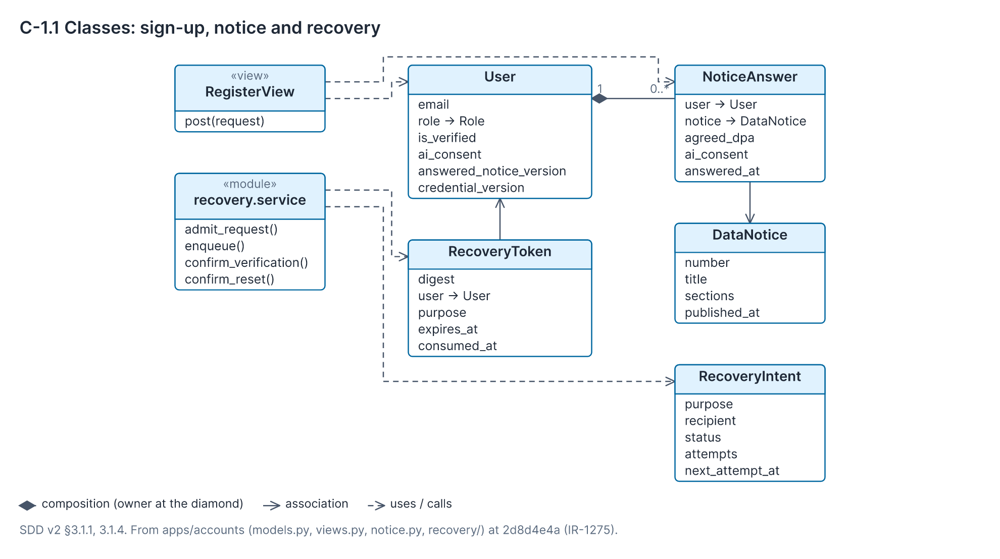
*Figure 4: Classes: sign-up, notice and recovery*

5. Sequence Diagrams

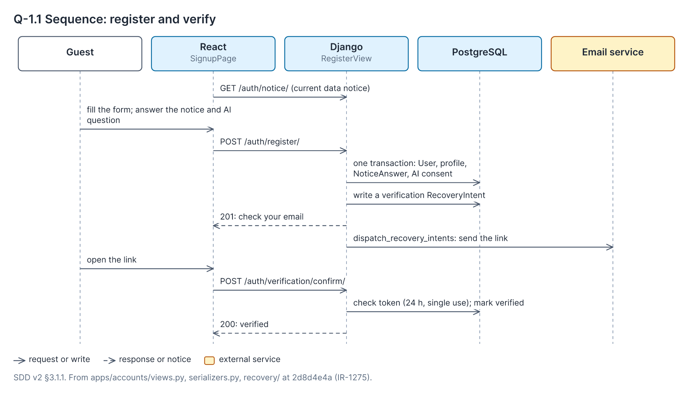
*Figure 5: Sequence Diagram for register and verify*

6. Schema

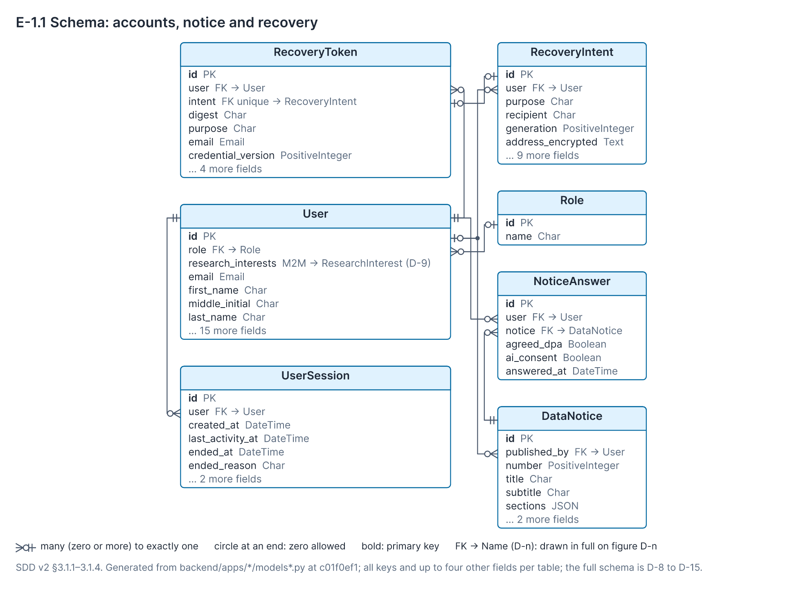
*Figure 6: Database Schema for accounts, notice and recovery*

7. Tests

Requirement status **PARTIAL**, from `TRACEABILITY.md` at `2d8d4e4a`. The tests below are the ones its matrix rows name ([FR-M6-06](testing/traceability/FR-M6-06.md)), each found in the repository at `2d8d4e4a`, plus the Playwright tests that drive the feature.

| Test | Kind | Recorded in |
| ----- | ----- | ----- |
| `backend/apps/accounts/tests.py` | Backend (pytest) | [FR-M6-06](testing/traceability/FR-M6-06.md) |
| `frontend/src/features/auth/SignupPage.test.tsx` | Frontend (Vitest) | [FR-M6-06](testing/traceability/FR-M6-06.md) |
| `e2e/specs/00-account-lifecycle.spec.ts`: "register through the three-step form"; "an unverified account is told so, and the emailed link verifies it" | End-to-end journey (Playwright) | [IR-631 core journeys](testing/CORE_JOURNEYS.md) |

#### 3.1.2 Sign In, Stay Signed In, Sign Out (FR-1.2)

A person should not sign in again in every tab, yet no page script may read a long-lived credential, and an unattended session must end (ADR-072, NFR-S2).

1. User Interface Design

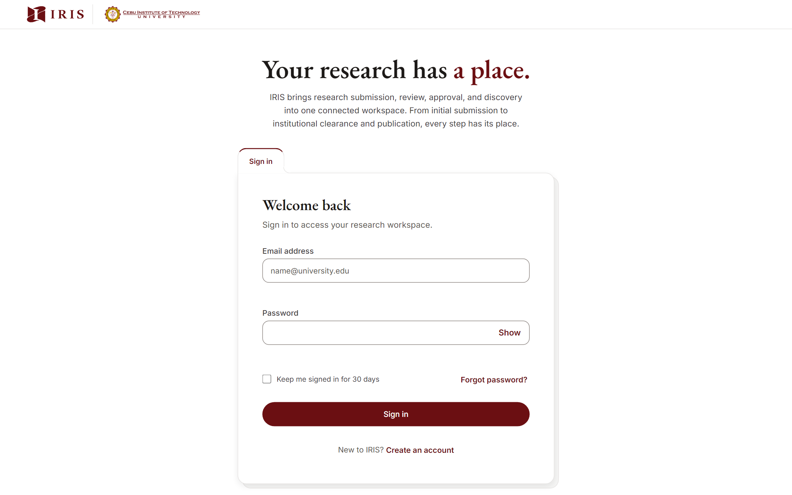
*Figure 7: Sign-in page (local build)*

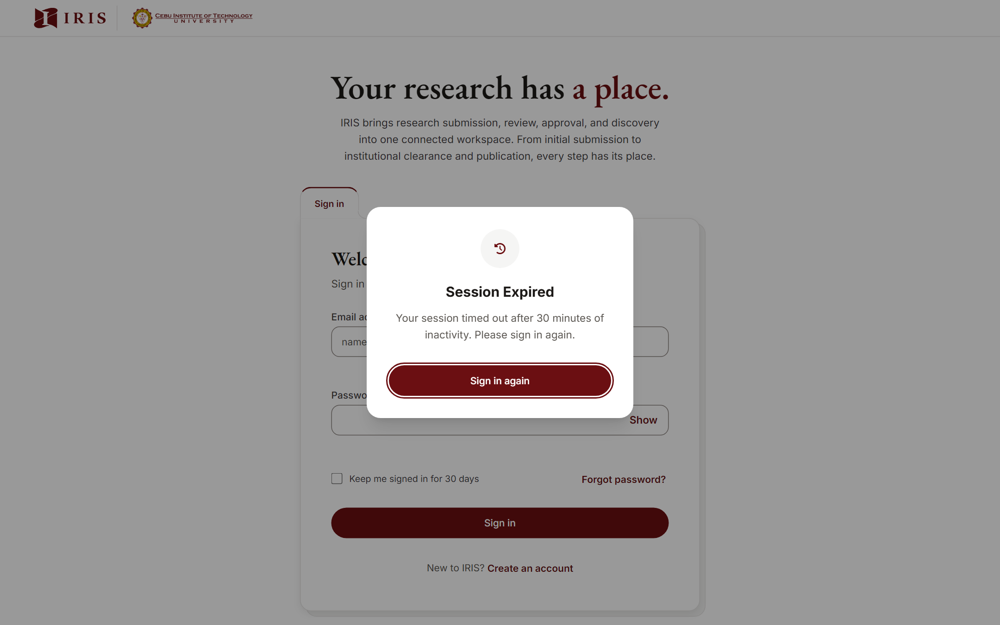
*Figure 8: Session ended after 30 idle minutes (local build)*

2. ##### Frontend Components

| Component Name | Description & Purpose | Component Format |
| :---: | ----- | ----- |
| **LoginPage** frontend/src/features/auth/LoginPage.tsx | Email, password, Keep me signed in; shows the server's lockout countdown. | React page component |
| **apiClient, sessionRefresh** frontend/src/api/client.ts, sessionRefresh.ts | Adds the Bearer token; refreshes once across tabs on 401 or load, then retries. | API client module |
| **authSession, authStorage** frontend/src/lib/ | Session-ended messages by code; clears any legacy stored token. | Utility module |

3. ##### Backend Components

| Component Name | Description & Purpose | Component Format |
| :---: | ----- | ----- |
| **LoginView, RefreshView, LogoutView** backend/apps/accounts/views.py | Issue, rotate and revoke tokens; audit sign-in and sign-out. | DRF APIView |
| **refresh_cookie** backend/apps/accounts/refresh_cookie.py | Sets and reads iris_refresh (HttpOnly, Secure, SameSite=Strict); checks Origin and X-IRIS-Auth. | Service module |
| **sessions** backend/apps/accounts/sessions.py | UserSession lifecycle: start, touch, idle and remembered expiry, end reasons. | Service module |
| **UserSession** backend/apps/accounts/models.py | One row per signed-in session. | Django model |

**API:** `POST /api/v1/auth/login/` · `POST /api/v1/auth/token/refresh/` · `POST /api/v1/auth/logout/` · `POST /api/v1/auth/password/change/`

4. Class Diagram

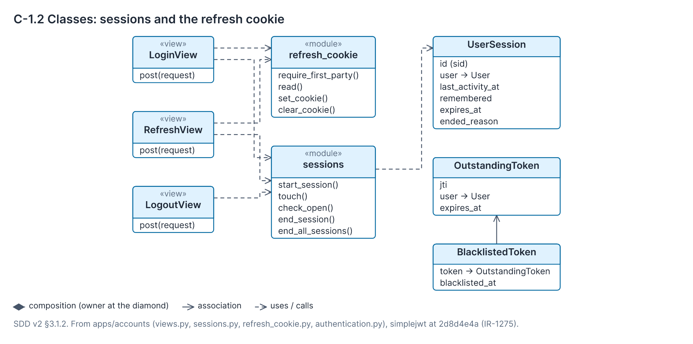
*Figure 9: Classes: sessions and the refresh cookie*

5. Sequence Diagrams

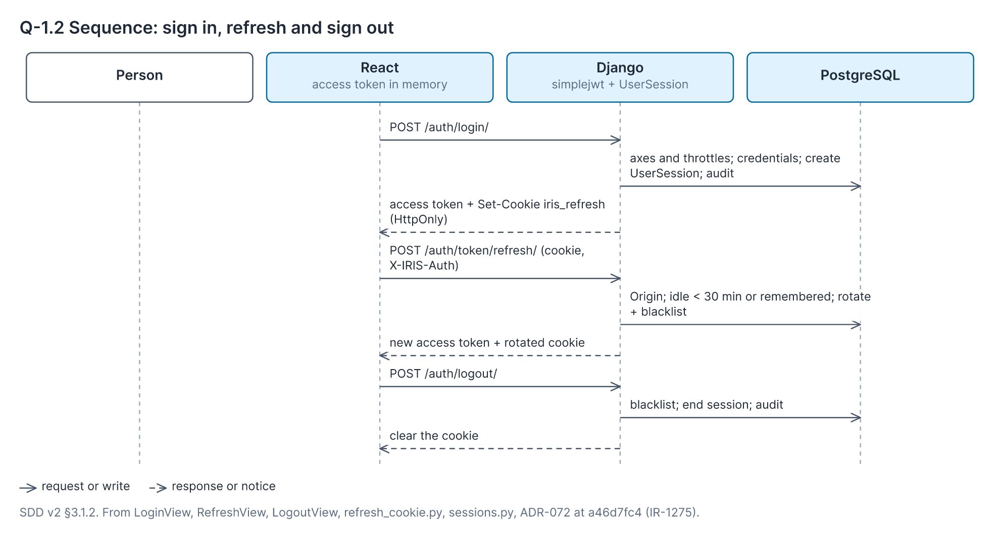
*Figure 10: Sequence Diagram for sign in, refresh and sign out*

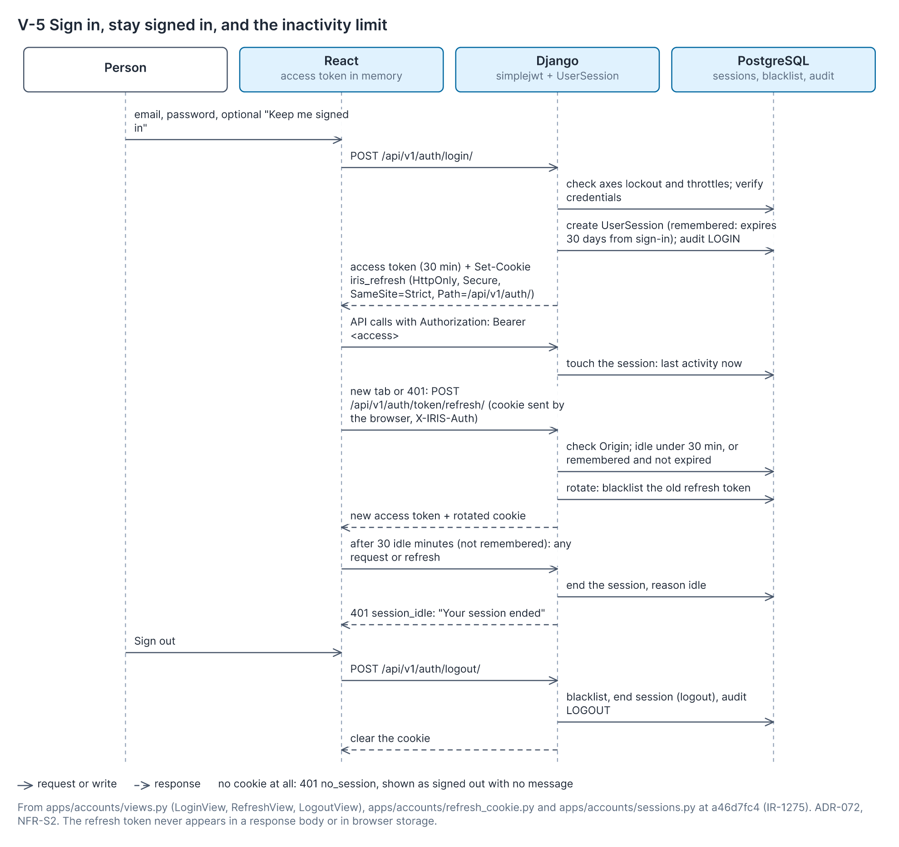
*Figure 11: Sequence Diagram for Sign in, stay signed in, and the inactivity limit*

6. Schema

See Figure 6 (Database Schema for accounts, notice and recovery).

7. Tests

Requirement status **PARTIAL** (FR-M6-01; IR-1222), from `TRACEABILITY.md` at `2d8d4e4a`. The tests below are the ones its matrix rows name ([FR-M6-01](testing/traceability/FR-M6-01.md), [IR-1222](testing/traceability/IR-1222.md)), each found in the repository at `2d8d4e4a`, plus the Playwright tests that drive the feature.

| Test | Kind | Recorded in |
| ----- | ----- | ----- |
| `backend/apps/accounts/test_refresh_cookie.py` | Backend (pytest) | [IR-1222](testing/traceability/IR-1222.md) |
| `frontend/src/api/auth.test.ts` | Frontend (Vitest) | [IR-1222](testing/traceability/IR-1222.md) |
| `frontend/src/api/client.test.ts` | Frontend (Vitest) | [IR-1222](testing/traceability/IR-1222.md) |
| `frontend/src/components/auth/ProtectedRoute.test.tsx` | Frontend (Vitest) | [FR-M6-01](testing/traceability/FR-M6-01.md) |
| `frontend/src/features/auth/LoginPage.test.tsx` | Frontend (Vitest) | [FR-M6-01](testing/traceability/FR-M6-01.md) |
| `frontend/src/lib/authStorage.test.ts` | Frontend (Vitest) | [IR-1222](testing/traceability/IR-1222.md) |
| `frontend/src/lib/redirectTarget.test.ts` | Frontend (Vitest) | [FR-M6-01](testing/traceability/FR-M6-01.md) |
| `frontend/src/lib/tokenRefresh.test.ts` | Frontend (Vitest) | [IR-1222](testing/traceability/IR-1222.md) |
| `frontend/src/store/hydrateAuth.test.ts` | Frontend (Vitest) | [IR-1222](testing/traceability/IR-1222.md) |
| `e2e/smoke/auth.spec.ts`: "rejected credentials keep the visitor on sign-in with an explanation"; "valid credentials land on Discover"; "a load restores the session from the server" | Smoke (Playwright) | IR-904, run on every pull request |
| `e2e/specs/00-account-lifecycle.spec.ts`: "inactivity ends the session and the next request needs reauthentication" | End-to-end journey (Playwright) | [IR-631 core journeys](testing/CORE_JOURNEYS.md) |

#### 3.1.3 Account Protection (FR-1.3)

Password guessing must be slow and visible, without hard-coding limits (NFR-S6).

1. User Interface Design

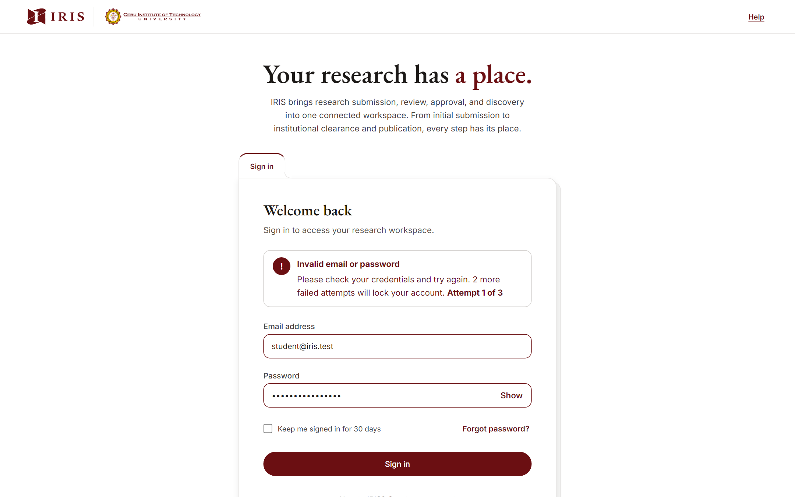
*Figure 12: Failed sign-in: the attempts left, said in a dialog (local build)*

2. ##### Frontend Components

| Component Name | Description & Purpose | Component Format |
| :---: | ----- | ----- |
| **LoginPage** frontend/src/features/auth/LoginPage.tsx | Shows the attempts left and the countdown from a 429. | React page component |

3. ##### Backend Components

| Component Name | Description & Purpose | Component Format |
| :---: | ----- | ----- |
| **AnonBurstThrottle, UserBurstThrottle** backend/core/throttling.py | Burst scopes on top of DRF's daily anon/user rates. | DRF throttle class |
| **django-axes** AUTHENTICATION_BACKENDS | Counts failures by username and address; locks for the cool-off (off by default, IR-865). | Third-party backend |
| **lockout_response** backend/apps/accounts/lockout.py | JSON 429 naming the lock and the next allowed time. | Service module |

**API:** `POST /api/v1/auth/login/ (throttled: auth_login, auth_login_burst)`

4. Class Diagram

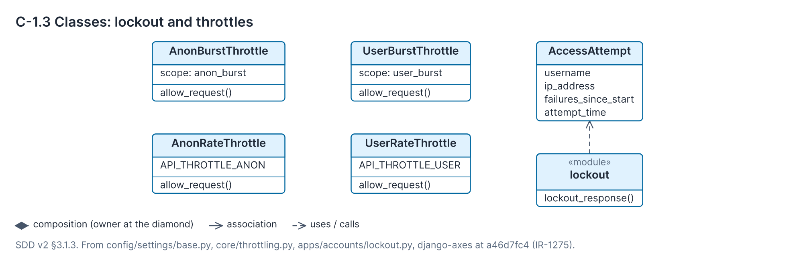
*Figure 13: Classes: lockout and throttles*

5. Sequence Diagrams

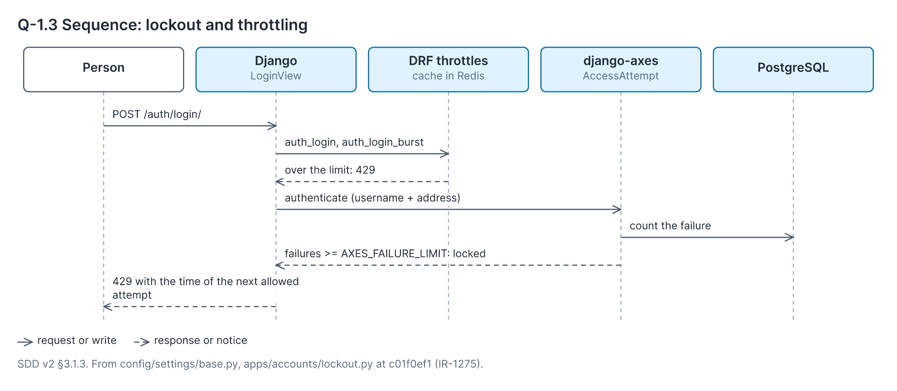
*Figure 14: Sequence Diagram for lockout and throttling*

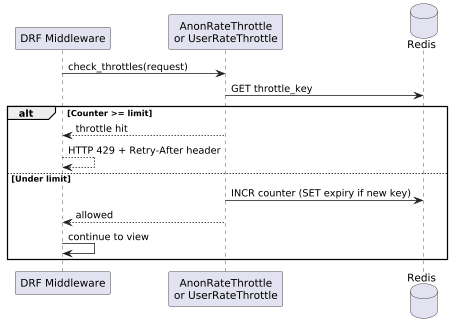
*Figure 15: Sequence Diagram for throttle middleware (v1, kept)*

6. Schema

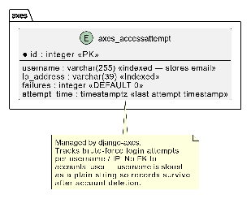
*Figure 16: Database Schema for django-axes AccessAttempt (v1, kept)*

7. Tests

Requirement status **PARTIAL** (NFR-S6), from `TRACEABILITY.md` at `2d8d4e4a`. The tests below are the ones its matrix rows name ([NFR-S6](testing/traceability/NFR-S6.md)), each found in the repository at `2d8d4e4a`, plus the Playwright tests that drive the feature.

| Test | Kind | Recorded in |
| ----- | ----- | ----- |
| `backend/apps/accounts/test_auth_throttles.py` | Backend (pytest) | [NFR-S6](testing/traceability/NFR-S6.md) |
| `backend/apps/accounts/test_lockout.py` | Backend (pytest) | [NFR-S6](testing/traceability/NFR-S6.md) |
| `frontend/src/features/auth/LoginPage.test.tsx` | Frontend (Vitest) | [NFR-S6](testing/traceability/NFR-S6.md) |
| `e2e/specs/00-account-lifecycle.spec.ts`: "three wrong passwords lock the account, and the screen says what the server said" | End-to-end journey (Playwright) | [IR-631 core journeys](testing/CORE_JOURNEYS.md) |

#### 3.1.4 Account Recovery (FR-1.4)

A person who forgot a password must get back in without IRIS ever revealing whether an account exists (ADR-045).

1. User Interface Design

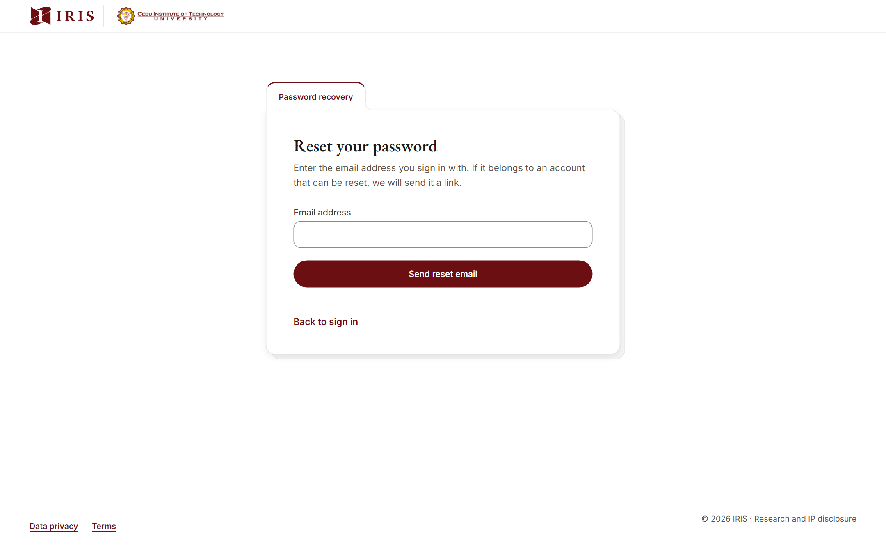
*Figure 17: Forgot password page (local build)*

2. ##### Frontend Components

| Component Name | Description & Purpose | Component Format |
| :---: | ----- | ----- |
| **ForgotPasswordPage, ResetPasswordPage** frontend/src/features/auth/ | Request a link; set a new password from it. | React page component |

3. ##### Backend Components

| Component Name | Description & Purpose | Component Format |
| :---: | ----- | ----- |
| **recovery.service** backend/apps/accounts/recovery/service.py | admit_request, confirm_reset; bumps credential_version so every session ends. | Service module |
| **dispatch_recovery_intents** backend/apps/accounts/recovery/tasks.py | Delivers and retries recovery email (celery-beat). | Celery task |
| **RecoveryToken, RecoveryIntent** backend/apps/accounts/models.py | Single-use digests and durable delivery intents. | Django model |

**API:** `POST /api/v1/auth/password/reset/request/` · `POST /api/v1/auth/password/reset/confirm/`

4. Class Diagram

See Figure 4 (Classes: sign-up, notice and recovery).

5. Sequence Diagrams

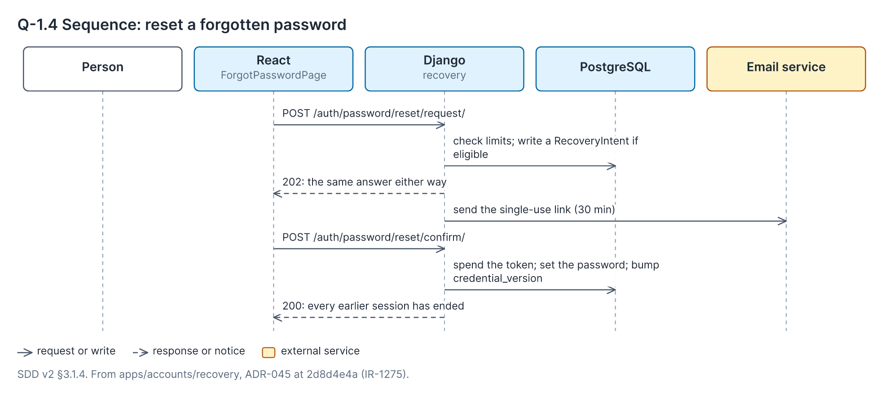
*Figure 18: Sequence Diagram for reset a forgotten password*

6. Schema

See Figure 6 (Database Schema for accounts, notice and recovery).

7. Tests

Requirement status **VERIFIED** (IR-641), from `TRACEABILITY.md` at `2d8d4e4a`. The tests below are the ones its matrix rows name ([IR-641](testing/traceability/IR-641.md), [IR-642](testing/traceability/IR-642.md), [IR-643](testing/traceability/IR-643.md)), each found in the repository at `2d8d4e4a`, plus the Playwright tests that drive the feature.

| Test | Kind | Recorded in |
| ----- | ----- | ----- |
| `backend/apps/accounts/test_activation_retired.py` | Backend (pytest) | [IR-643](testing/traceability/IR-643.md) |
| `backend/apps/accounts/test_credential_invalidation.py` | Backend (pytest) | [IR-642](testing/traceability/IR-642.md) |
| `backend/apps/accounts/test_email_verification.py` | Backend (pytest) | [IR-642](testing/traceability/IR-642.md) |
| `backend/apps/accounts/test_password_recovery.py` | Backend (pytest) | [IR-642](testing/traceability/IR-642.md) |
| `backend/apps/accounts/test_recovery_delivery.py` | Backend (pytest) | [IR-642](testing/traceability/IR-642.md) |
| `backend/apps/accounts/test_role_request_notification.py` | Backend (pytest) | [IR-643](testing/traceability/IR-643.md) |
| `backend/apps/tests/test_notice_block_every_route.py` | Backend (pytest) | [IR-643](testing/traceability/IR-643.md) |
| `backend/apps/tests/test_settings_validation.py` | Backend (pytest) | [IR-642](testing/traceability/IR-642.md) |
| `backend/apps/tests/access/table.py` | Access matrix (pytest) | [IR-643](testing/traceability/IR-643.md) |
| `frontend/src/features/audit/AuditLogPage.test.tsx` | Frontend (Vitest) | [IR-642](testing/traceability/IR-642.md) |
| `frontend/src/features/auth/ForgotPasswordPage.test.tsx` | Frontend (Vitest) | [IR-643](testing/traceability/IR-643.md) |
| `frontend/src/features/auth/ResendVerificationPage.test.tsx` | Frontend (Vitest) | [IR-643](testing/traceability/IR-643.md) |
| `frontend/src/features/auth/VerifyEmailPage.test.tsx` | Frontend (Vitest) | [IR-643](testing/traceability/IR-643.md) |
| `e2e/specs/00-account-lifecycle.spec.ts`: "recovery by emailed link sets a new password and ends old sessions" | End-to-end journey (Playwright) | [IR-631 core journeys](testing/CORE_JOURNEYS.md) |

#### 3.1.5 Roles, Role Requests and Office Coordinators (FR-1.5)

Who may give which role is a rule, not a screen: RDCO gives Student and Adviser, the System Admin gives office roles and the coordinator flag (ADR-051 decision 4).

1. User Interface Design

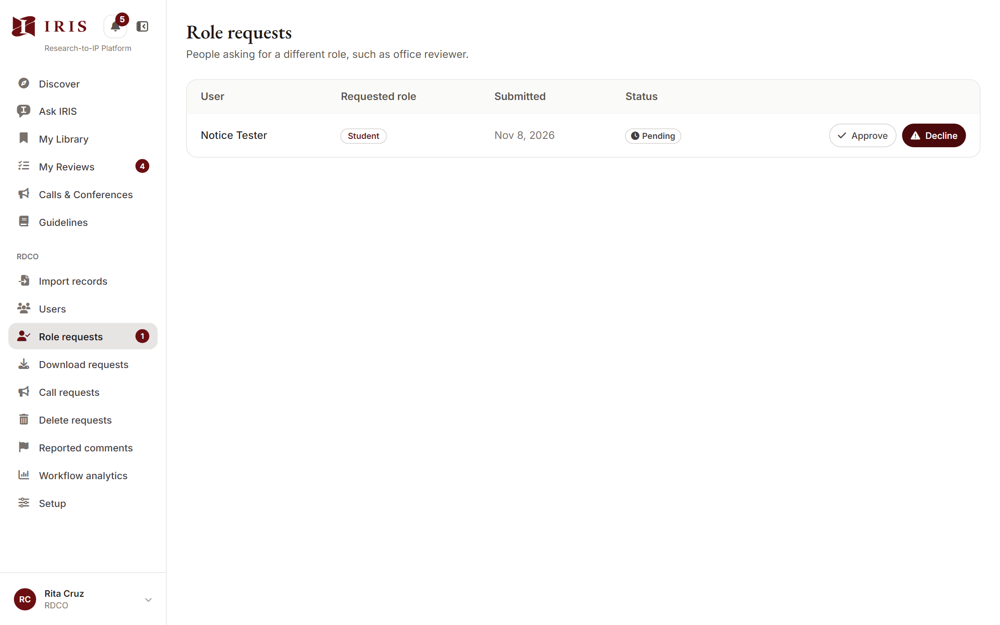
*Figure 19: Role requests (RDCO) (local build)*

2. ##### Frontend Components

| Component Name | Description & Purpose | Component Format |
| :---: | ----- | ----- |
| **RoleRequestsPage** frontend/src/features/accounts/RoleRequestsPage.tsx | RDCO's queue of role requests. | React page component |
| **UserListPage** frontend/src/features/accounts/UserListPage.tsx | Users page with role and coordinator actions. | React page component |

3. ##### Backend Components

| Component Name | Description & Purpose | Component Format |
| :---: | ----- | ----- |
| **permissions** backend/core/permissions.py | IsStaff, IsAdmin, IsAccountAdmin, IsSystemAdmin; role_change_refusal. | DRF permission class |
| **ChangeUserRoleView, OfficeCoordinatorView, RoleRequestDetailView** backend/apps/accounts/views.py | Role change, coordinator flag, request decisions; each audited. | DRF APIView |
| **Role, RoleRequest** backend/apps/accounts/models.py | Seven RoleName values; pending requests. | Django model |

**API:** `GET|PATCH /api/v1/users/role-requests/…` · `PATCH /api/v1/users/<id>/role/` · `POST /api/v1/users/<id>/coordinator/`

4. Class Diagram

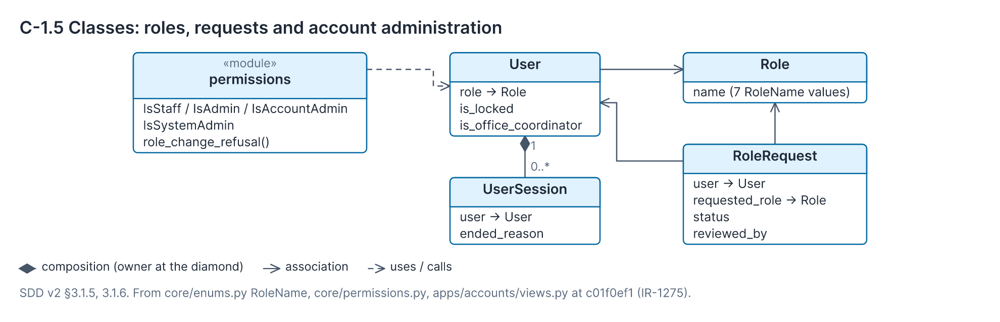
*Figure 20: Classes: roles, requests and account administration*

5. Sequence Diagrams

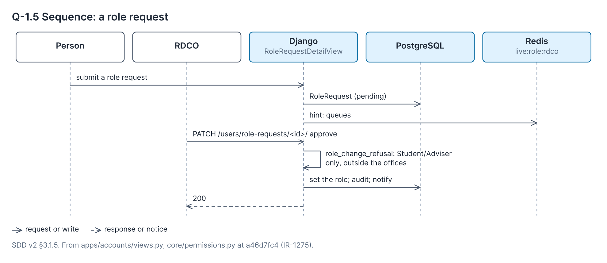
*Figure 21: Sequence Diagram for a role request*

6. Schema

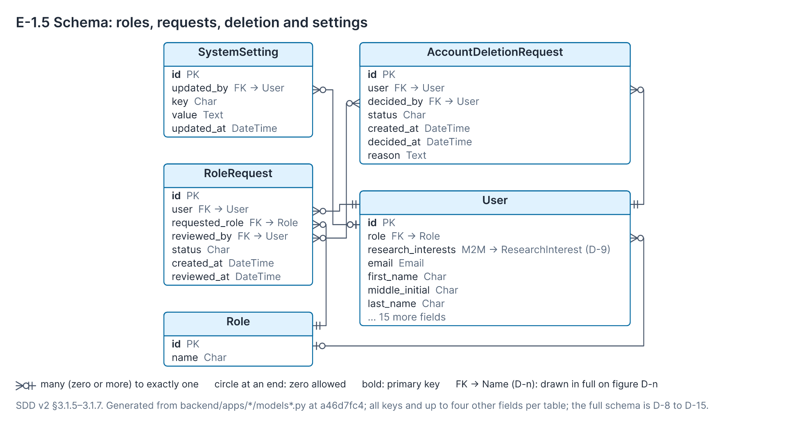
*Figure 22: Database Schema for roles, requests, deletion and settings*

7. Tests

Requirement status **IMPLEMENTED** (FR-M6-03 role-based access; IR-478), from `TRACEABILITY.md` at `2d8d4e4a`. The tests below are the ones its matrix rows name ([FR-M6-03](testing/traceability/FR-M6-03.md), [IR-478](testing/traceability/IR-478.md)), each found in the repository at `2d8d4e4a`, plus the Playwright tests that drive the feature.

| Test | Kind | Recorded in |
| ----- | ----- | ----- |
| `backend/apps/records/test_seed_demo.py` | Backend (pytest) | [IR-478](testing/traceability/IR-478.md) |
| `frontend/src/features/accounts/UserListPage.test.tsx` | Frontend (Vitest) | [IR-478](testing/traceability/IR-478.md) |
| `frontend/src/lib/access.test.ts` | Frontend (Vitest) | [IR-478](testing/traceability/IR-478.md) |
| `e2e/specs/00-account-lifecycle.spec.ts`: "signed in before approval, the account waits; after RDCO approves, it has the Student role" | End-to-end journey (Playwright) | [IR-631 core journeys](testing/CORE_JOURNEYS.md) |
| `e2e/specs/04-coordination.spec.ts`: "the System Admin grants and removes a coordinator, and the grant is what permits assigning" | End-to-end journey (Playwright) | [IR-631 core journeys](testing/CORE_JOURNEYS.md) |

#### 3.1.6 Account Administration (FR-1.6)

RDCO keeps accounts and sessions safe; every act is audited (ADR-051).

1. User Interface Design

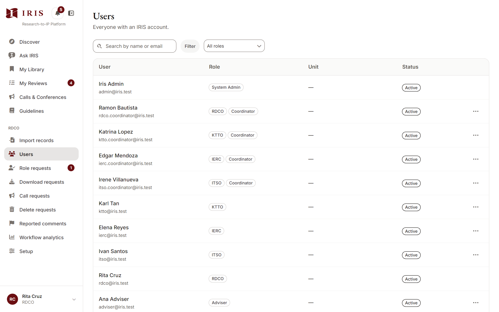
*Figure 23: Users page (RDCO) (local build)*

2. ##### Frontend Components

| Component Name | Description & Purpose | Component Format |
| :---: | ----- | ----- |
| **UserListPage** frontend/src/features/accounts/UserListPage.tsx | Search, lock and unlock users. | React page component |
| **SessionsPage** frontend/src/features/admin/SessionsPage.tsx | Active sessions and revoke. | React page component |

3. ##### Backend Components

| Component Name | Description & Purpose | Component Format |
| :---: | ----- | ----- |
| **LockUserView, UnlockUserView, LockedUsersView** backend/apps/accounts/views.py | Lock (refused for a System Admin), unlock; end sessions. | DRF APIView (IsAdmin) |
| **ActiveSessionsView, RevokeSessionView** backend/apps/accounts/views.py | List and revoke sessions. | DRF APIView (IsAdmin) |

**API:** `POST /api/v1/users/<id>/lock/` · `POST /api/v1/users/<id>/unlock/` · `GET /api/v1/users/sessions/` · `DELETE /api/v1/users/sessions/<jti>/`

4. Class Diagram

See Figure 20 (Classes: roles, requests and account administration).

5. Sequence Diagrams

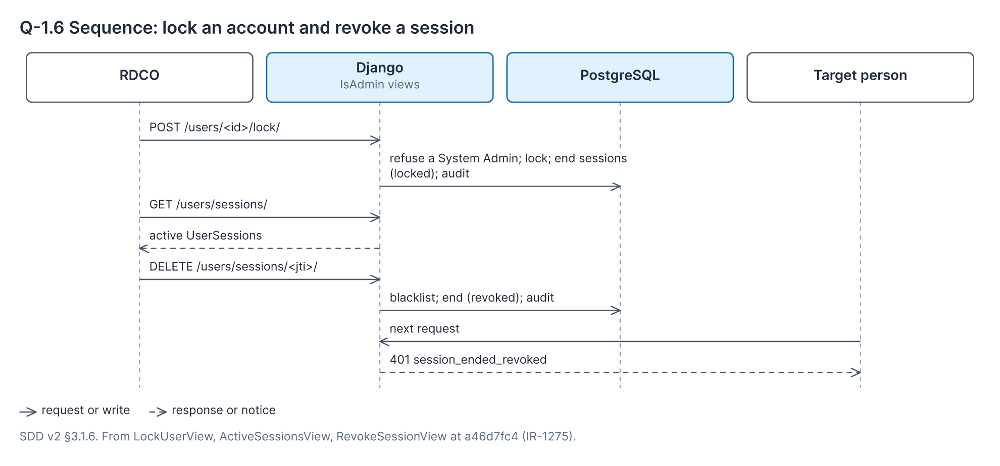
*Figure 24: Sequence Diagram for lock an account and revoke a session*

6. Schema

See Figure 22 (Database Schema for roles, requests, deletion and settings).

7. Tests

Requirement status **IMPLEMENTED** (FR-M6-05), from `TRACEABILITY.md` at `2d8d4e4a`. The tests below are the ones its matrix rows name ([FR-M6-05](testing/traceability/FR-M6-05.md)), each found in the repository at `2d8d4e4a`, plus the Playwright tests that drive the feature.

| Test | Kind | Recorded in |
| ----- | ----- | ----- |
| `backend/apps/accounts/test_session_revoke.py` | Backend (pytest) | [FR-M6-05](testing/traceability/FR-M6-05.md) |

#### 3.1.7 Personal Data Rights (FR-1.7)

RA 10173 gives each person access to their data and its erasure (ADR-051).

1. User Interface Design

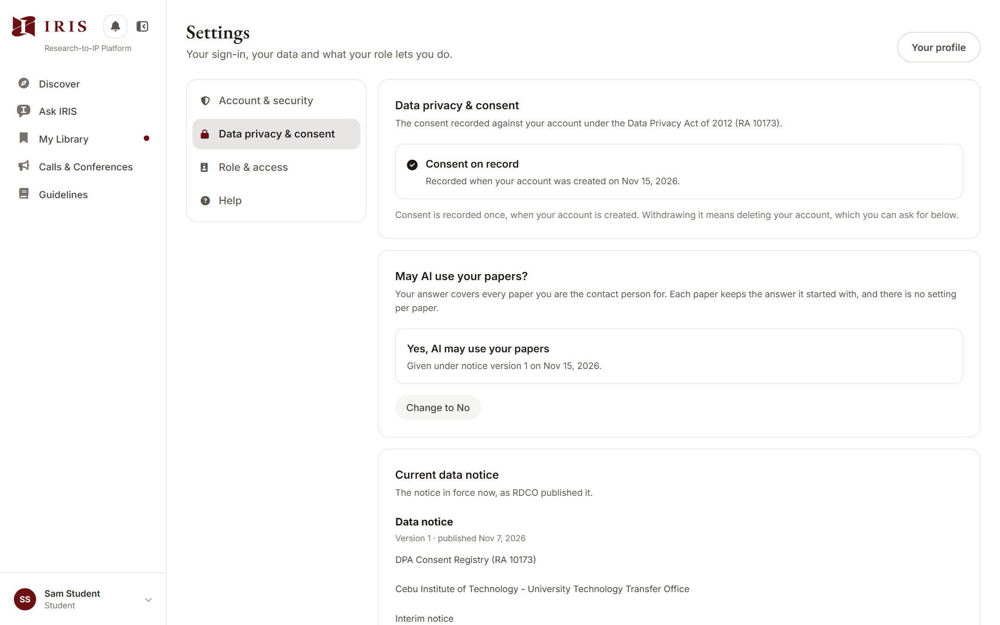
*Figure 25: Settings: data privacy and consent (local build)*

2. ##### Frontend Components

| Component Name | Description & Purpose | Component Format |
| :---: | ----- | ----- |
| **YourDataPanels, AiAnswerPanel** frontend/src/features/settings/ | Export, deletion request, AI answer. | React component |
| **AccountDeletionRequestsPage, RetentionPage** frontend/src/features/admin/ | System Admin's deletion queue and retention settings. | React page component |

3. ##### Backend Components

| Component Name | Description & Purpose | Component Format |
| :---: | ----- | ----- |
| **personal_data.export** backend/apps/accounts/personal_data/export.py | Builds the person's export. | Service module |
| **deletion.service, deletion.blockers** backend/apps/accounts/deletion/ | Request, confirm, reject; what blocks a deletion. | Service module |
| **erase_expired_personal_data** backend/apps/audit/tasks.py | Daily erasure by retention period; blank erases nothing. | Celery task |

**API:** `GET /api/v1/users/me/data/` · `POST|DELETE /api/v1/users/me/deletion-request/` · `GET /api/v1/users/deletion-requests/` · `POST /api/v1/users/deletion-requests/<id>/confirm/ · /reject/` · `GET|PATCH /api/v1/settings/<key>/`

4. Class Diagram

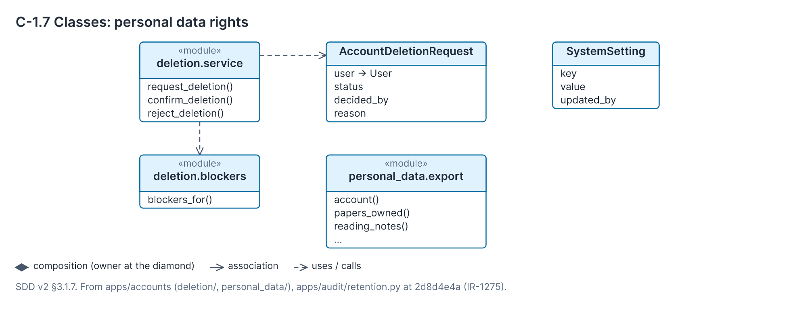
*Figure 26: Classes: personal data rights*

5. Sequence Diagrams

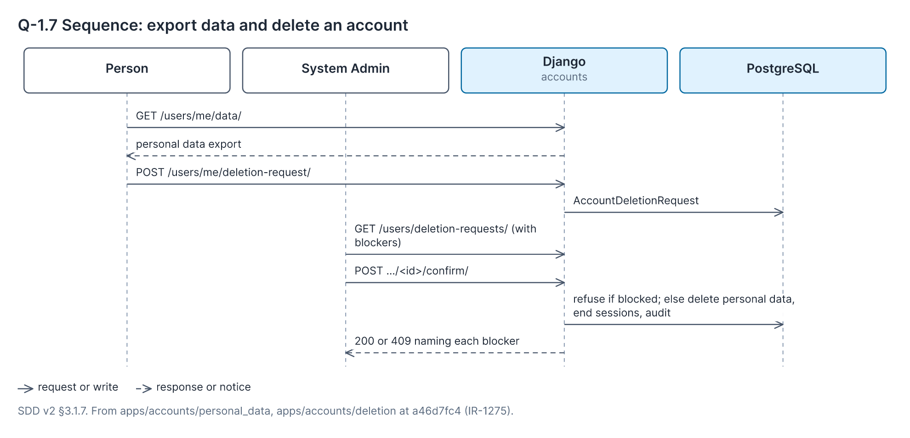
*Figure 27: Sequence Diagram for export data and delete an account*

6. Schema

See Figure 22 (Database Schema for roles, requests, deletion and settings).

7. Tests

Requirement status **PARTIAL** (IR-794, IR-795), from `TRACEABILITY.md` at `2d8d4e4a`. The tests below are the ones its matrix rows name ([IR-794](testing/traceability/IR-794.md), [IR-795](testing/traceability/IR-795.md)), each found in the repository at `2d8d4e4a`, plus the Playwright tests that drive the feature.

| Test | Kind | Recorded in |
| ----- | ----- | ----- |
| `backend/apps/audit/tests/test_retention.py` | Backend (pytest) | [IR-794](testing/traceability/IR-794.md) |
| `backend/apps/audit/tests/test_retention_preview.py` | Backend (pytest) | [IR-795](testing/traceability/IR-795.md) |
| `frontend/src/components/layout/Sidebar.test.tsx` | Frontend (Vitest) | [IR-795](testing/traceability/IR-795.md) |
| `frontend/src/features/admin/RetentionPage.test.tsx` | Frontend (Vitest) | [IR-795](testing/traceability/IR-795.md) |
| `frontend/src/lib/access.test.ts` | Frontend (Vitest) | [IR-795](testing/traceability/IR-795.md) |

### Module 2: Records and Submission

#### 3.2.1 Publish a Record (FR-2.1)

A record must enter review with a named Adviser who is not an owner, starting embargoed, with one Version (ADR-032, IR-882).

1. User Interface Design

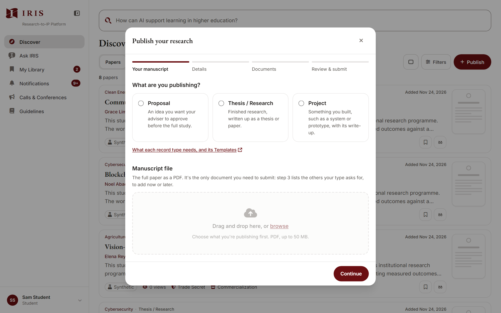
*Figure 28: Publish dialog (local build)*

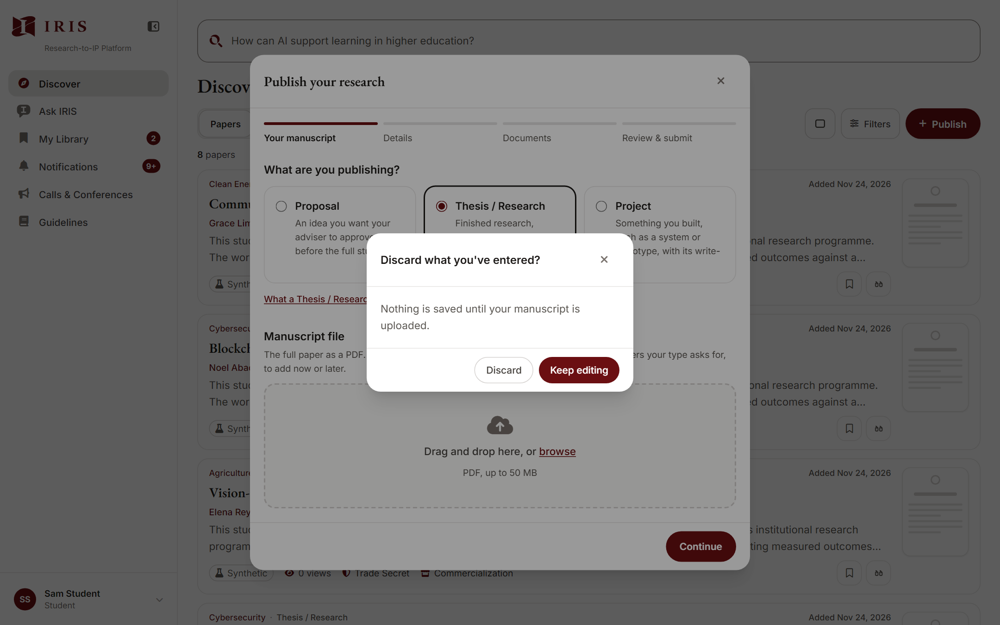
*Figure 29: Publish asks before closing: "Discard what you've entered?" (local build)*

2. ##### Frontend Components

| Component Name | Description & Purpose | Component Format |
| :---: | ----- | ----- |
| **PublishDialog** frontend/src/features/publish/PublishDialog.tsx | Multi-step form: ManuscriptStep, DocumentsStep, ReviewStep; autosaves the draft. | React dialog component |
| **recordsApi, documentsApi, peopleApi** frontend/src/api/ | Record, upload and people-search calls. | API client module |

3. ##### Backend Components

| Component Name | Description & Purpose | Component Format |
| :---: | ----- | ----- |
| **RecordViewSet** backend/apps/records/views.py | create, partial_update, submit, duplicate matches; queryset always visible_to(user). | DRF ViewSet action |
| **versions.write_version** backend/apps/records/versions.py | The one writer of Versions. | Service module |
| **duplicates** backend/apps/records/duplicates.py | Exact-manuscript matches among records the author may read. | Service module |
| **Record, RecordOwner, RecordVersion** backend/apps/records/models.py | The record, its owners and Versions. | Django model |

**API:** `POST /api/v1/records/` · `PATCH /api/v1/records/<id>/` · `POST /api/v1/records/<id>/submit/` · `GET /api/v1/records/<id>/duplicate-matches/` · `POST /api/v1/records/<id>/acknowledge-duplicates/`

4. Class Diagram

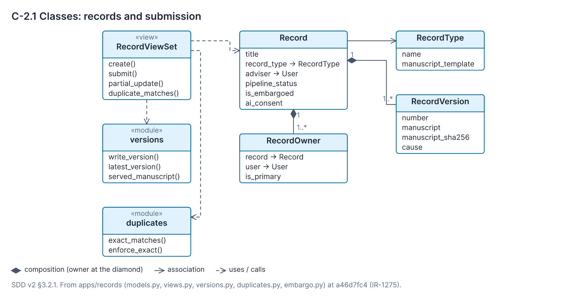
*Figure 30: Classes: records and submission*

5. Sequence Diagrams

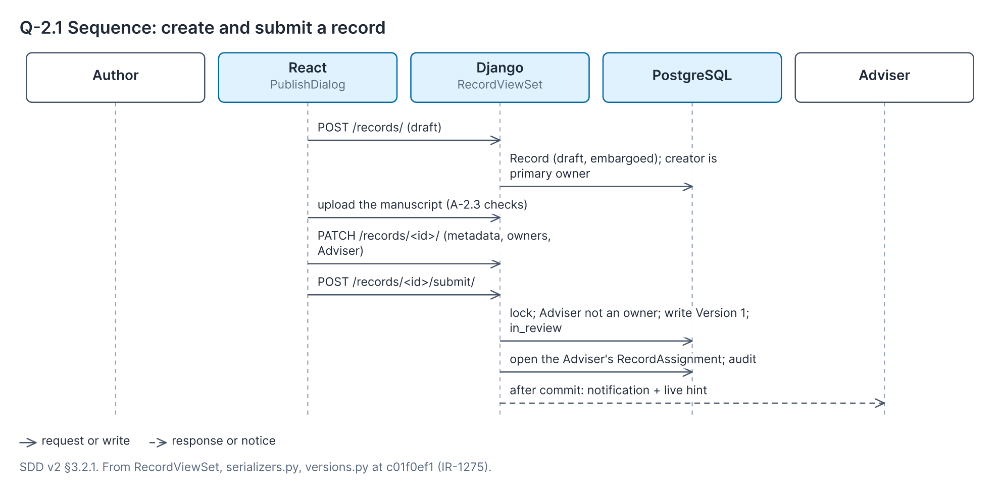
*Figure 31: Sequence Diagram for create and submit a record*

6. Schema

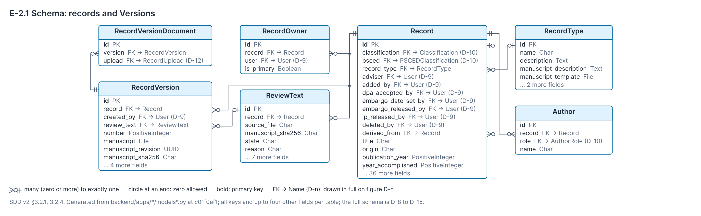
*Figure 32: Database Schema for records and Versions*

7. Tests

Requirement status **IMPLEMENTED** (FR-M2-01), from `TRACEABILITY.md` at `2d8d4e4a`. The tests below are the ones its matrix rows name ([FR-M2-01](testing/traceability/FR-M2-01.md)), each found in the repository at `2d8d4e4a`, plus the Playwright tests that drive the feature.

| Test | Kind | Recorded in |
| ----- | ----- | ----- |
| `frontend/src/features/publish/PublishDialog.test.tsx` | Frontend (Vitest) | [FR-M2-01](testing/traceability/FR-M2-01.md) |
| `frontend/src/features/publish/draft.test.ts` | Frontend (Vitest) | [FR-M2-01](testing/traceability/FR-M2-01.md) |
| `frontend/src/router/redirects.test.tsx` | Frontend (Vitest) | [FR-M2-01](testing/traceability/FR-M2-01.md) |
| `e2e/specs/01-thesis-project.spec.ts`: "draft, edit, upload and submit enter adviser-first review" | End-to-end journey (Playwright) | [IR-631 core journeys](testing/CORE_JOURNEYS.md) |
| `e2e/specs/02-adversarial-access.spec.ts`: "anonymous: a draft answers as if it did not exist"; "another student: the same draft is a 404 like a missing id, and never listed" | End-to-end journey (Playwright) | [IR-631 core journeys](testing/CORE_JOURNEYS.md) |
| `e2e/specs/06-integrity.spec.ts`: "a double submit makes one submission" | End-to-end journey (Playwright) | [IR-631 core journeys](testing/CORE_JOURNEYS.md) |

#### 3.2.2 Required Documents and Templates (FR-2.2)

RDCO, not a deployment, decides what each record type asks for (ADR-063).

1. User Interface Design

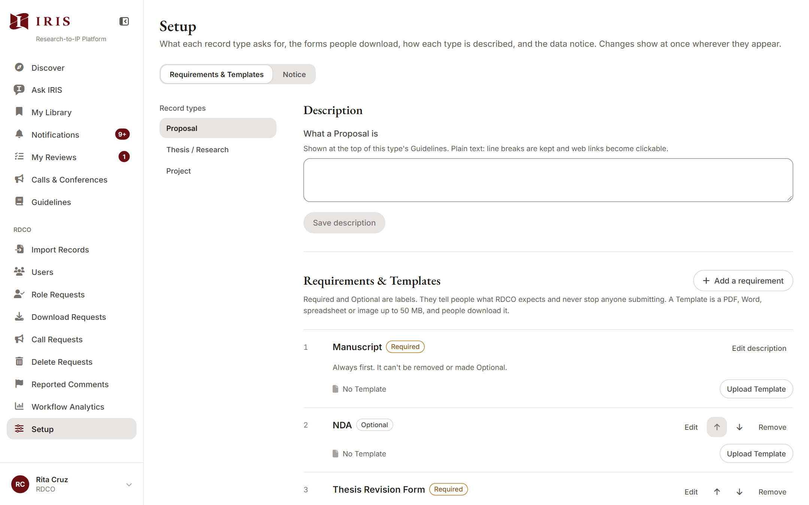
*Figure 33: Setup: a record type's description, requirements and templates (RDCO) (local build)*

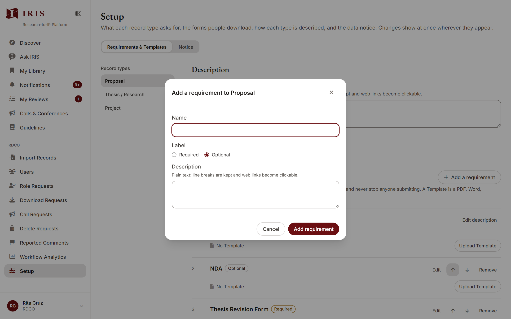
*Figure 34: Setup: the "Add a requirement" popup (RDCO) (local build)*

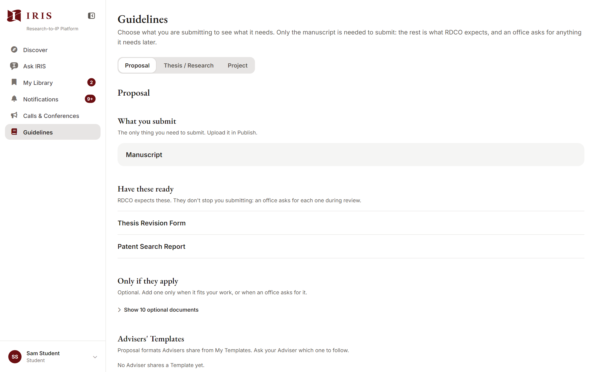
*Figure 35: Guidelines, one record type at a time (local build)*

2. ##### Frontend Components

| Component Name | Description & Purpose | Component Format |
| :---: | ----- | ----- |
| **SetupPage** frontend/src/features/setup/SetupPage.tsx | Requirements, templates and the data notice, per record type. | React page component |
| **GuidelinesPage** frontend/src/features/guidelines/GuidelinesPage.tsx | What every type needs, with templates. | React page component |

3. ##### Backend Components

| Component Name | Description & Purpose | Component Format |
| :---: | ----- | ----- |
| **setup** backend/apps/documents/setup.py | Add, edit, reorder, remove requirements; templates. | Service module |
| **setup_views** backend/apps/documents/setup_views.py | RDCO-only endpoints. | DRF APIView |
| **UploadSlot, AdviserTemplate** backend/apps/documents/models.py | Requirements and Advisers' templates. | Django model |

**API:** `/api/v1/documents/setup/record-types/…` · `/api/v1/documents/setup/requirements/…` · `GET /api/v1/documents/guidelines/` · `/api/v1/documents/my-templates/…`

4. Class Diagram

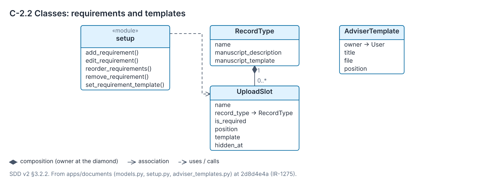
*Figure 36: Classes: requirements and templates*

5. Sequence Diagrams

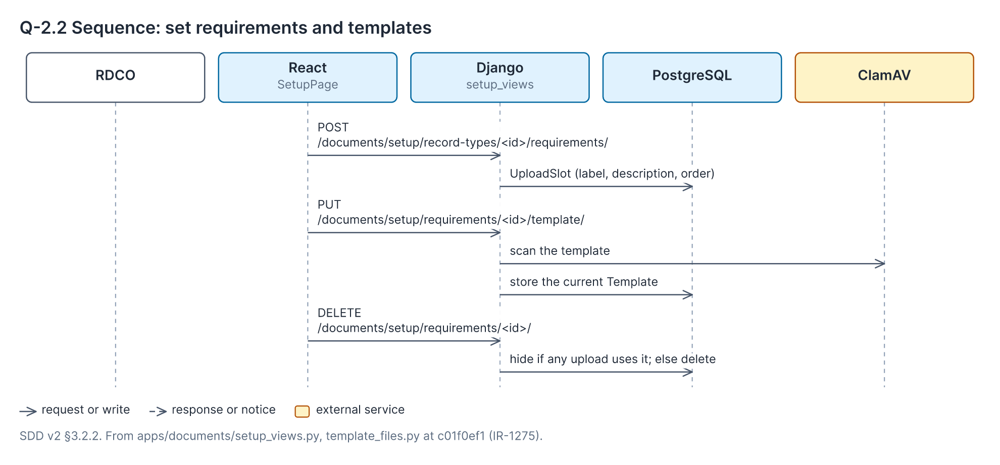
*Figure 37: Sequence Diagram for set requirements and templates*

6. Schema

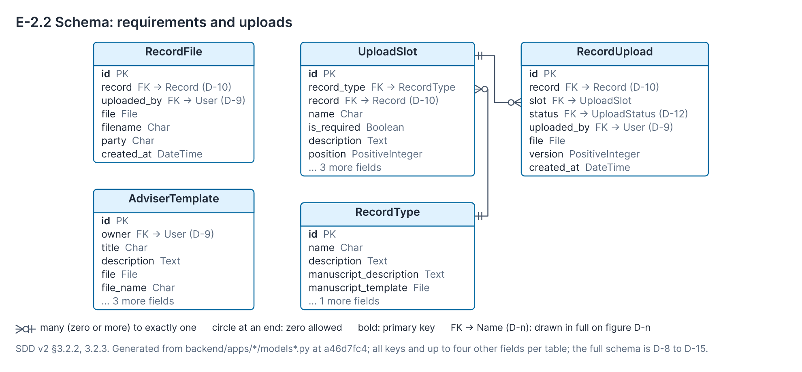
*Figure 38: Database Schema for requirements and uploads*

7. Tests

Requirement status **IMPLEMENTED** (IR-971), from `TRACEABILITY.md` at `2d8d4e4a`. The tests below are the ones its matrix rows name ([IR-971](testing/traceability/IR-971.md)), each found in the repository at `2d8d4e4a`, plus the Playwright tests that drive the feature.

| Test | Kind | Recorded in |
| ----- | ----- | ----- |
| `backend/apps/documents/test_upload_slot_requirements.py` | Backend (pytest) | [IR-971](testing/traceability/IR-971.md) |
| `backend/apps/documents/tests/test_setup_requirements.py` | Backend (pytest) | [IR-971](testing/traceability/IR-971.md) |
| `backend/apps/tests/access/table.py` | Access matrix (pytest) | [IR-971](testing/traceability/IR-971.md) |
| `frontend/src/features/setup/SetupPage.test.tsx` | Frontend (Vitest) | [IR-971](testing/traceability/IR-971.md) |
| `frontend/src/lib/access.test.ts` | Frontend (Vitest) | [IR-971](testing/traceability/IR-971.md) |
| `frontend/src/router/roleNavigation.test.tsx` | Frontend (Vitest) | [IR-971](testing/traceability/IR-971.md) |

#### 3.2.3 Upload Checks (FR-2.3)

Nothing unchecked may be stored: a real PDF, a size limit, and a malware scan during the upload (ADR-074).

1. User Interface Design

See Figure 28 (Publish dialog (local build)).

2. ##### Frontend Components

| Component Name | Description & Purpose | Component Format |
| :---: | ----- | ----- |
| **ManuscriptStep, DocumentsStep** frontend/src/features/publish/ | Upload areas showing the 50 MB limit and refusal reasons. | React component |

3. ##### Backend Components

| Component Name | Description & Purpose | Component Format |
| :---: | ----- | ----- |
| **validators.pdf_upload_problem** backend/apps/documents/validators.py | PDF signature, page count, MAX_PDF_SIZE_BYTES. | Service module |
| **scanning** backend/apps/documents/scanning.py | ClamdScanner (zINSTREAM over TCP 3310); fails closed. | Service module |
| **RecordUpload, RecordFile** backend/apps/documents/models.py | Stored only after both checks pass. | Django model |

**API:** `POST /api/v1/documents/uploads/create/` · `POST /api/v1/documents/files/upload/`

4. Class Diagram

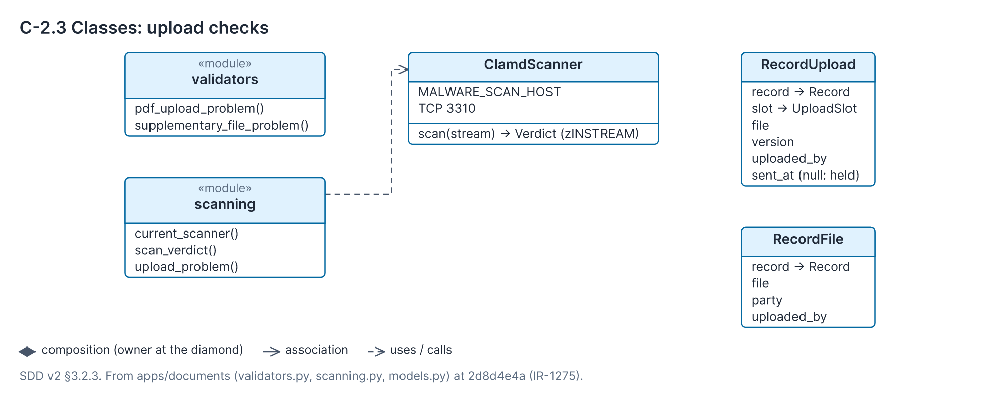
*Figure 39: Classes: upload checks*

5. Sequence Diagrams

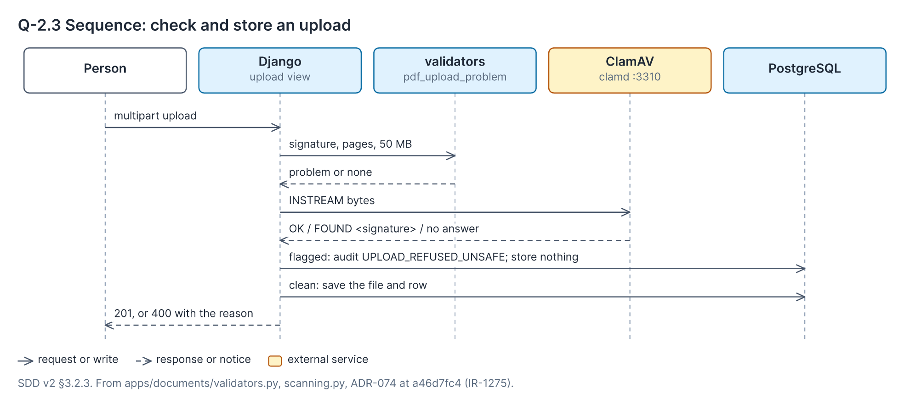
*Figure 40: Sequence Diagram for check and store an upload*

6. Schema

See Figure 38 (Database Schema for requirements and uploads).

7. Tests

Requirement status **IMPLEMENTED** (IR-665, IR-666), from `TRACEABILITY.md` at `2d8d4e4a`. The tests below are the ones its matrix rows name ([IR-665](testing/traceability/IR-665.md), [IR-666](testing/traceability/IR-666.md)), each found in the repository at `2d8d4e4a`, plus the Playwright tests that drive the feature.

| Test | Kind | Recorded in |
| ----- | ----- | ----- |
| `backend/apps/documents/tests/test_pdf_content.py` | Backend (pytest) | [IR-665](testing/traceability/IR-665.md) |
| `backend/apps/documents/tests/test_real_clamav.py` | Backend (pytest) | [IR-666](testing/traceability/IR-666.md) |
| `backend/apps/documents/tests/test_scanning.py` | Backend (pytest) | [IR-666](testing/traceability/IR-666.md) |
| `backend/apps/documents/tests/test_upload_scanning.py` | Backend (pytest) | [IR-666](testing/traceability/IR-666.md) |
| `backend/apps/tests/test_container_egress.py` | Backend (pytest) | [IR-666](testing/traceability/IR-666.md) |

#### 3.2.4 Versions (FR-2.4)

Each Version keeps its own manuscript, documents and review text, so reviewers can compare rounds (ADR-058).

1. User Interface Design

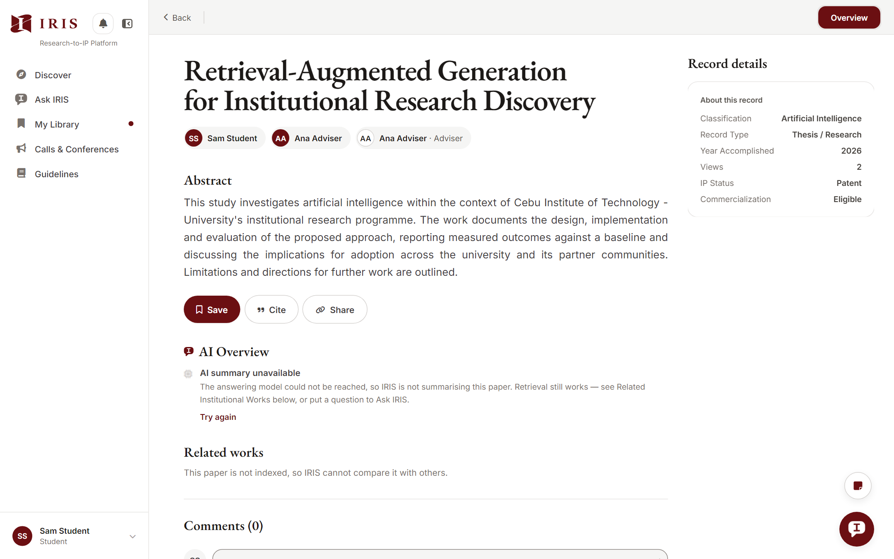
*Figure 41: Paper View: a published paper's Overview; its AI Overview is unavailable because no AI vendor is reached locally (local build)*

2. ##### Frontend Components

| Component Name | Description & Purpose | Component Format |
| :---: | ----- | ----- |
| **VersionPicker, NewVersionDialog** frontend/src/features/records/paper-view/ | Pick a Version; submit a new one. | React component |

3. ##### Backend Components

| Component Name | Description & Purpose | Component Format |
| :---: | ----- | ----- |
| **versions** backend/apps/records/versions.py | write_version, served_manuscript. | Service module |
| **review_text** backend/apps/records/review_text/ | Local pdfplumber read of each Version, no AI. | Service module |
| **version_comparison** backend/apps/reviews/version_comparison.py | Section-by-section comparison. | Service module |
| **RecordVersion, RecordVersionDocument, ReviewText** backend/apps/records/models.py | Versions and their text. | Django model |

**API:** `GET /api/v1/records/<id>/versions/<n>/manuscript/` · `GET /api/v1/records/<id>/versions/<n>/text/` · `GET /api/v1/records/<id>/versions/compare/` · `POST /api/v1/records/<id>/continue-as/`

4. Class Diagram

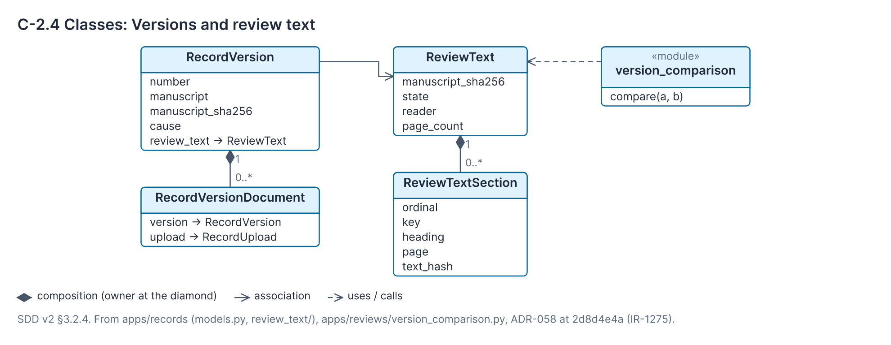
*Figure 42: Classes: Versions and review text*

5. Sequence Diagrams

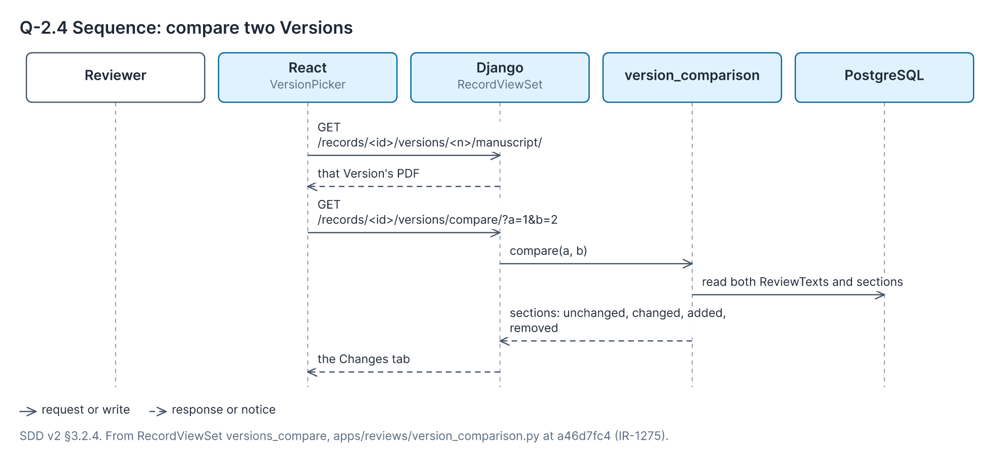
*Figure 43: Sequence Diagram for compare two Versions*

6. Schema

See Figure 32 (Database Schema for records and Versions).

7. Tests

Requirement status **IMPLEMENTED** (IR-871), from `TRACEABILITY.md` at `2d8d4e4a`. The tests below are the ones its matrix rows name ([IR-871](testing/traceability/IR-871.md)), each found in the repository at `2d8d4e4a`, plus the Playwright tests that drive the feature.

| Test | Kind | Recorded in |
| ----- | ----- | ----- |
| `backend/apps/records/test_record_versions.py` | Backend (pytest) | [IR-871](testing/traceability/IR-871.md) |
| `backend/apps/records/test_review_text.py` | Backend (pytest) | [IR-871](testing/traceability/IR-871.md) |
| `backend/apps/records/test_review_text_isolation.py` | Backend (pytest) | [IR-871](testing/traceability/IR-871.md) |
| `backend/apps/records/test_review_text_reader.py` | Backend (pytest) | [IR-871](testing/traceability/IR-871.md) |
| `backend/apps/records/test_review_text_sandbox.py` | Backend (pytest) | [IR-871](testing/traceability/IR-871.md) |
| `backend/apps/reviews/test_new_version.py` | Backend (pytest) | [IR-871](testing/traceability/IR-871.md) |
| `backend/apps/reviews/test_version_documents.py` | Backend (pytest) | [IR-871](testing/traceability/IR-871.md) |
| `backend/apps/tests/test_enum_vocabulary.py` | Backend (pytest) | [IR-871](testing/traceability/IR-871.md) |
| `e2e/specs/03-proposal-continuation.spec.ts`: "the Continuation cannot be submitted without its own manuscript"; "lineage reads both ways, in the API and on the page" | End-to-end journey (Playwright) | [IR-631 core journeys](testing/CORE_JOURNEYS.md) |
| `e2e/specs/06-integrity.spec.ts`: "a double new Version makes one Version" | End-to-end journey (Playwright) | [IR-631 core journeys](testing/CORE_JOURNEYS.md) |

#### 3.2.5 Download Requests and Watermarked Copies (FR-2.5)

Reading stays open, saving a copy needs RDCO's approval, and every copy names who took it (ADR-048).

1. User Interface Design

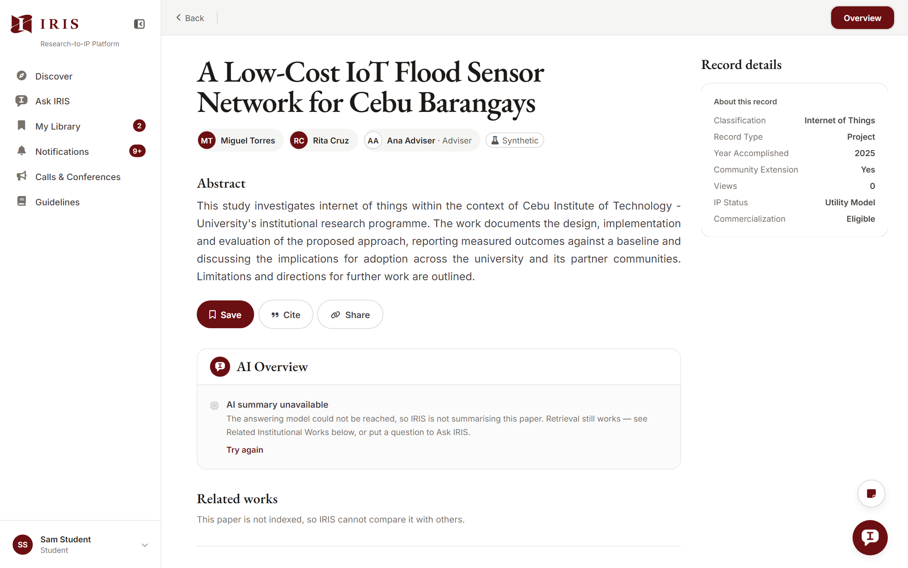
*Figure 44: Paper View: saving a copy needs a request (local build)*

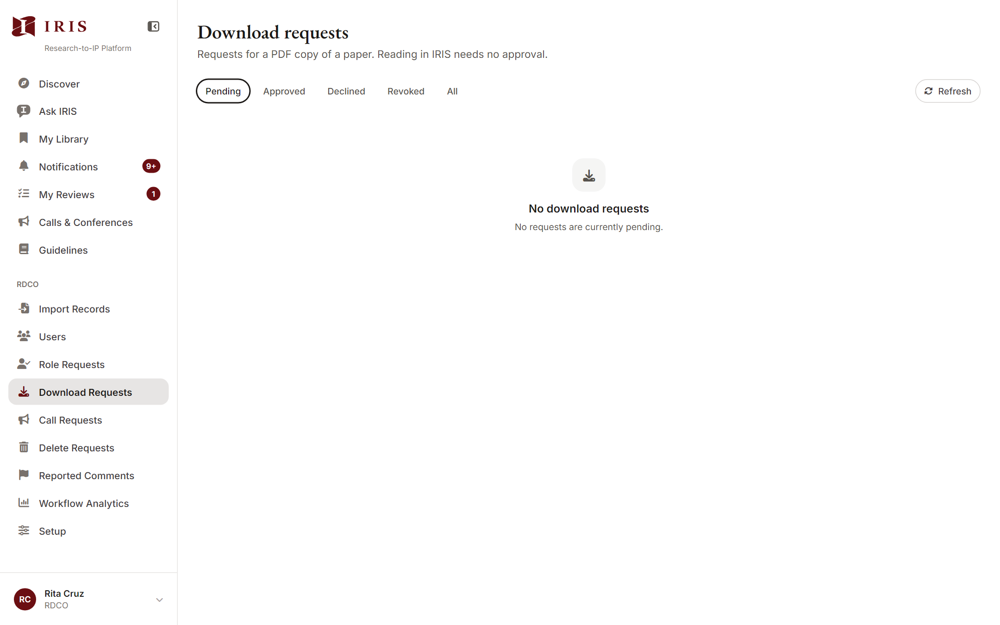
*Figure 45: Download requests (RDCO) (local build)*

2. ##### Frontend Components

| Component Name | Description & Purpose | Component Format |
| :---: | ----- | ----- |
| **PaperDownloadControl, ReaderWatermark** frontend/src/features/records/paper-view/ | Request, cancel, download; the per-page mark in the reader. | React component |
| **DownloadRequestsView** frontend/src/features/library/DownloadRequestsView.tsx | The reader's requests in My Library. | React page component |
| **DownloadRequestsPage** frontend/src/features/admin/DownloadRequestsPage.tsx | RDCO's queue. | React page component |

3. ##### Backend Components

| Component Name | Description & Purpose | Component Format |
| :---: | ----- | ----- |
| **DownloadRequestViewSet** backend/apps/records/views.py | create, approve, decline, revoke, cancel. | DRF ViewSet action |
| **download_service** backend/apps/records/download_service.py | Exemptions, grants, audit of each download. | Service module |
| **watermark** backend/apps/records/watermark.py | Per-download copy with reportlab and pypdf; never stored. | Service module |
| **DownloadRequest** backend/apps/records/models.py | Note, RDCO note, grant_expires_at. | Django model |

**API:** `POST /api/v1/records/download-requests/` · `POST …/<id>/approve/ · /decline/ · /revoke/ · /cancel/` · `GET /api/v1/records/<id>/download/`

4. Class Diagram

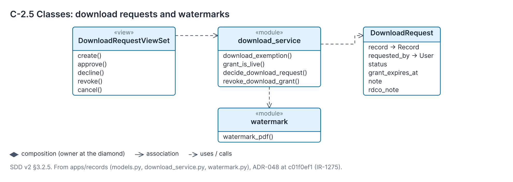
*Figure 46: Classes: download requests and watermarks*

5. Sequence Diagrams

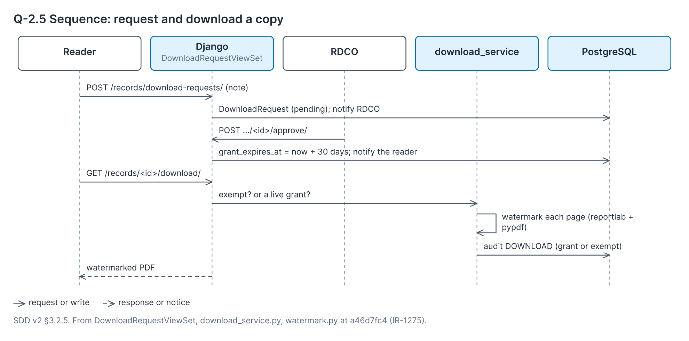
*Figure 47: Sequence Diagram for request and download a copy*

6. Schema

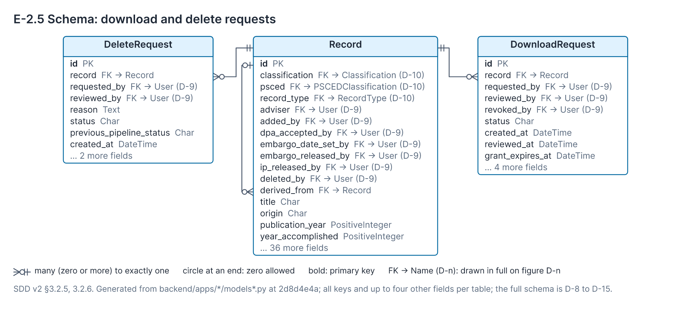
*Figure 48: Database Schema for download and delete requests*

7. Tests

Requirement status **PARTIAL** (FR-M2-02/03; IR-676 PARTIAL), from `TRACEABILITY.md` at `2d8d4e4a`. The tests below are the ones its matrix rows name ([FR-M2-02](testing/traceability/FR-M2-02-03.md), [IR-676](testing/traceability/IR-676.md), [IR-674](testing/traceability/IR-674.md), [IR-675](testing/traceability/IR-675.md), [IR-677](testing/traceability/IR-677.md), [IR-688](testing/traceability/IR-688.md), [IR-743](testing/traceability/IR-743.md)), each found in the repository at `2d8d4e4a`, plus the Playwright tests that drive the feature.

| Test | Kind | Recorded in |
| ----- | ----- | ----- |
| `backend/apps/records/test_download_grant.py` | Backend (pytest) | [IR-675](testing/traceability/IR-675.md) |
| `backend/apps/records/test_download_request_decisions.py` | Backend (pytest) | [IR-674](testing/traceability/IR-674.md) |
| `backend/apps/records/test_download_request_notes.py` | Backend (pytest) | [IR-688](testing/traceability/IR-688.md) |
| `backend/apps/records/test_download_state.py` | Backend (pytest) | [IR-677](testing/traceability/IR-677.md) |
| `backend/apps/records/test_download_watermark.py` | Backend (pytest) | [IR-676](testing/traceability/IR-676.md) |
| `backend/apps/records/test_my_download_requests.py` | Backend (pytest) | [IR-743](testing/traceability/IR-743.md) |
| `backend/apps/tests/access/table.py` | Access matrix (pytest) | [IR-675](testing/traceability/IR-675.md) |
| `frontend/src/features/admin/DownloadRequestsPage.test.tsx` | Frontend (Vitest) | [IR-688](testing/traceability/IR-688.md) |
| `frontend/src/features/library/MyLibraryPage.test.tsx` | Frontend (Vitest) | [IR-743](testing/traceability/IR-743.md) |
| `frontend/src/features/records/paper-view/PaperDownloadControl.test.tsx` | Frontend (Vitest) | [IR-677](testing/traceability/IR-677.md) |
| `frontend/src/features/records/paper-view/PaperPdfReader.test.tsx` | Frontend (Vitest) | [IR-677](testing/traceability/IR-677.md) |

#### 3.2.6 Delete Requests (FR-2.6)

An owner may ask for removal; RDCO decides, and a decline restores the record.

1. User Interface Design

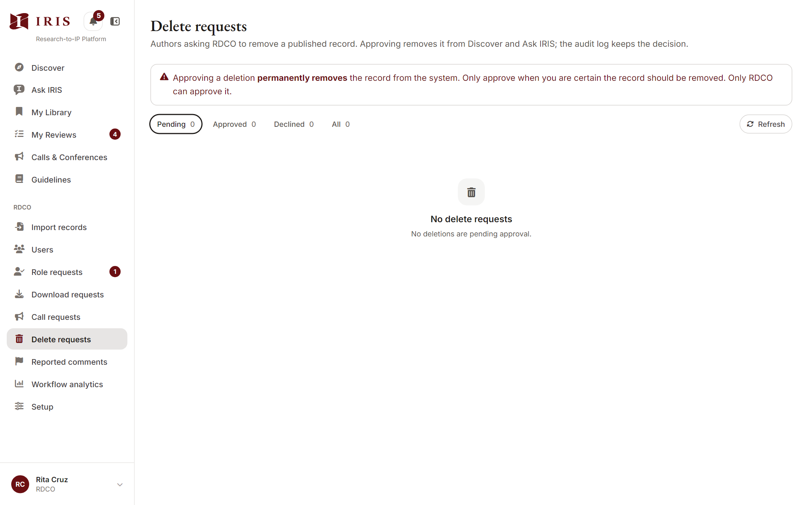
*Figure 49: Delete requests (RDCO) (local build)*

2. ##### Frontend Components

| Component Name | Description & Purpose | Component Format |
| :---: | ----- | ----- |
| **DeleteRequestsPage** frontend/src/features/admin/DeleteRequestsPage.tsx | RDCO's queue. | React page component |

3. ##### Backend Components

| Component Name | Description & Purpose | Component Format |
| :---: | ----- | ----- |
| **DeleteRequestViewSet** backend/apps/records/views.py | create, approve, decline, counts. | DRF ViewSet action |
| **DeleteRequest** backend/apps/records/models.py | Keeps previous_pipeline_status. | Django model |

**API:** `/api/v1/records/delete-requests/…`

4. Class Diagram

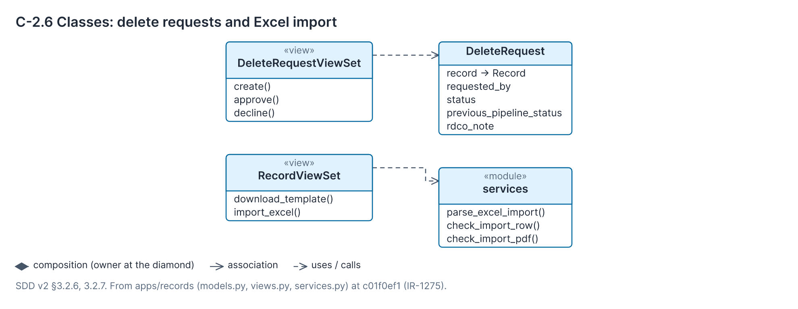
*Figure 50: Classes: delete requests and Excel import*

5. Sequence Diagrams

*Figure 51: Sequence Diagram for a delete request*

6. Schema

See Figure 48 (Database Schema for download and delete requests).

7. Tests

Requirement status **PARTIAL** (FR-M2-02/03), from `TRACEABILITY.md` at `2d8d4e4a`. The tests below are the ones its matrix rows name ([FR-M2-02](testing/traceability/FR-M2-02-03.md), [IR-1076](testing/traceability/IR-1076.md)), each found in the repository at `2d8d4e4a`, plus the Playwright tests that drive the feature.

| Test | Kind | Recorded in |
| ----- | ----- | ----- |
| `backend/apps/records/test_delete_request_queue.py` | Backend (pytest) | [IR-1076](testing/traceability/IR-1076.md) |
| `frontend/src/features/admin/DeleteRequestsPage.test.tsx` | Frontend (Vitest) | [IR-1076](testing/traceability/IR-1076.md) |
| `frontend/src/router/documentTitle.test.tsx` | Frontend (Vitest) | [IR-1076](testing/traceability/IR-1076.md) |
| `frontend/src/test/fontSize.test.ts` | Frontend (Vitest) | [IR-1076](testing/traceability/IR-1076.md) |

#### 3.2.7 Bulk Import from Excel (FR-2.7)

Records finished before IRIS come in by spreadsheet, row by row, all-or-nothing per row (IR-637).

1. User Interface Design

*Figure 52: Import records (RDCO) (local build)*

2. ##### Frontend Components

| Component Name | Description & Purpose | Component Format |
| :---: | ----- | ----- |
| **ImportRecordsPage** frontend/src/features/records/ImportRecordsPage.tsx | Template download, upload, import log (shown to RDCO). | React page component |

3. ##### Backend Components

| Component Name | Description & Purpose | Component Format |
| :---: | ----- | ----- |
| **RecordViewSet.download_template, import_excel** backend/apps/records/views.py | Styled template (openpyxl); import (IsStaff). | DRF ViewSet action |
| **services.parse_excel_import, check_import_row** backend/apps/records/services.py | Parse and validate rows. | Service module |

**API:** `GET /api/v1/records/download_template/` · `POST /api/v1/records/import_excel/`

4. Class Diagram

See Figure 50 (Classes: delete requests and Excel import).

5. Sequence Diagrams

*Figure 53: Sequence Diagram for import records from Excel*

*Figure 54: Sequence Diagram for bulk record import (v1, kept)*

*Figure 55: Sequence Diagram for template download and import (v1, kept)*

6. Schema

See Figure 32 (Database Schema for records and Versions).

7. Tests

Requirement status **IMPLEMENTED** (FR-M2-04; IR-639 VERIFIED), from `TRACEABILITY.md` at `2d8d4e4a`. The tests below are the ones its matrix rows name ([FR-M2-04](testing/traceability/FR-M2-04.md), [IR-639](testing/traceability/IR-639.md)), each found in the repository at `2d8d4e4a`, plus the Playwright tests that drive the feature.

| Test | Kind | Recorded in |
| ----- | ----- | ----- |
| `backend/apps/records/test_excel_import.py` | Backend (pytest) | [FR-M2-04](testing/traceability/FR-M2-04.md) |
| `frontend/src/features/records/ImportRecordsPage.test.tsx` | Frontend (Vitest) | [IR-639](testing/traceability/IR-639.md) |
| `frontend/src/router/documentTitle.test.tsx` | Frontend (Vitest) | [IR-639](testing/traceability/IR-639.md) |

#### 3.2.8 Discover: Browse and Search (FR-2.8)

Readers find published research by keyword and filters, and a refusal looks like a missing record (IR-153).

1. User Interface Design

*Figure 56: Discover (local build)*

*Figure 57: Discover: People, with College, Department and Role filters (local build)*

2. ##### Frontend Components

| Component Name | Description & Purpose | Component Format |
| :---: | ----- | ----- |
| **DiscoverPage** frontend/src/features/discover/DiscoverPage.tsx | Search, filters, Sort. | React page component |
| **PaperViewPage, PaperReader, PaperPdfReader** frontend/src/features/records/paper-view/ | Paper View with pdf.js. | React page component |

3. ##### Backend Components

| Component Name | Description & Purpose | Component Format |
| :---: | ----- | ----- |
| **RecordViewSet.list, facets** backend/apps/records/views.py | visible_to ∩ published; counts. | DRF ViewSet action |
| **filters** backend/apps/records/filters.py | Year, type, classification, PSCED, IP type. | django-filter FilterSet (RecordFilter) |
| **signals.on_record_saved, services.update_search_vector** backend/apps/records/ | Weighted title (A) and abstract (B) index. | Service module |

**API:** `GET /api/v1/records/?search=…` · `GET /api/v1/records/facets/` · `GET /api/v1/records/<id>/` · `GET /api/v1/records/<id>/manuscript/`

4. Class Diagram

*Figure 58: Class Diagram for Search index class diagram (v1, kept)*

5. Sequence Diagrams

*Figure 59: Sequence Diagram for search Discover*

*Figure 60: Sequence Diagram for search index update on save (v1, kept)*

6. Schema

See Figure 32 (Database Schema for records and Versions).

7. Tests

Requirement status **PARTIAL** (IR-902; IR-697, IR-1082 and IR-1187 IMPLEMENTED), from `TRACEABILITY.md` at `2d8d4e4a`. The tests below are the ones its matrix rows name ([IR-902](testing/traceability/IR-902.md), [IR-697](testing/traceability/IR-697.md), [IR-1082](testing/traceability/IR-1082.md), [IR-1187](testing/traceability/IR-1187.md), [IR-1188](testing/traceability/IR-1188.md), [IR-947](testing/traceability/IR-947.md)), each found in the repository at `2d8d4e4a`, plus the Playwright tests that drive the feature.

| Test | Kind | Recorded in |
| ----- | ----- | ----- |
| `backend/apps/accounts/test_public_profile_search.py` | Backend (pytest) | [IR-697](testing/traceability/IR-697.md) |
| `backend/apps/library/tests.py` | Backend (pytest) | [IR-947](testing/traceability/IR-947.md) |
| `backend/apps/tests/access/table.py` | Access matrix (pytest) | [IR-697](testing/traceability/IR-697.md) |
| `frontend/src/features/discover/DiscoverPage.test.tsx` | Frontend (Vitest) | [IR-1082](testing/traceability/IR-1082.md) |
| `frontend/src/features/discover/discoverQuery.test.ts` | Frontend (Vitest) | [IR-1187](testing/traceability/IR-1187.md) |
| `frontend/src/lib/urlPrivacy.test.ts` | Frontend (Vitest) | [IR-947](testing/traceability/IR-947.md) |
| `e2e/smoke/discover-toolbar.spec.ts`: "controls sit in one row that neither wraps nor scrolls" | Smoke (Playwright) | IR-904, run on every pull request |
| `e2e/smoke/discover.spec.ts`: "Discover lists the papers the catalogue returns and opens one"; "Discover says so when the catalogue is empty" | Smoke (Playwright) | IR-904, run on every pull request |
| `e2e/smoke/filter-widths.spec.ts`: "Discover People: College, Department and Role" | Smoke (Playwright) | IR-904, run on every pull request |
| `e2e/specs/07-discover.spec.ts` | End-to-end journey (Playwright) | [IR-1188](testing/traceability/IR-1188.md) |
| `e2e/specs/07-discover.spec.ts`: "search finds published papers by what they say, and never an unpublished one"; "filters narrow the results, the address holds them, and Clear filters undoes them"; "the manuscript opens at ?page=N and lands on that page" | End-to-end journey (Playwright) | [IR-631 core journeys](testing/CORE_JOURNEYS.md) |

### Module 3: Review Workflow (Thesis Core)

**Why this design.** The thesis claims that per-office clearance state makes resubmission cheaper: only the office that asked looks again (ADR-003). That needs three separate facts that v1 merged into one status column: **who holds the record** (Assignments and Seats), **what each office concluded** (Clearances), and **what is being asked of the owner** (revision and document requests). `pipeline_status` is kept to one value while in review, and the API derives a readable `workflow_state` from those facts (ADR-021 §4). Figure 61 shows the states; the core classes are in each feature's class diagram.

*Figure 61: Record lifecycle and review states*

#### 3.3.1 Adviser-First Review (FR-3.1)

Every record enters with its Adviser, who alone decides a Proposal and sends a Thesis or Project on to RDCO (ADR-032, ADR-047).

1. User Interface Design

*Figure 62: My Reviews (Adviser) (local build)*

*Figure 63: Review workspace (Adviser) (local build)*

*Figure 64: Finish review: "Request changes", which always asks for a new version and sends any draft document requests (Adviser) (local build)*

2. ##### Frontend Components

| Component Name | Description & Purpose | Component Format |
| :---: | ----- | ----- |
| **MyReviewsPage** frontend/src/features/review/MyReviewsPage.tsx | To review, In review, Done; sort; Overdue only. | React page component |
| **ReviewWorkspaceLayout, ReviewActionBar, DecisionDialog, RouteDialog** frontend/src/features/records/paper-view/ | The review workspace and its acts. | React component |
| **FinishReviewDialog** frontend/src/features/records/paper-view/threads/FinishReviewDialog.tsx | *Finish review*: summary and verdict; shows verdicts other than *Request changes* and *Comment only* as unavailable while document requests wait. | React dialog component |

3. ##### Backend Components

| Component Name | Description & Purpose | Component Format |
| :---: | ----- | ----- |
| **routing.accept_and_route** backend/apps/reviews/routing.py | Complete the Adviser's assignment; open RDCO's. | Service module |
| **decisions.decide** backend/apps/reviews/decisions.py | Accept (Proposal) or reject. | Service module |
| **finish_review** backend/apps/reviews/finish_review.py | Sends the reviewer's draft threads and draft document requests with the verdict, in one transaction; refuses other verdicts while document requests wait. | Service module |
| **RecordAssignment, ReviewerSeat, Review** backend/apps/reviews/models.py | Who holds the record; the Adviser's Review. | Django model |

**API:** `POST /api/v1/records/<id>/accept-and-route/` · `POST /api/v1/records/<id>/decide/` · `POST /api/v1/records/<id>/finish-review/` · `GET /api/v1/reviews/mine/`

4. Class Diagram

*Figure 65: Class Diagram for Workflow core classes (Section D-20)*

5. Sequence Diagrams

*Figure 66: Sequence Diagram for the Adviser accepts and sends to RDCO*

6. Schema

*Figure 67: Database Schema for assignments, Seats, clearances and revision requests*

7. Tests

Requirement status **IMPLEMENTED** (IR-271, IR-270), from `TRACEABILITY.md` at `2d8d4e4a`. The tests below are the ones its matrix rows name ([IR-271](testing/traceability/IR-271.md), [IR-270](testing/traceability/IR-270.md)), each found in the repository at `2d8d4e4a`, plus the Playwright tests that drive the feature.

| Test | Kind | Recorded in |
| ----- | ----- | ----- |
| `backend/apps/records/test_complete_authority.py` | Backend (pytest) | [IR-271](testing/traceability/IR-271.md) |
| `backend/apps/records/test_seed_demo.py` | Backend (pytest) | [IR-271](testing/traceability/IR-271.md) |
| `backend/apps/reviews/test_decisions.py` | Backend (pytest) | [IR-270](testing/traceability/IR-270.md) |
| `backend/apps/reviews/test_proposal_decision.py` | Backend (pytest) | [IR-271](testing/traceability/IR-271.md) |
| `backend/apps/reviews/test_routing.py` | Backend (pytest) | [IR-271](testing/traceability/IR-271.md) |
| `frontend/src/features/library/MyLibraryPage.test.tsx` | Frontend (Vitest) | [IR-271](testing/traceability/IR-271.md) |
| `frontend/src/features/records/capabilities.test.ts` | Frontend (Vitest) | [IR-271](testing/traceability/IR-271.md) |
| `frontend/src/features/records/paper-view/DecisionDialog.test.tsx` | Frontend (Vitest) | [IR-271](testing/traceability/IR-271.md) |
| `frontend/src/features/records/paper-view/ReviewActionBar.test.tsx` | Frontend (Vitest) | [IR-271](testing/traceability/IR-271.md) |
| `e2e/specs/01-thesis-project.spec.ts`: "the Adviser sends to RDCO, and RDCO routes to three offices in parallel pools" | End-to-end journey (Playwright) | [IR-631 core journeys](testing/CORE_JOURNEYS.md) |
| `e2e/specs/03-proposal-continuation.spec.ts`: "the Adviser accepts the Proposal, and it rests as Accepted" | End-to-end journey (Playwright) | [IR-631 core journeys](testing/CORE_JOURNEYS.md) |

#### 3.3.2 RDCO Routes and Decides at Any Time (FR-3.2)

RDCO routes to offices and alone publishes; a Decision closes all open work with itself as the reason (ADR-047).

1. User Interface Design

*Figure 68: RDCO's view of a record ready to decide, with its embargo card (local build)*

*Figure 69: RDCO's view while IERC and KTTO still review (local build)*

2. ##### Frontend Components

| Component Name | Description & Purpose | Component Format |
| :---: | ----- | ----- |
| **RouteDialog, DecisionDialog, RdcoPaperControls, ReviewRoutingTracker** frontend/src/features/records/paper-view/ | Route, decide, the party tracker, RDCO controls. | React component |

3. ##### Backend Components

| Component Name | Description & Purpose | Component Format |
| :---: | ----- | ----- |
| **routing.route** backend/apps/reviews/routing.py | Assignment per office; RoutingEvent. | Service module |
| **decisions.decide** backend/apps/reviews/decisions.py | Publish, keep unlisted, reject; withdraw open work. | Service module |
| **unlisted, embargo** backend/apps/records/ | Publish an Unlisted paper later; refuse while embargoed. | Service module |

**API:** `GET /api/v1/records/<id>/route-options/` · `POST /api/v1/records/<id>/route/` · `POST /api/v1/records/<id>/decide/` · `POST /api/v1/records/<id>/publish-unlisted/` · `GET /api/v1/records/<id>/tracker/`

4. Class Diagram

See Figure 65 (Class Diagram for Workflow core classes (Section D-20)).

5. Sequence Diagrams

*Figure 70: Sequence Diagram for RDCO routes, then decides*

6. Schema

See Figure 67 (Database Schema for assignments, Seats, clearances and revision requests).

7. Tests

Requirement status **VERIFIED** (FR-M5-01), from `TRACEABILITY.md` at `2d8d4e4a`. The tests below are the ones its matrix rows name ([FR-M5-01](testing/traceability/FR-M5-01.md)), each found in the repository at `2d8d4e4a`, plus the Playwright tests that drive the feature.

| Test | Kind | Recorded in |
| ----- | ----- | ----- |
| `backend/apps/records/test_complete_authority.py` | Backend (pytest) | [FR-M5-01](testing/traceability/FR-M5-01.md) |
| `backend/apps/records/test_lifecycle.py` | Backend (pytest) | [FR-M5-01](testing/traceability/FR-M5-01.md) |
| `backend/apps/records/test_tracker.py` | Backend (pytest) | [FR-M5-01](testing/traceability/FR-M5-01.md) |
| `backend/apps/reviews/test_clearance_payload.py` | Backend (pytest) | [FR-M5-01](testing/traceability/FR-M5-01.md) |
| `backend/apps/reviews/test_clearance_state.py` | Backend (pytest) | [FR-M5-01](testing/traceability/FR-M5-01.md) |
| `backend/apps/reviews/test_cutover_journeys.py` | Backend (pytest) | [FR-M5-01](testing/traceability/FR-M5-01.md) |
| `backend/apps/reviews/test_decisions.py` | Backend (pytest) | [FR-M5-01](testing/traceability/FR-M5-01.md) |
| `backend/apps/reviews/test_itso_for_thesis.py` | Backend (pytest) | [FR-M5-01](testing/traceability/FR-M5-01.md) |
| `backend/apps/reviews/test_new_version.py` | Backend (pytest) | [FR-M5-01](testing/traceability/FR-M5-01.md) |
| `backend/apps/reviews/test_office_review.py` | Backend (pytest) | [FR-M5-01](testing/traceability/FR-M5-01.md) |
| `backend/apps/reviews/test_proposal_decision.py` | Backend (pytest) | [FR-M5-01](testing/traceability/FR-M5-01.md) |
| `backend/apps/reviews/test_resubmission_regression.py` | Backend (pytest) | [FR-M5-01](testing/traceability/FR-M5-01.md) |
| `backend/apps/reviews/test_revisions.py` | Backend (pytest) | [FR-M5-01](testing/traceability/FR-M5-01.md) |
| `backend/apps/reviews/test_routing.py` | Backend (pytest) | [FR-M5-01](testing/traceability/FR-M5-01.md) |
| `backend/apps/reviews/test_shadow_backfill_migration.py` | Backend (pytest) | [FR-M5-01](testing/traceability/FR-M5-01.md) |
| `backend/apps/reviews/test_workflow_tables.py` | Backend (pytest) | [FR-M5-01](testing/traceability/FR-M5-01.md) |
| `backend/apps/reviews/test_workflow_tables_migration.py` | Backend (pytest) | [FR-M5-01](testing/traceability/FR-M5-01.md) |
| `backend/apps/tests/test_enum_vocabulary.py` | Backend (pytest) | [FR-M5-01](testing/traceability/FR-M5-01.md) |
| `frontend/src/features/records/paper-view/PaperViewPage.test.tsx` | Frontend (Vitest) | [FR-M5-01](testing/traceability/FR-M5-01.md) |
| `frontend/src/features/records/paper-view/ReviewRoutingTracker.test.tsx` | Frontend (Vitest) | [FR-M5-01](testing/traceability/FR-M5-01.md) |
| `frontend/src/lib/pipelineVocabulary.test.ts` | Frontend (Vitest) | [FR-M5-01](testing/traceability/FR-M5-01.md) |
| `e2e/specs/01-thesis-project.spec.ts`: "the Adviser sends to RDCO, and RDCO routes to three offices in parallel pools"; "IERC clears, RDCO still holds the record, and RDCO decides" | End-to-end journey (Playwright) | [IR-631 core journeys](testing/CORE_JOURNEYS.md) |
| `e2e/specs/06-integrity.spec.ts`: "a stale decision form is refused and changes nothing" | End-to-end journey (Playwright) | [IR-631 core journeys](testing/CORE_JOURNEYS.md) |

#### 3.3.3 Parallel Office Clearance (FR-3.3)

Each office reviews through its own Pool and records its own clearance (ADR-032 §4).

1. User Interface Design

*Figure 71: IERC office console: ITSO and KTTO clearances kept from v1 (local build)*

2. ##### Frontend Components

| Component Name | Description & Purpose | Component Format |
| :---: | ----- | ----- |
| **OfficeConsolePage** frontend/src/features/review/OfficeConsolePage.tsx | An office's workload, due dates, assign. | React page component |
| **AssignReviewerDialog, ReassignDialog, OfficeReviewDialog** frontend/src/features/ | Assign, reassign, clear or record a finding. | React dialog component |

3. ##### Backend Components

| Component Name | Description & Purpose | Component Format |
| :---: | ----- | ----- |
| **seats** backend/apps/reviews/seats.py | Claim, assign, add reviewer, reassign, withdraw. | Service module |
| **office_review, finish_review** backend/apps/reviews/ | Record the clearance; complete the assignment. | Service module |
| **RecordClearance** backend/apps/reviews/models.py | Unique per (record, office). | Django model |

**API:** `POST /api/v1/assignments/<id>/claim/ · /assign/ · /add-reviewer/` · `POST /api/v1/seats/<id>/open/ · /reassign/ · /withdraw/` · `POST /api/v1/records/<id>/office-review/` · `POST /api/v1/records/<id>/finish-review/` · `GET /api/v1/reviews/office/`

4. Class Diagram

See Figure 65 (Class Diagram for Workflow core classes (Section D-20)).

5. Sequence Diagrams

*Figure 72: Sequence Diagram for an office claims and clears*

6. Schema

See Figure 67 (Database Schema for assignments, Seats, clearances and revision requests).

7. Tests

Requirement status **VERIFIED** (FR-M5-01), from `TRACEABILITY.md` at `2d8d4e4a`. The tests below are the ones its matrix rows name ([FR-M5-01](testing/traceability/FR-M5-01.md)), each found in the repository at `2d8d4e4a`, plus the Playwright tests that drive the feature.

| Test | Kind | Recorded in |
| ----- | ----- | ----- |
| `backend/apps/records/test_complete_authority.py` | Backend (pytest) | [FR-M5-01](testing/traceability/FR-M5-01.md) |
| `backend/apps/records/test_lifecycle.py` | Backend (pytest) | [FR-M5-01](testing/traceability/FR-M5-01.md) |
| `backend/apps/records/test_tracker.py` | Backend (pytest) | [FR-M5-01](testing/traceability/FR-M5-01.md) |
| `backend/apps/reviews/test_clearance_payload.py` | Backend (pytest) | [FR-M5-01](testing/traceability/FR-M5-01.md) |
| `backend/apps/reviews/test_clearance_state.py` | Backend (pytest) | [FR-M5-01](testing/traceability/FR-M5-01.md) |
| `backend/apps/reviews/test_cutover_journeys.py` | Backend (pytest) | [FR-M5-01](testing/traceability/FR-M5-01.md) |
| `backend/apps/reviews/test_decisions.py` | Backend (pytest) | [FR-M5-01](testing/traceability/FR-M5-01.md) |
| `backend/apps/reviews/test_itso_for_thesis.py` | Backend (pytest) | [FR-M5-01](testing/traceability/FR-M5-01.md) |
| `backend/apps/reviews/test_new_version.py` | Backend (pytest) | [FR-M5-01](testing/traceability/FR-M5-01.md) |
| `backend/apps/reviews/test_office_review.py` | Backend (pytest) | [FR-M5-01](testing/traceability/FR-M5-01.md) |
| `backend/apps/reviews/test_proposal_decision.py` | Backend (pytest) | [FR-M5-01](testing/traceability/FR-M5-01.md) |
| `backend/apps/reviews/test_resubmission_regression.py` | Backend (pytest) | [FR-M5-01](testing/traceability/FR-M5-01.md) |
| `backend/apps/reviews/test_revisions.py` | Backend (pytest) | [FR-M5-01](testing/traceability/FR-M5-01.md) |
| `backend/apps/reviews/test_routing.py` | Backend (pytest) | [FR-M5-01](testing/traceability/FR-M5-01.md) |
| `backend/apps/reviews/test_shadow_backfill_migration.py` | Backend (pytest) | [FR-M5-01](testing/traceability/FR-M5-01.md) |
| `backend/apps/reviews/test_workflow_tables.py` | Backend (pytest) | [FR-M5-01](testing/traceability/FR-M5-01.md) |
| `backend/apps/reviews/test_workflow_tables_migration.py` | Backend (pytest) | [FR-M5-01](testing/traceability/FR-M5-01.md) |
| `backend/apps/tests/test_enum_vocabulary.py` | Backend (pytest) | [FR-M5-01](testing/traceability/FR-M5-01.md) |
| `frontend/src/features/records/paper-view/PaperViewPage.test.tsx` | Frontend (Vitest) | [FR-M5-01](testing/traceability/FR-M5-01.md) |
| `frontend/src/features/records/paper-view/ReviewRoutingTracker.test.tsx` | Frontend (Vitest) | [FR-M5-01](testing/traceability/FR-M5-01.md) |
| `frontend/src/lib/pipelineVocabulary.test.ts` | Frontend (Vitest) | [FR-M5-01](testing/traceability/FR-M5-01.md) |
| `e2e/specs/01-thesis-project.spec.ts`: "a member claims from the pool and a coordinator assigns a seat"; "two offices clear and IERC asks for a revision" | End-to-end journey (Playwright) | [IR-631 core journeys](testing/CORE_JOURNEYS.md) |
| `e2e/specs/02-adversarial-access.spec.ts`: "cross-office: ITSO cannot act on IERC"; "revoked permission: a withdrawn seat can no longer act" | End-to-end journey (Playwright) | [IR-631 core journeys](testing/CORE_JOURNEYS.md) |
| `e2e/specs/06-integrity.spec.ts`: "simultaneous claims of one pool make one Seat per reviewer" | End-to-end journey (Playwright) | [IR-631 core journeys](testing/CORE_JOURNEYS.md) |

#### 3.3.4 Clearance-Aware Resubmission (FR-3.4)

The thesis contribution: on a new Version, only the asking parties' clearances reset (ADR-003); restart-all is the comparison arm (ADR-004). A reviewer asks with *Request changes*, and the owner uploads and submits from the Documents tab; uploads are held until *Submit new version* sends them (ADR-022 Amendments 8 and 9, IR-1318).

1. User Interface Design

See Figure 64 (Finish review: "Request changes", which always asks for a new version and sends any draft document requests (Adviser) (local build)).

*Figure 73: Owner's Documents tab: changes requested by IERC; "Submit new version" waits for a change, and ITSO and KTTO keep their clearances (local build)*

*Figure 74: Review details: ITSO and KTTO kept on v2 while IERC reviews again; the demo record has no manuscript file (local build)*

2. ##### Frontend Components

| Component Name | Description & Purpose | Component Format |
| :---: | ----- | ----- |
| **FinishReviewDialog, RequestRevisionDialog** frontend/src/features/records/paper-view/ | *Request changes* (the `request_revision` verdict), from *Finish review* or the footer; it always asks for a new Version. | React dialog component |
| **DocumentsTab, SubmitChangesBar, NewVersionDialog** frontend/src/features/records/paper-view/ | The owner uploads in the Documents tab, sees what is not sent yet, and submits the new Version (IR-1318, IR-1322). | React component |

3. ##### Backend Components

| Component Name | Description & Purpose | Component Format |
| :---: | ----- | ----- |
| **finish_review** backend/apps/reviews/finish_review.py | *Request changes* opens the revision request and sends the caller's draft document requests, in one transaction. | Service module |
| **revisions** backend/apps/reviews/revisions.py | Request and withdraw revision requests. | Service module |
| **requests.send_held_uploads** backend/apps/documents/requests.py | Called inside `submit_new_version`: sends every held upload, so the Version names it. | Service module |
| **new_version.submit_new_version** backend/apps/reviews/new_version.py | The one transaction: Version, resolve requests, reset only the asking parties, reopen their Seats. | Service module |
| **lifecycle** backend/apps/records/lifecycle.py | RESUBMISSION_POLICY: CLEARANCE_AWARE (default) or RESTART_ALL (WORKFLOW_TABLE). | Service module |
| **clearance_state.is_preserved** backend/apps/reviews/clearance_state.py | Tells a kept clearance from a reset one. | Service module |

**API:** `POST /api/v1/records/<id>/finish-review/` · `POST /api/v1/records/<id>/request-revision/` · `POST /api/v1/records/<id>/revision-requests/<rid>/withdraw/` · `POST /api/v1/records/<id>/new-version/` · `POST /api/v1/records/<id>/discard-revised-manuscript/` · `GET /api/v1/records/<id>/response-letters/`

4. Class Diagram

See Figure 65 (Class Diagram for Workflow core classes (Section D-20)).

5. Sequence Diagrams

*Figure 75: Sequence Diagram for clearance-aware resubmission*

*Figure 76: Sequence Diagram for Clearance-aware resubmission (the thesis contribution)*

How `submit_new_version` (`apps/reviews/new_version.py`) works, in one transaction:

- **Step 1: Lock and check.** Lock the record. The actor must be an owner, the record in review, and at least one revision request open. Something must have changed since the newest request: a different manuscript, a document uploaded since, an upload still held, or an edited detail. Every *Must fix* thread from an asking party must be answered. The resubmission policy is read first, so a misconfiguration refuses cleanly.
- **Step 2: Work out who reviews again.** `_parties` lists the asking parties. `_reset_offices` decides which clearances reset: **under `CLEARANCE_AWARE`, only the asking parties'**; under `RESTART_ALL`, every office's. `_kept_offices` records which `cleared` clearances survive, counted per office for the evaluation (IR-144).
- **Step 3: Write.** `send_held_uploads` sends every held upload (sets `sent_at`) and answers any requested document it fills. `write_version(…, REVISION)` then writes Version n+1, which names those uploads. The response letter is frozen from the open threads. The requests are marked `resubmitted`. Earlier action notifications are settled (ADR-069). The record's resubmission count is bumped before the reset, so every reset row is dated after it.
- **Step 4: Reset and reopen.** `RecordClearance.update(...)` resets only the chosen offices to `pending`. The asking parties' completed assignments reopen with the **same Seats**, so the same reviewers look again in parallel. An office still reviewing keeps its Seats under both policies.
- **Step 5: After commit.** The revised manuscript gets its review text, and is read for AI only once the record is published. Threads are re-placed on the new Version. The asking reviewers are notified, and live hints sent. Each post-commit step is independent: a failing step is logged and the rest still run (IR-1049).

**Why it is correct by construction.** The two policies differ only in step 2's set of offices. Seats and assignments follow the reset rather than reading the policy, so the comparison arm changes exactly one thing (ADR-004). Nothing is deleted, so every round stays visible.

6. Schema

See Figure 67 (Database Schema for assignments, Seats, clearances and revision requests).

7. Tests

Requirement status **VERIFIED** (FR-M5-01), from `TRACEABILITY.md` at `2d8d4e4a`. The tests below are the ones its matrix rows name ([FR-M5-01](testing/traceability/FR-M5-01.md)), each found in the repository at `2d8d4e4a`, plus the Playwright tests that drive the feature.

| Test | Kind | Recorded in |
| ----- | ----- | ----- |
| `backend/apps/records/test_complete_authority.py` | Backend (pytest) | [FR-M5-01](testing/traceability/FR-M5-01.md) |
| `backend/apps/records/test_lifecycle.py` | Backend (pytest) | [FR-M5-01](testing/traceability/FR-M5-01.md) |
| `backend/apps/records/test_tracker.py` | Backend (pytest) | [FR-M5-01](testing/traceability/FR-M5-01.md) |
| `backend/apps/reviews/test_clearance_payload.py` | Backend (pytest) | [FR-M5-01](testing/traceability/FR-M5-01.md) |
| `backend/apps/reviews/test_clearance_state.py` | Backend (pytest) | [FR-M5-01](testing/traceability/FR-M5-01.md) |
| `backend/apps/reviews/test_cutover_journeys.py` | Backend (pytest) | [FR-M5-01](testing/traceability/FR-M5-01.md) |
| `backend/apps/reviews/test_decisions.py` | Backend (pytest) | [FR-M5-01](testing/traceability/FR-M5-01.md) |
| `backend/apps/reviews/test_itso_for_thesis.py` | Backend (pytest) | [FR-M5-01](testing/traceability/FR-M5-01.md) |
| `backend/apps/reviews/test_new_version.py` | Backend (pytest) | [FR-M5-01](testing/traceability/FR-M5-01.md) |
| `backend/apps/reviews/test_office_review.py` | Backend (pytest) | [FR-M5-01](testing/traceability/FR-M5-01.md) |
| `backend/apps/reviews/test_proposal_decision.py` | Backend (pytest) | [FR-M5-01](testing/traceability/FR-M5-01.md) |
| `backend/apps/reviews/test_resubmission_regression.py` | Backend (pytest) | [FR-M5-01](testing/traceability/FR-M5-01.md) |
| `backend/apps/reviews/test_revisions.py` | Backend (pytest) | [FR-M5-01](testing/traceability/FR-M5-01.md) |
| `backend/apps/reviews/test_routing.py` | Backend (pytest) | [FR-M5-01](testing/traceability/FR-M5-01.md) |
| `backend/apps/reviews/test_shadow_backfill_migration.py` | Backend (pytest) | [FR-M5-01](testing/traceability/FR-M5-01.md) |
| `backend/apps/reviews/test_workflow_tables.py` | Backend (pytest) | [FR-M5-01](testing/traceability/FR-M5-01.md) |
| `backend/apps/reviews/test_workflow_tables_migration.py` | Backend (pytest) | [FR-M5-01](testing/traceability/FR-M5-01.md) |
| `backend/apps/tests/test_enum_vocabulary.py` | Backend (pytest) | [FR-M5-01](testing/traceability/FR-M5-01.md) |
| `frontend/src/features/records/paper-view/PaperViewPage.test.tsx` | Frontend (Vitest) | [FR-M5-01](testing/traceability/FR-M5-01.md) |
| `frontend/src/features/records/paper-view/ReviewRoutingTracker.test.tsx` | Frontend (Vitest) | [FR-M5-01](testing/traceability/FR-M5-01.md) |
| `frontend/src/lib/pipelineVocabulary.test.ts` | Frontend (Vitest) | [FR-M5-01](testing/traceability/FR-M5-01.md) |
| `e2e/specs/01-thesis-project.spec.ts`: "two offices clear and IERC asks for a revision"; "a new Version resets only IERC; ITSO and KTTO are preserved" | End-to-end journey (Playwright) | [IR-631 core journeys](testing/CORE_JOURNEYS.md) |

#### 3.3.5 Explicit Document Requests (FR-3.5)

Asking for a file must not send the paper back for resubmission (ADR-022). Since Amendment 8 an owner's uploads are held until the owner sends them; since Amendment 9 a request is the reviewer's draft until their *Finish review* sends it.

1. User Interface Design

*Figure 77: Owner's Documents tab: an upload held as "Added, not sent yet", and "Submit added documents" (local build)*

2. ##### Frontend Components

| Component Name | Description & Purpose | Component Format |
| :---: | ----- | ----- |
| **RequestDocumentDialog, ReviewerDocumentRequests, ActionRequiredPanel** frontend/src/features/document-requests/ | Draft a request in the Documents tab, decide each upload, and the owner's to-do. | React component |
| **DocumentsTab, SubmitChangesBar** frontend/src/features/records/paper-view/ | *Upload* only on what an open request names; *Added, not sent yet* with a trash can; *Submit added documents*. | React component |

3. ##### Backend Components

| Component Name | Description & Purpose | Component Format |
| :---: | ----- | ----- |
| **requests** backend/apps/documents/requests.py | create_request (a draft), send_drafts, send_held_uploads, accept_item, reject_item, withdraw_request (deletes a draft). Migration `documents.0030` adds the `draft` state. | Service module |
| **RecordViewSet.send_documents** backend/apps/records/views.py | *Submit added documents*: 409 while a revision is open, 400 when nothing is held, 403 for anyone but an owner. | DRF ViewSet action |
| **DocumentRequest, DocumentRequestItem** backend/apps/documents/models.py | The request and its items. | Django model |
| **RecordUpload.sent_at, RecordUploadQuerySet.visible_to** backend/apps/documents/models.py | Null while held; a held upload is the owners' alone, a 404 to anyone else. Migration `documents.0029` adds it, with existing uploads marked sent. | Django model |

**API:** `POST /api/v1/records/<id>/document-requests/` · `POST /api/v1/records/<id>/documents/send/` · `PATCH /api/v1/document-requests/<id>/` · `PATCH /api/v1/document-request-items/<id>/`

4. Class Diagram

*Figure 78: Classes: document requests*

5. Sequence Diagrams

*Figure 79: Sequence Diagram for a document request*

6. Schema

*Figure 80: Database Schema for document requests*

7. Tests

Requirement status **IMPLEMENTED** (FR-M5-03; IR-1322, IR-1325), from `TRACEABILITY.md` at `2d8d4e4a`. The tests below are the ones its matrix rows name ([FR-M5-03](testing/traceability/FR-M5-03.md), [IR-1322](testing/traceability/IR-1322.md), [IR-1325](testing/traceability/IR-1325.md)), each found in the repository at `2d8d4e4a`, plus the Playwright tests that drive the feature.

| Test | Kind | Recorded in |
| ----- | ----- | ----- |
| `backend/apps/documents/tests/test_document_request_decisions.py` | Backend (pytest) | [FR-M5-03](testing/traceability/FR-M5-03.md) |
| `backend/apps/documents/tests/test_document_request_read_access.py` | Backend (pytest) | [FR-M5-03](testing/traceability/FR-M5-03.md) |
| `backend/apps/documents/tests/test_document_requests.py` | Backend (pytest) | [FR-M5-03](testing/traceability/FR-M5-03.md) |
| `backend/apps/documents/tests/test_held_uploads.py` | Backend (pytest) | [IR-1322](testing/traceability/IR-1322.md) |
| `backend/apps/notifications/test_delete_notifications.py` | Backend (pytest) | [FR-M5-03](testing/traceability/FR-M5-03.md) |
| `backend/apps/records/test_tracker.py` | Backend (pytest) | [FR-M5-03](testing/traceability/FR-M5-03.md) |
| `backend/apps/reviews/test_decisions.py` | Backend (pytest) | [FR-M5-03](testing/traceability/FR-M5-03.md) |
| `backend/apps/reviews/test_discussion.py` | Backend (pytest) | [IR-1325](testing/traceability/IR-1325.md) |
| `backend/apps/reviews/test_proposal_decision.py` | Backend (pytest) | [FR-M5-03](testing/traceability/FR-M5-03.md) |
| `backend/apps/reviews/test_review_comments.py` | Backend (pytest) | [IR-1325](testing/traceability/IR-1325.md) |
| `backend/apps/reviews/test_submitter_status.py` | Backend (pytest) | [IR-1322](testing/traceability/IR-1322.md) |
| `backend/apps/tests/test_enum_vocabulary.py` | Backend (pytest) | [FR-M5-03](testing/traceability/FR-M5-03.md) |
| `backend/apps/tests/access/table.py` | Access matrix (pytest) | [IR-1322](testing/traceability/IR-1322.md) |
| `frontend/src/features/document-requests/ActionRequiredPanel.test.tsx` | Frontend (Vitest) | [FR-M5-03](testing/traceability/FR-M5-03.md) |
| `frontend/src/features/document-requests/RequestDocumentDialog.test.tsx` | Frontend (Vitest) | [FR-M5-03](testing/traceability/FR-M5-03.md) |
| `frontend/src/features/document-requests/ReviewerDocumentRequests.test.tsx` | Frontend (Vitest) | [FR-M5-03](testing/traceability/FR-M5-03.md) |
| `frontend/src/features/records/paper-view/DocumentsTab.test.tsx` | Frontend (Vitest) | [IR-1322](testing/traceability/IR-1322.md) |
| `frontend/src/features/records/paper-view/PaperViewPage.test.tsx` | Frontend (Vitest) | [FR-M5-03](testing/traceability/FR-M5-03.md) |
| `frontend/src/features/records/paper-view/ReviewRoutingTracker.test.tsx` | Frontend (Vitest) | [FR-M5-03](testing/traceability/FR-M5-03.md) |
| `frontend/src/features/records/paper-view/threads/FinishReviewDialog.test.tsx` | Frontend (Vitest) | [IR-1322](testing/traceability/IR-1322.md) |
| `e2e/specs/01-thesis-project.spec.ts`: "the Adviser requests a document and the owner fulfils it" | End-to-end journey (Playwright) | [IR-631 core journeys](testing/CORE_JOURNEYS.md) |

#### 3.3.6 Review Threads and Comments (FR-3.6)

Reviewers' points and the owner's answers stay with the Version they were made on (ADR-032 §7).

1. User Interface Design

See Figure 63 (Review workspace (Adviser) (local build)): its Threads tab. The demo data has no threads.

2. ##### Frontend Components

| Component Name | Description & Purpose | Component Format |
| :---: | ----- | ----- |
| **SelectionMenu, SavedReplies, Mentions, CommentsSection** frontend/src/features/records/paper-view/ | Open threads on a passage, mention, saved replies, public comments. | React component |
| **ReportedCommentsPage** frontend/src/features/admin/ReportedCommentsPage.tsx | Moderation queue (RDCO and System Admin). | React page component |

3. ##### Backend Components

| Component Name | Description & Purpose | Component Format |
| :---: | ----- | ----- |
| **threads, thread_places** backend/apps/reviews/ | Severity, answers, resolve/reopen, placement on new Versions. | Service module |
| **RecordViewSet.review_thread_act** backend/apps/records/views.py | severity | resolve | reopen | answer | post. | DRF ViewSet action |
| **ReviewComment, ThreadPlace, ReviewThreadEvent** backend/apps/reviews/models.py | Threads and their history. | Django model |

**API:** `GET|POST /api/v1/records/<id>/review-comments/` · `POST /api/v1/records/<id>/review-comments/<cid>/<act>/` · `/api/v1/reviews/saved-replies/…` · `/api/v1/moderation/comments/…`

4. Class Diagram

*Figure 81: Classes: review threads*

5. Sequence Diagrams

*Figure 82: Sequence Diagram for a review thread*

6. Schema

*Figure 83: Database Schema for review threads*

7. Tests

Requirement status **VERIFIED** (IR-877), from `TRACEABILITY.md` at `2d8d4e4a`. The tests below are the ones its matrix rows name ([IR-877](testing/traceability/IR-877.md)), each found in the repository at `2d8d4e4a`, plus the Playwright tests that drive the feature.

| Test | Kind | Recorded in |
| ----- | ----- | ----- |
| `backend/apps/accounts/test_personal_data_export.py` | Backend (pytest) | [IR-877](testing/traceability/IR-877.md) |
| `backend/apps/reviews/test_mentions.py` | Backend (pytest) | [IR-877](testing/traceability/IR-877.md) |
| `backend/apps/reviews/test_saved_replies.py` | Backend (pytest) | [IR-877](testing/traceability/IR-877.md) |
| `backend/apps/reviews/test_viewed_marks.py` | Backend (pytest) | [IR-877](testing/traceability/IR-877.md) |
| `backend/apps/tests/test_enum_vocabulary.py` | Backend (pytest) | [IR-877](testing/traceability/IR-877.md) |
| `frontend/src/features/records/paper-view/Mentions.test.tsx` | Frontend (Vitest) | [IR-877](testing/traceability/IR-877.md) |
| `frontend/src/features/records/paper-view/ReviewTimeline.test.tsx` | Frontend (Vitest) | [IR-877](testing/traceability/IR-877.md) |
| `frontend/src/features/records/paper-view/SavedReplies.test.tsx` | Frontend (Vitest) | [IR-877](testing/traceability/IR-877.md) |
| `frontend/src/features/records/paper-view/changes/ChangesTab.test.tsx` | Frontend (Vitest) | [IR-877](testing/traceability/IR-877.md) |
| `frontend/src/features/records/paper-view/threads/ReviewThreads.test.tsx` | Frontend (Vitest) | [IR-877](testing/traceability/IR-877.md) |
| `e2e/specs/05-discussion-history.spec.ts`: "a comment and its reply are bound to the Version they were made on"; "the discussion is private to the Record"; "history keeps both Versions and each comment" | End-to-end journey (Playwright) | [IR-631 core journeys](testing/CORE_JOURNEYS.md) |

#### 3.3.7 Turnaround, Reminders and Escalation (FR-3.7)

Late reviews must be visible, but a date never decides anything (ADR-043).

1. User Interface Design

*Figure 84: Workflow analytics (RDCO) (local build)*

2. ##### Frontend Components

| Component Name | Description & Purpose | Component Format |
| :---: | ----- | ----- |
| **ExtendDueDateDialog** frontend/src/features/review/ExtendDueDateDialog.tsx | Coordinator extends with a reason. | React dialog component |
| **ReviewAnalyticsPage** frontend/src/features/review/ReviewAnalyticsPage.tsx | RDCO's workflow analytics. | React page component |

3. ##### Backend Components

| Component Name | Description & Purpose | Component Format |
| :---: | ----- | ----- |
| **deadlines** backend/apps/reviews/deadlines.py | Working days, holidays, pauses, extensions. | Service module |
| **reminders.run_deadline_notifications** backend/apps/reviews/reminders.py | Each moment once per assignment and due date. | Service module |
| **send_deadline_notifications** backend/apps/reviews/tasks.py | Hourly on celery-beat. | Celery task |
| **analytics** backend/apps/reviews/analytics.py | Reads workflow audit events. | Service module |

**API:** `POST /api/v1/assignments/<id>/extend/` · `GET /api/v1/reviews/analytics/`

4. Class Diagram

*Figure 85: Classes: turnaround and reminders*

5. Sequence Diagrams

*Figure 86: Sequence Diagram for reminders and escalation*

6. Schema

*Figure 87: Database Schema for turnaround*

7. Tests

Requirement status **IMPLEMENTED** (IR-1216), from `TRACEABILITY.md` at `2d8d4e4a`. The tests below are the ones its matrix rows name ([IR-1216](testing/traceability/IR-1216.md)), each found in the repository at `2d8d4e4a`, plus the Playwright tests that drive the feature.

| Test | Kind | Recorded in |
| ----- | ----- | ----- |
| `backend/apps/reviews/test_analytics.py` | Backend (pytest) | [IR-1216](testing/traceability/IR-1216.md) |
| `backend/apps/reviews/test_analytics_access.py` | Backend (pytest) | [IR-1216](testing/traceability/IR-1216.md) |
| `backend/apps/tests/access/table.py` | Access matrix (pytest) | [IR-1216](testing/traceability/IR-1216.md) |
| `frontend/src/components/layout/Sidebar.test.tsx` | Frontend (Vitest) | [IR-1216](testing/traceability/IR-1216.md) |
| `frontend/src/lib/access.test.ts` | Frontend (Vitest) | [IR-1216](testing/traceability/IR-1216.md) |
| `e2e/specs/04-coordination.spec.ts`: "an Extension needs a reason and moves the Due date later, beside the original"; "an overdue turn escalates to the coordinators and decides nothing"; "analytics are scoped: an office reads its own, RDCO reads every party" | End-to-end journey (Playwright) | [IR-631 core journeys](testing/CORE_JOURNEYS.md) |
| `e2e/specs/06-integrity.spec.ts`: "a retried reminder job sends each notification once" | End-to-end journey (Playwright) | [IR-631 core journeys](testing/CORE_JOURNEYS.md) |

#### 3.3.8 IP Type on Published Records (FR-3.8)

The IP type is recorded and filterable; an IP-marked paper waits for KTTO before AI (ADR-052).

1. User Interface Design

See Figure 68 (RDCO's view of a record ready to decide, with its embargo card (local build)).

2. ##### Frontend Components

| Component Name | Description & Purpose | Component Format |
| :---: | ----- | ----- |
| **IpTagger, EmbargoCard** frontend/src/features/records/paper-view/ | IP type, embargo state and release. | React component |

3. ##### Backend Components

| Component Name | Description & Purpose | Component Format |
| :---: | ----- | ----- |
| **RecordViewSet.tags** backend/apps/records/views.py | Set ip_type; only KTTO clears is_ip. | DRF ViewSet action |
| **ip_release, embargo** backend/apps/records/ | Release the IP mark; set and release embargoes. | Service module |

**API:** `PATCH /api/v1/records/<id>/tags/` · `POST /api/v1/records/<id>/ip-release/` · `POST /api/v1/records/<id>/embargo-set/ · /embargo-release/`

4. Class Diagram

*Figure 88: Classes: IP and embargo on a record*

5. Sequence Diagrams

*Figure 89: Sequence Diagram for tag and release IP*

6. Schema

*Figure 90: Database Schema for IP and embargo*

7. Tests

Requirement status **IMPLEMENTED** (FR-M5-05), from `TRACEABILITY.md` at `2d8d4e4a`. The tests below are the ones its matrix rows name ([FR-M5-05](testing/traceability/FR-M5-05.md)), each found in the repository at `2d8d4e4a`, plus the Playwright tests that drive the feature.

| Test | Kind | Recorded in |
| ----- | ----- | ----- |
| `backend/apps/records/tests.py` | Backend (pytest) | [FR-M5-05](testing/traceability/FR-M5-05.md) |

### Module 4: Notifications

#### 3.4.1 In-App and Email Notifications (FR-4.1)

People hear about events that concern them, and an action notice settles when its task ends (ADR-069).

1. User Interface Design

*Figure 91: Notifications, with answered requests marked (local build)*

2. ##### Frontend Components

| Component Name | Description & Purpose | Component Format |
| :---: | ----- | ----- |
| **NotificationsPage** frontend/src/features/notifications/NotificationsPage.tsx | All, unread, open the record. | React page component |
| **notifications store** frontend/src/store/notifications.store.ts | Unread count in the shell. | Zustand store |

3. ##### Backend Components

| Component Name | Description & Purpose | Component Format |
| :---: | ----- | ----- |
| **notifications.services** backend/apps/notifications/services.py | notify_* per event; recipients checked with visible_to. | Service module |
| **settling** backend/apps/notifications/settling.py | resolved_at and resolved_label. | Service module |
| **Notification, NotificationRead** backend/apps/notifications/models.py | Notices and reads. | Django model |

**API:** `GET /api/v1/notifications/` · `POST /api/v1/notifications/<id>/read/` · `POST /api/v1/notifications/mark-all-read/`

4. Class Diagram

*Figure 92: Classes: notifications and live hints*

5. Sequence Diagrams

*Figure 93: Sequence Diagram for notify and settle*

6. Schema

*Figure 94: Database Schema for notifications*

7. Tests

Requirement status **PARTIAL** (IR-1075), from `TRACEABILITY.md` at `2d8d4e4a`. The tests below are the ones its matrix rows name ([IR-1075](testing/traceability/IR-1075.md)), each found in the repository at `2d8d4e4a`, plus the Playwright tests that drive the feature.

| Test | Kind | Recorded in |
| ----- | ----- | ----- |
| `backend/apps/notifications/test_resolved_notifications.py` | Backend (pytest) | [IR-1075](testing/traceability/IR-1075.md) |
| `frontend/src/features/notifications/NotificationsPage.test.tsx` | Frontend (Vitest) | [IR-1075](testing/traceability/IR-1075.md) |
| `frontend/src/features/notifications/notificationLabels.test.ts` | Frontend (Vitest) | [IR-1075](testing/traceability/IR-1075.md) |

#### 3.4.2 Live Updates (FR-4.2)

Pages refresh themselves through hints, so permission checks stay in the API (ADR-073).

1. User Interface Design

No screen of its own: every wired page refreshes itself.

2. ##### Frontend Components

| Component Name | Description & Purpose | Component Format |
| :---: | ----- | ----- |
| **live** frontend/src/lib/live.ts | One fetch stream per tab; maps topics to refetches; reconnects. | Utility module |

3. ##### Backend Components

| Component Name | Description & Purpose | Component Format |
| :---: | ----- | ----- |
| **LiveStreamView, live.stream** backend/apps/live/ | Async text/event-stream; one PSUBSCRIBE per worker. | Async Django view |
| **live.channels, live.publish, live.signals** backend/apps/live/ | Server-chosen channels; publish on commit. | Service module |

**API:** `GET /api/v1/live/`

4. Class Diagram

See Figure 92 (Classes: notifications and live hints).

5. Sequence Diagrams

*Figure 95: Sequence Diagram for a live hint*

*Figure 96: Sequence Diagram for Live updates by server-sent hints*

6. Schema

No tables: hints travel over Redis channels (`live:user:<id>`, `live:office:<party>`, `live:role:rdco`) and are never stored.

7. Tests

Requirement status **PARTIAL** (IR-1213), from `TRACEABILITY.md` at `2d8d4e4a`. The tests below are the ones its matrix rows name ([IR-1213](testing/traceability/IR-1213.md)), each found in the repository at `2d8d4e4a`, plus the Playwright tests that drive the feature.

| Test | Kind | Recorded in |
| ----- | ----- | ----- |
| `backend/apps/live/test_live.py` | Backend (pytest) | [IR-1213](testing/traceability/IR-1213.md) |
| `backend/apps/tests/access/table.py` | Access matrix (pytest) | [IR-1213](testing/traceability/IR-1213.md) |
| `frontend/src/hooks/useApiRead.test.ts` | Frontend (Vitest) | [IR-1213](testing/traceability/IR-1213.md) |
| `frontend/src/hooks/useLiveRefresh.test.ts` | Frontend (Vitest) | [IR-1213](testing/traceability/IR-1213.md) |
| `frontend/src/lib/live.test.ts` | Frontend (Vitest) | [IR-1213](testing/traceability/IR-1213.md) |

### Module 5: Indexing and AI (Thesis-Critical)

#### 3.5.1 Extraction (FR-5.1)

A published paper's PDF is read by the one extractor, Unstructured, with no fallback (ADR-067).

1. User Interface Design

No screen of its own.

2. ##### Frontend Components

| Component Name | Description & Purpose | Component Format |
| :---: | ----- | ----- |
| **ManuscriptStep (retry), DocumentsTab** frontend/src/features/ | Retry a failed read. | React component |

3. ##### Backend Components

| Component Name | Description & Purpose | Component Format |
| :---: | ----- | ----- |
| **extract_manuscript_text** backend/apps/documents/tasks.py | Queued on publication (extraction queue). | Celery task |
| **UnstructuredExtractor** backend/apps/ai/extraction/unstructured_client.py | Platform API hi_res; the StructuredExtractor port. | Adapter |
| **shaping_unstructured** backend/apps/ai/extraction/shaping_unstructured.py | Shapes elements into the document IRIS chunks. | Service module |
| **PdfExtraction, ExtractionFigure** backend/apps/documents/models.py | Stored read and figures. | Django model |

**API:** `POST /api/v1/records/<id>/retry-extraction/` · `GET /api/v1/records/<id>/figures/<figure_id>/`

4. Class Diagram

*Figure 97: Classes: extraction*

5. Sequence Diagrams

*Figure 98: Sequence Diagram for extract a published manuscript*

6. Schema

*Figure 99: Database Schema for extraction*

7. Tests

Requirement status **IMPLEMENTED** (FR-M3-01; the Unstructured cutover, IR-988, is PARTIAL), from `TRACEABILITY.md` at `2d8d4e4a`. The tests below are the ones its matrix rows name ([FR-M3-01](testing/traceability/FR-M3-01.md), [IR-988](testing/traceability/IR-988.md)), each found in the repository at `2d8d4e4a`, plus the Playwright tests that drive the feature.

| Test | Kind | Recorded in |
| ----- | ----- | ----- |
| `backend/apps/ai/admission/tests/test_limits.py` | Backend (pytest) | [IR-988](testing/traceability/IR-988.md) |
| `backend/apps/ai/admission/tests/test_unstructured_price.py` | Backend (pytest) | [IR-988](testing/traceability/IR-988.md) |
| `backend/apps/ai/extraction/tests/test_contract.py` | Backend (pytest) | [FR-M3-01](testing/traceability/FR-M3-01.md) |
| `backend/apps/ai/extraction/tests/test_selection.py` | Backend (pytest) | [IR-988](testing/traceability/IR-988.md) |
| `backend/apps/ai/extraction/tests/test_shared_shaping.py` | Backend (pytest) | [IR-988](testing/traceability/IR-988.md) |
| `backend/apps/ai/tests/test_figure_descriptions.py` | Backend (pytest) | [IR-988](testing/traceability/IR-988.md) |
| `backend/apps/ai/tests/test_reextraction.py` | Backend (pytest) | [IR-988](testing/traceability/IR-988.md) |
| `backend/apps/documents/tests/test_offcampus_extraction.py` | Backend (pytest) | [IR-988](testing/traceability/IR-988.md) |
| `backend/apps/documents/tests/test_shaped_extraction.py` | Backend (pytest) | [IR-988](testing/traceability/IR-988.md) |
| `backend/apps/documents/tests/test_unstructured_admission.py` | Backend (pytest) | [IR-988](testing/traceability/IR-988.md) |

#### 3.5.2 Chunking and Embedding (FR-5.2)

The chunk is the retrievable unit; only changed chunks are re-embedded (ADR-013, ADR-015, ADR-024).

1. User Interface Design

No screen: indexing runs in background workers.

2. ##### Frontend Components

None: this feature has no screen.

3. ##### Backend Components

| Component Name | Description & Purpose | Component Format |
| :---: | ----- | ----- |
| **chunk_extraction** backend/apps/ai/tasks.py | Chunk and swap the ChunkSet (default queue). | Celery task |
| **chunking** backend/apps/ai/chunking/ | labeled-structure-v1; voyage-context-4 token counts. | Service module |
| **embed_chunk_set, indexing** backend/apps/ai/tasks.py, indexing.py | Contextualized Voyage embeddings (embedding queue). | Celery task |
| **ChunkSet, DocumentChunk, ChunkEmbedding, EmbeddingSpace** backend/apps/ai/models/ | Chunks and vectors (HNSW cosine). | Django model |

4. Class Diagram

*Figure 100: Classes: chunks and vectors*

5. Sequence Diagrams

*Figure 101: Sequence Diagram for chunk and embed*

6. Schema

*Figure 102: Database Schema for chunks and vectors*

7. Tests

Requirement status **PARTIAL** (FR-M3-03), from `TRACEABILITY.md` at `2d8d4e4a`. The tests below are the ones its matrix rows name ([FR-M3-03](testing/traceability/FR-M3-03.md), [FR-M3-02](testing/traceability/FR-M3-02.md)), each found in the repository at `2d8d4e4a`, plus the Playwright tests that drive the feature.

| Test | Kind | Recorded in |
| ----- | ----- | ----- |
| `backend/apps/ai/answers/tests/test_reasoning.py` | Backend (pytest) | [FR-M3-02](testing/traceability/FR-M3-02.md) |
| `backend/apps/ai/chunking/tests/test_token_unit_migration.py` | Backend (pytest) | [FR-M3-02](testing/traceability/FR-M3-02.md) |
| `backend/apps/ai/inference/tests/test_profiles.py` | Backend (pytest) | [FR-M3-02](testing/traceability/FR-M3-02.md) |
| `backend/apps/ai/providers/tests/test_errors.py` | Backend (pytest) | [FR-M3-02](testing/traceability/FR-M3-02.md) |
| `backend/apps/ai/providers/tests/test_llm_contracts.py` | Backend (pytest) | [FR-M3-02](testing/traceability/FR-M3-02.md) |
| `backend/apps/ai/providers/tests/test_voyage_adapter.py` | Backend (pytest) | [FR-M3-03](testing/traceability/FR-M3-03.md) |
| `backend/apps/ai/resilience/tests/test_llm.py` | Backend (pytest) | [FR-M3-02](testing/traceability/FR-M3-02.md) |
| `backend/apps/ai/resilience/tests/test_retry.py` | Backend (pytest) | [FR-M3-02](testing/traceability/FR-M3-02.md) |
| `backend/apps/ai/retrieval/tests/test_degradation_crosses_the_seam.py` | Backend (pytest) | [FR-M3-02](testing/traceability/FR-M3-02.md) |
| `backend/apps/ai/tests/test_ask_http.py` | Backend (pytest) | [FR-M3-02](testing/traceability/FR-M3-02.md) |
| `backend/apps/ai/tests/test_backfill_and_promotion.py` | Backend (pytest) | [FR-M3-02](testing/traceability/FR-M3-02.md) |
| `backend/apps/ai/tests/test_chunk_embedding.py` | Backend (pytest) | [FR-M3-03](testing/traceability/FR-M3-03.md) |
| `backend/apps/ai/tests/test_composition_llm.py` | Backend (pytest) | [FR-M3-02](testing/traceability/FR-M3-02.md) |
| `backend/apps/ai/tests/test_indexing_does_not_use_the_gateway.py` | Backend (pytest) | [FR-M3-02](testing/traceability/FR-M3-02.md) |
| `backend/apps/documents/tests/test_chunking_is_keyed_on_document_kind.py` | Backend (pytest) | [FR-M3-02](testing/traceability/FR-M3-02.md) |
| `backend/apps/documents/tests/test_extraction_task.py` | Backend (pytest) | [FR-M3-02](testing/traceability/FR-M3-02.md) |
| `backend/apps/documents/tests/test_manuscript_extraction_task.py` | Backend (pytest) | [FR-M3-02](testing/traceability/FR-M3-02.md) |
| `frontend/src/features/ai/components/ChatMessageBubble.test.tsx` | Frontend (Vitest) | [FR-M3-02](testing/traceability/FR-M3-02.md) |
| `frontend/src/features/ai/components/StreamingMessageBubble.test.tsx` | Frontend (Vitest) | [FR-M3-02](testing/traceability/FR-M3-02.md) |

#### 3.5.3 Disclosure Gate (FR-5.3)

No part of a paper reaches an AI vendor unless it is published, released, IP-released and consented (ADR-052, ADR-054).

1. User Interface Design

See Figure 68 (RDCO's view of a record ready to decide, with its embargo card (local build)).

2. ##### Frontend Components

| Component Name | Description & Purpose | Component Format |
| :---: | ----- | ----- |
| **EmbargoCard** frontend/src/features/records/paper-view/EmbargoCard.tsx | Embargo state, date, release. | React component |

3. ##### Backend Components

| Component Name | Description & Purpose | Component Format |
| :---: | ----- | ----- |
| **disclosure.may_disclose** backend/apps/ai/policy/disclosure.py | One decision with reason codes; every outbound path calls it. | Service module |
| **embargo, ip_release** backend/apps/records/ | Release acts; publishing queues the read. | Service module |
| **iris_authz row policies** backend/apps/ai/grants/, iris_ai migrations | The runtime reads only what the gate and visibility allow. | PostgreSQL row policy |

**API:** `POST /api/v1/records/<id>/embargo-release/` · `POST /api/v1/records/<id>/ip-release/`

4. Class Diagram

See Figure 88 (Classes: IP and embargo on a record).

5. Sequence Diagrams

*Figure 103: Sequence Diagram for release an embargo, then publish*

6. Schema

See Figure 90 (Database Schema for IP and embargo).

7. Tests

Requirement status **VERIFIED** (IR-1252; IR-882 and IR-791 IMPLEMENTED), from `TRACEABILITY.md` at `2d8d4e4a`. The tests below are the ones its matrix rows name ([IR-1252](testing/traceability/IR-1252.md), [IR-882](testing/traceability/IR-882.md), [IR-791](testing/traceability/IR-791.md)), each found in the repository at `2d8d4e4a`, plus the Playwright tests that drive the feature.

| Test | Kind | Recorded in |
| ----- | ----- | ----- |
| `backend/apps/ai/policy/tests/test_disclosure_policy.py` | Backend (pytest) | [IR-1252](testing/traceability/IR-1252.md) |
| `backend/apps/ai/policy/tests/test_embargo_rows.py` | Backend (pytest) | [IR-1252](testing/traceability/IR-1252.md) |
| `backend/apps/ai/policy/tests/test_record_adapter.py` | Backend (pytest) | [IR-1252](testing/traceability/IR-1252.md) |
| `backend/apps/ai/tests/test_ai_disclosure_reads_db.py` | Backend (pytest) | [IR-1252](testing/traceability/IR-1252.md) |
| `backend/apps/ai/tests/test_ai_runtime_metadata_db.py` | Backend (pytest) | [IR-1252](testing/traceability/IR-1252.md) |
| `backend/apps/ai/tests/test_ai_runtime_research_db.py` | Backend (pytest) | [IR-1252](testing/traceability/IR-1252.md) |
| `backend/apps/ai/tests/test_embargo_every_way_out.py` | Backend (pytest) | [IR-882](testing/traceability/IR-882.md) |
| `backend/apps/documents/tests/test_offcampus_extraction.py` | Backend (pytest) | [IR-1252](testing/traceability/IR-1252.md) |
| `backend/apps/records/test_ai_answer.py` | Backend (pytest) | [IR-791](testing/traceability/IR-791.md) |
| `backend/apps/records/test_capabilities.py` | Backend (pytest) | [IR-882](testing/traceability/IR-882.md) |
| `backend/apps/records/test_edit_policy.py` | Backend (pytest) | [IR-791](testing/traceability/IR-791.md) |
| `backend/apps/records/test_embargo.py` | Backend (pytest) | [IR-882](testing/traceability/IR-882.md) |
| `backend/apps/records/test_embargo_acts.py` | Backend (pytest) | [IR-882](testing/traceability/IR-882.md) |
| `backend/apps/records/test_embargo_migration.py` | Backend (pytest) | [IR-882](testing/traceability/IR-882.md) |
| `backend/apps/records/test_load_corpus.py` | Backend (pytest) | [IR-882](testing/traceability/IR-882.md) |
| `backend/apps/records/test_mark_corpus_cleared.py` | Backend (pytest) | [IR-882](testing/traceability/IR-882.md) |
| `backend/apps/records/test_seed_demo.py` | Backend (pytest) | [IR-882](testing/traceability/IR-882.md) |
| `backend/apps/records/tests.py` | Backend (pytest) | [IR-791](testing/traceability/IR-791.md) |
| `backend/apps/reviews/test_decisions.py` | Backend (pytest) | [IR-882](testing/traceability/IR-882.md) |
| `backend/apps/reviews/test_publishing_sends_to_ai.py` | Backend (pytest) | [IR-1252](testing/traceability/IR-1252.md) |
| `backend/apps/tests/access/table.py` | Access matrix (pytest) | [IR-882](testing/traceability/IR-882.md) |
| `frontend/src/api/records.test.ts` | Frontend (Vitest) | [IR-791](testing/traceability/IR-791.md) |
| `frontend/src/features/publish/PublishDialog.test.tsx` | Frontend (Vitest) | [IR-882](testing/traceability/IR-882.md) |
| `frontend/src/features/publish/draft.test.ts` | Frontend (Vitest) | [IR-882](testing/traceability/IR-882.md) |
| `frontend/src/features/records/paper-view/DecisionDialog.test.tsx` | Frontend (Vitest) | [IR-882](testing/traceability/IR-882.md) |
| `frontend/src/features/records/paper-view/EmbargoCard.test.tsx` | Frontend (Vitest) | [IR-882](testing/traceability/IR-882.md) |
| `frontend/src/features/records/paper-view/PaperViewPage.test.tsx` | Frontend (Vitest) | [IR-1252](testing/traceability/IR-1252.md) |

#### 3.5.4 Ask IRIS (FR-5.4)

Questions are answered by the AI runtime from passages the reader may read, streamed and cited (ADR-049).

1. User Interface Design

*Figure 104: Ask IRIS: the conversation history on the left; it cannot load conversations because the AI runtime is not running locally (local build)*

2. ##### Frontend Components

| Component Name | Description & Purpose | Component Format |
| :---: | ----- | ----- |
| **RAGChatPage, RuntimeReader** frontend/src/features/ai/ | Conversation list, streamed answers, citations. | React page component |
| **runtimeReader** frontend/src/api/runtimeReader.ts | Same-origin edge calls; resume with ?after=N. | API client module |

3. ##### Backend Components

| Component Name | Description & Purpose | Component Format |
| :---: | ----- | ----- |
| **ReaderSessionGrantView, RuntimeEdgeGrantView** backend/apps/ai/views/grants.py | Reader and edge grants. | DRF APIView |
| **ai/api, ai/runs** ai/ | Runs: submit, status, cancel, retry; worker claim with lease and fence. | FastAPI router / worker |
| **ai/agent, ai/research** ai/ | Bounded tool loop; read-only research tools: `search`, `open_passage`, `read_manuscript`, `resolve_papers`, `count_records`, `list_records`, `recover_turn`, and `paper_details` (IR-1278); three dates and a fixed "recent" (IR-1316). Both of the last rest on proposed ADR-049 amendments. | Runtime module |
| **ask_run, run_event, turn, citation** ai/runs/migrations/*.sql | The iris_ai schema. | SQL table |

**API:** `POST /api/v1/ai/runtime/edge-grant/ (nginx auth_request)` · `/api/v1/ai/runtime/runs, /runs/<id>?after=N, /runs/<id>/cancel, /runs/<id>/retry` · `/api/v1/ai/runtime/conversations/…`

4. Class Diagram

*Figure 105: Class Diagram for AI runtime classes: ports and adapters (Section D-21)*

5. Sequence Diagrams

*Figure 106: Sequence Diagram for an Ask IRIS run*

*Figure 107: Sequence Diagram for Ask IRIS request flow (Section D-18)*

**Run lifecycle:** submitted → `queued` → claimed by a worker (leased, fenced) → tool loop within Bounds → final draft checked (repaired once if needed) and sources rechecked → Turn and citations committed under the fence → delivered. A page that closes does not cancel the run, and reconnecting replays the journal from the cursor. A run that ended `cancelled`, `expired` or `failed` can be retried as a new linked run with fresh limits. A source replaced during the run stops it with `source_changed` rather than cite stale text. Django's old answer routes (`/ai/ask/`, `/ai/ask/stream/`, `/ai/search/`) answer **410 Gone**.

6. Schema

*Figure 108: Database Schema for AI runtime schema iris_ai (Section D-14)*

7. Tests

Requirement status **PARTIAL** (FR-M4-01; IR-957, IR-1278, IR-1316), from `TRACEABILITY.md` at `2d8d4e4a`. The tests below are the ones its matrix rows name ([FR-M4-01](testing/traceability/FR-M4-01.md), [IR-957](testing/traceability/IR-957.md), [IR-1278](testing/traceability/IR-1278.md), [IR-1316](testing/traceability/IR-1316.md)), each found in the repository at `2d8d4e4a`, plus the Playwright tests that drive the feature.

| Test | Kind | Recorded in |
| ----- | ----- | ----- |
| `backend/apps/ai/tests/test_ai_runtime_executor_selection_db.py` | Backend (pytest) | [IR-1278](testing/traceability/IR-1278.md) |
| `backend/apps/ai/tests/test_ai_runtime_metadata_db.py` | Backend (pytest) | [IR-1316](testing/traceability/IR-1316.md) |
| `backend/apps/ai/tests/test_ai_runtime_paper_details_contract.py` | Backend (pytest) | [IR-1278](testing/traceability/IR-1278.md) |
| `backend/apps/ai/tests/test_ai_runtime_paper_details_db.py` | Backend (pytest) | [IR-1278](testing/traceability/IR-1278.md) |
| `backend/apps/ai/tests/test_ai_runtime_prompts_contract.py` | Backend (pytest) | [IR-1278](testing/traceability/IR-1278.md) |
| `backend/apps/ai/tests/test_ai_runtime_recent_contract.py` | Backend (pytest) | [IR-1316](testing/traceability/IR-1316.md) |
| `backend/apps/ai/tests/test_ai_runtime_recent_db.py` | Backend (pytest) | [IR-1316](testing/traceability/IR-1316.md) |
| `backend/apps/ai/tests/test_ai_runtime_selection_agent_contract.py` | Backend (pytest) | [IR-1278](testing/traceability/IR-1278.md) |
| `backend/apps/ai/tests/test_ask_http.py` | Backend (pytest) | [FR-M4-01](testing/traceability/FR-M4-01.md) |
| `backend/apps/ai/tests/test_conversations_http.py` | Backend (pytest) | [IR-957](testing/traceability/IR-957.md) |
| `backend/apps/ai/tests/test_django_answer_path_retired.py` | Backend (pytest) | [IR-957](testing/traceability/IR-957.md) |
| `backend/apps/ai/tests/test_embargo_every_way_out.py` | Backend (pytest) | [IR-957](testing/traceability/IR-957.md) |
| `backend/apps/ai/tests/test_figure_description_never_reaches_a_reader.py` | Backend (pytest) | [IR-957](testing/traceability/IR-957.md) |
| `backend/apps/ai/tests/test_inference_tasks_http.py` | Backend (pytest) | [IR-957](testing/traceability/IR-957.md) |
| `backend/apps/ai/tests/test_ir1172_paper_text_exposure_contract.py` | Backend (pytest) | [IR-1278](testing/traceability/IR-1278.md) |
| `backend/apps/ai/tests/test_ir886_hybrid_search_db.py` | Backend (pytest) | [IR-1316](testing/traceability/IR-1316.md) |
| `backend/apps/ai/tests/test_overview_page_citations.py` | Backend (pytest) | [IR-957](testing/traceability/IR-957.md) |
| `backend/apps/ai/tests/test_runtime_reader_e2e.py` | Backend (pytest) | [IR-957](testing/traceability/IR-957.md) |
| `backend/apps/ai/tests/test_runtime_reader_edge.py` | Backend (pytest) | [IR-957](testing/traceability/IR-957.md) |
| `backend/apps/records/test_catalogue_facets.py` | Backend (pytest) | [IR-1316](testing/traceability/IR-1316.md) |
| `backend/apps/records/test_discovery_feed.py` | Backend (pytest) | [IR-1316](testing/traceability/IR-1316.md) |
| `backend/apps/records/test_excel_import.py` | Backend (pytest) | [IR-1316](testing/traceability/IR-1316.md) |
| `backend/apps/records/test_fill_test_years.py` | Backend (pytest) | [IR-1316](testing/traceability/IR-1316.md) |
| `ai/tests/test_agent_profile.py` | AI runtime (pytest) | [IR-1278](testing/traceability/IR-1278.md) |
| `ai/tests/test_embedding_provider_contract.py` | AI runtime (pytest) | [IR-1278](testing/traceability/IR-1278.md) |
| `frontend/src/api/ai.test.ts` | Frontend (Vitest) | [IR-957](testing/traceability/IR-957.md) |
| `frontend/src/features/ai/RAGChatPage.runtime.test.tsx` | Frontend (Vitest) | [IR-957](testing/traceability/IR-957.md) |
| `frontend/src/features/records/paper-view/PaperChatDock.test.tsx` | Frontend (Vitest) | [IR-957](testing/traceability/IR-957.md) |
| `frontend/src/features/records/paper-view/PaperViewPage.test.tsx` | Frontend (Vitest) | [IR-957](testing/traceability/IR-957.md) |
| `e2e/smoke/forced-states.spec.ts` | Smoke (Playwright) | [IR-957](testing/traceability/IR-957.md) |

#### 3.5.5 Paper Chat (FR-5.5)

Ask IRIS with its grant scoped to one record (ADR-049).

1. User Interface Design

See Figure 41 (Paper View: a published paper's Overview; its AI Overview is unavailable because no AI vendor is reached locally (local build)).

2. ##### Frontend Components

| Component Name | Description & Purpose | Component Format |
| :---: | ----- | ----- |
| **PaperChatDock, AskIrisFab** frontend/src/features/records/paper-view/ | Chat about this paper. | React component |

3. ##### Backend Components

| Component Name | Description & Purpose | Component Format |
| :---: | ----- | ----- |
| **grants** backend/apps/ai/grants/ | Grant scoped to one Record. | Service module |

**API:** (as Ask IRIS, with a scoped grant)

4. Class Diagram

See Figure 105 (Class Diagram for AI runtime classes: ports and adapters (Section D-21)).

5. Sequence Diagrams

*Figure 109: Sequence Diagram for Paper Chat*

6. Schema

See Figure 108 (Database Schema for AI runtime schema iris_ai (Section D-14)).

7. Tests

Requirement status **PARTIAL** (FR-M4-01; IR-957), from `TRACEABILITY.md` at `2d8d4e4a`. The tests below are the ones its matrix rows name ([FR-M4-01](testing/traceability/FR-M4-01.md), [IR-957](testing/traceability/IR-957.md)), each found in the repository at `2d8d4e4a`, plus the Playwright tests that drive the feature.

| Test | Kind | Recorded in |
| ----- | ----- | ----- |
| `backend/apps/ai/tests/test_ask_http.py` | Backend (pytest) | [FR-M4-01](testing/traceability/FR-M4-01.md) |
| `backend/apps/ai/tests/test_conversations_http.py` | Backend (pytest) | [IR-957](testing/traceability/IR-957.md) |
| `backend/apps/ai/tests/test_django_answer_path_retired.py` | Backend (pytest) | [IR-957](testing/traceability/IR-957.md) |
| `backend/apps/ai/tests/test_embargo_every_way_out.py` | Backend (pytest) | [IR-957](testing/traceability/IR-957.md) |
| `backend/apps/ai/tests/test_figure_description_never_reaches_a_reader.py` | Backend (pytest) | [IR-957](testing/traceability/IR-957.md) |
| `backend/apps/ai/tests/test_inference_tasks_http.py` | Backend (pytest) | [IR-957](testing/traceability/IR-957.md) |
| `backend/apps/ai/tests/test_overview_page_citations.py` | Backend (pytest) | [IR-957](testing/traceability/IR-957.md) |
| `backend/apps/ai/tests/test_runtime_reader_e2e.py` | Backend (pytest) | [IR-957](testing/traceability/IR-957.md) |
| `backend/apps/ai/tests/test_runtime_reader_edge.py` | Backend (pytest) | [IR-957](testing/traceability/IR-957.md) |
| `frontend/src/api/ai.test.ts` | Frontend (Vitest) | [IR-957](testing/traceability/IR-957.md) |
| `frontend/src/features/ai/RAGChatPage.runtime.test.tsx` | Frontend (Vitest) | [IR-957](testing/traceability/IR-957.md) |
| `frontend/src/features/records/paper-view/PaperChatDock.test.tsx` | Frontend (Vitest) | [IR-957](testing/traceability/IR-957.md) |
| `frontend/src/features/records/paper-view/PaperViewPage.test.tsx` | Frontend (Vitest) | [IR-957](testing/traceability/IR-957.md) |
| `e2e/smoke/forced-states.spec.ts` | Smoke (Playwright) | [IR-957](testing/traceability/IR-957.md) |

#### 3.5.6 AI Overview (FR-5.6)

Each indexed paper has a stored, cited summary; reviewers get a brief (ADR-020).

1. User Interface Design

See Figure 41 (Paper View: a published paper's Overview; its AI Overview is unavailable because no AI vendor is reached locally (local build)).

2. ##### Frontend Components

| Component Name | Description & Purpose | Component Format |
| :---: | ----- | ----- |
| **PaperAiOverview** frontend/src/features/records/paper-view/PaperAiOverview.tsx | The overview or why it is unavailable. | React component |

3. ##### Backend Components

| Component Name | Description & Purpose | Component Format |
| :---: | ----- | ----- |
| **overview.service** backend/apps/ai/overview/service.py | Queue and generate the overview. | Service module |
| **generate_record_overview, generate_paper_brief** backend/apps/ai/tasks.py | Embedding queue. | Celery task |
| **RecordOverview, PaperBrief** backend/apps/ai/models/ | Stored outputs. | Django model |

**API:** `GET /api/v1/ai/records/<id>/overview/` · `GET /api/v1/ai/records/<id>/brief/`

4. Class Diagram

*Figure 110: Classes: AI Overview, paper brief and index jobs*

5. Sequence Diagrams

*Figure 111: Sequence Diagram for the AI Overview*

6. Schema

*Figure 112: Database Schema for overviews, briefs and index jobs*

7. Tests

Requirement status **IMPLEMENTED** (FR-M4-02), from `TRACEABILITY.md` at `2d8d4e4a`. The tests below are the ones its matrix rows name ([FR-M4-02](testing/traceability/FR-M4-02.md)), each found in the repository at `2d8d4e4a`, plus the Playwright tests that drive the feature.

| Test | Kind | Recorded in |
| ----- | ----- | ----- |
| `backend/apps/ai/tests/test_overview_whole_paper.py` | Backend (pytest) | [FR-M4-02](testing/traceability/FR-M4-02.md) |

#### 3.5.7 Degradation When AI Is Unavailable (FR-5.7)

Non-AI features keep working and no answer is ever made up (ADR-008).

1. User Interface Design

See Figure 44 (Paper View: saving a copy needs a request (local build)).

2. ##### Frontend Components

| Component Name | Description & Purpose | Component Format |
| :---: | ----- | ----- |
| **AI status in RAGChatPage and PaperAiOverview** frontend/src/features/ | Say AI is unavailable. | React component |

3. ##### Backend Components

| Component Name | Description & Purpose | Component Format |
| :---: | ----- | ----- |
| **AIStatusView** backend/apps/ai/views/chatbot.py | GET /ai/status/: whether AI answers. | DRF APIView |

**API:** `GET /api/v1/ai/status/`

4. Class Diagram

See Figure 105 (Class Diagram for AI runtime classes: ports and adapters (Section D-21)).

5. Sequence Diagrams

*Figure 113: Sequence Diagram for when AI is unavailable*

6. Schema

No tables of its own.

7. Tests

Requirement status **IMPLEMENTED** (NFR-R2), from `TRACEABILITY.md` at `2d8d4e4a`. The tests below are the ones its matrix rows name ([NFR-R2](testing/traceability/NFR-R2.md)), each found in the repository at `2d8d4e4a`, plus the Playwright tests that drive the feature.

| Test | Kind | Recorded in |
| ----- | ----- | ----- |
| `backend/apps/ai/retrieval/tests/test_degradation_crosses_the_seam.py` | Backend (pytest) | [NFR-R2](testing/traceability/NFR-R2.md) |
| `backend/apps/ai/tests/test_ask_http.py` | Backend (pytest) | [NFR-R2](testing/traceability/NFR-R2.md) |

#### 3.5.8 Index Administration (FR-5.8)

Staff can rebuild vectors and read the job log; there is no screen.

1. User Interface Design

No screen: index administration is API-only.

2. ##### Frontend Components

None: this feature has no screen.

3. ##### Backend Components

| Component Name | Description & Purpose | Component Format |
| :---: | ----- | ----- |
| **EmbedRecordView, EmbedAllView, EmbeddingJobListView** backend/apps/ai/views/embedding.py | Re-embed and job log (IsStaff). | DRF APIView |
| **EmbeddingJob** backend/apps/ai/models/ | Job status and error. | Django model |

**API:** `POST /api/v1/ai/embed/<id>/` · `POST /api/v1/ai/embed/all/` · `GET /api/v1/ai/embed/jobs/`

4. Class Diagram

See Figure 110 (Classes: AI Overview, paper brief and index jobs).

5. Sequence Diagrams

*Figure 114: Sequence Diagram for re-embed records*

6. Schema

See Figure 112 (Database Schema for overviews, briefs and index jobs).

7. Tests

Requirement status **IMPLEMENTED** (FR-M8-03), from `TRACEABILITY.md` at `2d8d4e4a`. The tests below are the ones its matrix rows name ([FR-M8-03](testing/traceability/FR-M8-03.md)), each found in the repository at `2d8d4e4a`, plus the Playwright tests that drive the feature.

| Test | Kind | Recorded in |
| ----- | ----- | ----- |
| `backend/apps/ai/tests/test_backfill_and_promotion.py` | Backend (pytest) | [FR-M8-03](testing/traceability/FR-M8-03.md) |
| `backend/apps/ai/tests/test_index_health.py` | Backend (pytest) | [FR-M8-03](testing/traceability/FR-M8-03.md) |

### Module 6: Reader Library and Discovery

#### 3.6.1 Saved Records and Reading Status (FR-6.1)

A reader's library follows the account (ADR-044).

1. User Interface Design

*Figure 115: My Library: the count badge, and Waiting on you in the right column (local build)*

*Figure 116: My Library with nothing submitted yet (Adviser) (local build)*

2. ##### Frontend Components

| Component Name | Description & Purpose | Component Format |
| :---: | ----- | ----- |
| **MyLibraryPage, SavedView** frontend/src/features/library/ | Overview, submissions, saved papers, saved calls, download requests. | React page component |

3. ##### Backend Components

| Component Name | Description & Purpose | Component Format |
| :---: | ----- | ----- |
| **library views** backend/apps/library/views.py | Saves, history, positions, preferences. | DRF APIView |
| **SavedRecord, ReadingVisit, ReadingPosition** backend/apps/library/models.py | Owner-only rows. | Django model |

**API:** `/api/v1/library/saves/…` · `/api/v1/library/history/…` · `/api/v1/library/positions/<id>/`

4. Class Diagram

*Figure 117: Classes: the reader's library*

5. Sequence Diagrams

*Figure 118: Sequence Diagram for save, file and annotate*

6. Schema

*Figure 119: Database Schema for the reader's library*

7. Tests

Requirement status **IMPLEMENTED** (IR-579, IR-756, IR-573, IR-1331), from `TRACEABILITY.md` at `2d8d4e4a`. The tests below are the ones its matrix rows name ([IR-579](testing/traceability/IR-579.md), [IR-756](testing/traceability/IR-756.md), [IR-573](testing/traceability/IR-573.md), [IR-1331](testing/traceability/IR-1331.md)), each found in the repository at `2d8d4e4a`, plus the Playwright tests that drive the feature.

| Test | Kind | Recorded in |
| ----- | ----- | ----- |
| `backend/apps/accounts/test_account_deletion.py` | Backend (pytest) | [IR-756](testing/traceability/IR-756.md) |
| `backend/apps/accounts/test_personal_data_export.py` | Backend (pytest) | [IR-756](testing/traceability/IR-756.md) |
| `backend/apps/library/test_history.py` | Backend (pytest) | [IR-756](testing/traceability/IR-756.md) |
| `backend/apps/library/test_positions.py` | Backend (pytest) | [IR-573](testing/traceability/IR-573.md) |
| `backend/apps/tests/test_access_matrix.py` | Backend (pytest) | [IR-1331](testing/traceability/IR-1331.md) |
| `backend/apps/tests/access/table.py` | Access matrix (pytest) | [IR-756](testing/traceability/IR-756.md) |
| `frontend/src/features/library/MyLibraryPage.test.tsx` | Frontend (Vitest) | [IR-579](testing/traceability/IR-579.md) |
| `frontend/src/features/records/paper-view/PaperPdfReader.test.tsx` | Frontend (Vitest) | [IR-573](testing/traceability/IR-573.md) |
| `frontend/src/features/records/paper-view/PaperViewPage.test.tsx` | Frontend (Vitest) | [IR-756](testing/traceability/IR-756.md) |
| `frontend/src/lib/authStorage.test.ts` | Frontend (Vitest) | [IR-579](testing/traceability/IR-579.md) |
| `frontend/src/router/documentTitle.test.tsx` | Frontend (Vitest) | [IR-1331](testing/traceability/IR-1331.md) |
| `frontend/src/store/history.store.test.ts` | Frontend (Vitest) | [IR-756](testing/traceability/IR-756.md) |
| `e2e/smoke/axe-dialogs.spec.ts` | Smoke (Playwright) | [IR-1331](testing/traceability/IR-1331.md) |
| `e2e/smoke/dialog-coverage.spec.ts` | Smoke (Playwright) | [IR-1331](testing/traceability/IR-1331.md) |
| `e2e/smoke/filter-widths.spec.ts`: "My Library Saved papers: Sort, and a long folder name" | Smoke (Playwright) | IR-904, run on every pull request |

#### 3.6.2 Folders (FR-6.2)

Folders are the reader's alone and never a discovery signal (ADR-070).

1. User Interface Design

See Figure 115 (My Library: the count badge, and Waiting on you in the right column (local build)).

2. ##### Frontend Components

| Component Name | Description & Purpose | Component Format |
| :---: | ----- | ----- |
| **MyLibraryPage** frontend/src/features/library/MyLibraryPage.tsx | Folder management. | React page component |

3. ##### Backend Components

| Component Name | Description & Purpose | Component Format |
| :---: | ----- | ----- |
| **folders** backend/apps/library/folders.py | Names, entries, duplicates. | Service module |
| **LibraryFolder, FolderMembership** backend/apps/library/models.py | Folders and their saves. | Django model |

**API:** `/api/v1/library/folders/…`

4. Class Diagram

See Figure 117 (Classes: the reader's library).

5. Sequence Diagrams

See Figure 118 (Sequence Diagram for save, file and annotate).

6. Schema

See Figure 119 (Database Schema for the reader's library).

7. Tests

Requirement status **IMPLEMENTED** (IR-579), from `TRACEABILITY.md` at `2d8d4e4a`. The tests below are the ones its matrix rows name ([IR-579](testing/traceability/IR-579.md)), each found in the repository at `2d8d4e4a`, plus the Playwright tests that drive the feature.

| Test | Kind | Recorded in |
| ----- | ----- | ----- |
| `frontend/src/features/library/MyLibraryPage.test.tsx` | Frontend (Vitest) | [IR-579](testing/traceability/IR-579.md) |
| `frontend/src/lib/authStorage.test.ts` | Frontend (Vitest) | [IR-579](testing/traceability/IR-579.md) |

#### 3.6.3 Private Notes and Highlights (FR-6.3)

Notes never overwrite silently; highlights are bound to the bytes they were made on (ADR-064, ADR-065, proposed).

1. User Interface Design

No screen of its own.

2. ##### Frontend Components

| Component Name | Description & Purpose | Component Format |
| :---: | ----- | ----- |
| **NotesPanel, ReaderHighlights** frontend/src/features/records/paper-view/ | Autosaved notes and highlights. | React component |

3. ##### Backend Components

| Component Name | Description & Purpose | Component Format |
| :---: | ----- | ----- |
| **ReadingNoteView, highlights** backend/apps/library/ | Revision conflicts; stale and withheld highlights. | DRF APIView |
| **ReadingNote, ReadingHighlight** backend/apps/library/models.py | Owner-only rows. | Django model |

**API:** `GET|PUT|DELETE /api/v1/library/notes/<id>/` · `/api/v1/library/highlights/…`

4. Class Diagram

See Figure 117 (Classes: the reader's library).

5. Sequence Diagrams

See Figure 118 (Sequence Diagram for save, file and annotate).

6. Schema

See Figure 119 (Database Schema for the reader's library).

7. Tests

Requirement status **IMPLEMENTED** (IR-580, IR-583, IR-1326), from `TRACEABILITY.md` at `2d8d4e4a`. The tests below are the ones its matrix rows name ([IR-580](testing/traceability/IR-580.md), [IR-583](testing/traceability/IR-583.md), [IR-1326](testing/traceability/IR-1326.md)), each found in the repository at `2d8d4e4a`, plus the Playwright tests that drive the feature.

| Test | Kind | Recorded in |
| ----- | ----- | ----- |
| `backend/apps/accounts/test_account_deletion.py` | Backend (pytest) | [IR-580](testing/traceability/IR-580.md) |
| `backend/apps/accounts/test_personal_data_export.py` | Backend (pytest) | [IR-580](testing/traceability/IR-580.md) |
| `backend/apps/library/test_highlights.py` | Backend (pytest) | [IR-583](testing/traceability/IR-583.md) |
| `backend/apps/library/test_notes.py` | Backend (pytest) | [IR-580](testing/traceability/IR-580.md) |
| `backend/apps/records/test_manuscript.py` | Backend (pytest) | [IR-583](testing/traceability/IR-583.md) |
| `backend/apps/tests/access/table.py` | Access matrix (pytest) | [IR-580](testing/traceability/IR-580.md) |
| `frontend/src/features/records/paper-view/NotesPanel.test.tsx` | Frontend (Vitest) | [IR-580](testing/traceability/IR-580.md) |
| `frontend/src/features/records/paper-view/PaperPdfReader.test.tsx` | Frontend (Vitest) | [IR-583](testing/traceability/IR-583.md) |
| `frontend/src/features/records/paper-view/PaperViewPage.test.tsx` | Frontend (Vitest) | [IR-580](testing/traceability/IR-580.md) |

#### 3.6.4 Calls & Conferences (FR-6.4)

Calls are listed after RDCO confirms them (ADR-050).

1. User Interface Design

*Figure 120: Calls & Conferences: the empty board (local build)*

*Figure 121: Call requests (RDCO) (local build)*

2. ##### Frontend Components

| Component Name | Description & Purpose | Component Format |
| :---: | ----- | ----- |
| **CallsAndConferencesPage, MyCallsPage, OpportunityFormDialog** frontend/src/features/opportunities/ | Browse, save, post. | React page component |
| **CallRequestsPage** frontend/src/features/opportunities/CallRequestsPage.tsx | RDCO's queue. | React page component |

3. ##### Backend Components

| Component Name | Description & Purpose | Component Format |
| :---: | ----- | ----- |
| **OpportunityViewSet** backend/apps/opportunities/views.py | create, confirm, reject, remove, save, calendar. | DRF ViewSet action |
| **Opportunity, SavedCall** backend/apps/opportunities/models.py | Calls and saves. | Django model |

**API:** `/api/v1/opportunities/…`

4. Class Diagram

*Figure 122: Classes: Calls & Conferences*

5. Sequence Diagrams

*Figure 123: Sequence Diagram for post and confirm a call*

6. Schema

*Figure 124: Database Schema for Calls & Conferences*

7. Tests

Requirement status **IMPLEMENTED** (IR-760 to IR-763), from `TRACEABILITY.md` at `2d8d4e4a`. The tests below are the ones its matrix rows name ([IR-760](testing/traceability/IR-760.md), [IR-763](testing/traceability/IR-763.md)), each found in the repository at `2d8d4e4a`, plus the Playwright tests that drive the feature.

| Test | Kind | Recorded in |
| ----- | ----- | ----- |
| `backend/apps/audit/tests/test_event_types.py` | Backend (pytest) | [IR-763](testing/traceability/IR-763.md) |
| `backend/apps/opportunities/test_call_audit.py` | Backend (pytest) | [IR-763](testing/traceability/IR-763.md) |
| `backend/apps/opportunities/test_call_fields_migration.py` | Backend (pytest) | [IR-760](testing/traceability/IR-760.md) |
| `backend/apps/opportunities/tests.py` | Backend (pytest) | [IR-760](testing/traceability/IR-760.md) |
| `frontend/src/features/opportunities/CallsAndConferencesPage.test.tsx` | Frontend (Vitest) | [IR-760](testing/traceability/IR-760.md) |
| `frontend/src/lib/auditEventGroups.test.ts` | Frontend (Vitest) | [IR-763](testing/traceability/IR-763.md) |
| `e2e/smoke/filter-widths.spec.ts`: "Calls & Conferences: Area" | Smoke (Playwright) | IR-904, run on every pull request |

#### 3.6.5 Personal Discovery (FR-6.5)

Suggestions come from a transparent recipe the reader can see and reset (ADR-062).

1. User Interface Design

See Figure 56 (Discover (local build)).

2. ##### Frontend Components

| Component Name | Description & Purpose | Component Format |
| :---: | ----- | ----- |
| **DiscoverPage** frontend/src/features/discover/DiscoverPage.tsx | Sort: Best and For you. | React page component |

3. ##### Backend Components

| Component Name | Description & Purpose | Component Format |
| :---: | ----- | ----- |
| **discovery** backend/apps/records/discovery.py | Interests, feed snapshots, dismissals. | Service module |
| **DiscoveryInterests, DiscoveryDismissal, DiscoveryFeedSnapshot** backend/apps/records/models.py | Account-owned signals. | Django model |

**API:** `GET /api/v1/records/for-you/` · `GET|PUT /api/v1/records/interests/` · `POST /api/v1/records/<id>/not-interested/`

4. Class Diagram

*Figure 125: Classes: personal discovery*

5. Sequence Diagrams

*Figure 126: Sequence Diagram for personal discovery*

6. Schema

*Figure 127: Database Schema for personal discovery*

7. Tests

Requirement status **VERIFIED** (IR-576), from `TRACEABILITY.md` at `2d8d4e4a`. The tests below are the ones its matrix rows name ([IR-576](testing/traceability/IR-576.md)), each found in the repository at `2d8d4e4a`, plus the Playwright tests that drive the feature.

| Test | Kind | Recorded in |
| ----- | ----- | ----- |
| `backend/apps/records/test_discovery_feed.py` | Backend (pytest) | [IR-576](testing/traceability/IR-576.md) |
| `frontend/src/features/discover/DiscoverPage.test.tsx` | Frontend (Vitest) | [IR-576](testing/traceability/IR-576.md) |

### Module 7: Audit and Administration

#### 3.7.1 Audit Log (FR-7.1)

Every act and its audit row commit together; no role can edit the log (NFR-S5).

1. User Interface Design

*Figure 128: Audit Log (System Admin) (local build)*

2. ##### Frontend Components

| Component Name | Description & Purpose | Component Format |
| :---: | ----- | ----- |
| **AuditLogPage** frontend/src/features/audit/AuditLogPage.tsx | Filters and CSV export. | React page component |

3. ##### Backend Components

| Component Name | Description & Purpose | Component Format |
| :---: | ----- | ----- |
| **audit.workflow** backend/apps/audit/workflow.py | Workflow events written inside each act's transaction. | Service module |
| **AuditEventListView, AuditEventExportView** backend/apps/audit/views.py | Read-only (IsSystemAdmin). | DRF APIView |
| **AuditEvent** backend/apps/audit/models.py | Actor, type, time, target, metadata. | Django model |

**API:** `GET /api/v1/audit/` · `GET /api/v1/audit/export/` · `GET /api/v1/audit/event-types/`

4. Class Diagram

*Figure 129: Classes: audit and administration*

5. Sequence Diagrams

*Figure 130: Sequence Diagram for write and read audit events*

6. Schema

*Figure 131: Database Schema for audit and settings*

7. Tests

Requirement status **VERIFIED for immutability** (NFR-S5); **PARTIAL for retention** (FR-M8-02), from `TRACEABILITY.md` at `2d8d4e4a`. The tests below are the ones its matrix rows name ([NFR-S5](testing/traceability/NFR-S5.md), [FR-M8-02](testing/traceability/FR-M8-02.md)), each found in the repository at `2d8d4e4a`, plus the Playwright tests that drive the feature.

| Test | Kind | Recorded in |
| ----- | ----- | ----- |
| `backend/apps/audit/tests/test_immutability.py` | Backend (pytest) | [NFR-S5](testing/traceability/NFR-S5.md) |
| `e2e/smoke/filter-widths.spec.ts`: "Audit log: Event type" | Smoke (Playwright) | IR-904, run on every pull request |
| `e2e/specs/05-discussion-history.spec.ts`: "the System Admin filters the audit log and the CSV export carries every matching row" | End-to-end journey (Playwright) | [IR-631 core journeys](testing/CORE_JOURNEYS.md) |

#### 3.7.2 System Admin and RDCO Consoles (FR-7.2)

The System Admin runs IRIS with no workflow access; RDCO runs the workflow (ADR-051).

1. User Interface Design

*Figure 132: Retention (System Admin) (local build)*

*Figure 133: Account deletion requests (System Admin) (local build)*

See Figure 23 (Users page (RDCO) (local build)).

2. ##### Frontend Components

| Component Name | Description & Purpose | Component Format |
| :---: | ----- | ----- |
| **Administration pages** frontend/src/features/admin/ | Retention, deletions, reported comments. | React page component |
| **RDCO pages** frontend/src/features/accounts, setup, review | Users, requests, Setup, analytics. | React page component |

3. ##### Backend Components

| Component Name | Description & Purpose | Component Format |
| :---: | ----- | ----- |
| **SystemSettingView, RetentionPreviewView** backend/apps/accounts/views.py | Settings and erasure preview (IsSystemAdmin). | DRF APIView |
| **QueueCountsView** backend/apps/records/views_dashboard.py | Live sidebar counts. | DRF APIView |

**API:** `GET|PATCH /api/v1/settings/<key>/` · `GET /api/v1/settings/<key>/erasure-preview/` · `GET /api/v1/dashboard/queue-counts/`

4. Class Diagram

See Figure 129 (Classes: audit and administration).

5. Sequence Diagrams

*Figure 134: Sequence Diagram for a System Admin setting*

6. Schema

See Figure 131 (Database Schema for audit and settings).

7. Tests

Requirement status **PARTIAL** (FR-M8-02; IR-795), from `TRACEABILITY.md` at `2d8d4e4a`. The tests below are the ones its matrix rows name ([FR-M8-02](testing/traceability/FR-M8-02.md), [IR-795](testing/traceability/IR-795.md)), each found in the repository at `2d8d4e4a`, plus the Playwright tests that drive the feature.

| Test | Kind | Recorded in |
| ----- | ----- | ----- |
| `backend/apps/audit/tests/test_immutability.py` | Backend (pytest) | [FR-M8-02](testing/traceability/FR-M8-02.md) |
| `backend/apps/audit/tests/test_retention.py` | Backend (pytest) | [IR-795](testing/traceability/IR-795.md) |
| `backend/apps/audit/tests/test_retention_preview.py` | Backend (pytest) | [IR-795](testing/traceability/IR-795.md) |
| `frontend/src/components/layout/Sidebar.test.tsx` | Frontend (Vitest) | [IR-795](testing/traceability/IR-795.md) |
| `frontend/src/features/admin/RetentionPage.test.tsx` | Frontend (Vitest) | [IR-795](testing/traceability/IR-795.md) |
| `frontend/src/lib/access.test.ts` | Frontend (Vitest) | [IR-795](testing/traceability/IR-795.md) |
| `e2e/smoke/filter-widths.spec.ts`: "Users list: Role"; "Workflow analytics: Office" | Smoke (Playwright) | IR-904, run on every pull request |
| `e2e/specs/04-coordination.spec.ts`: "the System Admin grants and removes a coordinator, and the grant is what permits assigning" | End-to-end journey (Playwright) | [IR-631 core journeys](testing/CORE_JOURNEYS.md) |

#### 3.7.3 Settings and Help (FR-7.3)

Each person manages their account in one place, with Help inside it.

1. User Interface Design

*Figure 135: Settings: Help (local build)*

2. ##### Frontend Components

| Component Name | Description & Purpose | Component Format |
| :---: | ----- | ----- |
| **SettingsPage** frontend/src/features/settings/SettingsPage.tsx | Account & security, privacy & consent, role & access, Help. | React page component |

3. ##### Backend Components

| Component Name | Description & Purpose | Component Format |
| :---: | ----- | ----- |
| **MeView, ChangePasswordView, AiAnswerView** backend/apps/accounts/views.py | Profile, password, AI answer. | DRF APIView |

**API:** `GET|PATCH /api/v1/users/me/` · `POST /api/v1/auth/password/change/` · `PATCH /api/v1/users/me/ai-answer/`

4. Class Diagram

See Figure 26 (Classes: personal data rights).

5. Sequence Diagrams

*Figure 136: Sequence Diagram for change the AI answer*

6. Schema

See Figure 6 (Database Schema for accounts, notice and recovery).

7. Tests

Requirement status **PARTIAL** (IR-1245), from `TRACEABILITY.md` at `2d8d4e4a`. The tests below are the ones its matrix rows name ([IR-1245](testing/traceability/IR-1245.md)), each found in the repository at `2d8d4e4a`, plus the Playwright tests that drive the feature.

| Test | Kind | Recorded in |
| ----- | ----- | ----- |
| `frontend/src/features/help/HelpGuide.test.tsx` | Frontend (Vitest) | [IR-1245](testing/traceability/IR-1245.md) |
| `frontend/src/features/settings/SettingsPage.test.tsx` | Frontend (Vitest) | [IR-1245](testing/traceability/IR-1245.md) |
| `frontend/src/router/redirects.test.tsx` | Frontend (Vitest) | [IR-1245](testing/traceability/IR-1245.md) |

