## **CEBU INSTITUTE OF TECHNOLOGY**

**UNIVERSITY**

COLLEGE OF COMPUTER STUDIES

# **Software Requirements Specifications**

## *for*

## I.R.I.S. – Intelligent Research & IP System

**Version 2.0 (MVP as built)**

> **How to read this version.** This document is derived from the Architecture Decision Records in `docs/adr/` and from the code at commit `a46d7fc4` on `main`. **Where they differ from this document, they win.** It is a thesis deliverable that describes the Minimum Viable Product (MVP) as built. It is not an engineering authority: the ADRs are. Requirement status lines are copied from `docs/testing/TRACEABILITY.md` at the same commit, and nothing here is called VERIFIED unless that file says so.

**Change History**

| Date | Reason | Feedback |
| :---: | ----- | :---: |
| May 20, 2026 | Initial draft of Sections 1 (Introduction) and 2 (Overall Description). Included formal system rebranding notice (IPAMS to IRIS) and pivot to Hybrid-Cloud Architecture. | Pending Peer Review |
| May 23, 2026 | Suggested changing RAG framework from LangChain to n8n (rejected), add terms and conditions, fixed formatting issues, and revised FR-M2-02 activity diagram. | Mr. Chris Jordan G. Aliac |
| May 26, 2026 | Revised and expanded the SRS to reflect the confirmed full system scope (28 FRs across 7 modules, NFR-S6, NFR-R4, software interface tables). | |
| November 2026 | **v2: rewritten to the built MVP; see Appendix A: v1 → v2 mapping.** Hosting, extraction, embedding, language model, authentication transport, live updates, roles, record states and workflow routing are corrected to the ADRs and the code. Requirements are renumbered into seven modules. Features the team cut are listed in Appendix B with the reason. | Pending review (IR-1275) |

**Table of Contents**

- 1. Introduction
  - 1.1 Purpose
  - 1.2 Scope
  - 1.3 Definitions, Acronyms and Abbreviations
  - 1.4 References
- 2. Overall Description
  - 2.1 Product Perspective
  - 2.2 User Characteristics
  - 2.3 Product Functions
  - 2.4 Constraints
  - 2.5 Assumptions and Dependencies
- 3. Specific Requirements
  - 3.1 External Interface Requirements
    - 3.1.1 Hardware Interfaces
    - 3.1.2 Software Interfaces
    - 3.1.3 Communications Interfaces
  - 3.2 Functional Requirements
    - Module 1: Accounts and Access
      - 3.2.1.1 Sign-up, Consent and Email Verification
      - 3.2.1.2 Sign In, Stay Signed In, Sign Out
      - 3.2.1.3 Account Protection
      - 3.2.1.4 Account Recovery
      - 3.2.1.5 Roles, Role Requests and Office Coordinators
      - 3.2.1.6 Account Administration
      - 3.2.1.7 Personal Data Rights: Export and Account Deletion
    - Module 2: Records and Submission
      - 3.2.2.1 Publish a Record
      - 3.2.2.2 Required Documents and Templates
      - 3.2.2.3 Upload Checks
      - 3.2.2.4 Versions
      - 3.2.2.5 Download Requests and Watermarked Copies
      - 3.2.2.6 Delete Requests
      - 3.2.2.7 Bulk Import from Excel
      - 3.2.2.8 Discover: Browse and Search Published Records
    - Module 3: Review Workflow (Thesis Core)
      - 3.2.3.1 Adviser-First Review
      - 3.2.3.2 RDCO Routes and Decides at Any Time
      - 3.2.3.3 Parallel Office Clearance
      - 3.2.3.4 Clearance-Aware Resubmission
      - 3.2.3.5 Explicit Document Requests
      - 3.2.3.6 Review Threads and Comments
      - 3.2.3.7 Turnaround, Reminders and Escalation
      - 3.2.3.8 IP Type on Published Records
    - Module 4: Notifications
      - 3.2.4.1 In-App and Email Notifications
      - 3.2.4.2 Live Updates
    - Module 5: Indexing and AI (Thesis-Critical)
      - 3.2.5.1 Extraction
      - 3.2.5.2 Chunking and Embedding
      - 3.2.5.3 Disclosure Gate
      - 3.2.5.4 Ask IRIS
      - 3.2.5.5 Paper Chat
      - 3.2.5.6 AI Overview
      - 3.2.5.7 Degradation When AI Is Unavailable
      - 3.2.5.8 Index Administration
    - Module 6: Reader Library and Discovery
      - 3.2.6.1 Saved Records and Reading Status
      - 3.2.6.2 Folders
      - 3.2.6.3 Private Notes and Highlights
      - 3.2.6.4 Calls & Conferences
      - 3.2.6.5 Personal Discovery
    - Module 7: Audit and Administration
      - 3.2.7.1 Audit Log
      - 3.2.7.2 System Admin and RDCO Consoles
      - 3.2.7.3 Settings and Help
  - 3.3 Non-functional Requirements
    - Performance
    - Security
    - Reliability
    - Usability
    - Maintainability
  - 3.4 Planned Beyond the MVP
- Appendix A: v1 → v2 Requirement Mapping
- Appendix B: Removed v1 Features
- Appendix C: Known Gaps

---

# 1. Introduction

## 1.1 Purpose

This document is the Software Requirements Specification (SRS) for the Intelligent Research & IP System (IRIS). IRIS is a ground-up reimplementation of the Intellectual Property Asset Management System at Cebu Institute of Technology – University (CIT-U). It does not modify or extend the earlier IPAMS v2.0 codebase. It replaces it with a new backend, database schema and frontend.

Version 2 describes **the MVP as it is built**: what a person can do in IRIS today, which rules the server enforces, and what the system depends on. Version 1 (May 2026) described a planned system, and several of its plans changed during construction. Section 1.2 and Appendix A list the changes.

The intended audience of this SRS includes:

* **Research and Development Coordinating Office (RDCO) Directors:** to verify that IRIS enforces the institutional approval workflow, and to see which decisions are RDCO's alone.
* **Knowledge and Technology Transfer Office (KTTO), Innovation & Technology Support Office (ITSO) and Institutional Ethics Review Committee (IERC) officers:** to confirm how their parallel reviews and clearances work.
* **Faculty Advisers:** to understand adviser-first review.
* **Thesis panel and capstone evaluators:** to see what was built, its status, and where the research contribution lives.
* **Software developers:** as a readable overview. For engineering decisions, the ADRs remain the authority.
* **CIT-U IT administration:** to understand the hosting, the cloud services used, and the data-protection controls.

## 1.2 Scope

**System Name:** Intelligent Research & IP System (IRIS)
**Supersedes:** Intellectual Property Asset Management System v2.0 (IPAMS v2.0)

IPAMS v2.0 had three limitations that made incremental repair unfeasible: (1) it degraded badly when more than about ten people used it at once; (2) its AI module was a stateless language-model wrapper with no institutional context, so its answers could not be checked; and (3) it had no structured approval workflow matching CIT-U's governance, and no technical controls for the Data Privacy Act of 2012 (RA 10173).

IRIS is a web-based platform for submitting, reviewing, publishing and searching the research and intellectual-property (IP) outputs of CIT-U's students, faculty and research offices. Its MVP covers:

**Type-differentiated submission and review (the research contribution).** IRIS accepts three record types, each reviewed differently ([ADR-032](adr/032-adviser-first-review-and-office-reviewer-pools.md), [ADR-047](adr/047-rdco-routes-and-decides-at-any-time.md)):

* **Proposal:** an early-stage research idea. Its **Adviser alone** decides it (accept, request revision or reject). It is never routed to an office and never published.
* **Thesis / Research** and **Project:** completed work. The Adviser reviews it first and, on accepting it, **sends it to RDCO**. RDCO may request parallel reviews from ITSO, IERC and KTTO, and those offices may request each other. **Only RDCO publishes**, and RDCO may decide at any time.

When one reviewer asks for revisions, the owner submits a new **Version**. Under **clearance-aware resubmission**, only the clearance of the party that asked is reset; every other office's completed clearance is kept ([ADR-003](adr/003-clearance-aware-resubmission.md)). This is the thesis's primary research contribution. It is measured against a "restart-all" comparison policy ([ADR-004](adr/004-restart-all-comparison-mode.md)).

**Indexing and AI (thesis-critical since 2026-09-04, [ADR-013](adr/013-chunk-level-rag-pipeline.md)).** A submitted manuscript is extracted, split into passages ("chunks"), and embedded for search by meaning. **Ask IRIS** answers questions about the library with citations to passages the reader may read. **Paper Chat** does the same for one paper, and each paper has a cited **AI Overview**. Nothing reaches an AI vendor until the paper is **published**, a person has released its embargo, and its owner has consented to AI use (the **disclosure gate**).

**Discovery and reading.** Published records can be browsed and searched by keyword (PostgreSQL full-text search) with filters, and read in the browser. Readers keep a private library of saved papers, folders, notes and highlights, and can follow Calls & Conferences.

**Security and privacy.** Server-side role checks; one visibility rule applied everywhere, including AI retrieval; a 30-minute inactivity limit; malware scanning of every upload; consent at sign-up; an immutable audit log; and a person's right to export their data and delete their account.

**Responsive interface.** A redesigned React frontend for desktop and mobile widths.

IRIS shall NOT:

* Replace or integrate with CIT-U's ERP, student information or grade systems.
* Manage academic records that are not research or IP outputs (enrollment, finances, grades).
* Send a paper's content to any AI vendor before it is published, its embargo is released by a person, and its owner has consented to AI use (FR-5.3).
* Give legal advice, IP valuations or binding commercialization assessments.

**What changed from v1, in brief.** IRIS is hosted on one AWS EC2 instance, not on-premise CIT-U hardware. Extraction uses the Unstructured cloud service. Embeddings use Voyage `voyage-context-4` stored in pgvector. Ask IRIS is answered by a dedicated AI runtime. The KPI dashboard, PIN-gated access and file-storage modules were cut. Appendix A maps every v1 requirement.

## 1.3 Definitions, Acronyms and Abbreviations

Table 1: Definitions, Acronyms and Abbreviations

| Term / Acronym | Definition |
| :---: | ----- |
| **IPAMS** | Intellectual Property Asset Management System, the legacy CIT-U platform IRIS replaces. |
| **IRIS** | Intelligent Research & IP System, the reimplemented platform. |
| **MVP** | Minimum Viable Product. In this document: what is built on `main` and used by the pilot (Section 3.2). Work accepted but not built is in Section 3.4. |
| **ADR** | Architecture Decision Record, a short document in `docs/adr/` that records one design decision, its alternatives and its consequences. The ADRs are IRIS's requirements authority. |
| **Record** | One research or IP output in IRIS (a Proposal, Thesis / Research or Project), with its metadata, owners, Adviser and files. |
| **Version** | One submitted state of a Record. Every resubmission creates a new Version that keeps its own manuscript, text and documents ([ADR-058](adr/058-each-version-keeps-its-text-and-its-files.md)). |
| **Manuscript** | The main PDF of a Record: the paper itself. |
| **Party** | A reviewing role in the workflow: `adviser`, `itso`, `ierc`, `ktto` or `rdco`. |
| **Assignment** | "This party has the Record": an open review task for one party. |
| **Seat** | "This person is reviewing it for that party": a named reviewer on an Assignment. An office's unclaimed Assignment sits in its **Pool**. |
| **Clearance** | One specialist office's recorded outcome for a Record (pending, cleared, declined, not cleared). Each office's clearance is stored separately. |
| **Revision request** | A reviewer's request that the owner change the submission and send a new Version. Distinct from a **document request**, which asks only for a missing file. |
| **Decision** | The act that ends a Record's review: accept (Proposal), publish, keep unlisted or reject. |
| **Clearance-aware resubmission** | On a new Version, only the clearances of the parties that asked for revisions are reset; every other clearance is preserved. |
| **Embargo** | A hold on a paper's release, for example under a sponsor agreement. A person ends it; a date never does ([ADR-052](adr/052-each-paper-states-its-embargo-and-a-person-ends-it.md)). |
| **AI consent** | A person's Yes or No to AI using their papers, answered with the data notice ([ADR-054](adr/054-each-person-answers-whether-ai-may-use-their-papers.md)). |
| **Disclosure gate** | The check that a paper is published, its embargo is released, any IP mark is released by KTTO, and its Contact person answered Yes to AI use, before any of its text or details are sent to an AI vendor or a model. |
| **RAG** | Retrieval-Augmented Generation: answering a question by first retrieving relevant passages, then having a language model write an answer grounded in them. |
| **LLM** | Large Language Model, a model that reads and writes natural language. |
| **Chunk / Passage** | A short, contiguous piece of a manuscript (about 700 tokens) that is retrieved and cited. "Passage" is the reader-facing word. |
| **Embedding / Vector** | A list of numbers representing a passage's meaning, so passages with similar meaning can be found by distance. IRIS uses 1024-number vectors. |
| **pgvector** | A PostgreSQL extension that stores vectors and searches them (HNSW index, cosine distance). |
| **Rerank** | A second ranking step that reorders retrieved passages by relevance to the question. |
| **FTS** | Full-Text Search: keyword search with relevance ranking, built on PostgreSQL `tsvector` and a GIN index. |
| **AI runtime** | The FastAPI service (`ai-gateway`) and its worker (`ai-runs-worker`) that answer Ask IRIS and Paper Chat questions ([ADR-049](adr/049-dedicated-ai-runtime-and-local-research.md)). |
| **Reader grant** | A short-lived authorization Django issues to the AI runtime that says which reader is asking and what they may read. |
| **Admission** | Checking a paid AI call against spending limits before it is sent ([ADR-041](adr/041-shared-provider-admission.md), proposed, off by default). |
| **JWT** | JSON Web Token, a signed token that proves who is making a request. IRIS uses a 30-minute access token and a refresh token. |
| **HttpOnly cookie** | A browser cookie that page scripts cannot read, used to hold the refresh token ([ADR-072](adr/072-stay-signed-in-with-a-secure-cookie.md)). |
| **SSE** | Server-Sent Events, a one-way stream from server to browser over HTTP. IRIS uses it for streamed answers and live-update hints. |
| **RBAC** | Role-Based Access Control: permissions decided by a person's role. |
| **RDCO** | Research and Development Coordinating Office: publishes records and coordinates the workflow. |
| **KTTO** | Knowledge and Technology Transfer Office: evaluates IP and commercialization. |
| **ITSO** | Innovation & Technology Support Office: technical and patentability review. |
| **IERC** | Institutional Ethics Review Committee: ethics review. |
| **System Admin** | The role that runs IRIS itself, with no workflow access ([ADR-051](adr/051-system-admin-account-deletion-and-consent.md)). |
| **Office coordinator** | A flag on an office member who may assign, reassign and extend that office's reviews. |
| **PSCED** | Philippine Standard Classification of Education, a subject classification for records. |
| **ClamAV** | An open-source antivirus engine that scans uploads ([ADR-074](adr/074-uploads-scanned-for-malware.md)). |
| **Caddy** | The web server that terminates HTTPS and obtains certificates automatically ([ADR-057](adr/057-caddy-terminates-tls.md)). |
| **EC2** | Amazon Elastic Compute Cloud, a rented virtual server. |
| **RA 10173** | Republic Act 10173, the Data Privacy Act of 2012. |
| **IP** | Intellectual Property. |
| **API / REST** | Application Programming Interface; Representational State Transfer, the HTTP style IRIS's API follows. |
| **SUS** | System Usability Scale, a 10-item usability questionnaire scored 0–100. |
| **WCAG** | Web Content Accessibility Guidelines. |

## 1.4 References

v1's references stand and are reprinted here, with the sources this version adds at the end.

Abikoye, O. C., Abubakar, A., & Dokas, A. S. (2017). Performance evaluation of  and RSA algorithms for data security. *International Journal of Computer Science and Information Security*, *15*(8), 123–128.

Adamantiadou, K., & Tsironis, L. K. (2025). The impact of artificial intelligence on project management: A systematic literature review. *International Journal of Project Management*, *43*(1), 102–115. [https://doi.org/10.1016/j.ijproman.2024.102](https://doi.org/10.1016/j.ijproman.2024.102)

Bevara, V. K., et al. (2025). Retrieval-augmented generation for institutional knowledge discovery: A survey of recent developments. *Journal of Information Science*, *51*(2), 345–360. [https://doi.org/10.1177/0165551524101](https://doi.org/10.1177/0165551524101)

Biloshchytskyi, A., et al. (2019). Information system for scientific and educational quality management based on multi-role and multi-module architecture. *International Journal of Computing*, *18*(2), 165–172.

Castro, M. (2021). Compliance with the Data Privacy Act of 2012 among higher education institutions in the Philippines. *Philippine Journal of Public Administration*, *65*(1), 45–62.

Clark, B. (2020). Marketing dashboards, resource allocation and performance. *European Journal of Marketing*, *55*(1), 247–270. [https://doi.org/10.1108/ejm-03-2019-0300](https://doi.org/10.1108/ejm-03-2019-0300)

Cebu Institute of Technology – University. (n.d.). *College of Computer Studies software requirements specification template*.

Destini, F., & Tony, W. (2024). Implementing hierarchical role-based access control in university document management systems. *International Journal of Software Engineering*, *12*(2), 89–104.

Hatif, M., & Lee, S. (2025). Ethical governance and scalable role structures in intellectual property management systems. *Journal of Intellectual Property Law and Practice*, *20*(3), 210–225. [https://doi.org/10.1093/jiplp/jpaa210](https://doi.org/10.1093/jiplp/jpaa210)

Huamaní, E. L., et al. (2025). Development of a university research information system using React and Flask: A case study in a developing country. *International Journal of Advanced Computer Science and Applications*, *16*(1), 450–462.

IEEE Computer Society. (1998). *IEEE recommended practice for software requirements specifications* (IEEE Std 830-1998). Institute of Electrical and Electronics Engineers.

Jayaraman, P., & Goel, S. (2025). Resilient authentication architectures: A hybrid approach using OAuth 2.0 and SAML. *Computer Standards and Interfaces*, *91*, 103–118. [https://doi.org/10.1016/j.csi.2024.103118](https://doi.org/10.1016/j.csi.2024.103118)

Kumar, R. (2023). Kernel-level private key isolation for hybrid encryption in institutional data planes. *Journal of Information Security and Applications*, *75*, 103–115. [https://doi.org/10.1016/j.jisa.2023.103](https://doi.org/10.1016/j.jisa.2023.103)

Sethi, R., et al. (2023). Systematic review of usability evaluation instruments for institutional dashboards. *International Journal of Human-Computer Interaction*, *39*(8), 1560–1575. [https://doi.org/10.1080/10447318.2022.210](https://doi.org/10.1080/10447318.2022.210)

Shahid, M. A., et al. (2023). Evaluating load balancing algorithms for variable concurrent loads in institutional web systems. *Cloud Computing Journal*, *11*(2), 88–103.

Solanke, O. (2024). Theoretical framework for hybrid cloud and on-premise data residency in academic institutions. *Journal of Cybersecurity and Privacy*, *4*(1), 12–28. [https://doi.org/10.3390/jcp4010012](https://doi.org/10.3390/jcp4010012)

Umana, E., et al. (2022). Quantitative impact of data-driven tracking on project efficiency in research and development. *R&D Management Journal*, *52*(3), 310–325.

Wohlfart, L., & Wagner, C. (2025). The cyclical pattern of technology acceptance in longitudinal institutional settings. *Computers in Human Behavior*, *162*, 108–121. [https://doi.org/10.1016/j.chb.2024.108](https://doi.org/10.1016/j.chb.2024.108)

Yang, X., et al. (2026). Fuzzing for implementational vulnerabilities in widely deployed JWT libraries. *Proceedings of the 2026 IEEE Symposium on Security and Privacy*, 456–472.

Zhang, Y., et al. (2025). Adaptive load balancing in microservices-based institutional architectures. *IEEE Transactions on Network and Service Management*, *22*(1), 145–160. [https://doi.org/10.1109/TNSM.2024.1234567](https://doi.org/10.1109/TNSM.2024.1234567)

Django Software Foundation. (2025). *Django documentation* (Version 5.2). https://docs.djangoproject.com/en/5.2/

IRIS Architecture Decision Records, `docs/adr/001`–`074`, at commit `a46d7fc4`. The ADR cited for a requirement is its authority.

IRIS Requirements Traceability, `docs/testing/TRACEABILITY.md`, at commit `a46d7fc4`.

pgvector. (n.d.). *Open-source vector similarity search for Postgres*. https://github.com/pgvector/pgvector

Republic of the Philippines. (2012). *Republic Act No. 10173: Data Privacy Act of 2012*.

Unstructured. (n.d.). *Platform API documentation*. https://docs.unstructured.io/

Voyage AI. (n.d.). *Embeddings and rerankers documentation*. https://docs.voyageai.com/

Caddy. (n.d.). *Automatic HTTPS*. https://caddyserver.com/docs/automatic-https

# 2. Overall Description

## 2.1 Product Perspective

IRIS is a standalone web application. It runs as one Docker Compose stack on **one AWS EC2 instance** (Section 3.1.1). It uses three cloud AI services and an email service.

A record's journey through IRIS:

1. An author (a Student or an Adviser) fills in the **Publish** form, names the Adviser, and uploads the manuscript PDF. The upload is checked: it must really be a PDF, it must be within the size limit, and it is **scanned for malware by ClamAV** before it is stored.
2. The record enters **adviser-first review**. A Proposal ends there. A Thesis / Research or Project is sent to RDCO, which may request parallel office reviews and alone publishes.
3. Each Version gets a local text read (no AI) for reviewers. **Once the record is published**, and the rest of the **disclosure gate** allows it, the PDF is sent to **Unstructured** for structured extraction, split into chunks, and embedded with **Voyage**. Vectors are stored in PostgreSQL with pgvector.
4. Published records appear in **Discover** (keyword search and filters) and can be read in the browser. **Ask IRIS** and **Paper Chat** answer questions from the passages a reader may read, with citations.

**Data residency under RA 10173.** v1 said that all files and data stay on-premise and that only anonymized text reaches a cloud API. **That is no longer true, and this version says so plainly:**

* **Everything IRIS stores** (database, uploaded files, vectors and audit log) is on the AWS EC2 instance in region **[region]** (to be confirmed), on an encrypted disk.
* **Three vendors receive paper content:** **Unstructured** receives the whole manuscript PDF to extract it ([ADR-067](adr/067-unstructured-replaces-llamaparse.md)). **Voyage** receives chunk text to embed and rerank it ([ADR-015](adr/015-voyage-embedding-and-reranking.md)). A **language model reached through OpenRouter** receives passages to answer questions ([ADR-049](adr/049-dedicated-ai-runtime-and-local-research.md)).
* **The control is the disclosure gate (FR-5.3):** a paper reaches no AI vendor until it is **published** ([ADR-052](adr/052-each-paper-states-its-embargo-and-a-person-ends-it.md) §Amendment 2026-11-21, IR-1252), a person has released its embargo ([ADR-052](adr/052-each-paper-states-its-embargo-and-a-person-ends-it.md)) and its Contact person has consented to AI use ([ADR-054](adr/054-each-person-answers-whether-ai-may-use-their-papers.md)). An IP-marked paper also needs KTTO's release. Disclosure is decided once, at indexing. IR-996 removed an earlier requirement that the vendor must not train on the data ([ADR-049](adr/049-dedicated-ai-runtime-and-local-research.md) §Amendment 2026-11-09).
* **Personal data** in the database is covered by consent at sign-up, and by each person's right to export their data and to delete their account ([ADR-051](adr/051-system-admin-account-deletion-and-consent.md)).

**External software dependencies:** Django 5 and Django REST Framework; PostgreSQL 16 with pgvector; Redis and Celery for background work; ClamAV; FastAPI for the AI runtime; Caddy and nginx; and the cloud services Unstructured, Voyage, OpenRouter and an SMTP email provider (versions in Section 3.1.2).

## 2.2 User Characteristics

Table 2: User Characteristics

| User Class | Technical Level | Primary Interaction & System Role |
| :---: | :---: | ----- |
| **Students / Researchers** | Low–Medium | Sign up, publish records, answer revision and document requests, search and read the library, ask Ask IRIS, keep a private reading library. |
| **Advisers (faculty)** | Medium | Review their advisees' records first: decide Proposals; accept a Thesis / Research or Project and send it to RDCO, or request revision or reject. May also submit their own work, naming a different Adviser. Post Calls & Conferences for RDCO to confirm. |
| **IERC members** | Medium | Ethics review of records RDCO or another office routes to them; record a clearance or a finding. |
| **ITSO officers** | Medium–High | Technical and patentability review of routed records. |
| **KTTO officers** | Medium | IP and commercialization review of routed records; release an IP mark so a paper may reach AI. |
| **RDCO** | Low–Medium | Route records to offices, decide and publish them, grant Student and Adviser roles, handle role, download and delete requests, set requirements and templates, and see workflow analytics. |
| **Office coordinators** | Medium | Office members who assign, reassign and extend their office's reviews. |
| **System Admin** | High | Runs IRIS itself: gives office roles and the coordinator flag, reads the audit log, sets system settings and retention, confirms account deletions. Has no workflow access. |

## 2.3 Product Functions

At a high level, IRIS provides the following, each detailed in Section 3.2:

* **Accounts and access:** sign-up with email verification and consent; sign-in that stays signed in across tabs; inactivity expiry; account recovery; roles and role requests; account administration; data export and account deletion.
* **Records and submission:** the Publish form; RDCO-set requirements and templates; upload checks including malware scanning; Versions; download requests with watermarked copies; delete requests; Excel bulk import; Discover search.
* **Review workflow:** adviser-first review; RDCO routing and decisions; parallel office clearance; **clearance-aware resubmission**; document requests; review threads; due dates, reminders and escalation; IP type tagging.
* **Notifications:** in-app and email notices at each workflow event; pages that refresh themselves through live hints.
* **Indexing and AI:** extraction, chunking and embedding; the disclosure gate; Ask IRIS; Paper Chat; AI Overview; behavior when AI is unavailable; index administration.
* **Reader library and discovery:** saved records and reading status, folders, private notes and highlights, Calls & Conferences, personal discovery.
* **Audit and administration:** an immutable audit log; the System Admin and RDCO consoles; Settings with Help.

Figure D-1 (Section D, `docs/diagrams/section-d/png/D-01-usecase-overview.png`) shows the actors and subsystems.

## 2.4 Constraints

* **Regulatory compliance:** IRIS must implement the technical controls RA 10173 requires: recorded consent, access control, audit logging, and the data subject's rights to access and erasure ([ADR-051](adr/051-system-admin-account-deletion-and-consent.md)).
* **Hosting:** production is **one AWS EC2 instance running the Docker Compose stack**, created by CloudFormation (`deploy/aws/iris-demo.yaml`). **No ADR records this decision yet.** [ADR-010](adr/010-deployment-topology.md) still says "interim VPS, then CIT-U hardware", and rejects AWS *managed* services on cost. An amendment recording EC2 as production is **proposed** with this document ([ADR-010](adr/010-deployment-topology.md) §Amendment 2026-11-23, Proposed). To save cost, the server is switched off when it is not in use, with the adviser's approval (2026-11-15).
* **Framework:** Django on a new codebase; IPAMS v2.0 was not extended.
* **Cloud AI by design:** running local models is out of scope on cost ([ADR-008](adr/008-ai-degradation-to-fts.md), [ADR-015](adr/015-voyage-embedding-and-reranking.md)). Extraction, embedding and answering use cloud vendors, behind the disclosure gate.
* **Paid calls are bounded:** provider admission ([ADR-041](adr/041-shared-provider-admission.md), **proposed**) can limit every paid AI call against a campaign budget. The code ships off by default, and no limit value is approved.
* **University authentication:** IRIS has its own accounts with institutional email addresses. Integration with a CIT-U single sign-on is not part of the MVP.

## 2.5 Assumptions and Dependencies

**Assumptions**

* **The workflow is settled.** The routing described in Module 3 was decided by the project lead in ADR-032 and ADR-047. It replaces v1's provisional fixed route.
* **Requirements per record type are kept in IRIS.** RDCO sets each type's required and optional documents and their templates in Setup ([ADR-063](adr/063-rdco-sets-requirements-and-templates.md)). They are no longer a deployment-time assumption.
* **Legacy records** can be imported from Excel (FR-2.7).
* **Documentation** is provided to staff before rollout; in-app Help lives in Settings (FR-7.3).
* **Load testing** is planned with Apache JMeter. No load test has been run yet (NFR-P1).

**Dependencies**

* **AI services and degradation:** Unstructured, Voyage and the language model are cloud services. If one fails, the rest of IRIS keeps working: keyword search still answers, uploads are accepted, and indexing is retried. AI screens say that AI is unavailable and never show a made-up answer (FR-5.7, [ADR-008](adr/008-ai-degradation-to-fts.md)).
* **Extraction has no fallback:** Unstructured is the only extractor. If it is down, extraction waits and can be retried; there is no second extractor ([ADR-067](adr/067-unstructured-replaces-llamaparse.md)).
* **ClamAV:** uploads depend on the ClamAV container. If it does not answer, uploads are refused until it does ([ADR-074](adr/074-uploads-scanned-for-malware.md)).
* **Celery and Redis:** extraction, chunking, embedding, AI Overviews, reminders and email run as Celery tasks through Redis. Ask IRIS runs are stored in PostgreSQL, and Redis only wakes the workers, so a lost wake-up delays a run but never loses it.
* **Email:** an SMTP provider delivers verification, recovery and notification emails.
* **Cost:** AWS charges for the instance, and the AI vendors charge per use. An AWS budget alert is configured through `deploy/aws/iris-guards.yaml`.

---

# 3. Specific Requirements

## 3.1 External Interface Requirements

### 3.1.1 Hardware Interfaces

IRIS uses no dedicated peripherals. It imposes minimum requirements on the server and on client devices.

**Server-side**

All services run on **one AWS EC2 instance** as Docker Compose containers, created and updated as described in `deploy/README.md`.

Table 3: IRIS Server Specification (`deploy/aws/iris-demo.yaml`)

| Component | Specification | Rationale |
| ----- | :---: | ----- |
| Instance | `m7i-flex.large` (2 vCPU, 8 GB RAM); `t3.large` where that type is not offered | Runs the whole Compose stack for pilot-scale use. |
| Swap | 4 GB swap file (`deploy/bootstrap_server.sh`) | Headroom for memory peaks. |
| Operating system | Ubuntu 24.04 LTS | Canonical's current image for the region. |
| Storage | 64 GiB gp3 EBS volume, **encrypted** | Database, uploaded files, vectors, logs and images. Encryption at rest is AWS's EBS encryption (NFR-S1). |
| Network | Elastic IP; a security group that opens only ports 80 and 443 (22 only if asked for, from one address) | Only Caddy is published. |
| Shell access | AWS Systems Manager Session Manager | No SSH keys are needed. |
| Guards (`deploy/aws/iris-guards.yaml`) | Account budget alert, automatic recovery onto healthy hardware, daily stop and start schedule | Cost control and availability. |
| Backup | **None configured yet** (NFR-R4) | v1's separate backup drive does not exist on EC2. |

**Docker Compose Service Map**

Every service runs on the one EC2 instance as a container of `docker-compose.prod.yml`. `private` is an internal network with no outside access; `egress` is joined only by the containers that call a vendor.

Table 4: Docker Compose Service Map

| Service | Image | Networks | Role |
| ----- | ----- | ----- | ----- |
| `db` | pgvector/pgvector:pg16 | private | PostgreSQL 16 + pgvector: Django tables and the iris_ai schema |
| `redis` | redis:7-alpine | private | Celery broker, cache, live-hint channels, AI run wake-ups |
| `clamav` | clamav/clamav:stable | private, egress | Malware scanning of uploads; signature updates |
| `migrate` | backend image | private | Runs migrations once before the application services |
| `backend` | backend image | private, egress | Django on ASGI (Gunicorn + Uvicorn workers) |
| `ai-gateway` | ai image | private, egress | FastAPI AI runtime; no public port |
| `ai-runs-worker` | ai image | private, egress | Claims and runs Ask IRIS runs |
| `celery-default` | backend image | private, egress | Chunking, notifications, email, reminders |
| `celery-extraction` | backend image | private, egress | Manuscript extraction (concurrency 2) |
| `celery-embedding` | backend image | private, egress | Embedding and AI Overviews (concurrency 4) |
| `celery-beat` | backend image | private | Scheduled jobs in Manila time |
| `frontend` | frontend image (nginx) | private | Built SPA, /api proxy, AI runtime edge |
| `caddy` | caddy:2.11-alpine | private, egress | TLS on 80 and 443; the only published ports |

**Server Port Configuration**

Table 5: Server Port Configuration

| Port | Service | Reachable from | Purpose |
| ----- | ----- | ----- | ----- |
| 80/tcp | caddy | Public | HTTP; redirected to HTTPS |
| 443/tcp | caddy | Public | HTTPS (TLS 1.2/1.3) |
| 22/tcp | host | One address, only if asked for | SSH; Session Manager is the normal shell |
| 8080 | frontend (nginx) | Internal | Behind Caddy |
| 8000 | backend | Internal | Behind nginx |
| 3310 | clamav | Internal | clamd, from backend |
| 5432 | db | Internal | PostgreSQL |
| 6379 | redis | Internal | Redis |

**Client-side**

Table 6: Client-Side Device Requirements

| Component | Minimum | Rationale |
| ----- | :---: | ----- |
| Device | Desktop, laptop, tablet or phone with a current browser | The interface is responsive down to 360 px (NFR-U3). |
| Browser | Current Chrome, Edge, Firefox or Safari | Needs streaming `fetch`, used by Ask IRIS and live updates. |
| Network | Internet access to the IRIS domain over HTTPS | IRIS is served over HTTPS only. |

### 3.1.2 Software Interfaces

This section lists the software IRIS depends on. Each is a runtime dependency unless the table says otherwise.

**Django**

Table 7: Software Interface (Django)

| Attribute | Detail |
| ----- | ----- |
| Software | Django |
| Version | 5.2 |
| Interface Type | Runtime dependency |
| Role | Backend web framework |

**Django REST Framework**

Table 8: Software Interface (Django REST Framework)

| Attribute | Detail |
| ----- | ----- |
| Software | Django REST Framework |
| Version | ≥ 3.18 |
| Interface Type | Runtime dependency |
| Role | REST API |

**djangorestframework-simplejwt**

Table 9: Software Interface (djangorestframework-simplejwt)

| Attribute | Detail |
| ----- | ----- |
| Software | djangorestframework-simplejwt |
| Version | ≥ 5.3 |
| Interface Type | Runtime dependency |
| Role | Access and refresh tokens, rotation and blacklist |

**django-axes**

Table 10: Software Interface (django-axes)

| Attribute | Detail |
| ----- | ----- |
| Software | django-axes |
| Version | ≥ 6.4 |
| Interface Type | Runtime dependency |
| Role | Lockout after repeated failed sign-ins (NFR-S6) |

**PostgreSQL + pgvector**

Table 11: Software Interface (PostgreSQL + pgvector)

| Attribute | Detail |
| ----- | ----- |
| Software | PostgreSQL + pgvector |
| Version | 16 + pgvector ≥ 0.3 |
| Interface Type | Runtime dependency |
| Role | Relational data, full-text search, vectors |

**Redis**

Table 12: Software Interface (Redis)

| Attribute | Detail |
| ----- | ----- |
| Software | Redis |
| Version | 7 |
| Interface Type | Runtime dependency |
| Role | Celery broker, cache, live-update channels, AI run wake-ups |

**Celery**

Table 13: Software Interface (Celery)

| Attribute | Detail |
| ----- | ----- |
| Software | Celery |
| Version | ≥ 5.3 |
| Interface Type | Runtime dependency |
| Role | Background tasks on `default`, `extraction` and `embedding` queues, plus `celery-beat` for schedules |

**Gunicorn + Uvicorn**

Table 14: Software Interface (Gunicorn + Uvicorn)

| Attribute | Detail |
| ----- | ----- |
| Software | Gunicorn + Uvicorn |
| Version | ≥ 22 / ≥ 0.29 |
| Interface Type | Runtime dependency |
| Role | Django served over ASGI ([ADR-017](adr/017-asgi-deployment-for-gateway-streaming.md)) |

**FastAPI**

Table 15: Software Interface (FastAPI)

| Attribute | Detail |
| ----- | ----- |
| Software | FastAPI |
| Version | n/a |
| Interface Type | Runtime dependency |
| Role | The AI runtime (`ai-gateway`) |

**ClamAV**

Table 16: Software Interface (ClamAV)

| Attribute | Detail |
| ----- | ----- |
| Software | ClamAV |
| Version | `clamav/clamav:stable` |
| Interface Type | Runtime dependency |
| Role | Malware scanning of uploads |

**pypdf, reportlab**

Table 17: Software Interface (pypdf, reportlab)

| Attribute | Detail |
| ----- | ----- |
| Software | pypdf, reportlab |
| Version | pypdf 6, reportlab 5 |
| Interface Type | Runtime dependency |
| Role | PDF validation; watermarking downloaded copies |

**pdfplumber**

Table 18: Software Interface (pdfplumber)

| Attribute | Detail |
| ----- | ----- |
| Software | pdfplumber |
| Version | n/a |
| Interface Type | Runtime dependency |
| Role | Local review-text reading, no AI ([ADR-058](adr/058-each-version-keeps-its-text-and-its-files.md)) |

**pyexcel, pyexcel-xls, pyexcel-xlsx, openpyxl**

Table 19: Software Interface (pyexcel, pyexcel-xls, pyexcel-xlsx, openpyxl)

| Attribute | Detail |
| ----- | ----- |
| Software | pyexcel, pyexcel-xls, pyexcel-xlsx, openpyxl |
| Version | 0.7 / ≥ 0.6 / ≥ 3.1 |
| Interface Type | Runtime dependency |
| Role | Excel import and the styled template |

**httpx**

Table 20: Software Interface (httpx)

| Attribute | Detail |
| ----- | ----- |
| Software | httpx |
| Version | ≥ 0.27 |
| Interface Type | Runtime dependency |
| Role | Calls to Unstructured, Voyage and the language model |

**HuggingFace `tokenizers`**

Table 21: Software Interface (HuggingFace `tokenizers`)

| Attribute | Detail |
| ----- | ----- |
| Software | HuggingFace `tokenizers` |
| Version | pinned |
| Interface Type | Runtime dependency |
| Role | Counting `voyage-context-4` tokens when chunking |

**React**

Table 22: Software Interface (React)

| Attribute | Detail |
| ----- | ----- |
| Software | React |
| Version | 18 |
| Interface Type | Runtime dependency |
| Role | Frontend |

**TypeScript, Vite**

Table 23: Software Interface (TypeScript, Vite)

| Attribute | Detail |
| ----- | ----- |
| Software | TypeScript, Vite |
| Version | 5 / 8 |
| Interface Type | Runtime dependency |
| Role | Frontend language and build |

**Tailwind CSS**

Table 24: Software Interface (Tailwind CSS)

| Attribute | Detail |
| ----- | ----- |
| Software | Tailwind CSS |
| Version | 3 |
| Interface Type | Runtime dependency |
| Role | Styling |

**Zustand**

Table 25: Software Interface (Zustand)

| Attribute | Detail |
| ----- | ----- |
| Software | Zustand |
| Version | 4 |
| Interface Type | Runtime dependency |
| Role | Frontend state |

**react-hook-form, zod**

Table 26: Software Interface (react-hook-form, zod)

| Attribute | Detail |
| ----- | ----- |
| Software | react-hook-form, zod |
| Version | 7 / 4 |
| Interface Type | Runtime dependency |
| Role | Forms and validation ([ADR-060](adr/060-forms-use-react-hook-form-and-zod.md), proposed) |

**pdf.js (`pdfjs-dist`)**

Table 27: Software Interface (pdf.js (`pdfjs-dist`))

| Attribute | Detail |
| ----- | ----- |
| Software | pdf.js (`pdfjs-dist`) |
| Version | 6 |
| Interface Type | Runtime dependency |
| Role | In-browser paper reader |

**Caddy**

Table 28: Software Interface (Caddy)

| Attribute | Detail |
| ----- | ----- |
| Software | Caddy |
| Version | 2.11 |
| Interface Type | Runtime dependency |
| Role | TLS termination and automatic certificates |

**nginx**

Table 29: Software Interface (nginx)

| Attribute | Detail |
| ----- | ----- |
| Software | nginx |
| Version | n/a |
| Interface Type | Runtime dependency |
| Role | Serves the built frontend, proxies the API, and is the same-origin edge for the AI runtime |

**Docker Compose, AWS CloudFormation**

Table 30: Software Interface (Docker Compose, AWS CloudFormation)

| Attribute | Detail |
| ----- | ----- |
| Software | Docker Compose, AWS CloudFormation |
| Version | n/a |
| Interface Type | Runtime dependency |
| Role | Deployment |

**Vitest + axe-core, pytest, Playwright**

Table 31: Software Interface (Vitest + axe-core, pytest, Playwright)

| Attribute | Detail |
| ----- | ----- |
| Software | Vitest + axe-core, pytest, Playwright |
| Version | n/a |
| Interface Type | Development and test dependency |
| Role | Frontend tests with accessibility checks, backend tests, end-to-end smoke tests |

**Cloud services**

Table 32: External Cloud Services

| Service | Receives | Purpose | ADR |
| ----- | ----- | ----- | ----- |
| Unstructured Platform API (`hi_res`) | The whole manuscript PDF, after the disclosure gate | Structured extraction: text, layout, tables, figures | ADR-067 |
| Voyage AI (`voyage-context-4`, rerank) | Chunk text, after the gate; reader questions | Embedding (1024 dimensions) and reranking | ADR-015, ADR-024 |
| OpenRouter (OpenAI-compatible) | Passages and questions | Writing Ask IRIS answers and AI Overviews. The model is a configuration value | ADR-036, ADR-049 |
| SMTP provider | Email addresses and message text | Verification, recovery and notification email | ADR-045 |
| DuckDNS | The server's address | The domain name Caddy certifies | ADR-057 |

### 3.1.3 Communications Interfaces

**1. Client–server API: REST over HTTPS.** Every API route is under `/api/v1/` and exchanges JSON (file uploads use multipart forms). Plain HTTP is redirected to HTTPS by Caddy, which accepts TLS 1.2 and 1.3 and sends HSTS.

**2. Authentication: JWT plus a secure cookie** ([ADR-072](adr/072-stay-signed-in-with-a-secure-cookie.md)). The 30-minute access token travels in the `Authorization: Bearer` header and is kept only in the page's memory. The refresh token is held in an `HttpOnly`, `Secure`, `SameSite=Strict` cookie scoped to `/api/v1/auth/`, which page scripts cannot read. Refresh rotates the token and blacklists the old one. Refresh and logout also check the request's origin.

**3. Live updates: server-sent hints** ([ADR-073](adr/073-live-updates-by-server-sent-hints.md)). Each tab opens one stream, `GET /api/v1/live/`. The server sends short hints that name what changed, such as `{"topics": ["reviews"]}`, and never data. The page then refetches through the normal API, with its normal permission checks. There are no WebSockets and no polling timers.

**4. Ask IRIS: the AI runtime through a same-origin edge** ([ADR-049](adr/049-dedicated-ai-runtime-and-local-research.md)). The browser calls `/api/v1/ai/runtime/…` on the same origin. nginx first asks Django for a reader grant (`/api/v1/ai/runtime/edge-grant/`), then forwards the request to `ai-gateway` with a service secret. Answers stream as events, and a reconnecting page resumes from a cursor. `ai-gateway` publishes no port of its own and allows no CORS.

**5. Database: Django ORM over PostgreSQL.** The AI runtime reaches PostgreSQL with its own least-privilege login (`iris_ai_runtime`) and reads Django's tables only through row policies tied to the reader's grant.

**6. External cloud APIs:** HTTPS from containers on the `egress` network only. The `private` network, where the database and Redis live, has no outside access.

## 3.2 Functional Requirements

Table X lists every MVP functional requirement. Each subsection then gives its use-case diagram, use cases, activity diagrams and screens, as v1 did. Each entry's **Status** is copied from `docs/testing/TRACEABILITY.md` at commit `a46d7fc4`, using its vocabulary: VERIFIED (tested, evidence recorded), IMPLEMENTED (code exists, no recorded test evidence), PARTIAL (some of the requirement is met). Where a requirement has no `FR-` label in the matrix, its status is the matrix's row for the ticket that built it.

Table 33: Functional Requirements

| FR-ID | Current Label | Functional Description |
| ----- | :---: | ----- |
| **FR-1.1** | Sign-up, Consent and Email Verification | The system shall let a person register with an institutional email address as a Student or an Adviser. |
| **FR-1.2** | Sign In, Stay Signed In, Sign Out | The system shall authenticate a verified person by email and password. |
| **FR-1.3** | Account Protection | The system shall limit password guessing. |
| **FR-1.4** | Account Recovery | The system shall let a person reset a forgotten password by email. |
| **FR-1.5** | Roles, Role Requests and Office Coordinators | The system shall support **seven roles**: Student, Adviser, RDCO, KTTO, ITSO, IERC and System Admin (`core/enums.py` `RoleName`). |
| **FR-1.6** | Account Administration | The system shall let **RDCO** lock and unlock accounts and view and revoke active sessions. |
| **FR-1.7** | Personal Data Rights: Export and Account Deletion | The system shall let a person **download their personal data** (`GET /api/v1/users/me/data/`) and **request deletion of their account** in Settings. |
| **FR-2.1** | Publish a Record | The system shall provide a multi-step **Publish** form for Students and Advisers to create a record of one of three types: **Proposal**, **Thesis / Research** or **Project**. It collects the title, abstract, year, authors, co-owners (verified accounts only), a named **Adviser** (who **must not be an owner**: nobody reviews their own submission), the declared research origin and publication metadata, PSCED and classification, keywords, the manuscript PDF and the type's documents. |
| **FR-2.2** | Required Documents and Templates | The system shall let **RDCO** add, edit, reorder and remove each record type's **requirements** (upload slots), labelled Required or Optional, each with a description and at most one current **Template**, in Setup. |
| **FR-2.3** | Upload Checks | Every uploaded file shall be checked before it is stored:. |
| **FR-2.4** | Versions | Every submission and resubmission shall create a new **Version** of the same record. |
| **FR-2.5** | Download Requests and Watermarked Copies | Reading a paper in the browser shall stay open to everyone the visibility rule admits. |
| **FR-2.6** | Delete Requests | The system shall let a record's owner ask for its deletion. |
| **FR-2.7** | Bulk Import from Excel | Office staff shall be able to download a styled `.xlsx` template (the Import records page is shown to RDCO; the API admits any office staff, Appendix C) (`GET /api/v1/records/download_template/`) and upload an `.xls` or `.xlsx` workbook (`POST /api/v1/records/import_excel/`) to import legacy records. |
| **FR-2.8** | Discover: Browse and Search Published Records | The system shall let any signed-in person browse published records and search them by keyword. |
| **FR-3.1** | Adviser-First Review | Every record shall enter review with its Adviser. |
| **FR-3.2** | RDCO Routes and Decides at Any Time | From the Adviser's send onward, RDCO holds the record. |
| **FR-3.3** | Parallel Office Clearance | Each routed office shall review in parallel, through its own **reviewer pool**. An office's assignment lands in its Pool; a member **claims** it, or a coordinator **assigns** or reassigns it, as a **Seat**. A reviewer may **add a colleague** from their own office. |
| **FR-3.4** | Clearance-Aware Resubmission | **This is IRIS's primary research contribution.** When a reviewer requests revision, the owners answer every open revision request with one new Version. |
| **FR-3.5** | Explicit Document Requests | A reviewer who only needs a file shall create a **document request**, distinct from a revision request. |
| **FR-3.6** | Review Threads and Comments | Reviewers shall discuss a Version in **threads** that may be anchored to a passage of the manuscript. |
| **FR-3.7** | Turnaround, Reminders and Escalation | Each party's assignment shall carry a **due date** computed from that party's turnaround in **working days**, minus an administrator-kept holiday table, in Manila time. |
| **FR-3.8** | IP Type on Published Records | Office staff shall be able to tag a record with an IP type: **Patent**, **Copyright**, **Trade Secret** or **Utility Model** (`IPType`). |
| **FR-4.1** | In-App and Email Notifications | The system shall notify the relevant people in-app at each workflow event, for example a review request or assignment, a revision or document request, a new Version, a Decision, a deadline reminder, a download, delete or role request and its outcome, and a mention. |
| **FR-4.2** | Live Updates | Pages shall update themselves. |
| **FR-5.1** | Extraction | When a record is **published** (or a published record's embargo is released again), the system shall queue its manuscript's extraction on the `extraction` queue. |
| **FR-5.2** | Chunking and Embedding | After extraction, the system shall split the text into **chunks**, the retrievable unit. |
| **FR-5.3** | Disclosure Gate | **No part of a paper shall reach any AI vendor or model** (Unstructured's read, Voyage's vectors and reranking, the AI Overview, paper briefs, figure and formula reading, and Ask IRIS and Paper Chat, including their counts, lists and title lookups) unless all of the following hold:. |
| **FR-5.4** | Ask IRIS | The system shall let a signed-in person ask questions about the library in a conversation (`/ai`). |
| **FR-5.5** | Paper Chat | From a paper's page, a reader shall be able to ask questions about **that paper only**. This is Ask IRIS with its reader grant scoped to one record. |
| **FR-5.6** | AI Overview | Each published paper the gate admits shall have a **stored, cited summary** (`RecordOverview`), generated once on the `embedding` queue after its passages are embedded, and regenerated when the manuscript changes. |
| **FR-5.7** | Degradation When AI Is Unavailable | When an AI vendor or the AI runtime is unavailable, all non-AI features shall keep working. |
| **FR-5.8** | Index Administration | Office staff shall be able to see the index's status, re-embed one record or all records, and read the embedding job log filtered by status (`/api/v1/ai/embed/…`). |
| **FR-6.1** | Saved Records and Reading Status | A reader shall be able to save records to **My Library** with a reading status (*Want to read*, *Reading*, *Completed*). |
| **FR-6.2** | Folders | A reader shall be able to group saved records into their own **folders**. Folders are visible only to their owner, hold saves only, and are never a discovery signal. |
| **FR-6.3** | Private Notes and Highlights | A reader shall be able to keep **private notes** on a record, which autosave. |
| **FR-6.4** | Calls & Conferences | The system shall list **calls for papers and conferences**. Each has a type, description, paper deadline, location, Areas, link, and optional event dates and fee. |
| **FR-6.5** | Personal Discovery | Discover shall offer a **For you** ordering built from a **transparent recipe** of account signals: the reader's chosen Areas, plus the Areas of records they saved and may still read. |
| **FR-7.1** | Audit Log | The system shall write an `AuditEvent` for every security-relevant and workflow event, **in the same database transaction as the act**, so an act and its record succeed or fail together. |
| **FR-7.2** | System Admin and RDCO Consoles | * **System Admin** (`/admin/…`, the Administration section): the **audit log** viewer with filters (event type, actor, date range) and export; system settings; retention periods; account deletion requests; office roles and the coordinator flag; publishing data notices and moderating comments, both shared with RDCO. |
| **FR-7.3** | Settings and Help | Each person shall have a **Settings** page for their profile, password, AI answer, data export and account deletion. |

> **Note on FR-3.2 and FR-3.3.** The matrix tracks the whole workflow as one row, FR-M5-01, which is VERIFIED. Its evidence covers routing, parallel clearance and clearance-aware resubmission together. FR-3.1 is listed by its own ticket rows, which are IMPLEMENTED.

---

### Module 1: Accounts and Access

This module covers how a person gets an account, signs in and stays signed in, recovers access, receives a role, and exercises their personal-data rights.

#### 3.2.1.1 Sign-up, Consent and Email Verification

**FR-ID: FR-1.1** · **Status: PARTIAL** · Sources: [ADR-045](adr/045-account-recovery-contract.md), [ADR-051](adr/051-system-admin-account-deletion-and-consent.md), [ADR-054](adr/054-each-person-answers-whether-ai-may-use-their-papers.md)

The system shall let a person register with an institutional email address as a Student or an Adviser. They must accept the current data notice and answer Yes or No to AI using their papers. The answer is recorded with the notice version and the time. A time-limited link verifies the email address, and the person may ask for it to be sent again. An unverified registration that nothing links to expires after `UNVERIFIED_REGISTRATION_DAYS` (default 30).

**Use Case Diagram**

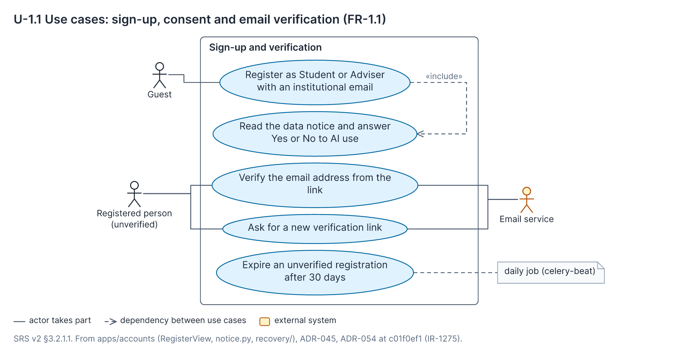
*Figure 1: Sign-up, Consent and Email Verification Use Case Diagram*

**Use Case Description**

Use Case M1-1.1: Register Account

| Use Case | Register Account |
| :---- | :---- |
| **Actors** | Guest (unregistered person) |
| **Description** | A person creates an IRIS account with an institutional email, chooses Student or Adviser, accepts the data notice and answers the AI question. |
| **Preconditions** | The person has an institutional email address not already registered. |
| **Main Flow** | 1. The person opens Sign up and enters their name, institutional email, password, role (Student or Adviser) and college, department or course. 2. The system shows the current data notice with a required Yes or No on AI use. 3. The person accepts the notice and answers. 4. The system validates the fields, the email domain and the password policy, creates an unverified account, and records the notice version, the AI answer and the time. 5. The system sends a verification email. |
| **Alternative Flow** | **Validation failure:** at step 4, if the email is not institutional or is already registered, the password is too weak, or a required field or answer is missing, the system shows field errors and creates no account. |
| **Postconditions** | An unverified account exists with its role, consent and AI answer recorded. A verification email has been queued. |

Use Case M1-1.2: Verify Email Address

| Use Case | Verify Email Address |
| :---- | :---- |
| **Actors** | Registered (unverified) person |
| **Description** | The person proves they own the email address by opening a time-limited link. |
| **Preconditions** | The person registered and received the verification email. |
| **Main Flow** | 1. The person opens the link. 2. The system checks that it is authentic, unused and not expired (`RECOVERY_VERIFICATION_TTL_SECONDS`, default 24 hours). 3. The system marks the account verified. 4. The person may sign in. |
| **Alternative Flow** | **Expired or used link:** the system says so and offers to send a new one (`/api/v1/auth/verification/resend/`). The response never says whether an address is registered. |
| **Postconditions** | The account is verified. |

**Activity Diagram**

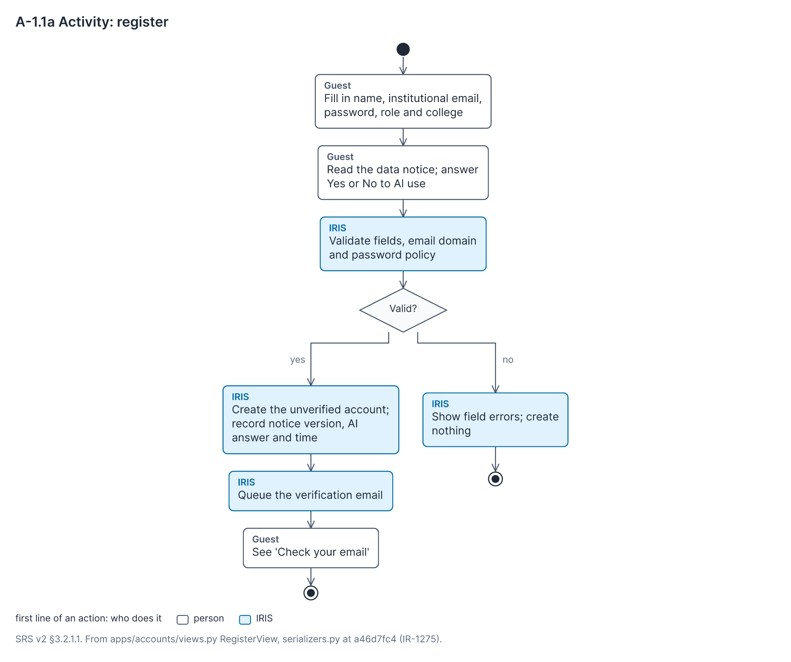
*Figure 2: Sub-Flow A – Register Activity Diagram*

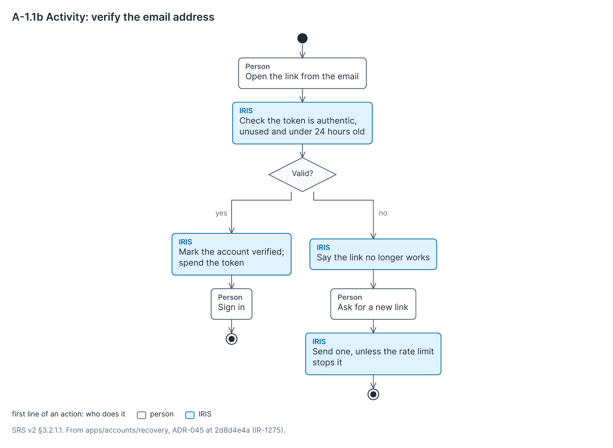
*Figure 3: Sub-Flow B – Verify the email address Activity Diagram*

**Wireframes**

Screens of a production build of this repository on a local machine, with `seed_demo` data (local build, not the live site).

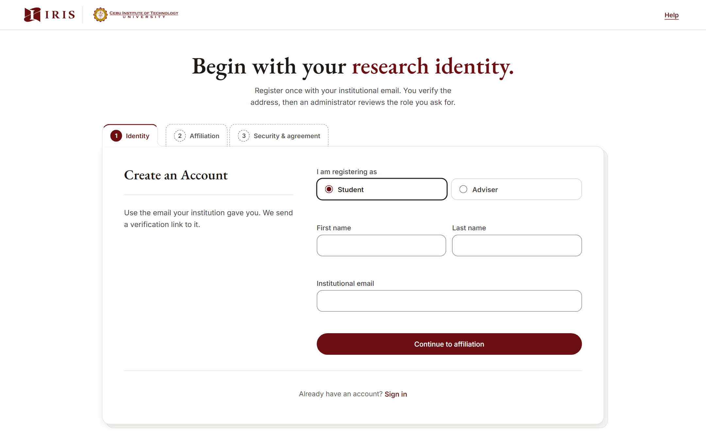
*Figure 4: Sign-up page (local build)*

#### 3.2.1.2 Sign In, Stay Signed In, Sign Out

**FR-ID: FR-1.2** · **Status: PARTIAL** (FR-M6-01; IR-1222) · Source: [ADR-072](adr/072-stay-signed-in-with-a-secure-cookie.md)

The system shall authenticate a verified person by email and password. It issues a 30-minute access token, kept in memory, and a refresh token in a secure HttpOnly cookie. The page refreshes the access token silently. Refresh rotates the token and blacklists the old one. A session ends after **30 minutes of inactivity**, enforced on the server (`SESSION_IDLE_TIMEOUT_MINUTES`, NFR-S2). A "Keep me signed in" box, off by default, keeps a session for 30 days from sign-in (`REMEMBERED_SESSION_DAYS`), outside the inactivity rule. Signing out revokes the session.

**Use Case Diagram**

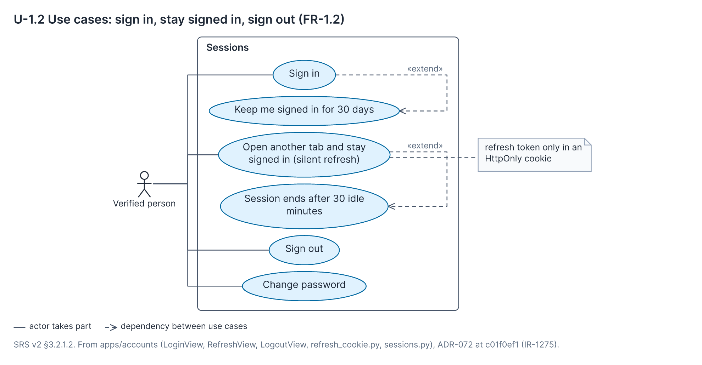
*Figure 5: Sign In, Stay Signed In, Sign Out Use Case Diagram*

**Use Case Description**

Use Case M1-2.1: Sign In

| Use Case | Sign In |
| :---- | :---- |
| **Actors** | Any registered, verified person |
| **Description** | The person starts a session and is taken to their workspace. |
| **Preconditions** | The account is verified and not locked. |
| **Main Flow** | 1. The person enters email and password, and may tick "Keep me signed in". 2. The system checks the credentials and the lockout and throttle limits (FR-1.3). 3. The system creates a session, returns an access token, and sets the refresh cookie. 4. The system records the sign-in in the audit log. 5. If the person has not answered the current data notice, they can only answer it, sign out or request deletion (ADR-054). Otherwise they land on their workspace. |
| **Alternative Flow** | **Wrong credentials:** a generic "Invalid email or password". **Locked or throttled:** the response names the lock and when the next attempt is allowed. **Unverified:** the person is told to verify and offered a new link. |
| **Postconditions** | A session exists. The refresh token is only in the HttpOnly cookie. |

Use Case M1-2.2: Stay Signed In Across Tabs (Silent Refresh)

| Use Case | Stay Signed In Across Tabs |
| :---- | :---- |
| **Actors** | Signed-in person |
| **Description** | A new tab, or a tab whose access token expired, gets a fresh token without asking the person to sign in. |
| **Preconditions** | The browser holds a valid refresh cookie. |
| **Main Flow** | 1. On load, or on a 401, the page calls `POST /api/v1/auth/token/refresh/`. The browser sends the cookie automatically. 2. The server checks the origin header, the session's inactivity and its expiry. 3. It issues a new access token and a rotated refresh cookie, and blacklists the old token. 4. The page retries the original request. |
| **Alternative Flow** | **No cookie:** `401 no_session`, and the page shows signed out with no error. **Idle or ended session:** `401 session_idle` or `session_ended_*`, and the page says the session ended and why. |
| **Postconditions** | The tab has a fresh access token. The old refresh token cannot be used again. |

Use Case M1-2.3: Sign Out

| Use Case | Sign Out |
| :---- | :---- |
| **Actors** | Signed-in person |
| **Description** | The person ends their session. |
| **Preconditions** | A session exists. |
| **Main Flow** | 1. The person chooses Sign out. 2. The server blacklists the refresh token, ends the session, clears the cookie and records the sign-out. 3. The page clears its memory and shows the sign-in screen. |
| **Alternative Flow** | **Already-ended session:** the server still answers success, and the page is cleared. |
| **Postconditions** | The session is ended and audited. |

Use Case M1-2.4: Change Password

| Use Case | Change Password |
| :---- | :---- |
| **Actors** | Signed-in person |
| **Description** | The person changes their password after confirming the current one. |
| **Preconditions** | A session exists. |
| **Main Flow** | 1. The person enters the current and new passwords. 2. The system checks the current password and the password policy. 3. It saves the new password, ends the person's other sessions, and records the change. 4. It emails the person that their password changed. |
| **Alternative Flow** | **Wrong current password or weak new password:** field errors; nothing changes. |
| **Postconditions** | The new password is in force. Other sessions are ended. |

**Activity Diagram**

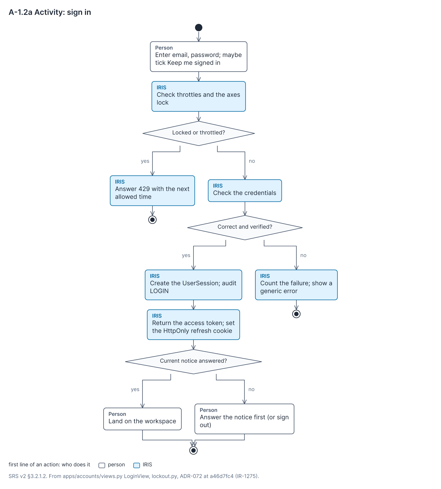
*Figure 6: Sub-Flow A – Sign in Activity Diagram*

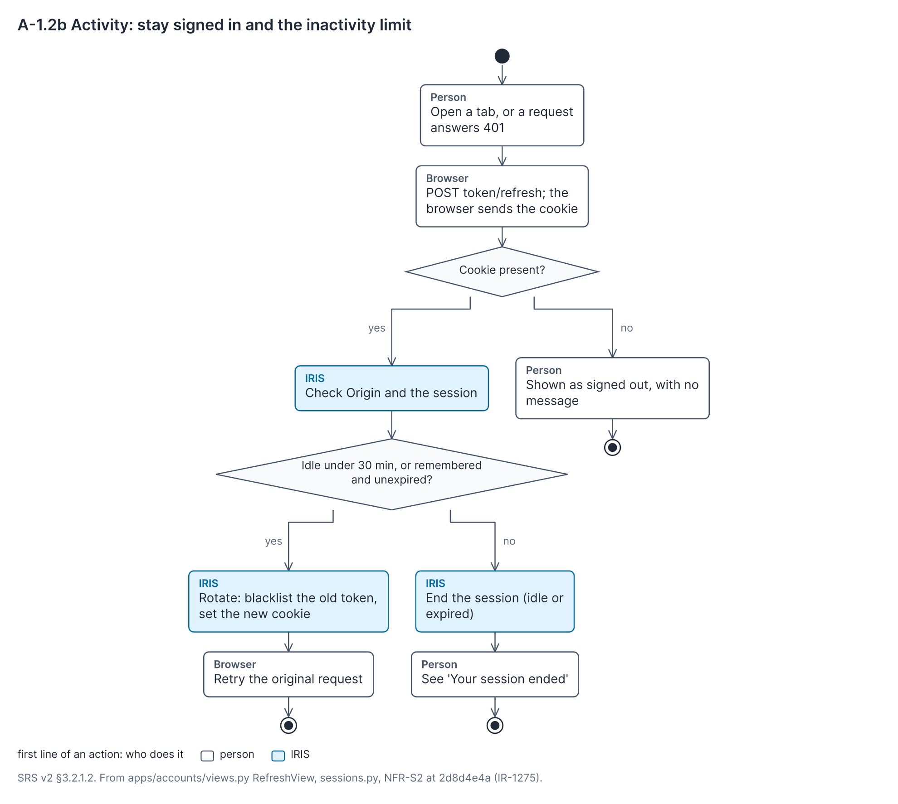
*Figure 7: Sub-Flow B – Stay signed in and the inactivity limit Activity Diagram*

**Wireframes**

Screens of a production build of this repository on a local machine, with `seed_demo` data (local build, not the live site).

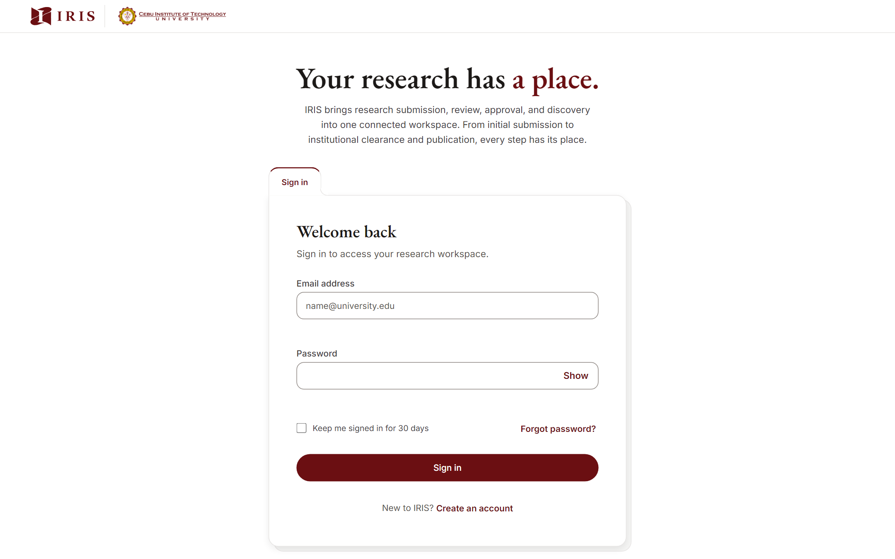
*Figure 8: Sign-in page (local build)*

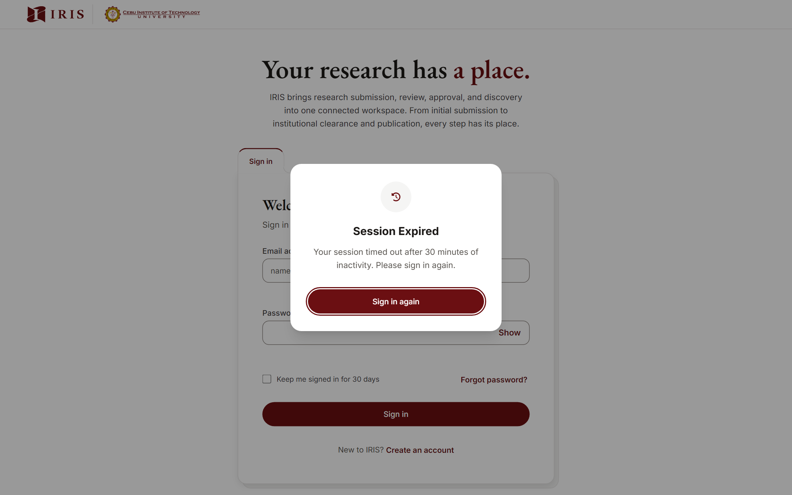
*Figure 9: Session ended after 30 idle minutes (local build)*

#### 3.2.1.3 Account Protection

**FR-ID: FR-1.3** · **Status: PARTIAL** (NFR-S6)

The system shall limit password guessing. django-axes locks an account and address pair after `AXES_FAILURE_LIMIT` consecutive failures for `AXES_COOLOFF_TIME_MINUTES` (both configurable; the defaults are in `config/settings/base.py`). A lockout answers 429 with the time of the next allowed attempt. DRF throttles limit sign-in attempts per address (`API_THROTTLE_LOGIN`, `API_THROTTLE_LOGIN_BURST`) and all requests per user and per anonymous address (`API_THROTTLE_USER`, `API_THROTTLE_ANON`). Exceeding a limit answers 429. Every limit is a setting, so it can change without a code change.

> **Known gap:** django-axes is **switched off by default** (`AXES_ENABLED=False`, IR-865). It must be turned on before launch. Until then only the sign-in throttle limits guessing (Appendix C).

**Use Case Diagram**

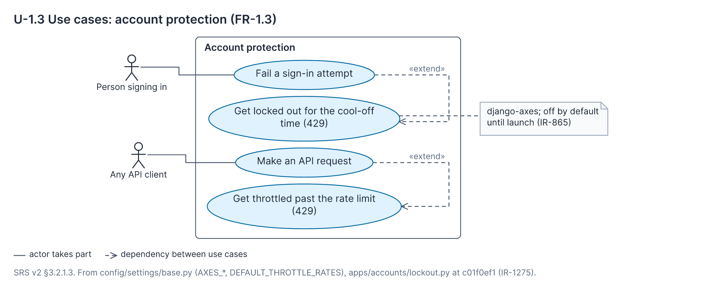
*Figure 10: Account Protection Use Case Diagram*

**Use Case Description**

Use Case M1-3.1: Lock Out Repeated Sign-in Failures

| Use Case | Lock Out Repeated Sign-in Failures |
| :---- | :---- |
| **Actors** | Person signing in |
| **Description** | IRIS slows down password guessing by limiting attempts and locking an account-and-address pair after repeated failures. |
| **Preconditions** | django-axes is enabled (AXES_ENABLED=True) for the lockout; throttles always apply. |
| **Main Flow** | 1. The person signs in with a wrong password. 2. IRIS counts the failure for this account and address and answers with a generic error that says how many attempts remain. 3. When failures reach AXES_FAILURE_LIMIT, IRIS locks the pair for AXES_COOLOFF_TIME_MINUTES and answers 429 with the time of the next allowed attempt. 4. The sign-in screen counts down to that time. |
| **Alternative Flow** | **Too many requests:** past a DRF throttle (per address, per user, or sign-in burst), IRIS answers 429 whatever the credentials. **Correct sign-in:** the failure count resets (AXES_RESET_ON_SUCCESS). |
| **Postconditions** | Guessing is limited; the account owner can sign in again after the cool-off. |

**Activity Diagram**

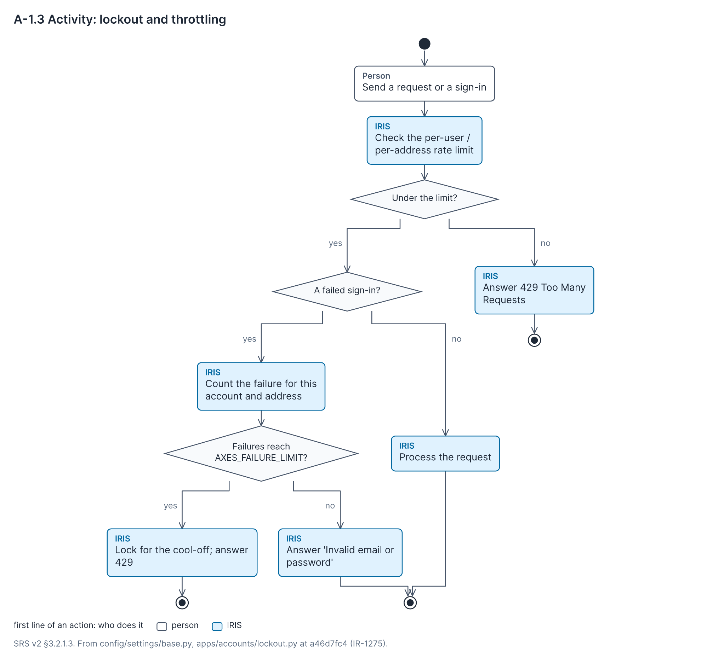
*Figure 11: Lockout and throttling Activity Diagram*

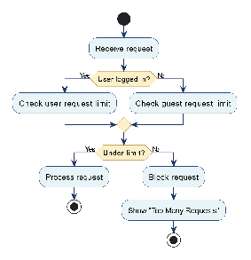
*Figure 12: Request throttle check activity diagram (v1, kept)*

**Wireframes**

Screens of a production build of this repository on a local machine, with `seed_demo` data (local build, not the live site).

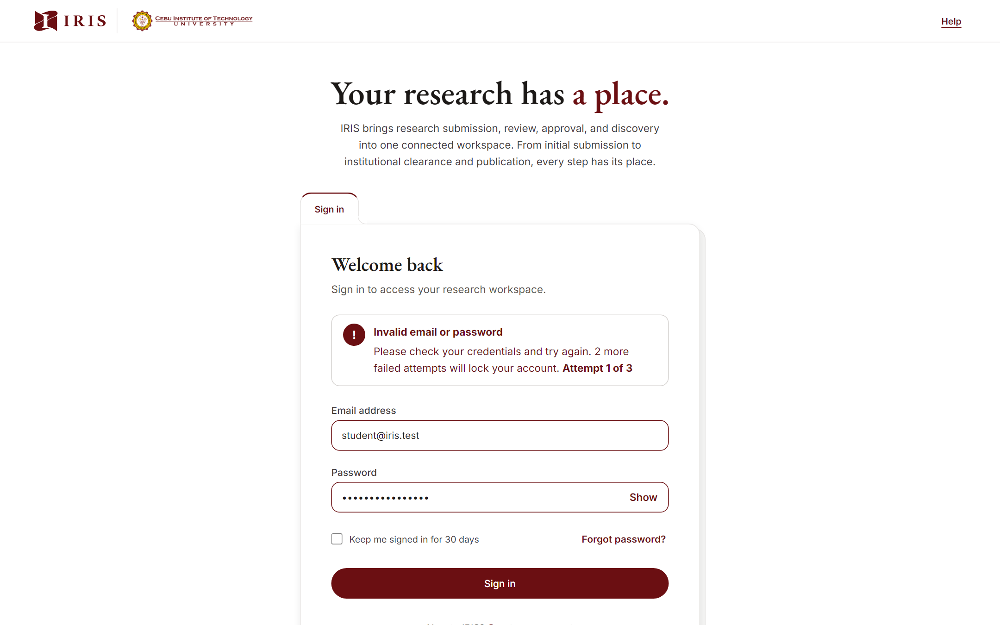
*Figure 13: Failed sign-in with the attempts left (local build)*

#### 3.2.1.4 Account Recovery

**FR-ID: FR-1.4** · **Status: VERIFIED** (IR-641) · Source: [ADR-045](adr/045-account-recovery-contract.md)

The system shall let a person reset a forgotten password by email. The reset link is single-use and time-limited (`RECOVERY_RESET_TTL_SECONDS`, default 30 minutes). Requests are rate-limited per address and per recipient. Responses never reveal whether an account exists. A successful reset ends every existing session.

**Use Case Diagram**

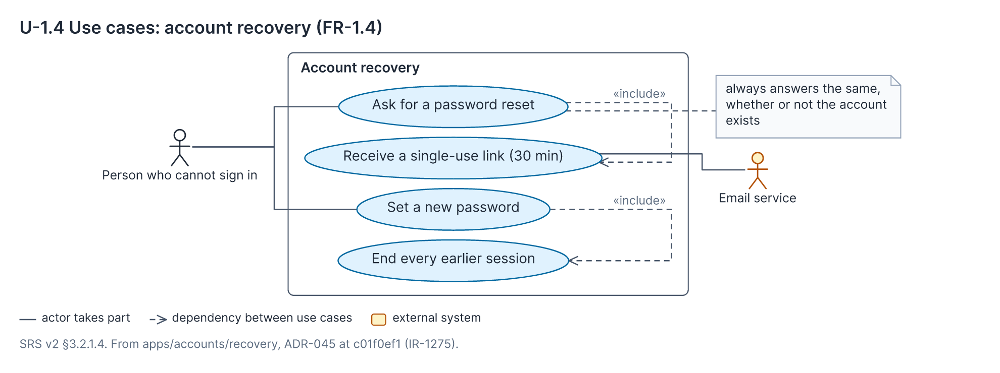
*Figure 14: Account Recovery Use Case Diagram*

**Use Case Description**

Use Case M1-4.1: Reset a Forgotten Password

| Use Case | Reset a Forgotten Password |
| :---- | :---- |
| **Actors** | Person who cannot sign in |
| **Description** | The person sets a new password through an emailed link. |
| **Preconditions** | None. |
| **Main Flow** | 1. The person opens "Forgot password" and enters their email. 2. The system always answers "If an account exists, we sent a link". 3. For an eligible account, it emails a single-use link. 4. The person opens the link and sets a new password that meets the policy. 5. The system saves it, invalidates the link and every existing session, and records the reset. |
| **Alternative Flow** | **Expired, used or tampered link:** the system says the link no longer works and offers a new one. **Too many requests:** further emails are suppressed silently, and the audit log records it. |
| **Postconditions** | The password is changed and every earlier session is ended. |

**Activity Diagram**

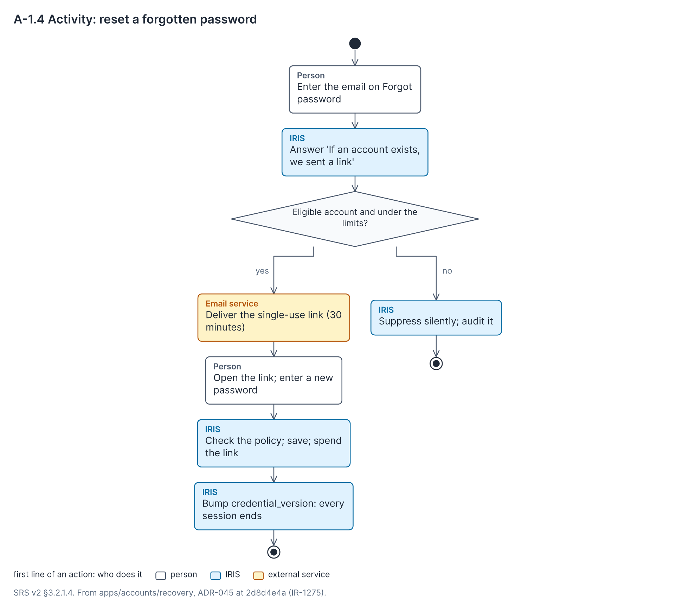
*Figure 15: Reset a forgotten password Activity Diagram*

**Wireframes**

Screens of a production build of this repository on a local machine, with `seed_demo` data (local build, not the live site).

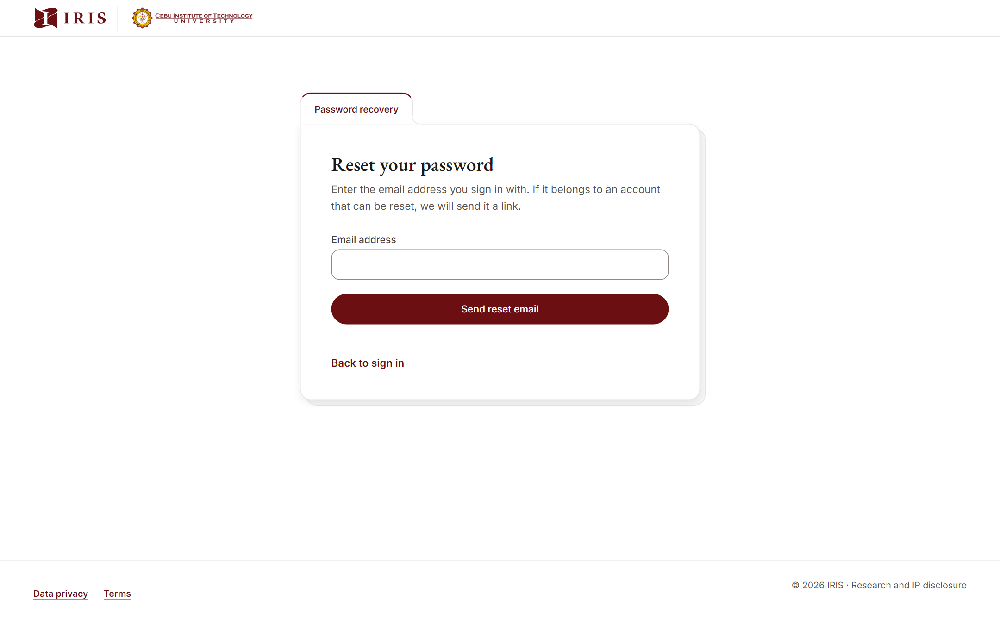
*Figure 16: Forgot password page (local build)*

#### 3.2.1.5 Roles, Role Requests and Office Coordinators

**FR-ID: FR-1.5** · **Status: IMPLEMENTED** (FR-M6-03 role-based access; IR-478) · Sources: [ADR-009](adr/009-authorization-model.md), [ADR-051](adr/051-system-admin-account-deletion-and-consent.md) decision 4 as amended

The system shall support **seven roles**: Student, Adviser, RDCO, KTTO, ITSO, IERC and System Admin (`core/enums.py` `RoleName`). Role checks are made on the server for every endpoint, whatever the frontend shows. Django's `is_staff` flag is not the permission model. RDCO gives the Student and Adviser roles, and only to people outside the offices. The System Admin alone gives the office roles (RDCO, KTTO, ITSO, IERC) and the **office coordinator** flag. Nobody can request or be granted the System Admin role through IRIS; the first such account is created with a server command.

**Use Case Diagram**

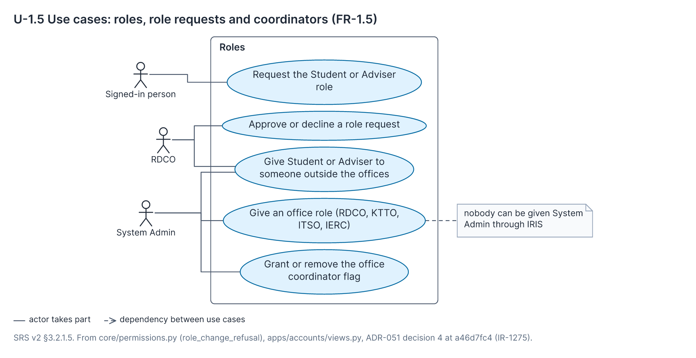
*Figure 17: Roles, Role Requests and Office Coordinators Use Case Diagram*

**Use Case Description**

Use Case M1-5.1: Request and Grant a Role

| Use Case | Request and Grant a Role |
| :---- | :---- |
| **Actors** | Registered person; RDCO |
| **Description** | A person asks for a Student or Adviser role and RDCO decides. |
| **Preconditions** | The person is verified. |
| **Main Flow** | 1. The person submits a role request. 2. RDCO sees it in its role-request queue, which updates live (FR-4.2). 3. RDCO approves or rejects it, with a reason for a rejection. 4. The system updates the role, notifies the person, and records the change. |
| **Alternative Flow** | **Office role asked of RDCO:** refused. Only the System Admin gives office roles. |
| **Postconditions** | The person has the new role, or knows why not. |

**Activity Diagram**

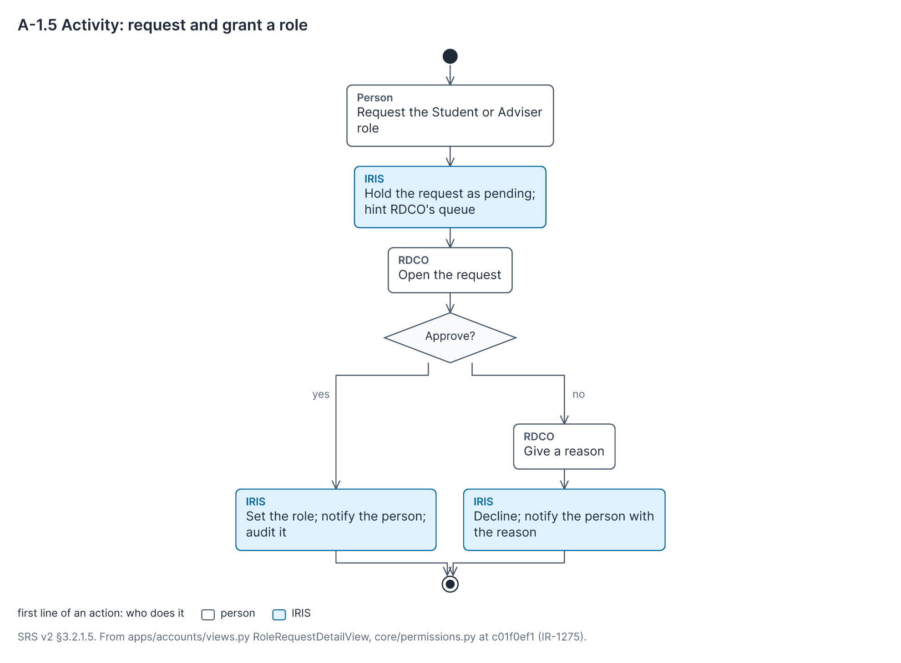
*Figure 18: Request and grant a role Activity Diagram*

**Wireframes**

Screens of a production build of this repository on a local machine, with `seed_demo` data (local build, not the live site).

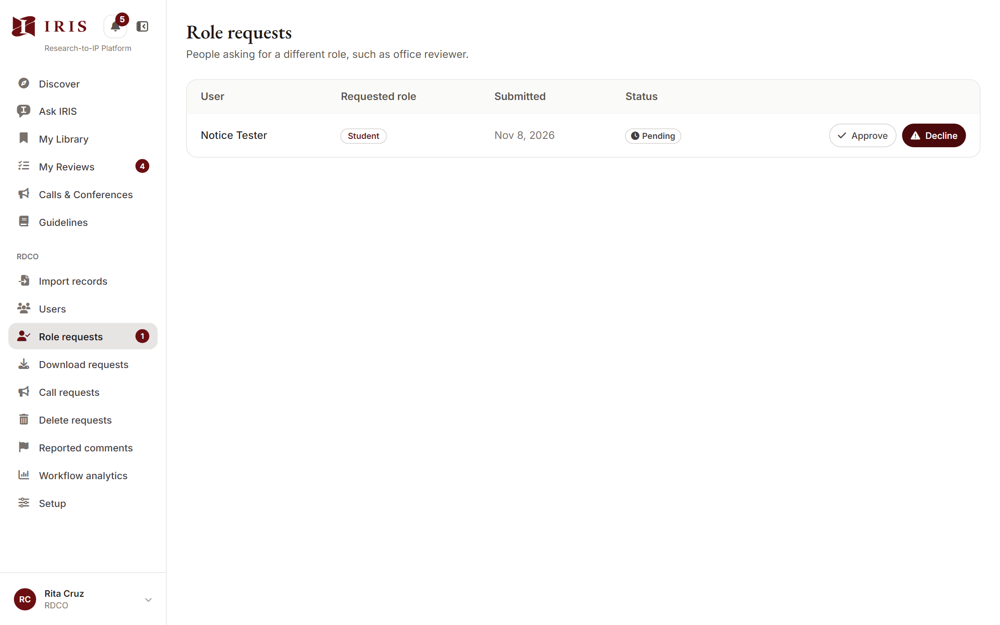
*Figure 19: Role requests (RDCO) (local build)*

#### 3.2.1.6 Account Administration

**FR-ID: FR-1.6** · **Status: IMPLEMENTED** (FR-M6-05) · Source: [ADR-051](adr/051-system-admin-account-deletion-and-consent.md)

The system shall let **RDCO** lock and unlock accounts and view and revoke active sessions. **RDCO and the System Admin** use the Users page and change roles within their own limits (FR-1.5). A locked person cannot sign in and is told the account is locked. Revoking a session blacklists its refresh token, so that person must sign in again. RDCO cannot lock the System Admin or revoke its sessions. Every act is recorded in the audit log.

**Use Case Diagram**

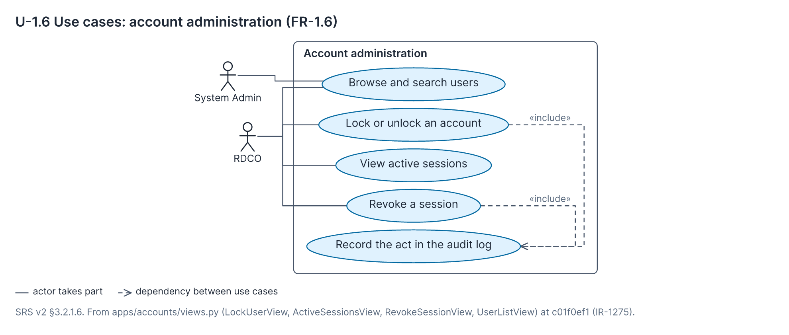
*Figure 20: Account Administration Use Case Diagram*

**Use Case Description**

Use Case M1-6.1: Revoke an Active Session

| Use Case | Revoke an Active Session |
| :---- | :---- |
| **Actors** | RDCO |
| **Description** | RDCO ends another person's session. |
| **Preconditions** | RDCO is signed in, and the session exists. |
| **Main Flow** | 1. RDCO opens Active sessions. 2. RDCO selects a session and confirms. 3. The system blacklists its token, ends the session with reason "Revoked by an administrator", and records the act. 4. The person's next request fails, and their page says why. |
| **Alternative Flow** | **Session already ended:** a not-found answer; nothing else happens. |
| **Postconditions** | The session is ended and audited. |

**Activity Diagram**

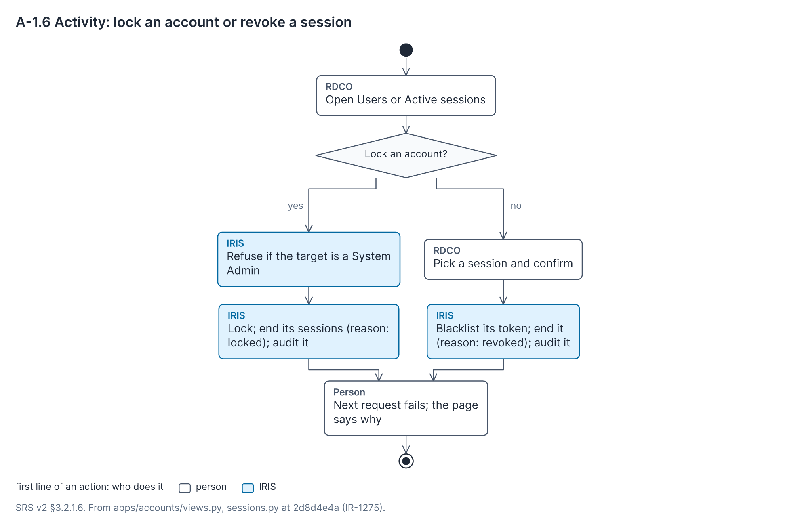
*Figure 21: Lock an account or revoke a session Activity Diagram*

**Wireframes**

Screens of a production build of this repository on a local machine, with `seed_demo` data (local build, not the live site).

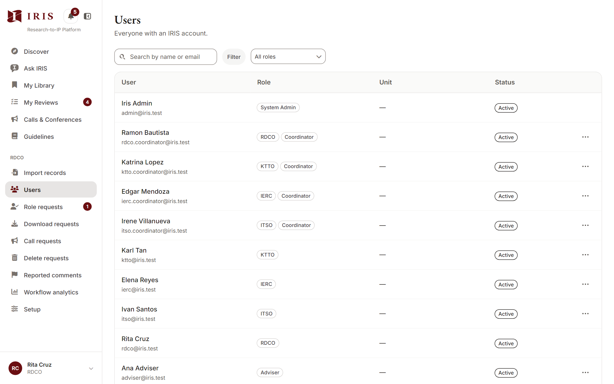
*Figure 22: Users page (RDCO) (local build)*

#### 3.2.1.7 Personal Data Rights: Export and Account Deletion

**FR-ID: FR-1.7** · **Status: PARTIAL** (IR-794, IR-795) · Source: [ADR-051](adr/051-system-admin-account-deletion-and-consent.md)

The system shall let a person **download their personal data** (`GET /api/v1/users/me/data/`) and **request deletion of their account** in Settings. A System Admin confirms or rejects the request, and a rejection needs a reason the person receives. Confirmation is refused while someone is waiting on that person, for example as the Adviser of a paper in review. The System Admin sees what blocks it, and RDCO, a coordinator or the person clears it. A daily job erases personal data past the retention period the System Admin sets; a blank period erases nothing. A person can also change their AI answer at any time in Settings (ADR-054).

**Use Case Diagram**

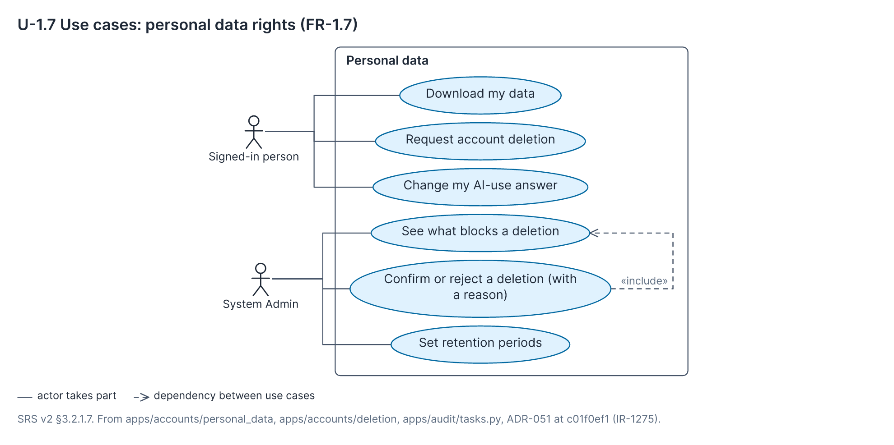
*Figure 23: Personal Data Rights: Export and Account Deletion Use Case Diagram*

**Use Case Description**

Use Case M1-7.1: Delete My Account

| Use Case | Delete My Account |
| :---- | :---- |
| **Actors** | Signed-in person; System Admin |
| **Description** | A person asks for their account to be deleted, and a System Admin confirms. |
| **Preconditions** | The person is signed in. |
| **Main Flow** | 1. The person requests deletion in Settings. 2. The System Admin sees the request and anything blocking it. 3. With nothing blocking, the System Admin confirms. 4. The system deletes the account's personal data, ends its sessions, and records the act. |
| **Alternative Flow** | **Blocked:** confirmation is refused and names each blocker. **Rejected:** the person receives the reason. |
| **Postconditions** | The account is deleted, or the person knows why not. |

**Activity Diagram**

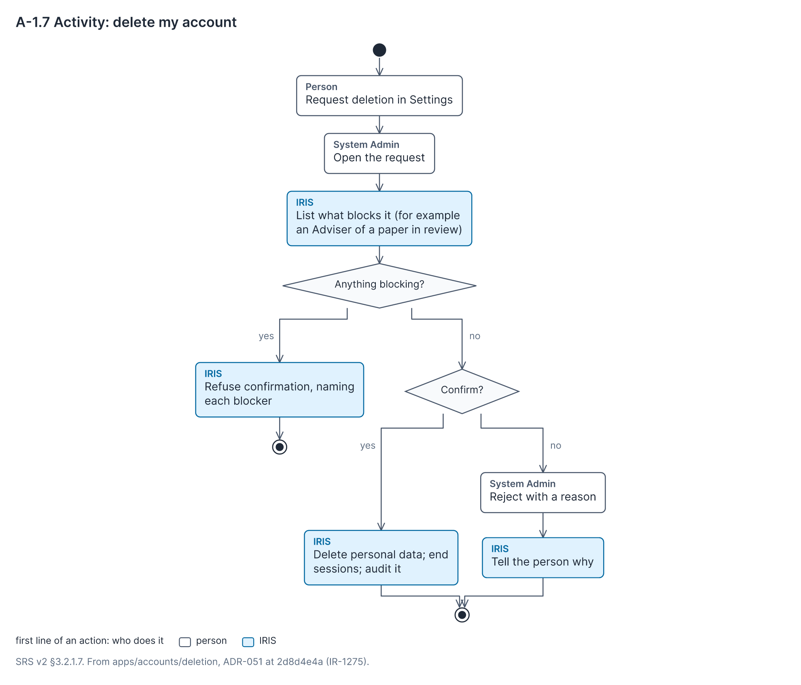
*Figure 24: Delete my account Activity Diagram*

**Wireframes**

Screens of a production build of this repository on a local machine, with `seed_demo` data (local build, not the live site).

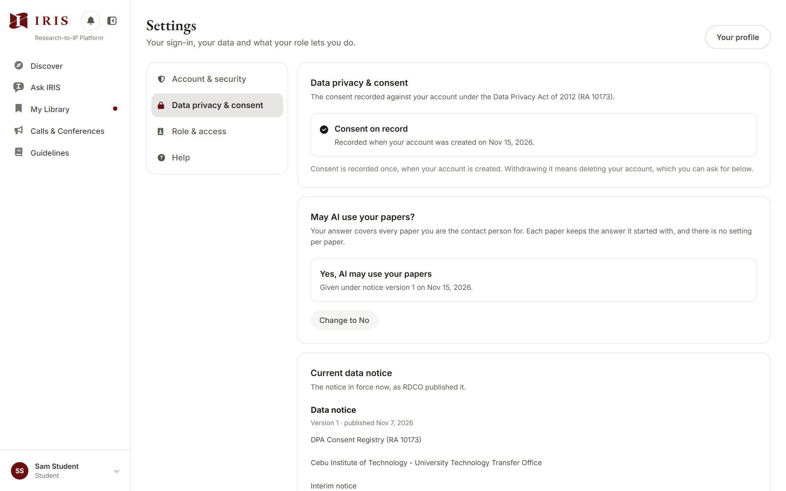
*Figure 25: Settings: data privacy and consent (local build)*

### Module 2: Records and Submission

This module covers creating and submitting records, their documents and Versions, access to the manuscript file, deletion, bulk import, and Discover.

#### 3.2.2.1 Publish a Record

**FR-ID: FR-2.1** · **Status: IMPLEMENTED** (FR-M2-01) · Sources: [ADR-032](adr/032-adviser-first-review-and-office-reviewer-pools.md), [ADR-046](adr/046-declared-research-origin-and-publication-metadata.md), [ADR-052](adr/052-each-paper-states-its-embargo-and-a-person-ends-it.md) as amended by IR-882, [ADR-054](adr/054-each-person-answers-whether-ai-may-use-their-papers.md)

The system shall provide a multi-step **Publish** form for Students and Advisers to create a record of one of three types: **Proposal**, **Thesis / Research** or **Project**. It collects the title, abstract, year, authors, co-owners (verified accounts only), a named **Adviser** (who **must not be an owner**: nobody reviews their own submission), the declared research origin and publication metadata, PSCED and classification, keywords, the manuscript PDF and the type's documents. A record starts as a `draft`, visible to its creator alone. On submission it becomes `in_review` with its Adviser.

* **Embargo.** Since IR-882, every paper starts **embargoed** and Publish asks no embargo question. Only the Adviser or RDCO may date or release an embargo (FR-5.3).
* **AI use.** Publish asks no consent question. A paper takes its Contact person's AI answer when its draft is created (ADR-054).

**Use Case Diagram**

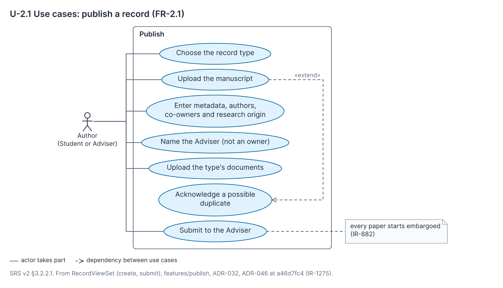
*Figure 26: Publish a Record Use Case Diagram*

**Use Case Description**

Use Case M2-1.1: Publish a Record

| Use Case | Publish a Record |
| :---- | :---- |
| **Actors** | Author (Student or Adviser) |
| **Description** | The author creates and submits a record for review. |
| **Preconditions** | The author is signed in, verified, and has answered the current data notice. |
| **Main Flow** | 1. The author opens Publish and chooses the record type. 2. The author uploads the manuscript; the upload is checked (FR-2.3). 3. The author enters the metadata, authors, co-owners and Adviser, and uploads the type's documents. 4. The author submits. 5. The system checks the Adviser is not an owner, writes Version 1, opens the Adviser's review assignment, notifies the Adviser, and records the submission. |
| **Alternative Flow** | **Adviser is an owner:** refused with a message. **A Required document missing:** allowed. The label never blocks submitting, and an office may ask for the document later (FR-3.5). **Possible duplicate manuscript:** the author is shown the matching readable records and must acknowledge them before continuing. |
| **Postconditions** | The record is `in_review`, Version 1 exists, and the Adviser is notified. |

**Activity Diagram**

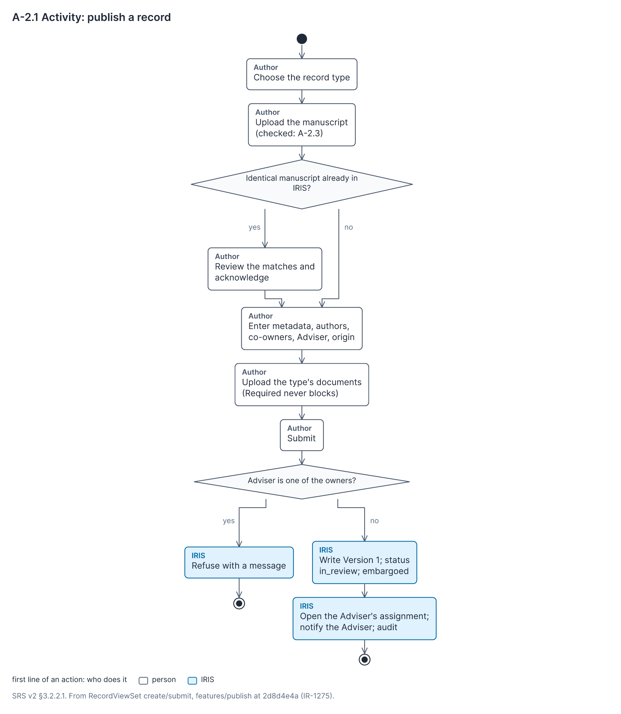
*Figure 27: Publish a record Activity Diagram*

**Wireframes**

Screens of a production build of this repository on a local machine, with `seed_demo` data (local build, not the live site).

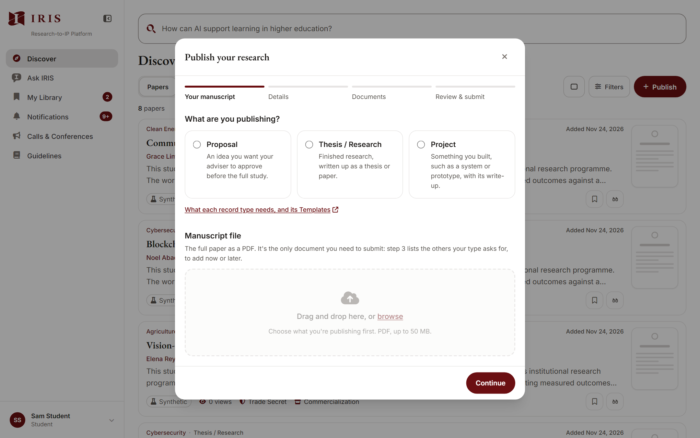
*Figure 28: Publish dialog (local build)*

#### 3.2.2.2 Required Documents and Templates

**FR-ID: FR-2.2** · **Status: IMPLEMENTED** (IR-971) · Source: [ADR-063](adr/063-rdco-sets-requirements-and-templates.md)

The system shall let **RDCO** add, edit, reorder and remove each record type's **requirements** (upload slots), labelled Required or Optional, each with a description and at most one current **Template**, in Setup. The Manuscript is always the first requirement and cannot be removed. Removing a requirement that holds uploads hides it but keeps the files. **Advisers** may share proposal templates with their advisees. The **Guidelines** page shows every type's requirements and templates to authors.

**Use Case Diagram**

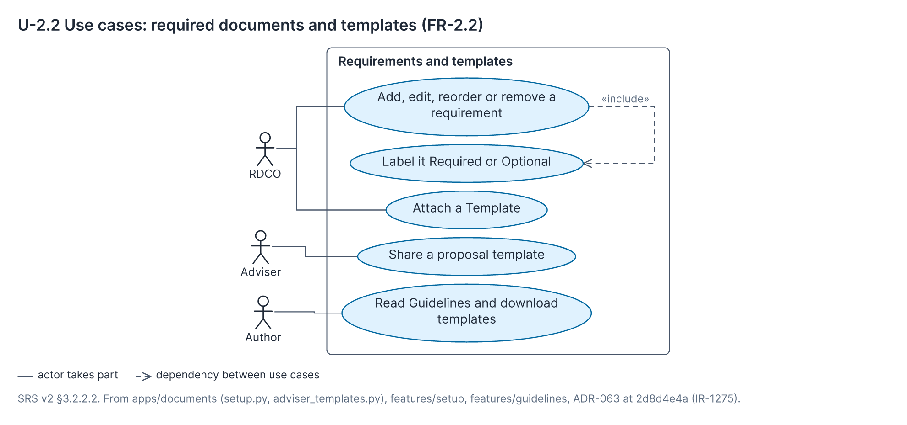
*Figure 29: Required Documents and Templates Use Case Diagram*

**Use Case Description**

Use Case M2-2.1: Set a Record Type's Requirements

| Use Case | Set a Record Type's Requirements |
| :---- | :---- |
| **Actors** | RDCO |
| **Description** | RDCO decides which documents each record type asks for, and attaches templates. |
| **Preconditions** | RDCO is signed in. |
| **Main Flow** | 1. RDCO opens Setup and picks Proposal, Thesis / Research or Project. 2. RDCO adds or edits a requirement: name, description, Required or Optional. 3. RDCO may upload a Template (checked and scanned like any upload). 4. RDCO reorders requirements. 5. IRIS saves; Guidelines and Publish show the change at once. |
| **Alternative Flow** | **Remove a requirement that holds uploads:** IRIS hides it and keeps the files on their papers. **Manuscript:** can be described and given a Template, but not removed or made Optional. |
| **Postconditions** | Authors see the current requirements and templates in Guidelines and Publish. |

**Activity Diagram**

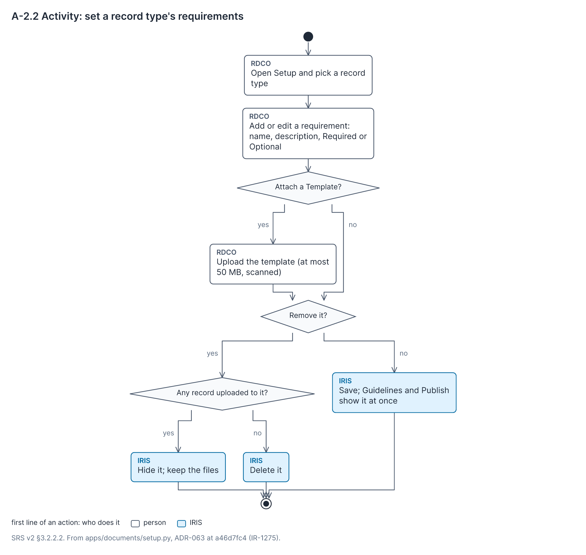
*Figure 30: Set a record type's requirements Activity Diagram*

**Wireframes**

Screens of a production build of this repository on a local machine, with `seed_demo` data (local build, not the live site).

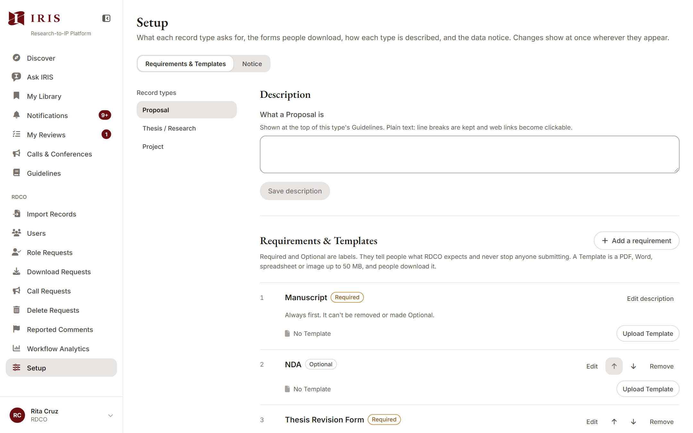
*Figure 31: Setup: requirements and templates (RDCO) (local build)*

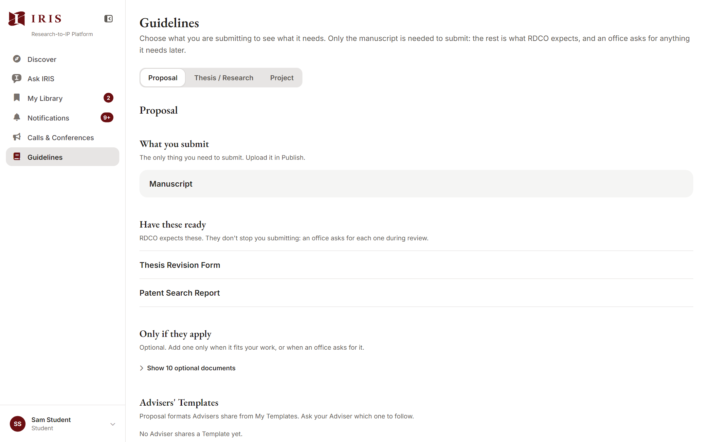
*Figure 32: Guidelines (local build)*

#### 3.2.2.3 Upload Checks

**FR-ID: FR-2.3** · **Status: IMPLEMENTED** (IR-665, IR-666) · Source: [ADR-074](adr/074-uploads-scanned-for-malware.md)

Every uploaded file shall be checked before it is stored:

1. **A PDF must really be one:** its bytes carry the PDF signature and it opens with at least one page (`documents/validators.py`).
2. **Size:** at most **50 MB** per PDF (`MAX_PDF_SIZE_BYTES`). nginx refuses a request body over 55 MB.
3. **Malware:** every file is streamed to **ClamAV** during the upload. A flagged file is refused with "This file was flagged as unsafe and was not uploaded", never stored, and the refusal is audited (its hash and signature name, never its bytes). **If ClamAV does not answer, the upload is refused.** In production, Django will not start without a scanner configured.
4. **Duplicates:** a manuscript identical to one already in IRIS is shown to the author before they continue (FR-2.1).

**Use Case Diagram**

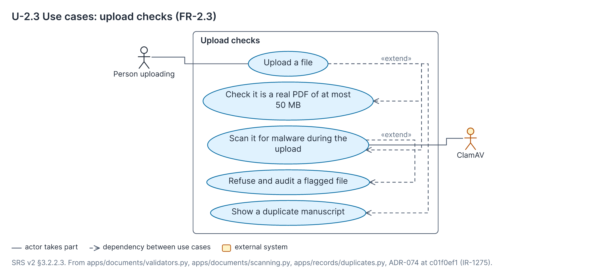
*Figure 33: Upload Checks Use Case Diagram*

**Use Case Description**

Use Case M2-3.1: Upload a Checked File

| Use Case | Upload a Checked File |
| :---- | :---- |
| **Actors** | Any person uploading (author, owner, reviewer, RDCO) |
| **Description** | Every file is checked before IRIS stores it. |
| **Preconditions** | The person may upload to this record or setting. |
| **Main Flow** | 1. The person chooses a file. 2. IRIS checks that a PDF really is one, with at least one page, at most 50 MB. 3. IRIS streams the bytes to ClamAV. 4. ClamAV answers clean. 5. IRIS stores the file and saves the row. |
| **Alternative Flow** | **Not a real PDF or too large:** refused with the reason. **Flagged by ClamAV:** refused with "This file was flagged as unsafe and was not uploaded"; nothing is stored; the refusal is audited. **Scanner down:** refused with "File checking is temporarily unavailable". |
| **Postconditions** | Only checked, clean files are stored. |

**Activity Diagram**

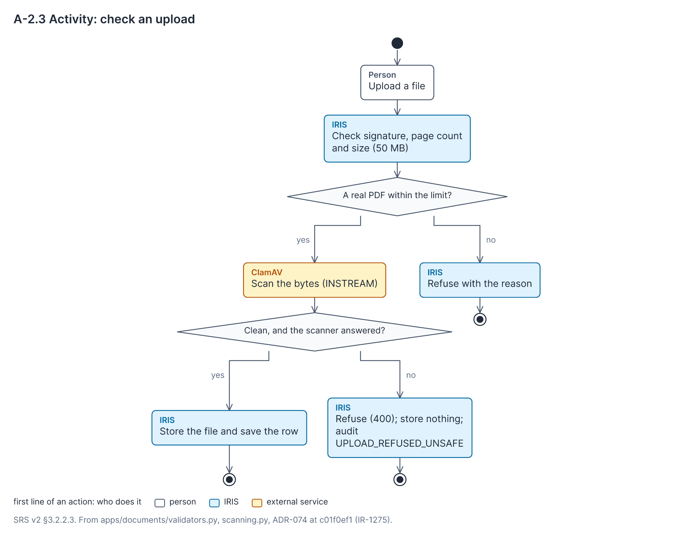
*Figure 34: Check an upload Activity Diagram*

**Wireframes**

Screens of a production build of this repository on a local machine, with `seed_demo` data (local build, not the live site).

*Figure 35: Publish dialog (local build)*

#### 3.2.2.4 Versions

**FR-ID: FR-2.4** · **Status: IMPLEMENTED** (IR-871) · Sources: [ADR-058](adr/058-each-version-keeps-its-text-and-its-files.md), [ADR-032](adr/032-adviser-first-review-and-office-reviewer-pools.md) §5–§6

Every submission and resubmission shall create a new **Version** of the same record. A Version keeps its own manuscript, its own documents and its own **review text**: a local read of the PDF with pdfplumber and no AI, made whatever the embargo or consent. Reviewers can compare two Versions section by section (IR-873, VERIFIED). A metadata-only Version names the previous Version's manuscript. An accepted Proposal can be **continued as** a Thesis / Research or Project, a new record linked to it (lineage).

**Use Case Diagram**

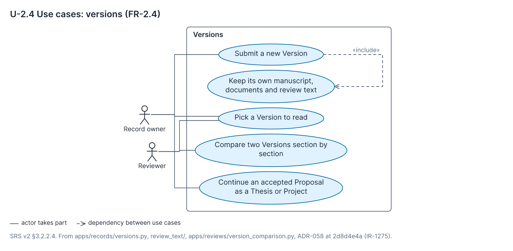
*Figure 36: Versions Use Case Diagram*

**Use Case Description**

Use Case M2-4.1: Compare Two Versions

| Use Case | Compare Two Versions |
| :---- | :---- |
| **Actors** | Reviewer |
| **Description** | A reviewer sees what changed between two Versions of a paper. |
| **Preconditions** | The record has at least two Versions and the reviewer may read it. |
| **Main Flow** | 1. The reviewer opens the paper's version menu and picks a Version. 2. IRIS serves that Version's manuscript and documents. 3. The reviewer opens the Changes tab and picks two Versions. 4. IRIS compares their review texts section by section and lists each section as unchanged, changed, added or removed. |
| **Alternative Flow** | **Review text not read yet:** IRIS reads it (locally, no AI) and the comparison appears when ready. |
| **Postconditions** | The reviewer reads only what changed. |

**Activity Diagram**

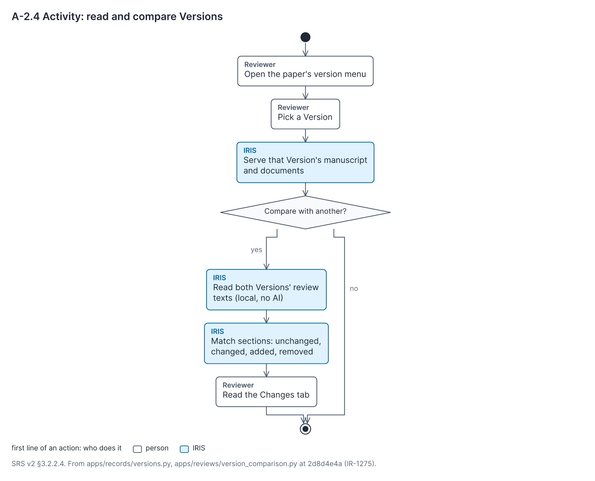
*Figure 37: Read and compare Versions Activity Diagram*

**Wireframes**

Screens of a production build of this repository on a local machine, with `seed_demo` data (local build, not the live site).

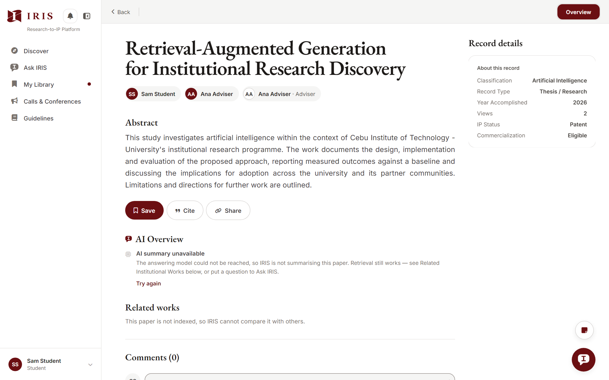
*Figure 38: Paper View with the in-browser reader (local build)*

#### 3.2.2.5 Download Requests and Watermarked Copies

**FR-ID: FR-2.5** · **Status: PARTIAL** (FR-M2-02/03; IR-676 PARTIAL) · Source: [ADR-048](adr/048-download-requests-and-watermarked-copies.md)

Reading a paper in the browser shall stay open to everyone the visibility rule admits. **Saving a copy of the manuscript needs an approved download request.** Owners, the Adviser, the four offices and assigned reviewers are exempt. RDCO alone approves, declines (with a note) or revokes. An approval is a time-limited grant (`DOWNLOAD_GRANT_DAYS`, default 30) to download while signed in; no link or token is emailed. **Every downloaded copy is watermarked** with who downloaded it and when (`records/watermark.py`), and the in-browser reader draws a faint mark with the reader's name on each page. Every download, cancellation and revocation is audited. The reader tracks their requests in My Library.

**Use Case Diagram**

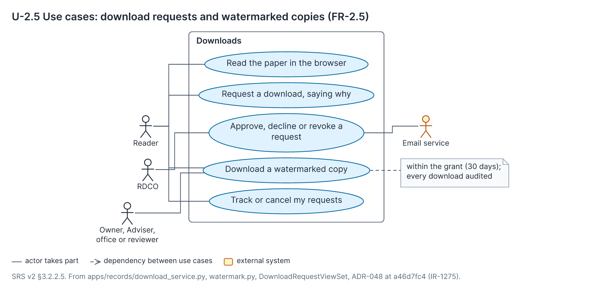
*Figure 39: Download Requests and Watermarked Copies Use Case Diagram*

**Use Case Description**

Use Case M2-5.1: Request a Download

| Use Case | Request a Download |
| :---- | :---- |
| **Actors** | Reader; RDCO |
| **Description** | A reader asks for, and RDCO grants, a downloadable copy. |
| **Preconditions** | The reader may see the record but is not exempt. They hold no pending request for it. |
| **Main Flow** | 1. The reader chooses Request download and writes why. 2. RDCO is notified in-app, and its queue updates live. 3. RDCO approves. 4. The reader is notified in-app and by email; the email links to the record, never to a file. 5. Within the grant, the reader downloads a watermarked copy as often as needed. Each download is audited. |
| **Alternative Flow** | **Declined:** the reader gets RDCO's note and may ask again. **Revoked or expired:** downloading is refused, and the reader may ask again. **Cancelled by the reader:** the request closes. |
| **Postconditions** | The grant and every download are recorded. Owners are never told who asked. |

**Activity Diagram**

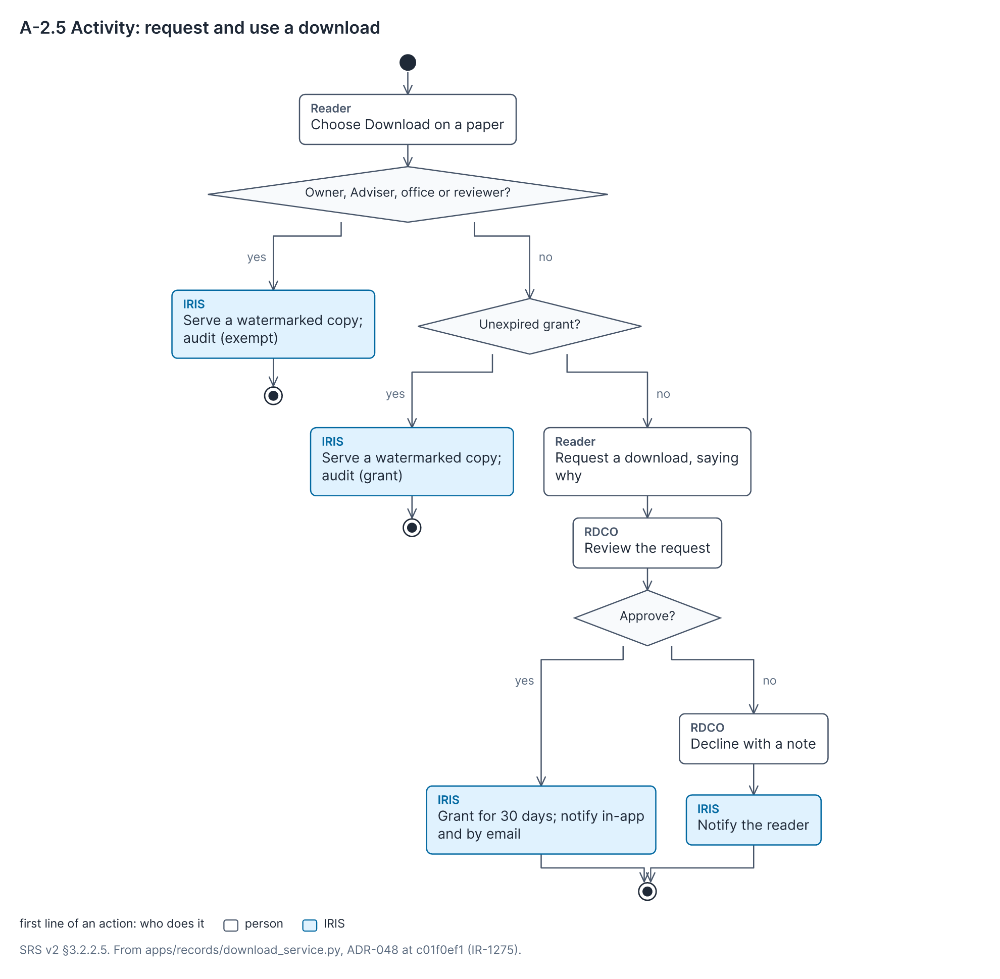
*Figure 40: Request and use a download Activity Diagram*

**Wireframes**

Screens of a production build of this repository on a local machine, with `seed_demo` data (local build, not the live site).

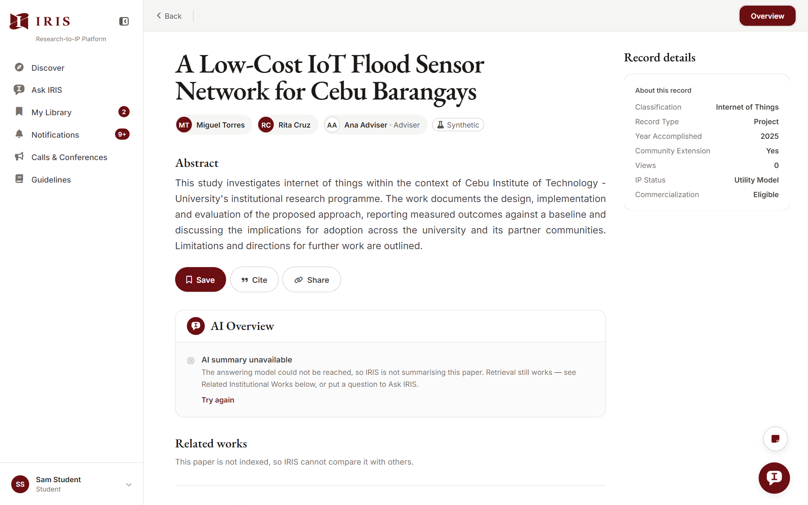
*Figure 41: Paper View: saving a copy needs a request (local build)*

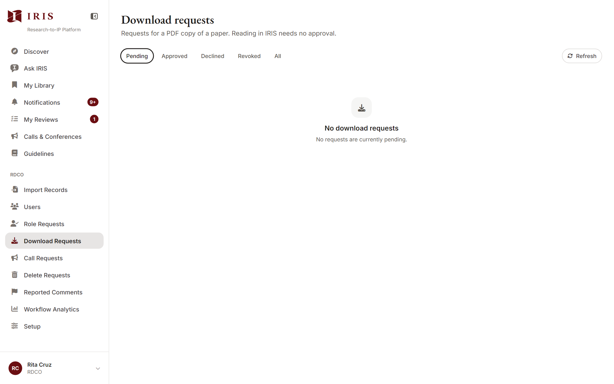
*Figure 42: Download requests (RDCO) (local build)*

#### 3.2.2.6 Delete Requests

**FR-ID: FR-2.6** · **Status: PARTIAL** (FR-M2-02/03)

The system shall let a record's owner ask for its deletion. The record moves to `pending_delete` and RDCO approves or declines the request, with a note. A declined request returns the record to its previous status. Deletion keeps the audit history. An unsubmitted draft is its creator's own and needs no request.

**Use Case Diagram**

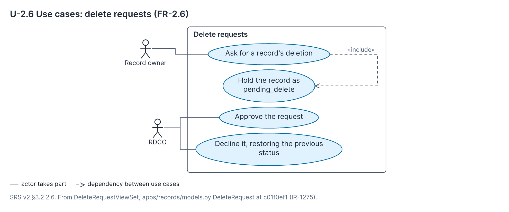
*Figure 43: Delete Requests Use Case Diagram*

**Use Case Description**

Use Case M2-6.1: Request a Record's Deletion

| Use Case | Request a Record's Deletion |
| :---- | :---- |
| **Actors** | Record owner; RDCO |
| **Description** | An owner asks for a submitted or published record to be removed, and RDCO decides. |
| **Preconditions** | The owner owns a record that is not a draft. |
| **Main Flow** | 1. The owner requests deletion with a reason. 2. IRIS keeps the record's previous status and sets pending_delete; RDCO's queue updates. 3. RDCO reviews the request. 4. RDCO approves. 5. IRIS deletes the record, keeping its audit history, and notifies the owner. |
| **Alternative Flow** | **RDCO declines (with a note):** IRIS restores the previous status and tells the owner why. **Draft:** the creator deletes it directly; no request is needed. |
| **Postconditions** | The record is gone, or back as it was, and the decision is audited. |

**Activity Diagram**

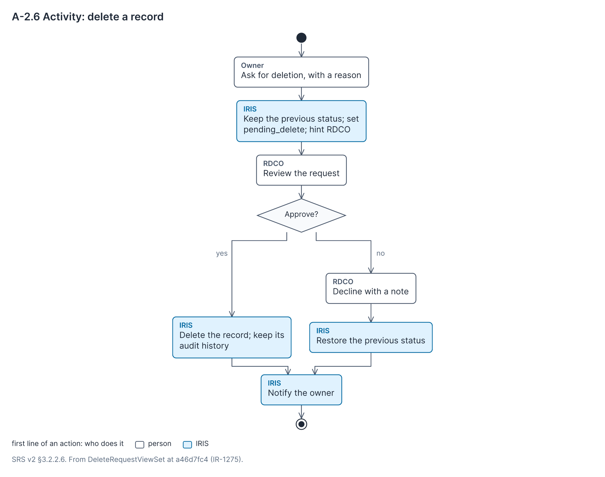
*Figure 44: Delete a record Activity Diagram*

**Wireframes**

Screens of a production build of this repository on a local machine, with `seed_demo` data (local build, not the live site).

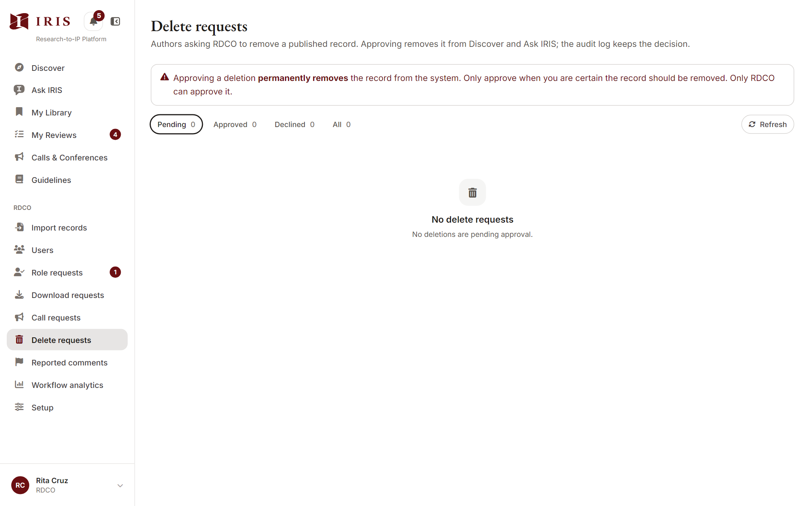
*Figure 45: Delete requests (RDCO) (local build)*

#### 3.2.2.7 Bulk Import from Excel

**FR-ID: FR-2.7** · **Status: IMPLEMENTED** (FR-M2-04; IR-639 VERIFIED)

Office staff shall be able to download a styled `.xlsx` template (the Import records page is shown to RDCO; the API admits any office staff, Appendix C) (`GET /api/v1/records/download_template/`) and upload an `.xls` or `.xlsx` workbook (`POST /api/v1/records/import_excel/`) to import legacy records. Each row is validated with the single-record rules and saved all-or-nothing with its owner and authors. A row with a value the system cannot accept is skipped and the response says why. The template uploaded unchanged imports nothing.

**Use Case Diagram**

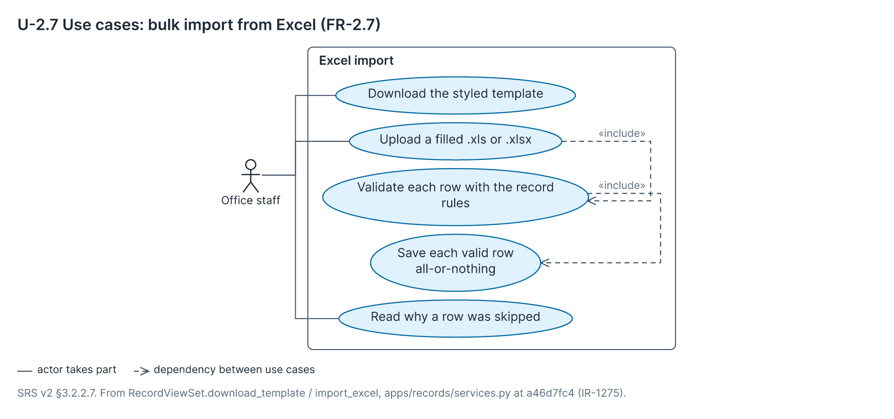
*Figure 46: Bulk Import from Excel Use Case Diagram*

**Use Case Description**

Use Case M2-7.1: Import Legacy Records

| Use Case | Import Legacy Records |
| :---- | :---- |
| **Actors** | RDCO (the Import page); the API admits any office staff |
| **Description** | Records finished before IRIS are imported in one batch from a spreadsheet. |
| **Preconditions** | The user is signed in with the right role. |
| **Main Flow** | 1. The user downloads the styled template. 2. The user fills one row per paper and uploads the workbook. 3. IRIS parses it and checks every row with the single-record rules. 4. IRIS saves each valid row's record, owner and authors together. 5. IRIS shows the import log. |
| **Alternative Flow** | **Unreadable file:** refused. **A value IRIS cannot accept:** that row is skipped and the log says why. **Template uploaded unchanged:** nothing is imported. |
| **Postconditions** | Valid rows are records; skipped rows are explained. |

**Activity Diagram**

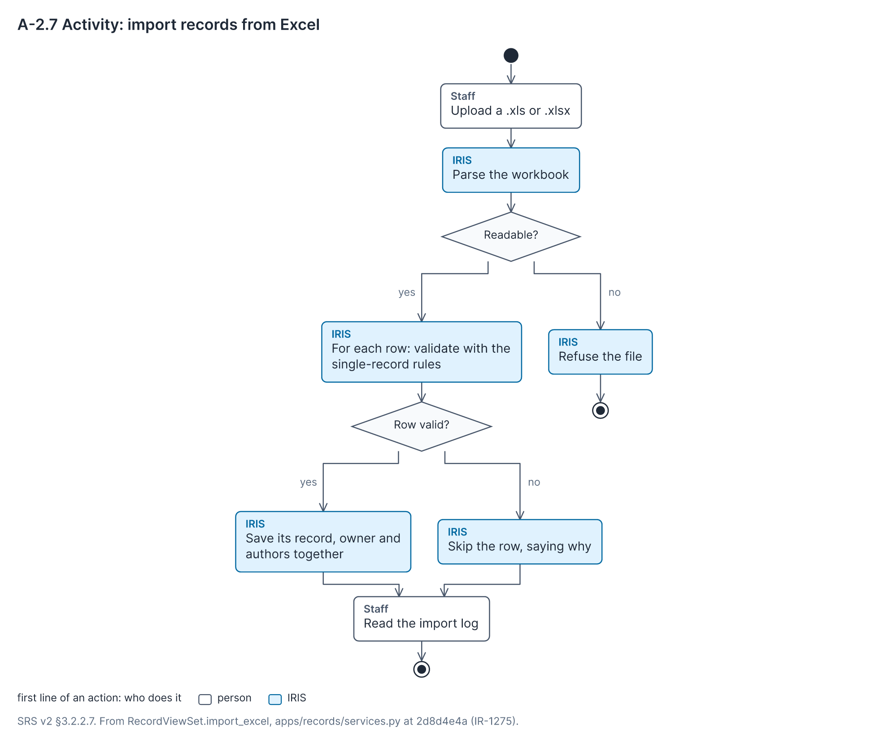
*Figure 47: Import records from Excel Activity Diagram*

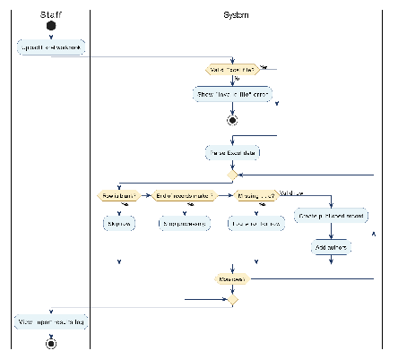
*Figure 48: Bulk import via Excel activity diagram (v1, kept)*

**Wireframes**

Screens of a production build of this repository on a local machine, with `seed_demo` data (local build, not the live site).

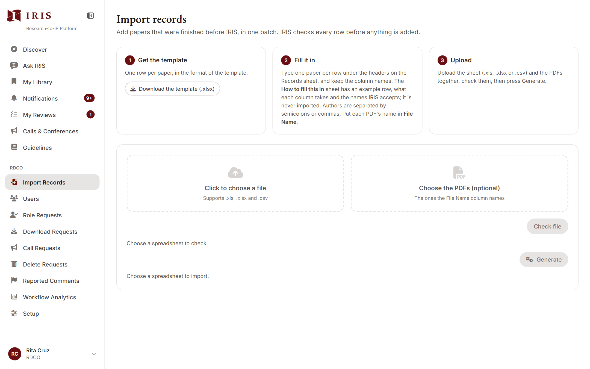
*Figure 49: Import records (RDCO) (local build)*

#### 3.2.2.8 Discover: Browse and Search Published Records

**FR-ID: FR-2.8** · **Status: PARTIAL** (FR-M3-02)

The system shall let any signed-in person browse published records and search them by keyword. Search uses a weighted PostgreSQL full-text index (title weight A, abstract weight B, GIN index) and ranks by relevance. Filters cover year, record type, classification, PSCED and IP type. A Sort control offers Best, Newest, Most viewed and Trending. A record opens on its **Paper View** page, with the in-browser reader. Paper View lists no documents for readers; attachments are sent only to those who may download them (IR-1244). A refusal or a missing record both answer **404**, so the API never confirms that someone else's unpublished record exists (NFR-S4).

**Use Case Diagram**

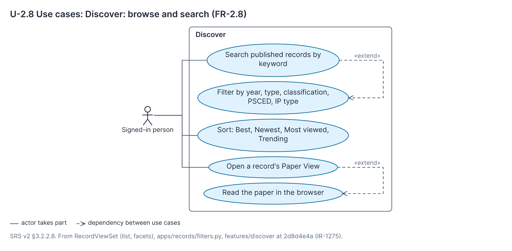
*Figure 50: Discover: Browse and Search Published Records Use Case Diagram*

**Use Case Description**

Use Case M2-8.1: Search Published Records

| Use Case | Search Published Records |
| :---- | :---- |
| **Actors** | Signed-in person |
| **Description** | A reader finds published research by keyword and filters. |
| **Preconditions** | The reader is signed in. |
| **Main Flow** | 1. The reader types keywords on Discover. 2. The reader picks filters (year, type, classification, PSCED, IP type) and a sort. 3. IRIS searches the weighted title-and-abstract index among published records the reader may see. 4. IRIS shows ranked results with counts. 5. The reader opens a record's Paper View and reads it in the browser. |
| **Alternative Flow** | **No results:** IRIS says so. **A record the reader may not see:** answers 404, the same as a missing record. |
| **Postconditions** | The reader has the records they were looking for. |

**Activity Diagram**

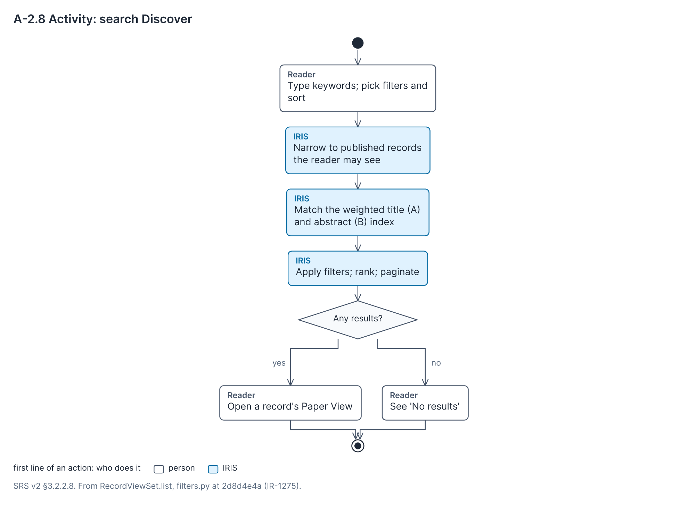
*Figure 51: Search Discover Activity Diagram*

*Figure 52: Keyword search activity diagram (v1, kept)*

**Wireframes**

Screens of a production build of this repository on a local machine, with `seed_demo` data (local build, not the live site).

*Figure 53: Discover (local build)*

### Module 3: Review Workflow (Thesis Core)

This module is the thesis's research contribution. v1's fixed route ("RDCO intake → IERC + KTTO → RDCO final") is **superseded** by ADR-021, ADR-032 and ADR-047: there is no intake stage, every record enters with its Adviser, and routing to offices is RDCO's decision.

*Figure 54: Record lifecycle and review states*

#### 3.2.3.1 Adviser-First Review

**FR-ID: FR-3.1** · **Status: IMPLEMENTED** (IR-271, IR-270) · Source: [ADR-032](adr/032-adviser-first-review-and-office-reviewer-pools.md) §1–§3, [ADR-047](adr/047-rdco-routes-and-decides-at-any-time.md) §1

Every record shall enter review with its Adviser.

* **Proposal:** the Adviser alone decides: **request revision**, **reject** (`rejected`, shown as *Archived*) or **accept** (`approved`, shown as *Accepted*). A Proposal is never routed to an office and never published.
* **Thesis / Research and Project:** the Adviser may **request revision**, **reject**, or **accept & send to RDCO**, with a required reason. Sending is not a Decision. It may nominate RDCO officers and suggest specialist offices, but the suggestion routes nothing. The Adviser's only Decision on these types is reject.
* A reject needs a reason, shown to the owners. Neither the Adviser's reject nor the send is allowed while a revision request is open.

**Use Case Diagram**

*Figure 55: Adviser-First Review Use Case Diagram*

**Use Case Description**

Use Case M3-1.1: Adviser Reviews a Thesis

| Use Case | Adviser Reviews a Thesis / Research or Project |
| :---- | :---- |
| **Actors** | Adviser |
| **Description** | The Adviser reviews the submission and decides what happens next. |
| **Preconditions** | The record is `in_review` and the Adviser holds its review. |
| **Main Flow** | 1. The Adviser opens the record from My Reviews (To review). 2. The Adviser reads the manuscript and may comment in threads (FR-3.6). 3. The Adviser chooses Accept & send to RDCO, gives a reason, and may nominate RDCO officers and tick suggested offices. 4. The system completes the Adviser's assignment, opens RDCO's assignment, notifies RDCO, and records the act. |
| **Alternative Flow** | **Request revision:** the owners are asked for a new Version (FR-3.4). **Reject:** with a reason, the record becomes `rejected` (*Archived*). |
| **Postconditions** | RDCO holds the record, or the owners have been asked to revise, or the record is archived. |

**Activity Diagram**

*Figure 56: The Adviser's review Activity Diagram*

**Wireframes**

Screens of a production build of this repository on a local machine, with `seed_demo` data (local build, not the live site).

*Figure 57: My Reviews (Adviser) (local build)*

*Figure 58: Review workspace (Adviser) (local build)*

#### 3.2.3.2 RDCO Routes and Decides at Any Time

**FR-ID: FR-3.2** · **Status: VERIFIED** (FR-M5-01) · Source: [ADR-047](adr/047-rdco-routes-and-decides-at-any-time.md)

From the Adviser's send onward, RDCO holds the record. The routing graph is:

| From | May request review from |
| --- | --- |
| Adviser (on accept) | RDCO only |
| RDCO | ITSO, IERC, KTTO |
| ITSO / IERC / KTTO | the other two specialist offices |

Every request carries a required reason and names an office (its Pool) or specific officers in it. One request may name several offices, so reviews start in parallel. A specialist office tells RDCO it is done by finishing, never by routing to it. **Only RDCO** may *accept & publish* (`published`), *keep unlisted* (`completed`, shown as *Unlisted*) or *reject* a Thesis / Research or Project. RDCO may decide **at any time**, even while offices are still reviewing or a revision request is open. The Decision dialog names each office still reviewing and each finding recorded, as a warning, not a block. A Decision withdraws every open assignment, Seat, document request and revision request, and records the Decision as the reason. Completed rounds keep their clearance. RDCO may later publish an Unlisted paper, and RDCO publishes only a paper whose embargo is released.

**Use Case Diagram**

*Figure 59: RDCO Routes and Decides at Any Time Use Case Diagram*

**Use Case Description**

Use Case M3-2.1: RDCO Routes to Offices

| Use Case | RDCO Routes to Offices |
| :---- | :---- |
| **Actors** | RDCO officer |
| **Description** | RDCO requests parallel specialist reviews. |
| **Preconditions** | RDCO holds the record in review. |
| **Main Flow** | 1. RDCO opens the record and sees the Adviser's and the author's suggested offices, each labelled with who made it. 2. RDCO picks one or more of ITSO, IERC and KTTO, optionally names officers, and gives a reason. 3. The system opens an assignment for each office (in its Pool or to the named officers), notifies them, and records the routing event. |
| **Alternative Flow** | **Office already holds the record:** it may be named only with specific officers; naming its Pool again opens nothing. |
| **Postconditions** | Each named office reviews in parallel. |

Use Case M3-2.2: RDCO Decides

| Use Case | RDCO Decides |
| :---- | :---- |
| **Actors** | RDCO officer holding a Seat |
| **Description** | RDCO ends the review by publishing, keeping unlisted or rejecting. |
| **Preconditions** | RDCO holds the record in review. |
| **Main Flow** | 1. RDCO chooses Publish, Keep unlisted or Reject (a reject needs a reason). 2. The dialog lists offices still reviewing and findings already recorded. 3. RDCO confirms. 4. The system records RDCO's Review, sets the status, withdraws open work with the Decision as the reason, notifies the owners once and each reviewer whose Seat closed, and records the act. 5. A published record appears in Discover. |
| **Alternative Flow** | **Embargo not released:** Publish is refused until the Adviser or RDCO releases it. **Stale page:** if the record changed since the page loaded, the act is refused with 409 and the page refreshes. |
| **Postconditions** | The record is `published`, `completed` (Unlisted) or `rejected` (Archived). |

**Activity Diagram**

*Figure 60: RDCO routes and decides Activity Diagram*

**Wireframes**

Screens of a production build of this repository on a local machine, with `seed_demo` data (local build, not the live site).

*Figure 61: RDCO's view of a record ready to decide, with its embargo card (local build)*

*Figure 62: RDCO's view while IERC and KTTO still review (local build)*

#### 3.2.3.3 Parallel Office Clearance

**FR-ID: FR-3.3** · **Status: VERIFIED** (FR-M5-01) · Sources: [ADR-018](adr/018-conditional-parallel-office-routing.md) as superseded by [ADR-032](adr/032-adviser-first-review-and-office-reviewer-pools.md) §4, [ADR-021](adr/021-reviewer-directed-routing.md)

Each routed office shall review in parallel, through its own **reviewer pool**. An office's assignment lands in its Pool; a member **claims** it, or a coordinator **assigns** or reassigns it, as a **Seat**. A reviewer may **add a colleague** from their own office. When the office completes, its **clearance** is recorded separately per office (`RecordClearance`, unique per record and office): `cleared`, or `not_cleared` for a recorded negative finding. Specialist offices never reject and never publish. Routing never resets a cleared clearance.

**Use Case Diagram**

*Figure 63: Parallel Office Clearance Use Case Diagram*

**Use Case Description**

Use Case M3-3.1: Review for an Office

| Use Case | Review for an Office |
| :---- | :---- |
| **Actors** | Office member; office coordinator |
| **Description** | A specialist office reviews a record RDCO routed to it. |
| **Preconditions** | RDCO (or another office) has requested this office. |
| **Main Flow** | 1. The record lands in the office's Pool. 2. A member claims it, or the coordinator assigns a reviewer. 3. The reviewer reads the paper, may add a colleague or request another office. 4. The reviewer clears it, or records a finding. 5. IRIS records the office's clearance, completes its assignment and tells RDCO. |
| **Alternative Flow** | **Needs a document:** the reviewer makes a document request (FR-3.5). **Needs changes:** the reviewer requests revision (FR-3.4). **Coordinator reassigns:** the Seat moves to another member. |
| **Postconditions** | The office's clearance is recorded on its own row. |

**Activity Diagram**

*Figure 64: An office's review Activity Diagram*

**Wireframes**

Screens of a production build of this repository on a local machine, with `seed_demo` data (local build, not the live site).

*Figure 65: IERC office console: ITSO and KTTO clearances kept from v1 (local build)*

#### 3.2.3.4 Clearance-Aware Resubmission

**FR-ID: FR-3.4** · **Status: VERIFIED** (FR-M5-01) · Sources: [ADR-003](adr/003-clearance-aware-resubmission.md), [ADR-004](adr/004-restart-all-comparison-mode.md)

**This is IRIS's primary research contribution.** When a reviewer requests revision, the owners answer every open revision request with one new Version. On that Version:

1. every open revision request is resolved as `resubmitted`;
2. **only the clearances of the parties that asked are reset** to `pending`; every other office's `cleared` clearance is **preserved**;
3. only the asking parties' reviewers return to `in_review`. An office still reviewing keeps its Seats, and if RDCO or the Adviser asked, only RDCO or the Adviser looks again;
4. nothing is deleted. Every round stays visible as a Version in the timeline.

A new Version is refused if nothing changed since the newest request, or if a *Must fix* thread from an asking party has no answer (*Addressed* or *Declined*). The sequence is drawn in Figure 68. The comparison policy **restart-all** (ADR-004), which resets every office, is available as a configuration (`WORKFLOW_TABLE`) for the thesis evaluation. The default is clearance-aware.

**Use Case Diagram**

*Figure 66: Clearance-Aware Resubmission Use Case Diagram*

**Use Case Description**

Use Case M3-4.1: Resubmit After a Revision Request

| Use Case | Resubmit After a Revision Request |
| :---- | :---- |
| **Actors** | Record owner; requesting reviewers |
| **Description** | The owner answers revision requests with a new Version, and only the asking parties review again. |
| **Preconditions** | The record is in review (`awaiting_resubmission`) with at least one open revision request. |
| **Main Flow** | 1. The owner sees each open request and its *Must fix* threads. 2. The owner answers each *Must fix* thread, and uploads a revised manuscript, documents, or edited details. 3. The owner submits the new Version. 4. The system writes the Version, freezes a response letter, resolves the requests, resets only the asking parties' clearances, reopens only their Seats, records which clearances were preserved, and notifies the asking reviewers. 5. A revised manuscript gets its own review text; it is read for AI only once the record is published (FR-5.1). |
| **Alternative Flow** | **Nothing changed:** refused with the reason. **Unanswered Must fix thread:** refused, naming it. **Owner discards the revised manuscript:** the record returns to its last submitted manuscript. |
| **Postconditions** | A new Version exists; the asking parties review it; every other clearance is unchanged. |

**Activity Diagram**

*Figure 67: Clearance-aware resubmission Activity Diagram*

*Figure 68: Clearance-Aware Resubmission Sequence (the thesis contribution)*

**Wireframes**

Screens of a production build of this repository on a local machine, with `seed_demo` data (local build, not the live site).

*Figure 69: Owner's review pane: who holds the paper and what waits (local build)*

*Figure 70: Review details: clearances kept across Versions (local build)*

#### 3.2.3.5 Explicit Document Requests

**FR-ID: FR-3.5** · **Status: IMPLEMENTED** (FR-M5-03) · Source: [ADR-022](adr/022-explicit-document-requests.md)

A reviewer who only needs a file shall create a **document request**, distinct from a revision request. The record stays in review (`awaiting_document`). No clearance resets, no assignment closes, and the owner does not resubmit. The owner uploads against the requested items, and the reviewer accepts or rejects each one with a reason. The requesting party's turnaround clock pauses while its own request is open (FR-3.7).

**Use Case Diagram**

*Figure 71: Explicit Document Requests Use Case Diagram*

**Use Case Description**

Use Case M3-5.1: Ask for a Missing Document

| Use Case | Ask for a Missing Document |
| :---- | :---- |
| **Actors** | Reviewer; record owner |
| **Description** | A reviewer asks for a file without sending the paper back for resubmission. |
| **Preconditions** | The reviewer holds an open review of the record. |
| **Main Flow** | 1. The reviewer picks the documents needed and writes a message. 2. IRIS opens the request, shows awaiting_document and pauses the reviewer's clock. 3. The owner is notified and uploads each item. 4. The reviewer accepts each item. 5. IRIS fulfils the request and restarts the clock. |
| **Alternative Flow** | **Reviewer rejects an item (with a reason):** the owner uploads again. **A Decision ends the review:** open requests are withdrawn. |
| **Postconditions** | The reviewer has the document; no clearance changed. |

**Activity Diagram**

*Figure 72: A document request Activity Diagram*

**Wireframes**

Screens of a production build of this repository on a local machine, with `seed_demo` data (local build, not the live site).

*Figure 73: My Library: documents requested of the author (local build)*

#### 3.2.3.6 Review Threads and Comments

**FR-ID: FR-3.6** · **Status: VERIFIED** (IR-877) · Source: [ADR-032](adr/032-adviser-first-review-and-office-reviewer-pools.md) §7

Reviewers shall discuss a Version in **threads** that may be anchored to a passage of the manuscript. A thread has a severity (*Must fix* or *Suggestion*). It is answered by the owner (*Addressed* or *Declined*), resolved, reopened, or closed by a Decision. Threads are re-placed on a new Version, and marked *Changed* or *Passage removed* where the text moved. Reviewers get saved replies, viewed marks and @mentions. Public comments on a published record are separate from review threads. A comment can be reported (spam, harassment, off-topic, other), and RDCO and the System Admin moderate reported comments.

**Use Case Diagram**

*Figure 74: Review Threads and Comments Use Case Diagram*

**Use Case Description**

Use Case M3-6.1: Discuss a Passage in a Thread

| Use Case | Discuss a Passage in a Thread |
| :---- | :---- |
| **Actors** | Reviewer; record owner |
| **Description** | Reviewers raise points on the manuscript, and the owner answers them. |
| **Preconditions** | The record is in review and the reviewer may read it. |
| **Main Flow** | 1. The reviewer selects a passage and opens a thread, marked Must fix or Suggestion. 2. IRIS notifies the owner and anyone mentioned. 3. The owner answers Addressed or Declined, with a note. 4. The reviewer resolves the thread. |
| **Alternative Flow** | **Not satisfied:** the reviewer reopens it. **A new Version:** IRIS places each thread on the new text and marks it changed or removed. **A Decision:** open threads close. |
| **Postconditions** | Each point and its answer are kept with the Version. |

**Activity Diagram**

*Figure 75: A review thread Activity Diagram*

**Wireframes**

Screens of a production build of this repository on a local machine, with `seed_demo` data (local build, not the live site).

*Figure 76: Owner's review pane: who holds the paper and what waits (local build)*

#### 3.2.3.7 Turnaround, Reminders and Escalation

**FR-ID: FR-3.7** · **Status: IMPLEMENTED** (IR-1216) · Source: [ADR-043](adr/043-review-turnaround-reminders-and-escalation.md)

Each party's assignment shall carry a **due date** computed from that party's turnaround in **working days**, minus an administrator-kept holiday table, in Manila time. Turnaround is off until set. The clock pauses while the party's own document request is open. A coordinator may extend a due date later, with a reason, and each extension is audited. In-app reminders go out 2 working days before and on the due date. On the first overdue working day the office's coordinators get an **escalation**, repeated every 5 working days. An Adviser gets reminders but no escalation, and the owner's status shows "Waiting on your Adviser · N days overdue". **A due date never decides, clears, rejects or routes anything.** My Reviews has To review, In review and Done tabs, sorting, and an "Overdue only" filter. Workflow analytics are RDCO's, at `/rdco/analytics`.

**Use Case Diagram**

*Figure 77: Turnaround, Reminders and Escalation Use Case Diagram*

**Use Case Description**

Use Case M3-7.1: Follow Due Dates

| Use Case | Follow Due Dates |
| :---- | :---- |
| **Actors** | Reviewer; office coordinator |
| **Description** | Reviews carry due dates in working days, with reminders and escalation. |
| **Preconditions** | A turnaround is set for the party. |
| **Main Flow** | 1. IRIS sets the assignment's due date when the party receives the record. 2. Two working days before, and on the due date, IRIS reminds the Seat holders (or the coordinators of an unclaimed Pool). 3. On the first overdue working day IRIS escalates to the office's coordinators, then every 5 working days. 4. The reviewer sees the due date in My Reviews and can filter Overdue only. |
| **Alternative Flow** | **Coordinator extends:** the due date moves later with a reason, audited, and the reminders re-arm. **Party's own document request open:** the clock pauses. **Adviser overdue:** no escalation; the owner's status says so. |
| **Postconditions** | Late reviews are visible; no date ever decides anything. |

**Activity Diagram**

*Figure 78: Reminders and escalation Activity Diagram*

**Wireframes**

Screens of a production build of this repository on a local machine, with `seed_demo` data (local build, not the live site).

*Figure 79: Workflow analytics (RDCO) (local build)*

#### 3.2.3.8 IP Type on Published Records

**FR-ID: FR-3.8** · **Status: IMPLEMENTED** (FR-M5-05)

Office staff shall be able to tag a record with an IP type: **Patent**, **Copyright**, **Trade Secret** or **Utility Model** (`IPType`). The type is shown on the record and filterable in Discover. An IP-marked paper is kept from AI until **KTTO** releases the mark (FR-5.3, ADR-052 decisions 11–12).

**Use Case Diagram**

*Figure 80: IP Type on Published Records Use Case Diagram*

**Use Case Description**

Use Case M3-8.1: Tag and Release IP

| Use Case | Tag and Release IP |
| :---- | :---- |
| **Actors** | Office staff; KTTO |
| **Description** | A record's IP type is recorded and, for an IP-marked paper, KTTO decides when it may reach AI. |
| **Preconditions** | The staff member may see the record. |
| **Main Flow** | 1. Office staff set the IP type (Patent, Copyright, Trade Secret, Utility Model). 2. IRIS marks the paper as IP and keeps it from AI. 3. KTTO releases the IP mark. 4. IRIS records and audits the release. |
| **Alternative Flow** | **Embargo still active or no consent:** the paper still does not reach AI (FR-5.3). |
| **Postconditions** | The IP type shows on the record and filters Discover. |

**Activity Diagram**

*Figure 81: Tag and release IP Activity Diagram*

**Wireframes**

Screens of a production build of this repository on a local machine, with `seed_demo` data (local build, not the live site).

*Figure 82: RDCO's view of a record ready to decide, with its embargo card (local build)*

### Module 4: Notifications

#### 3.2.4.1 In-App and Email Notifications

**FR-ID: FR-4.1** · **Status: PARTIAL** (IR-1075) · Source: [ADR-069](adr/069-notifications-know-when-their-task-closed.md)

The system shall notify the relevant people in-app at each workflow event, for example a review request or assignment, a revision or document request, a new Version, a Decision, a deadline reminder, a download, delete or role request and its outcome, and a mention. Some events are also emailed, such as a download decision and account recovery. A notification that asks the recipient to act is **resolved** when that task ends, whoever ended it. The server sends `resolved_at` and `resolved_label`, for example "Cleared by ITSO · no action needed". A resolved notification leaves the unread count. Every recipient of a notification naming a record is checked against the visibility rule.

**Use Case Diagram**

*Figure 83: In-App and Email Notifications Use Case Diagram*

**Use Case Description**

Use Case M4-1.1: Receive and Settle a Notification

| Use Case | Receive and Settle a Notification |
| :---- | :---- |
| **Actors** | Signed-in person |
| **Description** | People hear about workflow events that concern them, and see when a task they were asked to do has ended. |
| **Preconditions** | An act concerning the person has committed. |
| **Main Flow** | 1. IRIS creates a notification for each recipient the visibility rule admits. 2. For some events it also sends an email. 3. The person opens Notifications and follows the link. 4. When the task the notice asked for ends, IRIS marks it resolved with a label. |
| **Alternative Flow** | **Informational notice (a decision, a mention):** never resolves. **Mark all read:** clears the unread count. |
| **Postconditions** | The person knows what happened and what still needs them. |

**Activity Diagram**

*Figure 84: Notify and resolve Activity Diagram*

**Wireframes**

Screens of a production build of this repository on a local machine, with `seed_demo` data (local build, not the live site).

*Figure 85: Notifications, with answered requests marked (local build)*

#### 3.2.4.2 Live Updates

**FR-ID: FR-4.2** · **Status: PARTIAL** (IR-1213) · Source: [ADR-073](adr/073-live-updates-by-server-sent-hints.md)

Pages shall update themselves. Each tab holds one stream, `GET /api/v1/live/`. The server publishes **hints** that name what changed, never data, on channels it chooses from the account: the person's own channel, their offices' channels and their role's channel. A hint is published only after the change commits. On a hint, a reconnect or a return to the tab, the page refetches through the normal API. If Redis is down, the change still succeeds and pages refresh on the next manual load. This replaces v1's 30-second polling. There are no WebSockets.

**Use Case Diagram**

*Figure 86: Live Updates Use Case Diagram*

**Use Case Description**

Use Case M4-2.1: See a Page Update Itself

| Use Case | See a Page Update Itself |
| :---- | :---- |
| **Actors** | Signed-in person |
| **Description** | Queues and lists refresh when something changes, without reloading. |
| **Preconditions** | The person has IRIS open in a tab. |
| **Main Flow** | 1. The tab opens one hint stream. 2. Someone else's act commits. 3. IRIS publishes a hint naming what changed to the channels concerned. 4. The tab refetches the affected data through the normal API. |
| **Alternative Flow** | **Stream drops or the tab regains focus:** the tab reconnects and refetches. **Redis down:** the act still succeeds; the page updates on the next manual load. |
| **Postconditions** | The page shows current data, under the normal permission checks. |

**Activity Diagram**

*Figure 87: A live update Activity Diagram*

### Module 5: Indexing and AI (Thesis-Critical)

This module makes the library searchable by meaning and answerable by AI, within the disclosure gate.

#### 3.2.5.1 Extraction

**FR-ID: FR-5.1** · **Status: IMPLEMENTED** (FR-M3-01; the Unstructured cutover, IR-988, is PARTIAL) · Source: [ADR-067](adr/067-unstructured-replaces-llamaparse.md)

When a record is **published** (or a published record's embargo is released again), the system shall queue its manuscript's extraction on the `extraction` queue. If the disclosure gate allows it, the PDF is sent to the **Unstructured Platform API** (`hi_res`). It is the **only** extractor and there is **no fallback**. Docling and LlamaParse were tried and removed (ADR-016 → ADR-056 → ADR-067). Each read is admitted at a per-page price (`AI_ADMISSION_EXTRACTION_UNSTRUCTURED_USD_PER_PAGE`). Text, layout and tables are stored as a `PdfExtraction`. Figures are stored and served only through `GET /records/<id>/figures/<figure_id>/`, behind the visibility rule. A failed read is retried and can be retried by hand from Publish. With `DEBUG` off, Django refuses to start without the Unstructured key.

**Use Case Diagram**

*Figure 88: Extraction Use Case Diagram*

**Use Case Description**

Use Case M5-1.1: Extract a Published Manuscript

| Use Case | Extract a Published Manuscript |
| :---- | :---- |
| **Actors** | RDCO (publishes); IRIS |
| **Description** | A published paper's PDF is read into structured text for AI. |
| **Preconditions** | The record is published. |
| **Main Flow** | 1. RDCO publishes the paper. 2. IRIS queues the manuscript's extraction. 3. The disclosure gate allows it. 4. IRIS sends the PDF to Unstructured (hi_res), admitted against its per-page price. 5. IRIS stores the extraction and figures and queues chunking. |
| **Alternative Flow** | **Gate refuses:** nothing is sent. **Read fails:** the extraction is marked failed; the owner or RDCO retries it. |
| **Postconditions** | The paper's text is ready to chunk. |

**Activity Diagram**

*Figure 89: Extract a published manuscript Activity Diagram*

#### 3.2.5.2 Chunking and Embedding

**FR-ID: FR-5.2** · **Status: PARTIAL** (FR-M3-03) · Sources: [ADR-013](adr/013-chunk-level-rag-pipeline.md), [ADR-015](adr/015-voyage-embedding-and-reranking.md), [ADR-024](adr/024-embedding-path-bypasses-the-gateway.md), [ADR-007](adr/007-pgvector-vector-store.md)

After extraction, the system shall split the text into **chunks**, the retrievable unit. Chunking aims for 700 real `voyage-context-4` tokens (`AI_CHUNK_TARGET_TOKENS`) with a 2,000-token ceiling (`AI_CHUNK_MAX_TOKENS`), and counts the section-heading trail inside the target. A new chunk set replaces the old one atomically, and only changed chunks are re-embedded. Chunks are embedded with **Voyage `voyage-context-4`**, a contextualized model that sees each chunk with its siblings, into **1024-dimension** vectors. They are stored in **pgvector** with an HNSW cosine index on the `embedding` queue. Each record also has a title-and-abstract vector. Retrieval combines keyword and vector candidates and reorders them with **Voyage rerank**. Django embeds in-process through the `EmbeddingProvider` port, not through the AI gateway (ADR-024).

**Use Case Diagram**

*Figure 90: Chunking and Embedding Use Case Diagram*

**Use Case Description**

Use Case M5-2.1: Index a Paper's Passages

| Use Case | Index a Paper's Passages |
| :---- | :---- |
| **Actors** | IRIS (Celery workers) |
| **Description** | A paper's text is split into passages and embedded so it can be found by meaning. |
| **Preconditions** | An extraction is complete. |
| **Main Flow** | 1. IRIS chunks the text (700-token target, 2,000 ceiling) with its section trail. 2. IRIS swaps in the new chunk set atomically. 3. IRIS embeds the chunks whose text changed with Voyage voyage-context-4. 4. IRIS stores the vectors in pgvector (HNSW). 5. IRIS queues the AI Overview. |
| **Alternative Flow** | **Voyage unavailable:** the task retries; keyword search is unaffected. |
| **Postconditions** | The paper's passages are searchable by meaning. |

**Activity Diagram**

*Figure 91: Chunk and embed Activity Diagram*

#### 3.2.5.3 Disclosure Gate

**FR-ID: FR-5.3** · **Status: VERIFIED** (IR-1252; IR-882 and IR-791 IMPLEMENTED) · Sources: [ADR-052](adr/052-each-paper-states-its-embargo-and-a-person-ends-it.md) with its 2026-11-04 and 2026-11-21 amendments, [ADR-054](adr/054-each-person-answers-whether-ai-may-use-their-papers.md)

**No part of a paper shall reach any AI vendor or model** (Unstructured's read, Voyage's vectors and reranking, the AI Overview, paper briefs, figure and formula reading, and Ask IRIS and Paper Chat, including their counts, lists and title lookups) unless all of the following hold:

1. it is **published** and not deleted. A paper in review, or accepted but kept unlisted, reaches nothing, for every reader, its own authors and office staff included;
2. its **embargo is released by a person**: the Adviser or RDCO. A date is only a reminder, and never ends an embargo;
3. if it is **IP-marked**, **KTTO** has released the mark;
4. its **Contact person answered Yes** to AI use. The paper keeps the answer it had when its draft was created.

The gate is one module (`apps/ai/policy/disclosure.py`) consulted at every outbound call, and the AI runtime applies the same conditions to its reads. **Publishing** queues the paper's reading and indexing; releasing the embargo of an already-published paper queues it again. Since an embargo stops RDCO publishing, a published paper has always been released first. An embargo never unpublishes: a published paper put under embargo again stays in Discover, and the AI stops reading it until it is released. Asking about a paper whose owner said No says that the owner did not consent; an embargo is never named to a reader who may not see the paper. This replaces v1's claim that only "anonymized text" is sent.

**Use Case Diagram**

*Figure 92: Disclosure Gate Use Case Diagram*

**Use Case Description**

Use Case M5-3.1: Release an Embargo

| Use Case | Release an Embargo |
| :---- | :---- |
| **Actors** | Adviser or RDCO |
| **Description** | A person ends a paper's embargo so that RDCO may publish it, and so that, once published, it may be indexed for AI. |
| **Preconditions** | The paper is embargoed, and the actor is its Adviser or RDCO. |
| **Main Flow** | 1. The actor opens the paper and chooses Release embargo. 2. The system asks for confirmation, because a release cannot be undone. 3. The system records the release, who and when, and audits it. If the paper is already published, its indexing is queued; otherwise publishing queues it later. |
| **Alternative Flow** | **Student owner:** cannot release. **Embargo date reached:** IRIS reminds the owners and Adviser to review it, then every 5 working days; the paper stays embargoed. |
| **Postconditions** | The embargo is released. Once the paper is published, and if consent and the IP mark allow, it is indexed. |

**Activity Diagram**

*Figure 93: The disclosure gate Activity Diagram*

**Wireframes**

Screens of a production build of this repository on a local machine, with `seed_demo` data (local build, not the live site).

*Figure 94: RDCO's view of a record ready to decide, with its embargo card (local build)*

#### 3.2.5.4 Ask IRIS

**FR-ID: FR-5.4** · **Status: PARTIAL** (FR-M4-01; IR-957) · Sources: [ADR-049](adr/049-dedicated-ai-runtime-and-local-research.md), [ADR-019](adr/019-persisted-unified-conversation-history.md), [ADR-034](adr/034-ungrounded-answers-as-a-distinct-state.md) (proposed)

The system shall let a signed-in person ask questions about the library in a conversation (`/ai`). Each answer cites the passages it rests on, and opens the paper at the cited page. **Citations only ever point at passages the reader may read**: retrieval applies the same visibility rule as the rest of IRIS. The question is answered by the **AI runtime**. Django issues a reader grant, and the run is queued in PostgreSQL (`iris_ai` schema) and claimed by `ai-runs-worker`. A bounded agent loop uses read-only research tools: search that combines keyword, paper-level and passage-level vector search; opening a passage; reading a manuscript in order; resolving a named paper; and exact record counts. Answers **stream**. A reconnecting page resumes from a cursor, and a stopped, expired or failed run can be retried. Conversations are kept per account and can be pinned, renamed and deleted (one ⋯ menu, IR-1253). Django's earlier answer path answers 410 Gone; earlier Django conversations stay readable, read-only.

**Use Case Diagram**

*Figure 95: Ask IRIS Use Case Diagram*

**Use Case Description**

Use Case M5-4.1: Ask a Question

| Use Case | Ask a Question |
| :---- | :---- |
| **Actors** | Signed-in person |
| **Description** | The person asks a question and receives a cited, streamed answer. |
| **Preconditions** | The person is signed in and has answered the current notice. |
| **Main Flow** | 1. The person types a question in Ask IRIS. 2. The browser asks nginx's runtime edge; nginx gets a reader grant from Django and forwards the run to `ai-gateway`. 3. The run is stored as queued and a worker is woken. 4. The worker searches and reads passages the reader may read, drafts an answer, checks every cited sentence against its source, and repairs a failing draft once. 5. The answer streams to the page with citations. 6. The Turn and its citations are stored in the conversation. |
| **Alternative Flow** | **Nothing found:** the answer says so and gives no made-up content. **AI unavailable or busy:** the page says so (FR-5.7) and the person may retry. **Page closed mid-answer:** the run continues; reopening resumes from the cursor. **Source changed during the run:** the run stops rather than cite a replaced passage. |
| **Postconditions** | The conversation holds the question and the cited answer. |

**Activity Diagram**

*Figure 96: Answer an Ask IRIS question Activity Diagram*

**Wireframes**

Screens of a production build of this repository on a local machine, with `seed_demo` data (local build, not the live site).

*Figure 97: Ask IRIS (AI runtime not running locally) (local build)*

#### 3.2.5.5 Paper Chat

**FR-ID: FR-5.5** · **Status: PARTIAL** (FR-M4-01; IR-957) · Sources: [ADR-019](adr/019-persisted-unified-conversation-history.md), [ADR-049](adr/049-dedicated-ai-runtime-and-local-research.md)

From a paper's page, a reader shall be able to ask questions about **that paper only**. This is Ask IRIS with its reader grant scoped to one record. It uses the same runtime, citations and conversation history. A paper outside the disclosure gate (including any paper not yet published) offers no Paper Chat, and says why when the reason is consent.

**Use Case Diagram**

*Figure 98: Paper Chat Use Case Diagram*

**Use Case Description**

Use Case M5-5.1: Ask About One Paper

| Use Case | Ask About One Paper |
| :---- | :---- |
| **Actors** | Reader |
| **Description** | A reader asks questions answered only from the paper they are reading. |
| **Preconditions** | The paper is published and passes the gate; the reader may read it. |
| **Main Flow** | 1. The reader opens Paper Chat on the paper. 2. IRIS issues a grant scoped to this record. 3. The reader asks a question. 4. The AI runtime answers from this paper's passages, with citations. |
| **Alternative Flow** | **Owner did not consent:** IRIS says why and offers no chat. **Not published:** no chat. |
| **Postconditions** | The answer cites only this paper. |

**Activity Diagram**

*Figure 99: Paper Chat Activity Diagram*

**Wireframes**

Screens of a production build of this repository on a local machine, with `seed_demo` data (local build, not the live site).

*Figure 100: Paper View with the in-browser reader (local build)*

#### 3.2.5.6 AI Overview

**FR-ID: FR-5.6** · **Status: IMPLEMENTED** (FR-M4-02) · Source: [ADR-020](adr/020-per-record-assessment-brief.md)

Each published paper the gate admits shall have a **stored, cited summary** (`RecordOverview`), generated once on the `embedding` queue after its passages are embedded, and regenerated when the manuscript changes. v1 said summaries were generated on demand and never stored. A paper outside the gate shows why no Overview is available, without naming an embargo to a reader who may not see it. Reviewers also get a per-record **paper brief** for decision support at intake.

**Use Case Diagram**

*Figure 101: AI Overview Use Case Diagram*

**Use Case Description**

Use Case M5-6.1: Read a Paper's AI Overview

| Use Case | Read a Paper's AI Overview |
| :---- | :---- |
| **Actors** | Reader |
| **Description** | Each indexed paper has a stored, cited summary. |
| **Preconditions** | The paper is published and indexed. |
| **Main Flow** | 1. Indexing finishes. 2. IRIS writes a cited summary from the passages and stores it. 3. The reader opens the paper. 4. IRIS shows the overview with its citations. |
| **Alternative Flow** | **No overview yet, or AI unavailable:** IRIS says it is unavailable. **Owner did not consent:** IRIS says so. |
| **Postconditions** | The reader has a quick, cited summary. |

**Activity Diagram**

*Figure 102: The AI Overview Activity Diagram*

**Wireframes**

Screens of a production build of this repository on a local machine, with `seed_demo` data (local build, not the live site).

*Figure 103: Paper View with the in-browser reader (local build)*

#### 3.2.5.7 Degradation When AI Is Unavailable

**FR-ID: FR-5.7** · **Status: IMPLEMENTED** (NFR-R2) · Source: [ADR-008](adr/008-ai-degradation-to-fts.md)

When an AI vendor or the AI runtime is unavailable, all non-AI features shall keep working. Keyword search (FTS) still answers, and uploads are accepted with indexing retried later. AI screens say that AI is unavailable. **IRIS never presents a made-up answer as grounded**: an answer with no supporting passage is shown as such.

**Use Case Diagram**

*Figure 104: Degradation When AI Is Unavailable Use Case Diagram*

**Use Case Description**

Use Case M5-7.1: Use IRIS While AI Is Down

| Use Case | Use IRIS While AI Is Down |
| :---- | :---- |
| **Actors** | Signed-in person |
| **Description** | IRIS keeps working when an AI vendor or the AI runtime is unavailable. |
| **Preconditions** | An AI service is unavailable. |
| **Main Flow** | 1. The person searches Discover: keyword search answers. 2. The person uploads a manuscript: it is accepted and indexing waits. 3. The person opens Ask IRIS or an AI Overview: IRIS says AI is unavailable. |
| **Alternative Flow** | **Runtime busy:** IRIS says so and the person may retry. |
| **Postconditions** | No made-up answer is ever shown. |

**Activity Diagram**

*Figure 105: Degrade when AI is unavailable Activity Diagram*

**Wireframes**

Screens of a production build of this repository on a local machine, with `seed_demo` data (local build, not the live site).

*Figure 106: Paper View: saving a copy needs a request (local build)*

#### 3.2.5.8 Index Administration

**FR-ID: FR-5.8** · **Status: IMPLEMENTED** (FR-M8-03)

Office staff shall be able to see the index's status, re-embed one record or all records, and read the embedding job log filtered by status (`/api/v1/ai/embed/…`). AI configuration is held in environment variables. v1's `RAGConfiguration` singleton was never built and is not a requirement.

**Use Case Diagram**

*Figure 107: Index Administration Use Case Diagram*

**Use Case Description**

Use Case M5-8.1: Re-embed Records

| Use Case | Re-embed Records |
| :---- | :---- |
| **Actors** | Office staff |
| **Description** | Staff rebuild vectors for one record or all, and watch the jobs. |
| **Preconditions** | The staff member is signed in (API only; there is no screen). |
| **Main Flow** | 1. Staff ask to re-embed one record, or all. 2. IRIS queues an embedding job per record. 3. Each job embeds through Voyage, within the gate. 4. Staff read the job log. |
| **Alternative Flow** | **A job fails:** it is marked failed with the error. |
| **Postconditions** | The index is current. |

**Activity Diagram**

*Figure 108: Re-embed records Activity Diagram*

### Module 6: Reader Library and Discovery

These features are built and on screen, so they are part of the MVP.

#### 3.2.6.1 Saved Records and Reading Status

**FR-ID: FR-6.1** · **Status: IMPLEMENTED** (IR-579, IR-756, IR-573) · Source: [ADR-044](adr/044-account-backed-research-library.md)

A reader shall be able to save records to **My Library** with a reading status (*Want to read*, *Reading*, *Completed*). Saves, reading history and the reading position belong to the account, so they follow the reader to any device. Reading history is private and can be cleared. A paper reopens where the reader left off, on the same manuscript bytes they read.

**Use Case Diagram**

*Figure 109: Saved Records and Reading Status Use Case Diagram*

**Use Case Description**

Use Case M6-1.1: Save a Paper and Read It Later

| Use Case | Save a Paper and Read It Later |
| :---- | :---- |
| **Actors** | Reader |
| **Description** | A reader keeps papers in My Library with a reading status. |
| **Preconditions** | The reader may see the paper. |
| **Main Flow** | 1. The reader saves the paper and sets a reading status. 2. The reader reads it; IRIS keeps the position on the account. 3. Later, on any device, the reader resumes where they left off. |
| **Alternative Flow** | **Manuscript replaced since:** reading starts from the top. **Clear history:** IRIS deletes the reading history. |
| **Postconditions** | The paper is in My Library with its status. |

**Activity Diagram**

*Figure 110: Save and read Activity Diagram*

**Wireframes**

Screens of a production build of this repository on a local machine, with `seed_demo` data (local build, not the live site).

*Figure 111: My Library (local build)*

#### 3.2.6.2 Folders

**FR-ID: FR-6.2** · **Status: IMPLEMENTED** (IR-579) · Source: [ADR-070](adr/070-reader-folders-follow-the-account.md)

A reader shall be able to group saved records into their own **folders**. Folders are visible only to their owner, hold saves only, and are never a discovery signal.

**Use Case Diagram**

*Figure 112: Folders Use Case Diagram*

**Use Case Description**

Use Case M6-2.1: File Saves in Folders

| Use Case | File Saves in Folders |
| :---- | :---- |
| **Actors** | Reader |
| **Description** | A reader groups saved papers into private folders. |
| **Preconditions** | The reader has saved papers. |
| **Main Flow** | 1. The reader creates a folder. 2. The reader adds saved papers to it. 3. The reader renames or deletes the folder. |
| **Alternative Flow** | **Unsave a paper:** it leaves every folder. |
| **Postconditions** | Folders are the reader's alone and never used for discovery. |

**Activity Diagram**

*Figure 113: File a save in a folder Activity Diagram*

**Wireframes**

Screens of a production build of this repository on a local machine, with `seed_demo` data (local build, not the live site).

*Figure 114: My Library (local build)*

#### 3.2.6.3 Private Notes and Highlights

**FR-ID: FR-6.3** · **Status: IMPLEMENTED** (IR-580, IR-583) · Sources: [ADR-064](adr/064-private-reading-notes.md), [ADR-065](adr/065-highlights-are-bound-to-the-manuscript-bytes.md), **both proposed: design awaiting acceptance**

A reader shall be able to keep **private notes** on a record, which autosave. A conflicting save keeps both texts rather than overwriting. A reader may also make **highlights**, bound to the exact manuscript bytes they were made on. A highlight becomes stale after the manuscript is replaced, and is withheld if the reader loses access. Notes and highlights are visible only to their owner.

**Use Case Diagram**

*Figure 115: Private Notes and Highlights Use Case Diagram*

**Use Case Description**

Use Case M6-3.1: Keep a Private Note

| Use Case | Keep a Private Note |
| :---- | :---- |
| **Actors** | Reader |
| **Description** | A reader writes notes and highlights on a paper that only they see. |
| **Preconditions** | The reader may read the paper. |
| **Main Flow** | 1. The reader types a note; IRIS autosaves it with its revision. 2. The reader highlights a passage; IRIS binds it to the manuscript bytes. |
| **Alternative Flow** | **Saved from another tab meanwhile:** IRIS keeps both texts and asks the reader to merge. **Manuscript replaced:** the highlight is marked stale. **Access lost:** notes are kept, highlights withheld. |
| **Postconditions** | The note and highlights belong to the reader. |

**Activity Diagram**

*Figure 116: A private note Activity Diagram*

#### 3.2.6.4 Calls & Conferences

**FR-ID: FR-6.4** · **Status: IMPLEMENTED** (IR-760 to IR-763) · Source: [ADR-050](adr/050-calls-for-papers-and-rdco-confirmation.md)

The system shall list **calls for papers and conferences**. Each has a type, description, paper deadline, location, Areas, link, and optional event dates and fee. Each reports its papers state (*Accepting papers*, *Submissions closed*) and event state (*Upcoming*, *Happening now*, *Over*), worded in Manila's date. RDCO posts calls directly. **An Adviser's call waits for RDCO to confirm or reject it**, and a lapsed request is removed. RDCO removes calls with a reason and alone features them. Readers can save calls and add them to their calendar. Every change is audited.

**Use Case Diagram**

*Figure 117: Calls & Conferences Use Case Diagram*

**Use Case Description**

Use Case M6-4.1: Post and Confirm a Call

| Use Case | Post and Confirm a Call |
| :---- | :---- |
| **Actors** | Adviser; RDCO; reader |
| **Description** | Calls for papers are listed after RDCO confirms them. |
| **Preconditions** | The poster is signed in. |
| **Main Flow** | 1. An Adviser posts a call. 2. IRIS holds it as waiting for RDCO. 3. RDCO confirms it. 4. IRIS lists it; readers save it or add it to their calendar. |
| **Alternative Flow** | **RDCO posts:** listed at once. **RDCO rejects (with a reason) or the request lapses:** not listed. **RDCO removes a listed call:** with a reason, audited. |
| **Postconditions** | Readers see confirmed calls only. |

**Activity Diagram**

*Figure 118: Post a call Activity Diagram*

**Wireframes**

Screens of a production build of this repository on a local machine, with `seed_demo` data (local build, not the live site).

*Figure 119: Calls & Conferences (local build)*

*Figure 120: Call requests (RDCO) (local build)*

#### 3.2.6.5 Personal Discovery

**FR-ID: FR-6.5** · **Status: VERIFIED** (IR-576) · Source: [ADR-062](adr/062-personal-discovery-recipe-signals-and-snapshots.md)

Discover shall offer a **For you** ordering built from a **transparent recipe** of account signals: the reader's chosen Areas, plus the Areas of records they saved and may still read. The reader can see why a record is suggested, mark it *Not interested* (with Undo), and reset their interests.

**Use Case Diagram**

*Figure 121: Personal Discovery Use Case Diagram*

**Use Case Description**

Use Case M6-5.1: Get Suggestions For You

| Use Case | Get Suggestions For You |
| :---- | :---- |
| **Actors** | Reader |
| **Description** | Discover suggests papers from a transparent recipe. |
| **Preconditions** | The reader is signed in. |
| **Main Flow** | 1. The reader chooses Areas of interest. 2. IRIS adds the Areas of saved papers the reader may still read. 3. IRIS ranks published papers by the recipe and shows why each is suggested. 4. The reader marks one Not interested. |
| **Alternative Flow** | **Undo:** the paper returns. **Reset interests:** the recipe starts over. |
| **Postconditions** | The reader sees suggestions and the reasons for them. |

**Activity Diagram**

*Figure 122: Personal discovery Activity Diagram*

**Wireframes**

Screens of a production build of this repository on a local machine, with `seed_demo` data (local build, not the live site).

*Figure 123: Discover (local build)*

### Module 7: Audit and Administration

#### 3.2.7.1 Audit Log

**FR-ID: FR-7.1** · **Status: VERIFIED for immutability** (NFR-S5); **PARTIAL for retention** (FR-M8-02)

The system shall write an `AuditEvent` for every security-relevant and workflow event, **in the same database transaction as the act**, so an act and its record succeed or fail together. Security events include sign-in, sign-out, failed sign-in, lock, unlock, role change, session revocation, password change and recovery. Workflow events include submission, routing, clearance, revision request, new Version, Decision, embargo, IP release, download and refused upload. Each event records the actor, type, time and target. The audit log is **read-only to every role**: no endpoint edits or deletes an event. Acts from before IR-144 have no workflow rows, because there is no backfill.

**Use Case Diagram**

*Figure 124: Audit Log Use Case Diagram*

**Use Case Description**

Use Case M7-1.1: Read the Audit Log

| Use Case | Read the Audit Log |
| :---- | :---- |
| **Actors** | System Admin |
| **Description** | The System Admin reviews what happened in IRIS. |
| **Preconditions** | The System Admin is signed in. |
| **Main Flow** | 1. The System Admin opens the Audit Log. 2. The System Admin filters by event type, actor, record and dates. 3. IRIS lists matching events, read-only. 4. The System Admin exports them as CSV. |
| **Alternative Flow** | **No events match:** IRIS says so. |
| **Postconditions** | Nothing in the log has changed; every act was recorded in its own transaction. |

**Activity Diagram**

*Figure 125: Write and read the audit log Activity Diagram*

**Wireframes**

Screens of a production build of this repository on a local machine, with `seed_demo` data (local build, not the live site).

*Figure 126: Audit Log (System Admin) (local build)*

#### 3.2.7.2 System Admin and RDCO Consoles

**FR-ID: FR-7.2** · **Status: PARTIAL** (FR-M8-02; IR-795) · Source: [ADR-051](adr/051-system-admin-account-deletion-and-consent.md)

* **System Admin** (`/admin/…`, the Administration section): the **audit log** viewer with filters (event type, actor, date range) and export; system settings; retention periods; account deletion requests; office roles and the coordinator flag; publishing data notices and moderating comments, both shared with RDCO.
* **RDCO** (`/rdco/…`): users, role requests, active sessions, download and delete requests, requirements and templates (Setup), Calls & Conferences confirmations, and workflow analytics.

Django's own admin site (`/django-admin/`) is closed to outside networks and is not the System Admin's console.

**Use Case Diagram**

*Figure 127: System Admin and RDCO Consoles Use Case Diagram*

**Use Case Description**

Use Case M7-2.1: Run IRIS as System Admin

| Use Case | Run IRIS as System Admin |
| :---- | :---- |
| **Actors** | System Admin |
| **Description** | The System Admin manages IRIS itself, with no workflow access. |
| **Preconditions** | The System Admin is signed in. |
| **Main Flow** | 1. The System Admin opens Administration. 2. The System Admin reviews account deletion requests, sets retention periods and settings, reads the audit log, and gives office roles and the coordinator flag. 3. Every change is audited. |
| **Alternative Flow** | **RDCO:** uses the RDCO console instead (users, requests, sessions, Setup, analytics). |
| **Postconditions** | IRIS is administered without anyone holding both roles. |

**Activity Diagram**

*Figure 128: The consoles Activity Diagram*

**Wireframes**

Screens of a production build of this repository on a local machine, with `seed_demo` data (local build, not the live site).

*Figure 129: Retention (System Admin) (local build)*

*Figure 130: Account deletion requests (System Admin) (local build)*

*Figure 131: Users page (RDCO) (local build)*

#### 3.2.7.3 Settings and Help

**FR-ID: FR-7.3** · **Status: PARTIAL** (IR-1245)

Each person shall have a **Settings** page for their profile, password, AI answer, data export and account deletion. **Help lives inside Settings** (`/settings?tab=help`); opening it never leaves Settings, and `/help` redirects there, keeping its section.

**Use Case Diagram**

*Figure 132: Settings and Help Use Case Diagram*

**Use Case Description**

Use Case M7-3.1: Change My Settings

| Use Case | Change My Settings |
| :---- | :---- |
| **Actors** | Signed-in person |
| **Description** | A person manages their account and finds help. |
| **Preconditions** | The person is signed in. |
| **Main Flow** | 1. The person opens Settings. 2. The person edits the profile, changes the password, changes the AI answer, downloads their data or requests deletion. 3. The person opens Help inside Settings. |
| **Alternative Flow** | **/help:** redirects to Settings' Help, keeping its section. |
| **Postconditions** | The person's choices are saved. |

**Activity Diagram**

*Figure 133: Settings and Help Activity Diagram*

**Wireframes**

Screens of a production build of this repository on a local machine, with `seed_demo` data (local build, not the live site).

*Figure 134: Settings: Help (local build)*

## 3.3 Non-functional Requirements

The targets are the team's commitments, kept from v1 unless stated; the mechanisms are corrected to what is built. Each status is copied from `TRACEABILITY.md`. No measurement is claimed that has not been made.

### Performance

**NFR-P1 - Concurrent User Support**  
The ***system shall*** support at least 100 simultaneous authenticated sessions with an average response time not exceeding 2 seconds and zero session failures. *Validation:* Apache JMeter load test of 100 virtual users across the core journeys (planned; no load test has been run). *Status:* NOT STARTED

**NFR-P2 - Page Load Response Time**  
The ***system shall*** deliver page responses within 2 seconds for the 95th percentile of requests under 100 or fewer concurrent users. *Validation:* JMeter response-time percentile report. *Context only, not a load test:* on 2026-11-20 the production build showed a screen in about 0.2 s against 2.5–4.5 s on the development server. *Status:* NOT STARTED

**NFR-P3 - Ask IRIS Responsiveness**  
***Ask IRIS shall*** show the first streamed text within 5 seconds and a complete answer within 60 seconds for the 95th percentile of questions. v1's "complete answer within 3 seconds" no longer fits: answers stream, and an agent run takes longer by design. *Validation:* Timed runs of a fixed question set against the runtime, recording first-event and final-answer times. *Status:* NOT STARTED

**NFR-P4 - Indexing Time**  
A ***10-page published PDF shall*** be searchable in Ask IRIS within 30 seconds of publication. Extraction is a cloud vendor call, so this includes Unstructured's and Voyage's response times. *Validation:* Timed publication of five representative papers, measuring publication to first retrievable passage. *Status:* NOT STARTED

**NFR-P5 - Maximum Upload Size**  
The ***system shall*** refuse any PDF larger than 50 MB (`MAX_PDF_SIZE_BYTES`); nginx refuses request bodies over 55 MB with 413. *Validation:* Upload a 51 MB PDF and confirm the refusal. The limit is enforced in code; the matrix has not recorded the test. *Status:* NOT STARTED (NFR-P2…P5 row)

### Security

**NFR-S1 - Encryption at Rest and in Transit**  
***All stored data shall*** be encrypted at rest, met by the encrypted AWS EBS gp3 volume (`deploy/aws/iris-demo.yaml`), not LUKS; data in transit uses HTTPS (NFR-S3). The matrix's NFR-S1 row is labelled "Transport security" (Appendix A). *Validation:* Confirm `Encrypted: true` on the instance volume and HTTPS on every route. *Status:* PARTIAL

**NFR-S2 - Session Expiry**  
***IRIS sessions shall*** end after 30 consecutive minutes of inactivity, enforced on the server; a remembered session lasts 30 days from sign-in. *Validation:* Automated idle-timeout tests (recorded in the matrix). *Status:* VERIFIED

**NFR-S3 - Encrypted Transmission**  
***All traffic shall*** use HTTPS with TLS 1.2 or 1.3, with automatic Let's Encrypt certificates, HTTP redirected to HTTPS and HSTS, all by Caddy (ADR-057). *Validation:* Request the site over HTTP and confirm the redirect; inspect the certificate and headers. *Status:* PARTIAL

**NFR-S4 - Server-Side Authorization**  
The ***system shall*** check roles and object permissions on the server for every endpoint, with one visibility rule (`Record.objects.visible_to`) used everywhere, AI retrieval included. A refusal is a 404 identical to a missing record (IR-153), not v1's 403. *Validation:* Access tests per role against another person's draft and records. *Status:* PARTIAL

**NFR-S5 - Audit Immutability and Retention**  
***Audit events shall*** be immutable to every role and kept at least 12 months. *Validation:* No route edits or deletes an event (tested); retention per the System Admin's setting. *Status:* VERIFIED (immutability); PARTIAL (retention, FR-M8-02)

**NFR-S6 - Brute-Force Protection**  
***The system shall use django-axes*** to lock an account-and-address pair after a configurable number of failures for a configurable time. v1's hard-coded "3 tries, 10 minutes" is dropped. Axes is off by default until launch (Appendix C). *Validation:* Repeated failed sign-ins answer 429 with the next allowed time. *Status:* PARTIAL

**NFR-S7 - Malware Scanning (new)**  
***Every upload shall*** be scanned by ClamAV before it is stored, and uploads shall be refused while the scanner is down (ADR-074). *Validation:* Upload the EICAR test file and confirm the refusal and audit row; stop clamd and confirm uploads are refused. *Status:* IMPLEMENTED (IR-666)

**NFR-S8 - Threat Model (new)**  
***IRIS shall*** be defended against the threats named in ADR-053, which is cited here rather than restated. *Validation:* Review against ADR-053. *Status:* —

### Reliability

**NFR-R1 - Uptime**  
The ***system shall*** be available 99.5% of the time as an always-on deployment. During the pilot, availability is by schedule: the server is switched off when not in use to save cost. *Validation:* Monthly uptime monitoring once always-on. *Status:* NOT STARTED

**NFR-R2 - Recovery and Degradation**  
The ***system shall*** recover by itself (Compose restart policies, the one-shot `migrate` service, AWS automatic recovery) and degrade to keyword search when AI fails (FR-5.7). *Validation:* Stop a service and an AI vendor; confirm recovery and degradation. *Status:* IMPLEMENTED

**NFR-R3 - Integrity Under Concurrency**  
The ***system shall*** keep records intact under concurrent acts; workflow acts lock the record and refuse a stale page with 409. *Validation:* JMeter concurrent-write test (planned). *Status:* NOT STARTED

**NFR-R4 - Backup and Recovery Point**  
The ***database and uploaded files shall*** be backed up daily, by EBS snapshots and/or `pg_dump` to S3, for a recovery point of 24 hours. Nothing in `deploy/` configures a backup yet; a follow-up for daily EBS snapshots through AWS Data Lifecycle Manager is recommended. *Validation:* Restore from the latest backup into a test stack. *Status:* NOT STARTED

### Usability

**NFR-U1 - SUS Score Target**  
The ***system shall*** reach a mean SUS score of at least 75 across at least three role groups. *Validation:* SUS survey after the pilot. *Status:* NOT STARTED

**NFR-U2 - Submission Time**  
A ***first-time user shall*** complete a submission in under 10 minutes; five of five participants. *Validation:* Timed usability test. *Status:* NOT STARTED

**NFR-U3 - Responsive Layout**  
***Every screen shall*** work at 360 px wide and above with no horizontal scroll. *Validation:* The viewport matrix in the smoke tier (360, 768, 1280, 1745 px). *Status:* PARTIAL

*Figure 135: Responsive layout activity diagram (v1, kept; v1 FR-M1-03 is now NFR-U3)*

**NFR-A1 - Accessibility (new)**  
***Interactive controls shall*** meet WCAG 2.1 AA. axe-core runs in the frontend tests and fails on serious or critical issues; colour contrast stays a manual check. *Validation:* axe-core in Vitest and in a real browser (smoke tier). *Status:* PARTIAL

### Maintainability

**NFR-M1 - Layered Backend**  
***Backend features shall*** keep views thin and rules in service modules (for example `apps/reviews/new_version.py`). *Validation:* Code review. *Status:* —

**NFR-M2 - Documentation**  
v1 said pydocstyle runs in CI. ***It does not.*** Docstrings are a review standard (`docs/engineering/CODING_STANDARDS.md`), and decisions are recorded as ADRs. *Validation:* Code review. *Status:* —

**NFR-M3 - Modular Apps**  
***The backend shall*** stay split into apps (accounts, records, reviews, documents, notifications, audit, ai, library, opportunities, publication, live), with the AI runtime as the separate package `ai/`. *Validation:* Architecture review. *Status:* —

## 3.4 Planned Beyond the MVP

These are accepted or proposed, but not built or built only as a stub. They have no use-case tables and no SDD design.

* **IP applications beside publishing, owned by KTTO** ([ADR-066](adr/066-ip-applications-beside-publishing.md), accepted, **not built**). A paper's IP applications (patent search report, patent draft, utility model and others) would run beside its publishing, as KTTO's work. No model exists yet.
* **TBI as a specialist office for commercialization** ([ADR-068](adr/068-tbi-is-a-specialist-office.md), accepted, not built). The `Office` enum still holds only ITSO, IERC and KTTO.
* **Proposal similarity and opt-in collaboration** ([ADR-029](adr/029-proposal-similarity-and-collaboration.md); collaboration consent in ADR-051, not built). Novelty checks for proposals by default, and matching with others who opt in.
* **More than one backend container behind nginx** ([ADR-071](adr/071-backend-replicas-behind-nginx.md), proposed). Load balancing is not built and is not claimed.
* **Durable queued questions and enforced provider admission** ([ADR-040](adr/040-durable-queued-ask-iris-questions.md), [ADR-041](adr/041-shared-provider-admission.md), both proposed). The admission code ships off, and no limit value is approved.
* **Conversation compaction** (`RUNS_AGENT_COMPACTION`, off). Summarizing older parts of a long conversation.
* **Reports export** (v1 FR-M7-02: BLOCKED, never defined outside the frozen v1 SRS).
* **1,000 concurrent users** (v1's enterprise phase of NFR-P1).

---

# Appendix A: v1 → v2 Requirement Mapping

The v1 SRS numbered its requirements differently in its table and its contents (for example, its contents repeat 3.2.2.6/3.2.2.7). `TRACEABILITY.md` keeps the v1 **labels** as stable names (IR-97) and **reuses some with different meanings**. For example, the matrix's FR-M6-02 is "DPA consent", while the v1 SRS table's FR-M6-02 is role-based access. This table reconciles them. Labels inside `TRACEABILITY.md` and the ADRs are not renamed.

| v1 ID (SRS table) | v1 meaning | v2 ID | `TRACEABILITY.md` label (its meaning) |
| --- | --- | --- | --- |
| FR-M1-01 | Login and session management | FR-1.2 | FR-M6-01 (Authentication) |
| FR-M1-02 | Throttling and rate limiting | FR-1.3 | NFR-S6 (Account protection) |
| FR-M1-03 | Mobile-responsive interface | NFR-U3 | NFR-U3 |
| M1 use cases 1.1/1.2 | Register, verify | FR-1.1 | FR-M6-06 (consent at signup) |
| — | (new) Account recovery | FR-1.4 | IR-641 |
| FR-M2-01 | Submission portal | FR-2.1 | FR-M2-01 (Record submission) |
| FR-M2-02 | Document download | FR-2.5 | FR-M2-02/03 (Download and delete queues) |
| FR-M2-03 | Soft deletion | FR-2.6 | FR-M2-02/03 |
| FR-M2-04 | Excel import | FR-2.7 | FR-M2-04 |
| FR-M2-05 | Browse and FTS | FR-2.8 | FR-M3-02 (Semantic indexing) |
| FR-M2-06/07 | Institutional / personal storage | **Removed** (App. B) | FR-M2-06/07 (DEFERRED) |
| (assumption) | Document requirements per type | FR-2.2 | IR-971 |
| NFR-P5 | Upload limit | FR-2.3, NFR-P5 | NFR-P2…P5; IR-665, IR-666 |
| FR-M5-03 (version part) | Document versions | FR-2.4 | IR-871 |
| FR-M3-01 | PDF extraction | FR-5.1 | FR-M3-01 |
| FR-M3-02 | FTS indexing | FR-2.8 | FR-M3-02 |
| FR-M3-03 | Vector embedding | FR-5.2 | FR-M3-03 |
| FR-M4-01 | RAG chatbot | FR-5.4, FR-5.5 | FR-M4-01 (Ask IRIS) |
| FR-M4-02 | Summarization | FR-5.6 | FR-M4-02 (AI Overview) |
| — | (new) Disclosure gate | FR-5.3 | IR-1252 (VERIFIED), IR-882, IR-791 |
| — | (new) Degradation | FR-5.7 | NFR-R2 |
| FR-M5-01 | Routing and IP workflow | FR-3.1, FR-3.2, FR-3.3, FR-3.4 | FR-M5-01 (Hierarchical workflow, VERIFIED) |
| FR-M5-02 | Auth PIN | **Removed** (App. B) | — |
| FR-M5-03 | Document-level review | FR-3.5 | FR-M5-03 (Explicit document requests) |
| FR-M5-04 | Pipeline notifications | FR-4.1 | IR-1075 |
| — | (new) Live updates | FR-4.2 | IR-1213 |
| FR-M5-05 | IP classification | FR-3.8 | FR-M5-05 |
| — | (new) Review threads | FR-3.6 | IR-877 |
| — | (new) Turnaround and reminders | FR-3.7 | IR-1216 |
| FR-M6-01 | JWT enforcement | FR-1.2 | FR-M6-01 |
| FR-M6-02 | RBAC enforcement | FR-1.5, NFR-S4 | FR-M6-03 (Role-based access control) |
| FR-M6-03 | Role request flow | FR-1.5 | FR-M6-03 |
| FR-M6-04 | Lock, unlock, role change | FR-1.6 | FR-M6-05 |
| FR-M6-05 | Session monitoring | FR-1.6 | FR-M6-05 (Session monitoring) |
| FR-M6-06 | Consent and audit logging | FR-1.1 (consent), FR-7.1 (audit) | FR-M6-02 (DPA consent), FR-M6-06 (consent at signup), NFR-S5 |
| — | (new) Data export and deletion | FR-1.7 | IR-794, IR-795 |
| FR-M7-01 | KPI dashboard | **Removed** (App. B) | FR-M7-01 (DROPPED) |
| FR-M7-02 | Report export | **§3.4** | FR-M7-02 (BLOCKED) |
| FR-M8-01 | Admin portal and users | FR-1.6, FR-7.2 | FR-M8-01 (BLOCKED: not defined outside the frozen SRS) |
| FR-M8-02 | Audit log management | FR-7.1, FR-7.2 | FR-M8-02 (PARTIAL) |
| FR-M8-03 | RAG and index administration | FR-5.8 | FR-M8-03 (IMPLEMENTED) |
| — | (new) Library, folders, notes, Calls, discovery | FR-6.1 to FR-6.5 | IR-579, IR-580, IR-583, IR-760–763, IR-576 |
| — | (new) Settings and Help | FR-7.3 | IR-1245 |
| NFR-S1 | Encryption at rest (LUKS) | NFR-S1 (EBS encryption) | NFR-S1 ("Transport security") |
| NFR-S3 | TLS, redirect | NFR-S3 | NFR-S3 ("Secure configuration") |
| — | (new) Malware scanning | NFR-S7 | IR-666 |
| — | (new) Threat model | NFR-S8 | ADR-053 |
| — | (new) Accessibility | NFR-A1 | NFR-A1 |

# Appendix B: Removed v1 Features

| v1 | Reason |
| --- | --- |
| FR-M7-01 KPI / pipeline dashboard (Module 7) | DROPPED in `TRACEABILITY.md`. ADR-001 cut it; My Reviews and My Library cover the queues, and RDCO has workflow analytics (FR-3.7). |
| FR-M7-02 Report export | BLOCKED: never defined outside the frozen v1 SRS. Listed in §3.4 at most. |
| FR-M5-02 Auth PIN for gated records | Cut (ADR-001). Replaced by download requests (ADR-048) and the visibility rule. |
| FR-M2-06/07 Institutional / personal file storage | DEFERRED (ADR-001). The leftover `apps/storage` app has since been removed. |
| `RAGConfiguration` singleton (part of FR-M8-03) | Never built (it answered 501). Configuration is environment variables. |
| Qdrant, LangChain, Cohere Rerank, OpenDataLoader, PyMuPDF and Tesseract fallbacks, Docling-serve, sentence-transformers with pickled vectors, WhiteNoise-served SPA, OpenAI `text-embedding-3-small` | Replaced: pgvector, no orchestration framework, Voyage rerank, Unstructured with no fallback, `voyage-context-4`, and nginx serving the SPA (Section 3.1.2). |
| On-premise CIT-U server, LUKS, separate backup drive | Replaced by one AWS EC2 instance with an encrypted EBS volume. Backup is not yet configured (NFR-R4). |
| NGINX least-connections load balancing, 100 requests/s per IP | Not built. Backend replicas are only proposed (ADR-071). Caddy terminates TLS. |
| Polling KPI dashboard every 30 s; WebSockets later | Replaced by server-sent hints (ADR-073). |
| Refresh token stored in the browser ("no cookies") | Replaced by an HttpOnly cookie (ADR-072). |
| Fixed route "RDCO intake → IERC + KTTO → RDCO final"; per-document "For Application / Reviewed / Filed" status | Superseded by adviser-first review, RDCO-directed routing and per-office clearance (ADR-021, ADR-032, ADR-047). |
| "Faculty" role at sign-up | The role is "Adviser". |
| "Django Admin" / `is_staff` as the administrator model | Replaced by the System Admin role (ADR-051); `is_staff` is not the permission model (ADR-009). |
| Lockout after 3 tries for 10 minutes | Configurable django-axes values instead (NFR-S6). |
| pydocstyle in CI (NFR-M2) | Never true; docstrings are a review standard. |
| Deleting a document version (v1 3.2.2.3 and 3.2.2.4 sub-flows) | Versions are never deleted; each keeps its files (ADR-058). |
| Emailed secure download link (v1 3.2.2.4 wireframe) | An approval is a time-limited grant used while signed in; no link or token is emailed (ADR-048 decision 5). |
| Embedding Jobs admin screen (v1 3.2.3.3 wireframe) | Never built; index administration is API-only (FR-5.8). |

# Appendix C: Known Gaps

Contradictions found while writing this version are recorded here, not silently reconciled. Where an ADR and the code disagree, the ADR wins.

1. **Production hosting has no ADR.** AWS EC2 is production, but [ADR-010](adr/010-deployment-topology.md) still describes an interim VPS followed by CIT-U hardware. An amendment is proposed with this document and awaits approval.
2. **django-axes is off by default** (`AXES_ENABLED=False`, IR-865, "must be on before launch"). NFR-S6 depends on it being switched on in production.
3. **No backup is configured** (NFR-R4).
4. **The AWS region** for the data-residency paragraph is not yet confirmed and is shown as [region].
5. **Traceability rows that read stale against the ADRs:**
   - `TRACEABILITY.md` row IR-667 says system settings are readable and writable by RDCO only. The code (`SystemSettingView`, `IsSystemAdmin`) and ADR-051 decision 3 give them to the System Admin.
   - `TRACEABILITY.md`'s header still names the v1 SRS as its baseline (already recorded in that file).
6. **ADR-051 names the demo System Admin login as `admin@cit.edu`.** The demo logins moved to `@iris.test` with IR-1067.
7. **Section D diagrams predated ADR-067 and ADR-074.** D-1, D-3, D-16 and D-17 named LlamaParse and D-16 had no ClamAV container. Corrected in this change (IR-1275).
8. **`backend/apps/storage` no longer exists.** The v2 handoff expected an empty leftover app; it has already been removed.
9. **The Import page is RDCO's, the import API is any office's.** `RecordViewSet.import_excel` admits `IsStaff` (KTTO, RDCO, ITSO, IERC), but the frontend route shows Import records to RDCO only. FR-2.7 describes both.

