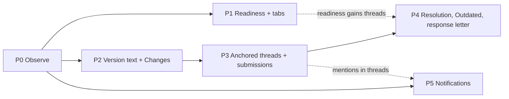

# Review workspace — the pull-request model, applied to Versions of a paper

**Purpose.** The roadmap for giving Advisers and office reviewers a review workspace built on the anatomy of a GitHub pull request, with Versions of a Manuscript in place of commits.
**Owns.** The GitHub → IRIS mapping, the proposed new domain terms, the phase order and its dependencies, and the decisions still open.
**Does not own.** Any accepted decision: each phase below names the ADR it needs, and that ADR is the authority once accepted. Screen structure stays in [`ui-ux/16-paper-view-and-review.md`](ui-ux/16-paper-view-and-review.md); vocabulary in [`../CONTEXT.md`](../CONTEXT.md).
**Update when.** A phase is accepted, built or dropped, or an open decision is settled.

> **Status: Proposed (2026-10-30).** Nothing here is decided. The thesis contribution — type-differentiated routing, parallel multi-office clearance and clearance-aware resubmission — is unchanged by every phase: this is a layer over Versions, Seats and Revision requests, never a replacement for them.

---

## 1 · The problem

Review mode today (16 §4) gives a reviewer the paper, a chronological timeline, a party status strip and an action bar. What it does not give them is a way to *do* the review:

- **Nothing shows what changed.** A reviewer reopened by a new Version gets the Version picker and their memory. They re-read the whole paper to find out whether "clarify §3" was done.
- **A comment points at nothing.** `ReviewComment` belongs to the record and the latest Version, not to a passage, so "the sample size on p.12" is prose the author must locate.
- **Comments and verdicts are separate acts.** Each comment posts on its own; the verdict is a different dialog. An author can be notified of half a review.
- **Nothing is ever settled.** No comment can be marked addressed, so neither side can tell what is still outstanding after v3.
- **Why a Decision is refused is scattered** across the action bar, the status strip and banners.

These are hypotheses drawn from the code and the reports of confusion, **not from observed sessions**. Phase 0 checks them before anything is built.

---

## 2 · The pull request, reverse-engineered

The parts of GitHub's model that carry the review experience, stated as data and state rather than as screens:

| Object | What it is | State and rules that matter |
|---|---|---|
| **Pull request** | A proposed change, a head compared against a base | open · draft · closed · merged. Merging is gated by *branch protection*. |
| **Commit** | An immutable snapshot | The PR's head moves; old commits stay addressable. |
| **Diff** ("Files changed") | Base ↔ head, per file, in hunks | Any two commits can be compared. *Viewed* is a per-reviewer, per-file mark that **clears itself when that file changes again**. "Changes since your last review" compares against the commit the reviewer last reviewed. |
| **Review** | A batch: summary + verdict + inline comments | **pending** (visible only to its author, accumulating comments) → **submitted** as *Comment*, *Approve* or *Request changes*. One notification per review, not per comment. A later review from the same person supersedes their earlier verdict. |
| **Review comment** | An inline comment | Anchored to `(commit, path, line, side)` and its original position. When a later commit changes those lines the anchor no longer maps, and the thread shows as **Outdated** — still visible, still answerable, shown against its original snapshot. |
| **Thread** | A review comment and its replies | **Resolved / unresolved**, by the author or a reviewer. Resolution is required for merge when the branch rule says so. |
| **Suggestion** | A comment carrying replacement text | The author applies it as a commit, singly or in a batch. |
| **Re-request review** | The author asking a reviewer to look again | Puts the PR back in that reviewer's queue. |
| **Requested reviewers / CODEOWNERS** | Who must review, derived from what changed | Required approvals before merge. |
| **Checks** | Automated results attached to the head | Required checks gate merge. |
| **Merge box** | One panel stating *every* reason the PR cannot merge yet | Each blocker is named and links to where it is resolved. |
| **Timeline** | Every event and comment in order | Conversation tab. |
| **Notifications** | Per-PR subscription with a *reason* (review requested, mentioned, author…) | `@mentions`, saved replies, reactions. |

---

## 3 · Superimposed on IRIS

| GitHub | IRIS today | Target |
|---|---|---|
| Pull request | Record under review | unchanged |
| Draft PR | Draft record | unchanged |
| Commit | **Version** (`RecordVersion`) | unchanged — already immutable and numbered |
| Requested reviewers / CODEOWNERS | Type-differentiated routing, Seats, Pools | unchanged — richer than GitHub's |
| Re-request review | Clearance-aware resubmission reopens only the parties that asked | unchanged; the new Version confirmation already names them (16 §6) |
| Request changes | **Revision request** | unchanged in meaning; becomes one of the verdicts a submitted review carries (P3) |
| Approve | Clear (office) · Accept (Adviser, RDCO) | unchanged in meaning; carried by a submitted review (P3) |
| Checks | Party status strip | kept; joined by derived checks in the readiness panel (P1) |
| Merge | **Decision** | unchanged — a Decision stays a human act, never automatic |
| Merge box | — | **Readiness panel** (P1) |
| Conversation tab | Review timeline | becomes the *Conversation* tab, threads collapsed in place (P1, P3) |
| Files changed / diff | Version picker only | **Changes** tab: a section-aligned comparison of two Versions (P2) |
| Viewed / since last review | — | per-section *Viewed*, reset by change; default comparison is the reviewer's last reviewed Version (P2) |
| Inline review comment | Record-level `ReviewComment` | **Anchored thread** on a Version's passage (P3) |
| Pending review | — | comments held as a draft until **Submit review** (P3) |
| Resolve conversation | — | **Resolved** thread (P4) |
| Outdated | — | thread whose passage changed in a later Version (P4) |
| Suggestion | — | **Suggested wording**: accepted or declined by the author, applied by them in the next Version (P4) |
| — (no equivalent) | — | **Response to reviewers**: every thread's answer, assembled into the letter attached to the new Version (P4) |
| Notifications, `@mention`, saved replies | Notifications app; none of the rest | P5 |

### Deliberately not imported

- **Merge as a button anyone with approvals can press.** A Decision is reserved to the Adviser and RDCO and stays a judgement, not a count of approvals.
- **Approval counts.** An office clears its own question (CONTEXT *Clearance*); two clears do not outvote one Finding.
- **Dismissing a review, rewriting history (force-push).** IRIS never deletes review history (IR-256) and Versions are immutable.
- **Applying a suggestion to the file.** A Manuscript is a PDF the author produces elsewhere; IRIS cannot edit it, so the author applies suggested wording in their own copy.
- **Automated checks that judge the work** (plagiarism, quality scoring). Plagiarism is deliberately out of scope (CONTEXT *Novelty check*). The only derived checks are facts IRIS already holds: documents requested and outstanding, due dates, Revision requests.
- **Public visibility of the review.** Review threads stay under `may_read_review`; public discussion stays a separate model (16 §8).

---

## 4 · New domain terms (proposed, for CONTEXT.md once accepted)

| Term | Meaning | Avoid |
|---|---|---|
| **Version text** | The extracted structure of one Version's Manuscript: its sections, passages and page regions. Belongs to the Version and never changes after it is made. | Extraction (the task that produces it) |
| **Comparison** | Two Versions' texts set side by side, aligned by section, with the passages added, removed and changed. | Diff alone (suggests line-level code diffs), track changes (implies IRIS edited the file) |
| **Anchor** | Where a thread points: one Version, a page, the quoted passage, and its regions on the page. | Highlight (the drawing, not the reference) |
| **Thread** | A reviewer's anchored or general comment and the replies to it. Resolved or unresolved. | Conversation (that is the tab) |
| **Review submission** | One Seat holder's batch: a summary, a verdict, and the threads they drafted. Held pending, seen only by its writer, until submitted. | Review alone (the stored verdict, `Review`), pass, round (*Review round* is the office's) |
| **Outdated** | A thread whose anchored passage changed or disappeared in a later Version. Still open until resolved. | Stale, obsolete |
| **Suggested wording** | A thread that proposes replacement text, accepted or declined by the author. | Suggested change (implies IRIS applies it) |
| **Response to reviewers** | The author's answer to each thread for one Version, assembled into a letter attached to the next Version. | Rebuttal (one kind of answer), changelog |
| **Readiness** | Every condition that stands between the Record and the next act its viewer could take, each named and linked. | Merge box, checklist |

---

## 5 · Phases

### Phase 0 — Observe before building

**Why first.** The problems in §1 are inferred. A wrong guess here costs four phases of work.

- Walk two Advisers and two office reviewers through one real Revision request cycle on staging. Record where they look, what they ask, what they do outside IRIS (printing, emailing PDFs, Word track changes).
- Ask what they compare against today. If the answer is "the student's Word file with track changes", the Comparison in P2 must beat that or be explained against it.
- **Output:** a short findings note in `docs/ui-ux/`, and the phase order below confirmed or changed.

**Not code.** No ADR.

### Phase 1 — Readiness and a tabbed review workspace

**Why second.** It needs no new data: every fact it shows already exists. It answers the most common confusion — *why can't I decide?* — and gives later phases somewhere to live.

- **Readiness panel** above the action bar, computed by the server with the capabilities:
  - open Revision requests, by party, each with who asked and when
  - parties still reviewing (from the status strip), and Pools nobody has claimed
  - document requests outstanding
  - the viewer's own due date, and whether its clock is paused
  - from P4: unresolved threads, and how many are Outdated
- Each item names what clears it and links there. The panel says *Ready for your Decision* only when the server says the Decision would be accepted; the browser derives nothing (16 §1).
- **Tabs in Review mode:** *Conversation* (the timeline) · *Paper* · *Changes* (P2, hidden until then) · *Parties* (the status strip expanded: each party, its Seats, Clearance and due date).
- **Backend:** a `readiness` block on the record payload, built from the rows `clearance_state`, `deadlines` and `revisions` already read. No migration.
- **ADR:** an amendment to ADR-032 §7 (timeline) and 16 §4 (regions).
- **Done when:** a Decision refused by the server is always explained by an item the panel already showed.

### Phase 2 — Version text and the Changes tab

**The blocker.** `PdfExtraction.record` is a one-to-one with the Record, and `new_version.py` re-extracts the Manuscript in place when a Version is submitted. The previous Version's structure is overwritten, so **no two Versions can be compared today**.

- **Version text.** Extraction gains a link to the `RecordVersion` it was made from, and a new Version's extraction is a new row. The Record's current extraction, which chunking and Ask IRIS read, is the latest Version's; nothing in the RAG path changes what it reads.
- **A metadata-only Version** points at the same Manuscript as the one before (CONTEXT *Version*) and shares its Version text rather than extracting it again.
- **Older Versions are not reconstructed.** A Version whose text was overwritten before this phase reads *Comparison unavailable for v1 — its text was not kept*. Nothing is guessed (CONTEXT *Version*: "none is made up to fill the gap").
- **Comparison** (`apps/reviews/comparison.py`, pure): align the two texts by section heading (Docling's structure), then compare passages within each section at sentence level. Report each section as unchanged, changed, added, removed or moved, and each passage as added, removed or changed, with its page and regions in *both* Versions.
  - Normalise before comparing — hyphenation at line breaks, ligatures, whitespace, page headers and footers — so re-typesetting does not read as a change. Keep the source text; normalisation is for matching only.
  - Report what could not be aligned rather than forcing a match.
- **Changes tab:**
  - a section outline with a change count per section; unchanged sections collapsed
  - inline view (struck and inserted text) and side-by-side view of the two Versions' passages
  - *Open in paper* jumps to the passage's page with its region drawn (reuses the citation overlay, ADR-031)
  - default comparison: **the Version this reviewer last submitted against → latest**; otherwise previous → latest; any pair selectable
- **Viewed.** A reviewer marks a section viewed for a Version; a later Version that changes the section clears the mark. Stored per Seat, private to its holder.
- **Cost.** Storage grows by one extraction per Manuscript-changing Version. Measure on the demo corpus before accepting.
- **ADR:** new — *Version text is kept per Version* — amending ADR-013's ownership of the extraction and ADR-032 §5.
- **Evaluation risk.** ADR-004's restart-all comparison measures reviewer time from `opened_at` (IR-144). The Changes tab shortens re-review under **both** policies, and must be present in both arms of the evaluation or absent from both.
- **Done when:** a reviewer reopened on v3 can see every passage that changed since the Version they reviewed, without opening the PDF; and a scanned or failed extraction says so instead of showing an empty comparison.

### Phase 3 — Anchored threads and review submissions

**Depends on P2** (an anchor needs Version text that does not change under it).

- **Anchor.** A thread may anchor to a passage of one Version: Version, page, quoted text, and regions as page fractions (ADR-031's format). A thread with no anchor is a general comment, as `ReviewComment` is today.
  - Selecting text in the reader or the Changes tab offers *Comment*.
  - Store the quote and its surrounding text alongside the regions, so the anchor can be found again in a later Version (P4) and survives a re-render.
- **Review submission.** A Seat holder's threads start pending, visible to them alone. *Submit review* posts them together with a summary and a verdict:
  - **Comment** — threads only; the Seat stays open
  - the verdicts their capabilities already allow: *Clear* / *Record finding* (office), *Accept…* (Adviser, RDCO), *Request revision*
  - a verdict is still checked by the same services (`office_review`, `decisions`, `revisions`); submission adds no new authority
- **Notification:** one per submission, not one per comment.
- **Author and other participants** reply to threads directly, without a submission; only a Seat holder submits.
- **Migration:** `ReviewComment` gains anchor fields and a link to its submission, or a `ReviewThread` is introduced above it — settled by the ADR. Existing comments become unanchored, submitted threads; nothing is rewritten.
- **ADR:** new — *Anchored threads and review submissions* — amending ADR-032 §7.
- **Done when:** an author receiving a Revision request can open every point raised at the passage it concerns, and never sees a reviewer's draft.

### Phase 4 — Resolution, Outdated, and the author's response

**Depends on P3.**

- **Resolved.** A thread is resolved by its author, or by the Seat holder who opened it, once answered. The author of the Record may mark it *addressed*, which a reviewer confirms by resolving it; who may resolve alone is an open decision (§7).
- **Outdated.** On a new Version, IRIS looks for each open anchored thread's passage in the new Version text. Found unchanged: the thread moves to it. Found changed: the thread is **Outdated**, shown against its original Version with the new passage beside it. Not found: Outdated, *passage removed*. Moving an anchor never resolves a thread.
- **Response to reviewers.** Submitting a new Version asks the author to answer each open thread from the Revision requests it answers: *addressed* (optionally pointing at the new passage), *declined* with a reason, or a reply. IRIS assembles the answers into a letter attached to the Version and shown first to each reopened reviewer.
- **Suggested wording.** A thread may propose replacement text. The author accepts or declines it; accepting is a promise to apply it, which the Comparison then shows.
- **Readiness** gains unresolved threads. Whether an unresolved thread **blocks** a Decision, or only shows, is an open decision (§7); GitHub makes it a per-repository rule.
- **ADR:** amendment to the P3 ADR.
- **Done when:** after v3, a reviewer can see which of their own points were addressed, declined or are still open, without reading the paper again.

### Phase 5 — Notifications and conveniences

Independent of P2–P4 except where noted; each piece can be scheduled alone. Two existing gaps come first, because a review workspace nobody is told about still confuses: notifications fetch once and never refresh, and no workflow email is sent ([gap analysis §1.6–1.7](architecture-review/2026-10-30-ui-ux-functional-gap-analysis.md)).

- **Subscription reasons** on notifications: *you hold a Seat*, *your office's Pool*, *you were mentioned*, *you own the Record*, *a thread you wrote was answered*.
- **`@mentions`** of the Record's participants only. Mentioning someone outside `may_read_review` is refused, never silently granted access.
- **Saved replies** per reviewer, for the comments an office writes often.
- **Reactions** on threads, if P0 shows a need; otherwise not built.

---

## 5a · UI direction

A clickable prototype of P1–P4, in IRIS's own tokens and with synthetic data: [`ui-ux/prototypes/review-workspace.html`](ui-ux/prototypes/review-workspace.html). Open it in a browser; the dark strip picks the stage (*v2 · revision requested*, *v3 · back with Adviser*, *v3 · with RDCO and offices*) and who is looking (Adviser, RDCO, ITSO, IERC, KTTO, Author). Switching who is looking keeps the record as it is, so an act in one seat — a request to another office, a clear, a claim — shows up in the others. It is a design proposal under this roadmap, not an accepted screen; 16 §4 stays the authority until it is amended.

What it settles, for discussion:

- **Three columns, the outer two resizable.** The paper takes what is left; the review pane opens at 30 % and the details sidebar at 20 % of the workspace. Dragging either one's left edge (or the arrow keys on it) resizes it, a double click restores it, and the widths are remembered in this browser. The paper keeps at least 480 px, the review pane runs from 320 px to half the workspace, and the sidebar from 220 px to 420 px, always at least 40 px slimmer than the review pane. The whole paper is on the left, as on the Paper tab. In the middle, where Ask IRIS sits, the **Conversation · Changes · Threads** tabs. On the right, always visible whatever the tab, a details sidebar after a pull request's: **Reviewers** (by party, each person with their state, and the gear to request review), **Researchers**, **Adviser**, **Classification** (type, area, PSCED, college, program), **Flagged by the authors**, **Keywords**, **Version**, **Due dates**, **Documents**, **Notifications** (watch / stop watching, with the reason), **Participants**. Every person opens a profile card. Below a 1200 px workspace the sidebar folds into a *Details* tab; below 900 px the review pane is a drawer over the paper with *Back to paper*.
- **Conversation ends in *where it stands*,** as a pull request ends in its merge box: the timeline, then the verdict and its facts, then a comment box for the whole record. The pane's foot always carries the verdict and the one filled action — *Finish review*, *Decide…*, *Claim review*, *Open review*, *Prepare v3* or *Upload*.
- **Who may request whom (proposed; reverses ADR-032 §3).** The Adviser requests **RDCO only**, and doing so is the Adviser's *Accept & send to RDCO*. Only offices request offices: RDCO asks ITSO, IERC or KTTO; each specialist office asks the other two. Every request names the office as a whole (its Pool) or **specific officers** in it, several at once, and carries a required reason. An office already reviewing takes named officers only. *Add a colleague* inside one's own office stays a separate act.
- **RDCO decides at any time.** RDCO holds the record from the Adviser's send onward and never waits for the offices. Its *Accept & publish*, *Accept, keep unlisted* and *Reject* say which office reviews are still open, warn that the Decision closes them, and mark them *closed by RDCO's Decision* with their comments and findings kept. The offices finishing only tells RDCO; there is no hand-back.
- **Each specialist office's verdicts are its own:** *Clear*, *Record a finding* (with a reason; it goes to RDCO), *Request revision* (only that office reviews the next Version again).
- **Readiness leads with a verdict in words** — *Ready for your Decision*, *You can't decide yet*, *Waiting on you* — then each fact with an icon, and the one control that changes it (*Withdraw request*, *Show them*). Only a real blocker is maroon; information is outlined.
- **Changes compares two Versions section by section** in the pane, with *Viewed* marks and *Show in paper* on each changed section, and each earlier comment placed under the passage it was about, with the author's answer. An office that first saw the record at v3 is told so.
- **Threads are labelled by party** (ITSO, IERC, the Adviser), and a reviewer's own are marked; *Yours* filters to them.
- **Commenting never floats over the paper.** Selecting a passage arms *Comment* in the reader toolbar (or **C**); the composer opens in the Threads tab with the quote. Drafts are visible only to their writer until *Finish review* sends them with a summary and a verdict.
- **Verdicts that can't be given say why** inside the finish dialog, rather than disappearing.
- **The author answers point by point** (*Addressed* with where, or *Decline* with a required reason), and the submit dialog shows the response letter being assembled from those answers before v3 is sent.
- **Within the design system:** maroon, stone, white and ink only; Garamond for headings; hairlines between regions; status always as an icon plus a word; changes shown by underline-on-wash and strike-through, never by colour alone.

## 6 · Dependencies

P1 and P2 can be built in parallel by different people once P0 confirms the order: P1 is frontend-led and needs no migration; P2 is backend-led.

---

## 7 · Open decisions

1. **Does an unresolved thread block a Decision?** Blocking makes the rule visible and enforced; showing only leaves it to the decider's judgement, as now.
2. **Who may resolve a thread?** Its opener only, its opener or the Record's author, or any Seat holder of the same party.
3. **Is *Comment* a recorded verdict?** If yes, `ReviewDecision` gains a value and every consumer that reads `Review.status` must handle it. If no, a comment-only submission writes no `Review` row.
4. **Version text retention.** Keep every Version's text for the Record's life, or only while the Record is under review.
5. **Where suggested wording ends.** Accept/decline only, or also a check that the next Version contains the accepted text.
7. **The routing change in §5a needs its own ADR before any code.** Drafted as [ADR-047](adr/047-rdco-routes-and-decides-at-any-time.md) (Proposed, 2026-10-30). Its two defaults answer the questions below, pending the project lead. It reverses ADR-032 §3 ("Nobody routes to RDCO by hand"; the Adviser's *Accept & route* to specialist offices; RDCO entering only by hand-back) and changes `ROUTE_TARGETS` in `apps/reviews/routing.py` (adviser → `rdco` only; `rdco` gains the record before any office). It also moves the *Specialist path* and *Hand-back* entries in `CONTEXT.md`. Open within it: whether RDCO's executive Decision may also override an open Revision request, as the prototype lets it (ADR-032 today refuses every Decision while one is open), and whether the Adviser keeps *Accept & publish* with no RDCO involvement.
6. **Evaluation.** Whether P2–P4 ship before or after ADR-004's comparison runs, since they change reviewer time under both policies.

---

## 8 · Risks

- **Comparison noise.** PDF extraction differs between two typesettings of the same text. Normalisation and section alignment reduce it; the Changes tab must report what it could not align rather than show spurious changes. Prototype against real v1/v2 pairs before committing to the design.
- **Scanned Manuscripts.** No Version text, no Comparison, no anchors. Each must say so plainly.
- **Scope.** None of this is in ADR-001's thesis-critical set. It is UX on top of the contribution and must be scheduled as such.
- **Privacy.** Earlier Versions, threads and the response letter are review material, readable only under `may_read_review`, and never reach Discover, Ask IRIS or public discussion.
